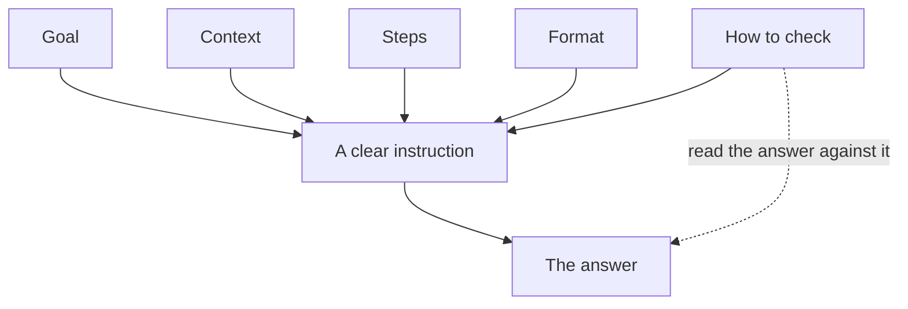

## "Bring some bread"

Omar asks his younger brother: "Can you bring some bread on your way home?" His brother comes back with two small loaves. Omar needed twenty pieces of flat bread for a family lunch. Nobody did anything wrong. The instruction was simply too thin.

AI chat tools have the same problem, only bigger. Your brother knows your family. The tool knows nothing about you except the words you type.

<BigWordAlert term="Prompt" plainEnglish="The instruction you type into an AI tool. It is just a request in words." whyItMatters="A clear prompt gets a useful answer the first time. A vague prompt gets a general answer that fits nobody well." />

## A vague request

Sami is a freelance designer. He is making a logo for a small bakery. He will deliver it two days late, and he wants to tell the client politely. He types into an AI chat tool:

"Write a message to my client about the delay."

```predict
prompt: "Sami types only: 'Write a message to my client about the delay.' Which missing detail will hurt the message most?"
options:
  - id: name
    label: "The client's name at the top"
  - id: day
    label: "The new day he will deliver"
correctOptionId: day
explanation: "Sami can add a name in two seconds. But the client's main question is 'when?', and the tool cannot guess the new day. Without it, the message is polite and useless."
```

The tool writes a long, very formal message. It says sorry three times. It promises delivery "as soon as possible". It does not say which day, because it does not know. Sami has to rewrite almost all of it.

## The five parts

A clear instruction has five parts. You do not need long sentences. One or two lines for each part is often enough.

1. **Goal:** what you want at the end. "A short message to a client explaining a two-day delay."
2. **Context:** what the helper needs to know. Who the reader is, what happened, any limits.
3. **Steps:** the order, or the parts to include. "First say sorry once, then give the new day, then offer one small extra."
4. **Format:** the shape of the answer. Length, list or paragraph, <GlossaryTerm term="tone" definition="The feeling a message gives, such as friendly, formal or firm." />, language.
5. **How to check:** how you will know the answer is good. You can ask the helper to check it too, before answering.

The fifth part is the one most people leave out. It is also the one that connects to the rest of this module. If you write down how you will check, you are more likely to actually check.

The chart shows why the fifth part is different from the other four.



Notice that "How to check" has two arrows. Like the other parts, it goes into the instruction. It also goes to the answer, because it is the list you read the answer against. That second arrow is the one people forget.

## A worked example: before and after

Here is Sami's instruction again, rewritten in five parts. Read it slowly and notice that every line answers a question the tool could not answer alone.

> **Goal:** Write a short, polite message to a client. It explains that their logo will be two days late.
>
> **Context:** I am a freelance designer. The client is a small bakery. The deadline was Thursday. My internet was down for a day, so I lost time. The new delivery day is Saturday. This is my first delay with this client.
>
> **Steps:** First say sorry in one sentence. Then give the new day. Then offer one small extra: a second colour version of the logo at no cost.
>
> **Format:** Under 80 words. Plain, friendly English. No long apology.
>
> **How to check:** Before you answer, check that the message names Saturday, says sorry only once and is under 80 words.

The answer is now short and clear. It names Saturday. It says sorry once. Sami changes two words and sends it. The whole thing took less time than rewriting the first answer.

Look at the reasoning, part by part. The goal stops the tool from writing a long letter. The context gives it the facts it could never guess: Saturday, first delay, a bakery. The steps fix the order, so the most important fact is not lost at the end. The format stops it from sounding too formal. The check gives Sami a short list to read the answer against.

## The same five parts work for a person

These five parts are not special rules for computers. They are simply what a clear instruction is. Here is Sami's instruction next to one Omar could give his brother.

| Part | For an AI tool (Sami) | For a person (Omar) |
|---|---|---|
| Goal | A polite message about a delay | Bread for a family lunch |
| Context | Bakery client, new day is Saturday | Twelve people are coming |
| Steps | Sorry, then new day, then the extra | Try the bakery by the school first |
| Format | Under 80 words, friendly | Flat bread, at most 20 shekels |
| How to check | Names Saturday, says sorry once | Count: at least 20 pieces |

With this, Omar's brother would come home with the right bread. The check line is the clever part. It tells the helper what "done well" looks like, so they can check their own work before they come back.

<Callout type="warning" title="Context is not private data">
Give the facts the helper needs, not everything you know. Sami does not need to type the client's phone number or full name. Chapter 7.5 says more about what to keep out of an AI tool.
</Callout>

## A common mistake

The most common mistake is to write only the goal: "Write a message", "Make a study plan", "Help with my CV". The tool fills every gap with something general. Then the answer is long and polite and fits nobody.

The opposite mistake is to write a very long paragraph with everything mixed together. The five parts help here too. Put each part on its own line. Short and sorted beats long and mixed.

A third mistake is to leave out the check part, then copy the answer without reading it. If you wrote "under 80 words", count the words.

## Check your understanding

```quiz
type: mcq
question: "Lina writes: 'Make me a study plan for my maths exam. The exam is in 10 days and I can study 2 hours each evening. Put it in a table with one row per day. I will check that all 6 topics appear at least once.' Which of the five parts is missing?"
options:
  - "The goal: what she wants at the end"
  - "The context: her time and her exam"
  - "The steps: what order to follow"
  - "How to check: what makes the plan good"
correct: 2
explanations:
  - "The goal is there: a study plan for her maths exam."
  - "The context is there: 10 days, 2 hours each evening."
  - "Right. She never says what order to use or what to include, for example 'hardest topics first, last day for revision'."
  - "The check is there: all 6 topics appear at least once."
```

```quiz
type: mcq
question: "Nour asks a friend: 'Can you look at my CV?' She wants to add a 'how to check' part. Which sentence does that job?"
options:
  - "I am applying to be a shop assistant at a big store"
  - "Please read the first page, then the skills list"
  - "Write your notes for me as a short list of points"
  - "It is good if a stranger sees my top skill quickly"
correct: 3
explanations:
  - "This is useful context: it says what the CV is for. But it does not say how to judge the result."
  - "These are steps: the order to read in. They do not say what a good CV looks like."
  - "This is format: the shape of the friend's notes. It does not say how to judge the CV."
  - "Right. This tells the friend what 'good' looks like, so they can test the CV against it."
```

<ChapterRecap points={["A vague request gets a general answer, from a person or a tool", "Five parts: goal, context, steps, format and how to check", "One or two short lines for each part is often enough", "The check part tells the helper what 'done well' looks like", "Give the facts the helper needs, not private details"]} />

**Next:** The answer has arrived. How do you check it before you trust it?
