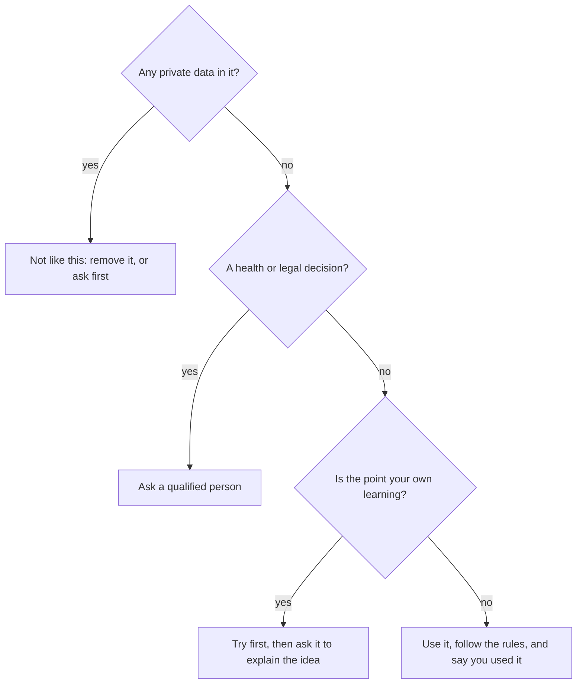

## A list that is not yours

Yousef does freelance work for a small clothes shop. The owner sends him a file with 300 customers: names, phone numbers and what each person bought. She asks him to sort the customers by area. It is a boring job. Yousef thinks: "An AI chat tool could do this in seconds."

```predict
prompt: "Should Yousef paste the shop's customer list into an AI chat tool to sort it?"
options:
  - id: yes
    label: "Yes, sorting lists is a job AI does well"
  - id: no
    label: "No, not without the owner's permission"
correctOptionId: no
explanation: "Sorting is a fine job for a tool. But the list belongs to the shop and its customers. Their names and phone numbers are private, and Yousef has no permission to share them."
```

## Four times to stop

The last three chapters showed how to ask well and how to check. This chapter is about the times when the best choice is not to ask at all, or to ask a person instead. There are four.

<BigWordAlert term="Private data" plainEnglish="Information about a person that others should not see without that person's permission: names with phone numbers, ID numbers, passwords, bank details, health details." whyItMatters="When you type something into an online tool, it leaves your phone. You do not control where it is kept or who may read it later." />

**1. Private data.** This means yours, your family's and your clients'. Never type passwords, ID numbers or bank details. Do not paste a client's files or a customer list unless the client clearly says you may. Often you do not need the real data at all. Yousef can ask: "How do I sort a list by area in a spreadsheet?" Then he does the sorting himself, on his own computer.

**2. Health and legal decisions.** An AI tool can explain a word on a medicine box, or help you write questions to ask a doctor. But the decision itself belongs with a <GlossaryTerm term="qualified person" definition="Someone trained and allowed to give that kind of advice, such as a doctor, a pharmacist or a lawyer." />. These answers depend on your exact situation. A wrong answer can do real harm, and it cannot be undone easily.

**3. When the point is your own learning.** Think of exercise. If a friend lifts the weights for you, your arms do not get stronger. The puzzles in this course work the same way. If a tool solves them, you get the answer but not the skill. Try first. Then, if you are stuck, ask the tool to explain the idea, not to give the answer.

**4. Honest work.** Your course, your exam or your client may have rules about AI use. Follow them. If AI use is allowed, say when you used it and what for. If there is no rule, ask. Handing in AI work as your own, when someone expects your own, is not honest, even if nobody finds out.

These four are not about AI being bad. They are about who owns the data, who carries the risk, and whose skill is being built.

Here are the four stops as one chart. Start at the top with any job you might give a tool.



Notice how few arrows end in a plain no. Most stops change how you use the tool: remove the data, ask a person, or try first. The last box holds the fourth stop, honest work.

## A worked example

Maryam studies at university and writes short articles for clients. On one busy day she has four things she could ask an AI chat tool. She goes through the four stops for each one.

| Request | Use AI? | Why |
|---|---|---|
| Write my graded essay on saving water | No | Her course says graded essays must be her own words |
| Check a client contract that shows bank details | Not like this | Private data. She removes the details first, or asks the client |
| Can my mother take her medicine with tea? | Ask a person | Health decision: she asks the pharmacist |
| Ten title ideas for an article on saving power | Yes | Ideas she can judge. The client allows AI for ideas |

Look at the reasoning. For the essay, the problem is the rule, so she follows it. She may still ask the tool to explain a word she does not know, if her course allows that. For the contract, the problem is the data, not the job. With the bank details removed, the tool can help her spot unclear sentences. For the medicine, the tool might help her write a clear question, but the answer comes from the pharmacist. For the titles, none of the four stops apply, so she uses the tool and picks the best idea herself.

Notice that only one of the four was a simple "no". Most of the time the answer is "not like this": change the question, remove the data, or ask a person.

<Callout type="tip" title="Use made-up names">
If you need help with a real case, replace private details first. Write "Client A", "Customer 1" or "a 30-year-old man" instead of real names and numbers. The tool still understands the problem.
</Callout>

## A common mistake

The most common mistake is thinking "it is just a tool, so it does not matter what I type". It matters. A message to an AI tool is still a message that leaves your phone.

Another common mistake is hiding AI use. Some people worry that saying "I used an AI tool for ideas" makes their work look weaker. Usually it does the opposite: it shows you understand the rules and you are honest about your work. If a client or teacher has said no AI, then the honest answer is to do the work without it.

## Check your understanding

```quiz
type: mcq
question: "Khaled's course rule says: 'You may use AI tools to explain ideas, but write your answers yourself.' He is stuck on a homework question. What fits the rule?"
options:
  - "Ask it to explain the idea, then write his answer"
  - "Ask it to write the answer, then change some words"
  - "Ask it to write the answer, and say so at the end"
  - "Avoid AI fully, since any use breaks the rule"
correct: 0
explanations:
  - "Right. The rule allows explaining ideas. Khaled learns the idea, then writes the answer in his own words."
  - "Changing some words does not make it his answer. The rule says to write answers yourself."
  - "Saying so is honest, but the rule still says answers must be his own. Honesty does not replace following the rule."
  - "The rule allows AI for explaining ideas, so not every use breaks it. Khaled can get help with the idea and still follow the rule."
```

```quiz
type: mcq
question: "Rania's father asks an AI chat tool whether he can take two kinds of pain medicine together. The tool says: 'Yes, that is safe.' What is the best next step?"
options:
  - "Take both, because the tool's answer was clear"
  - "Ask the tool again, in a different way"
  - "Find the same answer on a second website"
  - "Ask a pharmacist or doctor before taking both"
correct: 3
explanations:
  - "A clear, sure answer is not the same as a correct one, and the tool does not know his health details."
  - "Asking the same tool again is the same way twice. It cannot replace a person who knows his health."
  - "A second website is a better check than nothing, but this is a health decision. It belongs with a qualified person."
  - "Right. This is a health decision. A pharmacist or doctor can ask about his other medicines and his health."
```

**Next:** Five short scenarios to test your thinking with AI.
