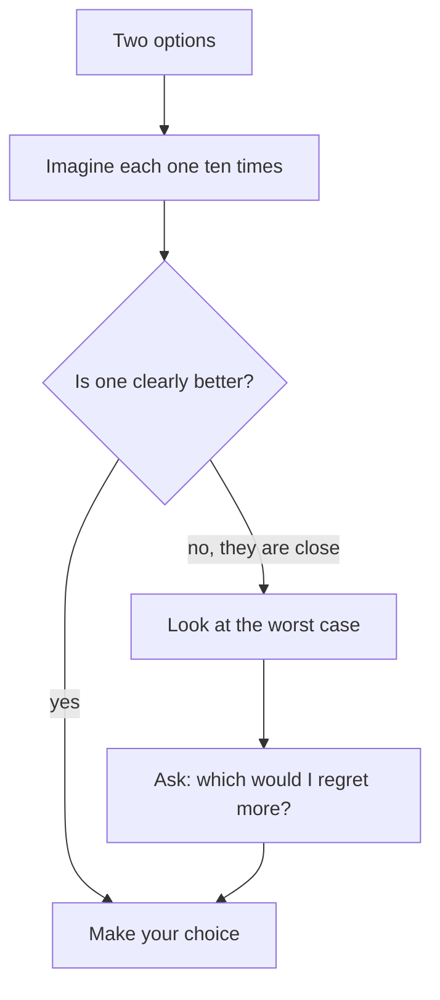

## Two students, one exam

Sami and Tamer have the same exam at 9:00. Sami takes the usual bus at 7:45, which gives him more than half an hour to spare. That morning, a water pipe bursts and the road is closed. Sami arrives 20 minutes late. Tamer leaves home at 8:50. He runs, a neighbour gives him a lift, and he walks in at 8:59.

```predict
prompt: "Sami arrived late. Tamer arrived on time. Who made the better decision about when to leave?"
options:
  - id: sami
    label: "Sami, who left early"
  - id: tamer
    label: "Tamer, who arrived on time"
correctOptionId: sami
explanation: "Sami left with plenty of spare time. That was a good decision. A burst pipe was bad luck that nobody could know about. Tamer's choice depended on luck, and luck does not come every time."
```

## Decision and outcome are not the same thing

Most people judge a choice by how it turned out. That feels natural, but it mixes two different things. The decision is what you chose, with what you knew. The outcome is what happened, and it includes luck.

<BigWordAlert term="Decision quality" plainEnglish="How good a choice was, judged by what you knew and how you thought at the time, not by luck." whyItMatters="If you judge only by outcomes, you learn the wrong lessons: you copy lucky choices and drop good ones after bad luck." />

A small table makes this clear. Read across each row.

| | Good outcome | Bad outcome |
|---|---|---|
| **Good decision** | Deserved: keep deciding this way | Bad luck: keep deciding this way |
| **Bad decision** | Lucky: do not repeat it | A lesson: change how you decide |

Sami is in the top right box. He should leave early again next time. Tamer is in the bottom left box. If he keeps leaving at 8:50, he will be late often.

To judge a decision fairly, ask three questions. What did I know at the time? What could I have found out cheaply? How did I think about it? None of these questions asks "how did it turn out?". A later course in the fellowship goes deeper into decisions, so here we keep it short.

## Rough chances

You rarely know exactly how likely something is. But you can usually guess roughly. Simple words work well: "almost always", "about half the time", "rarely". A helpful trick is to imagine making the same choice ten times. In how many of those ten would it go well?

You do not need exact numbers. A rough chance is a guess, like the rough numbers in module 5. Say it out loud, so other people can question it.

## A worked example

Rania is a freelance translator. This week she can take only one of two jobs.

- **Job A:** 100 dollars. A client she knows, who has always paid. She guesses he pays about 9 times in 10.
- **Job B:** 200 dollars. A new client with no reviews. In this example, Rania guesses he pays about half the time.

**Step 1: imagine ten times.** Jobs like A, ten times: paid about 9 times, so about 9 x 100 = 900 dollars. Jobs like B, ten times: paid about 5 times, so about 5 x 200 = 1,000 dollars. The two are close. The numbers alone do not decide it.

**Step 2: look at the <GlossaryTerm term="worst case" definition="The worst thing that could reasonably happen if you choose this option." />.** Rania needs at least 80 dollars this month for her share of the internet bill and her phone credit. With Job A, the worst case is rare. With Job B, there is a real chance she ends the month with nothing.

**Step 3: ask "which would I regret more?"** Imagine each choice went badly. If she picks B and the client never pays, she gave up safe money for a gamble when she needed it. She would regret that a lot. If she picks A and later sees that B's client did pay, she lost 100 dollars of extra pay. She would regret that a little.

So Rania chooses Job A. Notice the reasoning: the numbers were close, so the worst case and the regret question decided it. A different person, with savings for this month, might sensibly choose B. A good decision fits the person's situation.

Here is Rania's reasoning as a chart.



Notice where the worst case and the regret question come in: only on the "close" arrow. For Rania, 900 and 1,000 dollars were close, so what she could afford to lose decided it.

<Callout type="tip" title="The regret question">
When numbers are close, imagine it is one year later and the choice went badly. Which choice would you be more upset about? That feeling often shows what matters most to you.
</Callout>

## A common mistake

The most common mistake is to say "it worked, so it was smart", or "it failed, so it was stupid". Both judge only the outcome. Next time something goes badly, ask the three questions first. Maybe you did decide well and were unlucky.

Another mistake is to say "I should have known" when you could not have known. If the information did not exist, or would have cost too much to get, it is not fair to blame yourself. If it was cheap and easy to find, that is a real lesson: next time, find it first. The next chapter shows how.

## Check your understanding

```quiz
type: mcq
question: "Khaled compared three laptops, read the warranty, and bought the one with the best battery for his budget. After a month, it stopped working because of a factory fault that affects a few laptops of that model. How should he judge his decision?"
options:
  - "A bad decision, because the laptop broke"
  - "A good decision, with bad luck this time"
  - "A bad decision, as he should have known"
  - "There is no fair way to judge any decision"
correct: 1
explanations:
  - "This judges only the outcome. Khaled compared, read the warranty and fit his budget. The fault was luck he could not see."
  - "Right. He used what he knew well. A rare factory fault is bad luck. He should decide the same way next time, and use the warranty now."
  - "He could not have known about a rare fault in a few laptops. 'I should have known' is only fair when the facts were cheap to find."
  - "You can judge a decision fairly: by what you knew, what you could find out cheaply, and how you thought."
```

```quiz
type: mcq
question: "Omar has two offers. Offer A pays 50 dollars, and that client pays about 9 times in 10. Offer B pays 60 dollars, but that new client pays only about half the time. If he took each kind of offer ten times, about how much would each bring?"
options:
  - "A about 500, B about 600"
  - "A about 450, B about 600"
  - "A about 450, B about 300"
  - "A about 50, B about 30"
correct: 2
explanations:
  - "This counts every job as paid. The chances matter: not every client pays."
  - "A is right, but B uses all ten jobs. Half the time is 5 jobs: 5 x 60 = 300."
  - "Right. A: paid about 9 times, 9 x 50 = 450. B: paid about 5 times, 5 x 60 = 300."
  - "These are close to one job of each kind, not ten. The question asks about ten jobs of each kind."
```

<ChapterRecap points={["A decision and its outcome are not the same thing", "Judge a decision by what you knew, what you could find out cheaply and how you thought", "Rough chances: imagine making the same choice ten times", "When numbers are close, look at the worst case and ask which you would regret more"]} />

**Next:** When a choice is big and the facts are missing, how a small, cheap test can find them for you.
