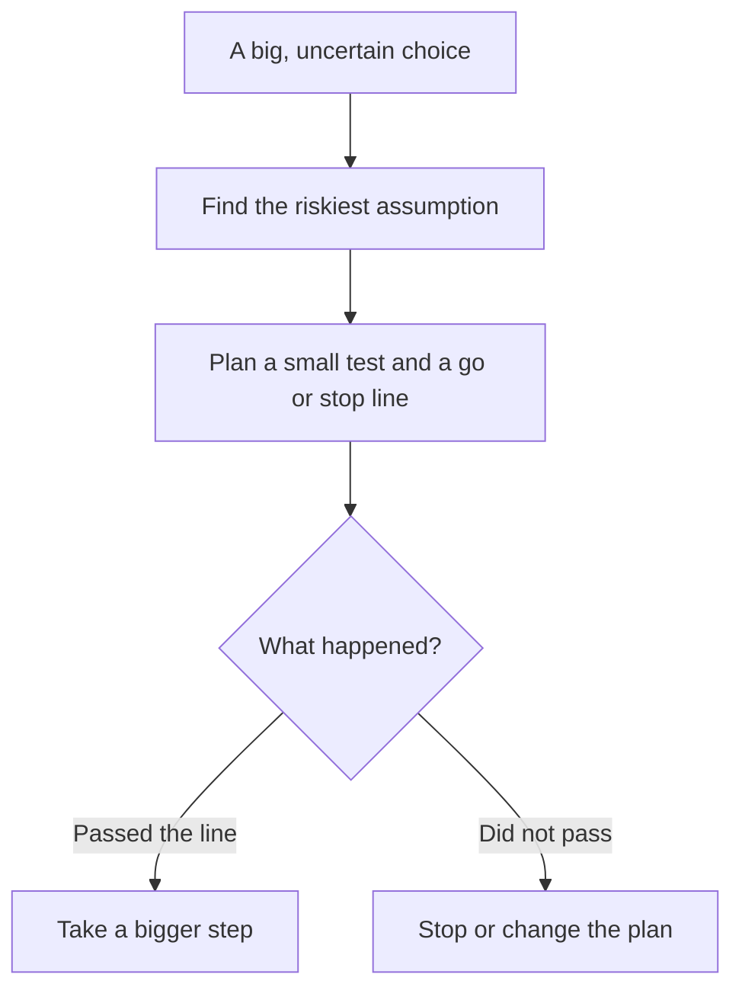

## Four hundred dollars

Omar wants to learn graphic design. He finds an online course: 400 dollars for six months. He has saved the money, and he is ready to pay today. Then he notices one line on the page: "Try the first lesson free." He almost scrolled past it.

The free lesson takes one evening. It will tell him something the course page cannot: does he like this teacher, and can he follow the lessons on his phone with his internet? That one evening could save him 400 dollars, or it could make him pay with much more confidence.

<BigWordAlert term="Small test" plainEnglish="A cheap, quick try that tells you something important before you commit to a big choice." whyItMatters="Many facts you are missing cannot be found by thinking. A small test finds them for you, at a price you can afford to lose." />

## How to design a small test

A small test is not a smaller version of everything. It aims at one thing: the assumption that worries you most. In module 4 you learned to find hidden assumptions. Here you pick the riskiest one, the one that would ruin the plan if it were wrong.

Before you read the steps, make a guess.

```predict
prompt: "Tamer wants to open a juice stand near the university. Which first step tells him more about whether students will buy?"
options:
  - id: sell
    label: "Sell from one table for two days"
  - id: ask
    label: "Ask 20 friends if they would buy"
correctOptionId: sell
explanation: "Friends are kind, and saying 'yes' costs them nothing. Selling for two days shows what real students do with real money. What people do tells you more than what they say."
```

Here are the steps. The flowchart below shows the same steps as a picture.



Notice the box in the middle: you decide the go or stop line **before** the test. If you decide after, it is too easy to explain away any result.

A good small test has four marks. It is **cheap**: you can afford to lose what it costs. It is **quick**: days or weeks, not a year. It is **real**: people act, they do not only say. And it **can fail**: if the result could only ever look good, it is not a test.

## A worked example

Basel works six days a week in a phone shop. He wants to quit and work as a freelance video editor. That is a big bet. If it goes wrong, he has no income. Watch how he turns it into a small test.

**Step 1: the big choice.** Quit the shop job and freelance full time.

**Step 2: the riskiest assumption.** He lists three assumptions. He can edit well enough: his friends' videos say yes. He has a good enough laptop: he already does. Clients will pay him enough, often enough: he has no idea. That third one is the riskiest.

**Step 3: the test and the line.** He keeps the shop job. For one month, he uses his day off and two evenings a week to find small editing jobs on a freelance website. Before he starts, he writes down his line: "If I finish at least 2 paid jobs and earn at least 100 dollars this month, I take a bigger step. If I finish none, I keep the job and rethink."

**Step 4: the result.** He finishes 3 small jobs and earns 120 dollars. One client asks for more work next month. He passed his line.

**Step 5: the next step, not a jump.** Basel does not quit yet. He asks the shop for four days a week instead of six, and repeats the test with more time. Each step is bigger, but each one is still safe.

Notice what the test cost: one month of evenings. Notice what it bought: real evidence about the one assumption he could not check by thinking.

Small tests look different for every choice, but the shape is the same. Omar takes one free lesson before he pays for six months. Nour from chapter 8.1 shares a stall with a friend for one day before she rents her own. Someone thinking of leaving a job tries one small freelance job first. Each test is cheap, quick and real.

<Callout type="info" title="When you do not need a test">
If a choice is cheap and easy to undo, just decide and learn as you go. A test is for choices that are big, costly or hard to undo. If the test costs almost as much as the choice, it is not small.
</Callout>

## A common mistake

The most common mistake is a test that cannot fail. Asking friends "would you buy my juice?" usually gets "yes". Friends are kind, and words are free. Look for a test where people do something real: pay, come back, sign up, give time.

The second mistake is not writing the line first. After the test, Basel might be tempted to say "1 job is a good start" or "3 jobs is still not enough", depending on his mood that day. A line written before the test keeps him honest with himself.

## Check your understanding

```quiz
type: mcq
question: "Huda wants to buy a sewing machine for 800 shekels and start a clothes mending business from home. She is not sure people nearby will pay for mending. What is the best small test?"
options:
  - "Buy the machine now, before the price goes up"
  - "Ask her family if they think it is a good plan"
  - "Read about mending businesses for a few weeks"
  - "Borrow a machine and take five mending jobs"
correct: 3
explanations:
  - "This is the big bet itself, not a test. It does not check whether people will pay for mending."
  - "Family are kind, and saying yes costs them nothing. This test can hardly fail, so it tells her little."
  - "Reading costs time and does not tell her about people nearby. It never reaches a real customer."
  - "Right. It is cheap, quick and real, and it tests her riskiest assumption: will people nearby pay?"
```

```quiz
type: mcq
question: "Sami will teach one free trial class to see if students want paid English lessons. What should he write down before the class?"
options:
  - "What result means go on, and what means stop"
  - "A list of reasons why the class will surely go well"
  - "The price he plans to charge for lessons next year"
  - "The names of the friends who will say yes to him"
correct: 0
explanations:
  - "Right. A go or stop line written before the test stops him from explaining away the result later. For example: 'If 4 of the 10 students ask about paid lessons, I go on.'"
  - "Reasons it will go well make him feel good, but they do not help him read the result honestly."
  - "A price may matter later, but it does not tell him how to read the result of this test."
  - "Friends who will say yes make the test unable to fail. He needs real students, not kind answers."
```

<ChapterRecap points={["A small test finds facts that thinking cannot", "Aim the test at your riskiest assumption", "A good test is cheap, quick, real, and can fail", "Write your go or stop line before the test", "After a good result, take the next step, not a jump"]} />

**Next:** The capstone. Bring every habit from the course together on one choice.
