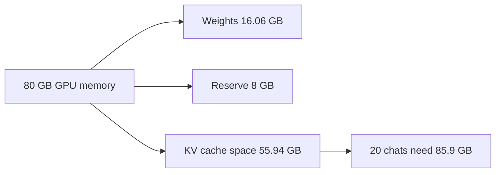

## Launch day at Wadi Labs

Wadi Labs (a fictional remote software company of about 40 people) wanted an internal assistant. Engineers would paste design documents, logs and meeting notes into a chat and ask questions about them. The team did not want to send that text to an outside provider. So Nour was asked to run an open model with 8 billion parameters on the team's own server.

Nour rented one <GlossaryTerm term="GPU" definition="A graphics processing unit: the chip that does most of the arithmetic when a model runs. It has its own memory, and the model must fit in that memory." /> with 80 GB of memory. The setup took two days. In the demo, three colleagues chatted with the model at the same time. Answers came back fast, and nobody saw a problem.

On launch day, 20 people opened the assistant before 10 a.m. Several of them pasted long documents and kept the chat open for follow-up questions. The engine Nour had chosen sets aside room for the longest chat it allows, 32,768 tokens, for every chat at the moment the chat opens. At 10:40 the server stopped answering. The log said the GPU was out of memory.

Nour was confused. A week earlier, Nour had done the sum. The model has 8,030,261,248 parameters, and each one is stored in 2 bytes. That is 16.06 GB, on a GPU with 80 GB. The model used about a fifth of the memory. How can a GPU that is 80% empty run out of memory?

<BigWordAlert term="Inference" plainEnglish="Running a model that is already trained, to get answers from it. Training teaches the model; inference uses it. Serving is inference for many users at once." whyItMatters="Most AI engineers never train a model, but many have to run one. Cost, speed and the number of users you can serve are all decided by how inference uses the GPU." />

## The question Nour did not ask

Nour had asked the right question for the demo: does the model fit? The answer was yes, and it was still yes on launch day. The weights did not change between the demo and the crash. The <GlossaryTerm term="weights" definition="The numbers a model learned during training. They are loaded into GPU memory once and stay there, the same size for one user or for a hundred." /> are the model.

The better question is different: what else sits in memory while people use the model, and how does it grow with the number of users and the length of their chats? Nour had not asked that, because the demo could not show it. Three people sent short messages. The problem only appears with many users and long text.

Look at the numbers first, then guess the cause. Nour's server has 80 GB. Take the weights, 16.06 GB. Something else filled most of the other 64 GB. Before you read on, decide what that something is.

```predict
prompt: "The weights use 16.06 GB of an 80 GB GPU. The server runs out of memory when 20 people keep chats open. What most likely fills the rest of the memory?"
options:
  - id: copies
    label: "A separate copy of the weights for each user, since each chat needs the model"
  - id: cache
    label: "A store that grows with every token of every open chat, and holds room for more"
correctOptionId: cache
explanation: "The weights are loaded once and shared by every user. What grows is a store of numbers kept for each token of each open chat, and room is set aside for tokens still to come. It is called the KV cache. This chapter shows how large it becomes."
```

## Where the memory of a GPU goes

A GPU holds four kinds of things while it serves a model: the weights, the KV cache, the activations and the engine's own reserve. The diagram shows this example's budget, with the last two kinds merged into one reserve.



The **weights** are fixed. They take 16.06 GB whether one person or a hundred people use the model. The <GlossaryTerm term="KV cache" definition="Numbers the model keeps for every token it has already read in a chat, so it does not have to compute them again for each new token. Chapter 11.3 explains it step by step." /> is different. It holds a small amount of data for every <GlossaryTerm term="token" definition="A piece of text, often a word or part of a word, that the model reads and writes. Models count text in tokens, not words." /> that every open chat contains or has reserved. More chats, or longer chats, mean a bigger KV cache. It is the part that grows.

The <GlossaryTerm term="activations" definition="The temporary numbers a model produces while it works on one step. They are used and then thrown away, so they take a small, steady amount of memory." /> are the temporary working numbers of one step. They are small and steady. The **engine reserve** is memory that the serving program (the engine) keeps for itself: working buffers and some spare room. Nobody wants to run at 100%, because an engine with no free memory can fail on the next request.

The diagram argues one thing. The last box asks for more than the box before it holds: 20 chats ask for 85.9 GB, and only 55.94 GB is there. Three of the four kinds of memory do not depend on the number of users. Only the KV cache does. So the question "will it fit?" is mostly a question about the KV cache.

## Nour's numbers

In this example, the server keeps 10% of the GPU back for activations and the engine. A real engine has its own setting for this share. In vLLM v0.32.0, an open-source serving engine from a university research lab, the default is 0.92. That share must pay for the weights, the cache and the activations together, so a real start-up log can show a somewhat smaller cache than this estimate. The round figure of 0.9 is close enough to size a plan. The memory left for the KV cache is:

80 GB × 0.9 = 72 GB, and 72 - 16.06 = **55.94 GB**.

For the model in this example, one token in the cache takes 131,072 bytes, about 0.13 MB. Chapter 11.3 shows where that number comes from. Now a 32,768-token chat, which is a long document plus a long conversation, takes 32,768 × 131,072 bytes, about **4.29 GB**. That is more than a quarter of the weights, for one chat.

| Quantity | Value | How it is found |
|---|---|---|
| Weights | 16.06 GB | 8,030,261,248 × 2 bytes |
| Memory left for cache | 55.94 GB | 80 × 0.9 - 16.06 |
| One 32,768-token chat | about 4.29 GB | 32,768 × 131,072 bytes |
| 20 such chats | about 85.9 GB | 20 × 4.29 GB |

The 20 chats need 85.9 GB, and 55.94 GB is available. The server is short by about 30 GB. The most it can hold is 55.94 ÷ 4.29, which is 13 chats. The 14th chat asked for room that was no longer there. That is what happened at 10:40.

The demo hid all of this. Three chats set aside 3 × 32,768 × 131,072 bytes, which is 12.88 GB. That is a sixth of the GPU, and it fits. The weights fit in the demo and they fit on launch day. The difference was the number of tokens the cache had to make room for: 98,304 in the demo (3 × 32,768) and 655,360 on launch day (20 × 32,768).

Two honest notes. First, the numbers are the example's own: a real engine, a real GPU and real traffic will differ in details. Second, this simple model leaves out waste. Chapter 11.5 shows that most of the room the first engine set aside was empty, and how paging fixed it. The method does not change: bytes and tokens, counted carefully.

## Why this is a good interview question

"Will this model fit on this GPU for this many users?" is a good test of an AI engineer who runs their own models. It is an estimation question, and it is also a way to ask "why did it crash under load?" without saying so. Both questions have the same shape. A strong answer says the arithmetic aloud, checks the units, and arrives at a clear answer.

A weak answer says: "The model is 16 GB and the GPU is 80 GB, so it fits." It stops at the weights, as Nour did. A strong answer names the KV cache, estimates it from the model's shape, compares it with the memory left, and offers a fix with its cost. For example: "No, it does not fit. About 86 GB of cache is needed and about 56 GB is free. I could store the cache in 8-bit numbers, which halves it to about 43 GB, if a quality check passes."

The same skill appears in system design. When a design says "we will self-host the model", the next useful questions are how many users one GPU serves and what a million tokens costs. You will be able to answer both, with a method, by the end of this module.

## What this module covers

Each chapter fixes one gap in Nour's understanding. You start with what the model does when it answers, then the KV cache, then the budget. After that come the tools that let one GPU serve more people, and the controls that stop a server from falling over.

| Chapter | You will practise |
|---|---|
| 11.2 | What happens when a model answers: prefill and decode |
| 11.3 | The KV cache from first principles |
| 11.4 | GPU memory budgeting and sizing |
| 11.5 | Continuous batching, PagedAttention and prefix caching |
| 11.6 | Quantization, speculative decoding and FlashAttention |
| 11.7 | Beyond one GPU, and choosing how to serve |
| 11.8 | Admission control and capacity in tokens |
| 11.9 | Interview drill: will this deployment fit? |
| 11.10 | A graded quiz on inference and serving |
| 11.11 | Your written sizing of a deployment |

You need no GPU for any of it. Every number is something you can work out by hand or with a calculator, and the interactive models in the Learn chapters let you change the inputs and see the result. Chapters 11.2 to 11.4 come first on purpose. Almost every later technique is an answer to a problem you will meet there.

<LearningObjectives items={["Explain the two phases of answering a request, prefill and decode, and why decode is limited by memory reads", "Work out the KV cache size per token from a model's configuration, and say how context length, GQA and FP8 change it", "Budget GPU memory for weights, KV cache and a reserve, and plan capacity in tokens held at once", "Say what continuous batching, paged memory, prefix caching, quantization and speculative decoding each fix", "Choose between one GPU, several GPUs and a hosted API, with reasons", "Protect a server with token budgets, queues and limits, and answer 'will this fit?' with the arithmetic"]} />

**Next:** What happens when a model answers: prefill and decode, the two phases that explain why the first word waits and the next words stream.
