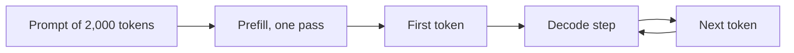

## The first word waits, then the rest stream

After the launch-day crash, Ahmad tried the assistant by himself. He pasted a long design document and asked a question. For a moment nothing happened. Then the words streamed out faster than he could read them. He asked Nour: "Why does it wait first and then run fast? Why can't it start writing at once?"

The answer is a picture of what happens inside one request, and everything else in this module builds on it. By the end of this chapter you can describe the two phases of a request, name the three numbers that measure it, work out the fastest speed one request can reach, and explain why serving more users at once raises total output but can slow each user down.

## One token at a time

A language model writes by repeating one step: given all the text so far, produce the next token. A token is a word or a part of a word. The model cannot write token 5 before token 4 exists, because token 5 depends on it. This single fact explains most of the cost of running a model.

A request has two parts in time. First the model reads the prompt. Then it writes the answer. Inside, the two parts use the GPU in opposite ways.

<BigWordAlert term="Prefill and decode" plainEnglish="Prefill is the first phase: the model reads the whole prompt at once and produces the first token. Decode is the second phase: the model writes the rest of the answer, one token per step." whyItMatters="The two phases use the GPU in opposite ways. Prefill is limited by arithmetic and decode by memory reads, so almost every serving technique is aimed at one of them." />

In **prefill**, the model processes all the prompt tokens in parallel, in one pass. If the prompt has 2,000 tokens, all 2,000 positions go through the model together. Each weight is read from memory once and used for all 2,000 tokens. The GPU's arithmetic units stay busy, so prefill is <GlossaryTerm term="compute-bound" definition="Limited by how fast the chip can do arithmetic. Getting data from memory is quick enough, so the calculating units are the bottleneck." />.

In **decode**, the model makes one token per step. Each step is a full pass through the model, but for one new token only. Yet the pass still needs every weight, so the engine must read all 16.06 GB from memory to make a single token. The arithmetic takes very little time, and the units mostly wait for data. Decode is <GlossaryTerm term="memory-bound" definition="Limited by how fast data can be read from memory, not by arithmetic. The calculating units finish early and wait for the next data." /> at small batch sizes. The diagram shows the order.



Prefill runs once. Decode repeats in a loop until the answer ends. The loop is why a 300-token answer needs 300 trips through the weights.

## Why decode waits for memory

The reason is arithmetic you can do by hand. For each weight, the GPU does 2 operations per token: one multiply and one add. A 16-bit weight takes 2 bytes. So when the batch holds B tokens, the weights are read once and the GPU does 2 × B operations for every 2 bytes read. That is B operations per byte.

A data-centre GPU can do roughly 156 operations for every byte it reads. We get that from a peak of 312 trillion operations a second divided by an example memory speed of 2 trillion bytes (2 TB) a second. Memory speed is called <GlossaryTerm term="memory bandwidth" definition="How many bytes the GPU can read from its memory each second. For 80 GB-class data-centre GPUs it is about 2 to 3.4 TB per second." />. In decode with one request, B is 1. The GPU needs 156 operations per byte to stay busy, and it gets 1. In prefill with a 2,000-token prompt, B is 2,000, far above 156, so arithmetic is the limit.

This gives a useful number: the fastest one request can decode. Each step must read at least 16.06 GB. At 2 TB/s, that takes 16.06 GB ÷ 2,000 GB/s = 0.00803 s, or 8.03 ms. One request cannot make a token faster than that, which is about 1 ÷ 0.00803 = 125 tokens per second at most.

Treat 125 as a ceiling, not a measurement. It leaves out the KV cache reads and the software overhead, so real speed is lower. The 2 TB/s is also the example's own choice, at the low end for 80 GB-class GPUs.

Prefill shows the other side. A 2,000-token prompt needs 2 × 8,030,261,248 × 2,000 operations, about 32 trillion. At the 312 trillion operations a second peak, that is at best 0.103 s. Writing 2,000 tokens one by one in decode would take 2,000 × 8.03 ms, about 16 seconds, at the same ceiling. The weights are the same. What differs is how many tokens share each read: 2,000 in prefill and 1 in decode. So prefill finishes the same 2,000 tokens about 150 times faster, 0.1 s against 16 s.

## Three numbers: TTFT, TPOT and throughput

Three measures describe a request. They answer different questions.

<GlossaryTerm term="Time to first token (TTFT)" definition="The wait from the moment a request arrives until the first token of the answer appears. It includes any time spent in a queue plus the prefill." /> is the wait before anything appears. It decides whether the system feels alive. <GlossaryTerm term="Time per output token (TPOT)" definition="The average time between tokens after the first one. It decides how smooth the streaming looks, and how fast a person can read along." /> is the average gap between tokens after the first. It decides how smooth the stream feels. <GlossaryTerm term="Throughput" definition="The total number of tokens the server produces per second, added up across all users." /> is the total tokens per second across all users. It decides how many people one GPU can serve.

They connect: total time = TTFT + TPOT × (tokens after the first). In this example, a 300-token answer has a TTFT of 0.5 s and a TPOT of 25 ms: 0.5 + 299 × 0.025 = 7.975 s, about 8 seconds. A longer prompt grows TTFT, and a busier server grows TPOT.

```quiz
type: mcq
question: "After Wadi Labs users start pasting prompts four times longer, the dashboard shows TTFT rising from 0.3 s to 1.2 s while TPOT stays at 25 ms. Which explanation fits these numbers?"
options:
  - "Decode slowed, since every new word needs a full read of the weights"
  - "Prefill takes longer, since it must read every prompt token first"
  - "Throughput fell, since fewer tokens are made per second across users"
  - "The weights grew, since a longer prompt makes the model itself bigger"
correct: 1
explanations:
  - "Decode speed is shown by TPOT, and TPOT did not change. Each decode step still reads the same weights."
  - "Right. Prefill must process every prompt token before the first word. Four times more prompt tokens gives about four times the wait, and the later tokens are not affected."
  - "Throughput adds up all users and does not explain why one request waits longer for its first word."
  - "The weights are fixed after training. A longer prompt makes the work bigger, not the model."
```

## Batching: one read for many users

A decode step reads the weights once, no matter how many requests share the step. Group several users into one **batch**, and the same 16.06 GB read produces one token for each of them. The cost of the read is shared.

Before the interactive model, predict what happens to the step time when a second user joins. Ignore the KV cache for now.

```predict
prompt: "One user is decoding and each step takes 8.03 ms. A second user joins, and both decode in the same step. Ignoring the KV cache, what happens to the step time?"
options:
  - id: same
    label: "It barely changes, since one read of the weights serves both"
  - id: double
    label: "It about doubles, since the GPU now has twice as much work to do"
correctOptionId: same
explanation: "Decode is limited by reading the weights, and the weights are read once per step for the whole batch. A second token adds a little arithmetic and no extra weight read, so the step time barely changes."
```

<InteractiveCanvas slug="prefill-decode-steps" />

**What this shows.** One request travelling between four parts: the app, the engine, the weights and the KV cache. Prefill reads the weights once for all 2,000 prompt tokens and fills the cache with 2,000 tokens, about 262 MB (2,000 × 0.13 MB). The first token ends the wait. Each decode step then reads all 16.06 GB of weights again to produce one token, and adds one token to the cache. With a batch of 8 users, the same 16.06 GB read produces 8 tokens.

**Try this.** Step to the first token: the weights were read once, and the cache holds 2,000 tokens. Now step through two decode steps and watch the weights lane light up each time, for one token each. Then step to the batch of 8: the read is still 16.06 GB, and 8 tokens come out of it.

**What changed.** From prefill to decode, the weights are the same but the number of tokens sharing each read drops from 2,000 to 1. From one user to a batch of 8, the read stays the same size and the tokens per read grow eight times.

**Limits of the model.** The canvas has no real timings, one GPU and activations ignored. The 2,000-token prompt and the sizes are the example's own. In a real engine, every user in the batch also adds cache reads to each step.

## What batching costs each user

The cache reads are where the free lunch ends. Each decode step reads the weights once, but it reads every user's KV cache in full. So the bytes per step grow with the batch.

Take the example numbers. Each of 8 users holds 2,000 tokens, which is 262 MB of cache. One user: 16.06 + 0.26 = 16.32 GB per step, so 16.32 ÷ 2,000 = 8.16 ms. Eight users: 16.06 + 8 × 0.262 = 18.16 GB per step, so 9.08 ms. Throughput for one user is 1 ÷ 8.16 ms, about 122 tokens a second. For eight users it is 8 ÷ 9.08 ms, about 881 tokens a second, 7.2 times more. Each user's TPOT rose from 8.16 to 9.08 ms, which is 11% slower.

This is the trade-off in one example: batching raises total throughput a lot and slows each user a little. It keeps working until the batch is large enough that arithmetic, not memory, is the limit. By the estimate above that is near 150 requests, though a research paper measured the crossover later, at 500 to 600 tokens in some multi-GPU setups, so use 150 only as a rough guide. In practice, memory space often stops the growth first: every user brings a cache, and the cache must fit. That is the subject of chapter 11.4.

A second cost is easy to miss. A long prefill occupies the GPU for its whole pass, and other users' next tokens wait. A 2,000-token prefill takes at best 0.1 s, so users who saw a token every 9 ms see a pause more than ten times longer. Chapter 11.5 shows how engines cut long prefills into pieces to avoid this.

```quiz
type: mcq
question: "A server has 16.06 GB of weights, a memory speed of 2 TB/s, and each request holds 8,000 tokens, which is 1.05 GB of cache. A step reads the weights once plus every user's cache. Going from 1 user to a batch of 16, what happens?"
options:
  - "About 16 times the throughput, with each user's time per token unchanged"
  - "About 2 times the throughput, with each user's time per token unchanged"
  - "About the same throughput, with each user's time per token about doubled"
  - "About 8 times the throughput, with each user's time per token about doubled"
correct: 3
explanations:
  - "Each step also reads 16 caches, so it takes longer than one step for a single user. The gain cannot be a full 16 times."
  - "A step for 16 users reads about 32.8 GB against 17.1 GB for one, so each user's time per token does change, and the throughput gain is far larger than 2 times."
  - "Throughput rises, because 16 tokens come out of a step that takes only about twice as long. It does not stay the same."
  - "Right. One user reads 16.06 + 1.05 = 17.11 GB, so 8.55 ms. Sixteen users read 16.06 + 16.78 = 32.84 GB, so 16.42 ms, about 1.9 times longer. Throughput is 16 × 8.55 ÷ 16.42, about 8.3 times higher."
```

## Failure modes and debugging

Four mistakes appear again and again when people first reason about this.

- **Reading the ceiling as a speed.** The 125 tokens per second figure is an upper bound from weights alone. Measure real speed under real load before you promise anything.
- **Mixing up TTFT and total time.** A slow first word and a slow stream have different causes. Prompt length and queueing affect TTFT. Batch size and cache size affect TPOT.
- **Quoting throughput without latency.** A server that makes 880 tokens a second for 8 users gives each about 110. If someone says "1,000 tokens a second", ask for how many users and with what TPOT.
- **Testing with one short request.** This is what happened at Wadi Labs. One short request has no queue, no batch and no large cache, so it hides the problems that appear under load.

<Callout type="warning" title="A floor is not a measurement">
The weight-read ceiling ignores cache reads, overhead and other work. Use it to see which resource limits you, and measure the real number on your engine.
</Callout>

## In the interview

Interviewers use this topic to check that you understand why a model behaves as it does under load. The strongest answers give the two phases, name what limits each, and use one number. Answer each question aloud first, then open it.

<FaqGroup title="Practice questions">
<FaqItem question="Why is the first token slow and the later tokens fast?">

The first token must wait for prefill, where the model processes the whole prompt before it can write anything. Prefill is compute-bound, so its time grows with the prompt: a 2,000-token prompt needs about 32 trillion operations, at best about 0.1 s. After that, each decode step makes one token and takes roughly the time to read the weights, about 8 ms in my example. Under load, queueing adds to the first-token wait.

**Follow-up probes:**

- What happens to TTFT if the prompt grows from 2,000 to 8,000 tokens?
- What else besides prefill can add to TTFT?

</FaqItem>
<FaqItem question="Why does batching raise throughput but can hurt each user's latency?">

A decode step reads the weights once however many requests share it, so more requests means more tokens per read. In my example, a batch of 8 users with 2,000 tokens each gives about 881 tokens per second against about 122 for one user, 7.2 times more. But each step also reads every user's cache, so the step grows from about 8.16 to 9.08 ms. Each user waits 11% longer per token. The gain stops when the batch is large enough for arithmetic or memory space to become the limit.

**Follow-up probes:**

- What happens when a long prompt joins a running batch?
- Which number would you watch to see that a batch is too big?

</FaqItem>
<FaqItem question="What limits the speed of one request on one GPU?">

For one request, decode is limited by memory reads. Every step reads all the weights, 16.06 GB for an 8B model at 16-bit. With 2 TB/s of memory speed, a step takes at least 8.03 ms, so the speed is at most about 125 tokens per second. This is a ceiling, because it ignores the cache reads and overhead. To go faster I would read fewer bytes, for example with 8-bit weights, or use a GPU with more memory bandwidth.

**Follow-up probes:**

- How would 8-bit weights change the ceiling, and what would you check before using them?
- Why does a faster arithmetic chip not help a single request much?

</FaqItem>
</FaqGroup>

**Next:** The KV cache from first principles: what the model stores for every token, how to compute its size, and why it, not the weights, is what filled Nour's GPU.
