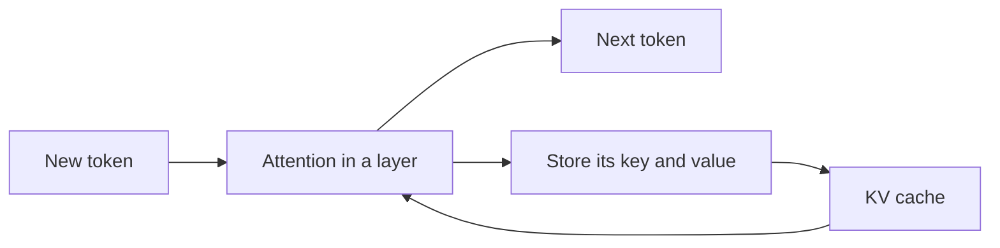

## What did the crash actually fill?

Nour went back to the log from launch day. The engine had printed one line before it stopped: the memory for the cache was full. Ahmad asked a fair question. "You keep saying the cache grows. What is in it, and why does a model need to keep it at all?"

This chapter answers both questions from zero. By the end you can say what the KV cache holds, compute its size from a model's configuration file, and predict how it changes when the context gets longer, the model uses fewer KV heads, or the values are stored in 8 bits.

## Why a model keeps old work

To write the next token, a model looks back at all the earlier tokens and decides which ones matter. This looking back is called <GlossaryTerm term="attention" definition="The step in which a model, before it writes a token, compares that token with all earlier tokens to decide which ones to use." />. For each earlier token, the model has made two short lists of numbers. The **key** is like a label on a drawer: it says what this token is about. The **value** is what is inside the drawer: the information the token can give. The new token asks a question, compares it with every key, and collects the values of the best matches.

A model has many <GlossaryTerm term="layers" definition="The stacked steps of a model. The 8B model in this chapter has 32. Each layer does its own attention, so it needs its own keys and values." />, and every layer does this separately. So every earlier token needs a key and a value in every layer. Those lists do not change once they are made, because an earlier token does not change when a later one is added.

That suggests a saving. Without a cache, each new token would force the model to rebuild the keys and values of the whole text again. Take a 2,000-token prompt and a 300-token answer. The model would process 2,000 + 2,001 + 2,002 and so on up to 2,299 tokens, which adds up to 644,850 token-passes. With a cache, it processes the prompt once and then one new token per step: 2,000 + 300 = 2,300 token-passes. That is about 280 times less work.

The diagram shows what happens in one layer for each new token.



The layer reads all the old keys and values from the cache, uses them to help produce the next token, and then adds the new token's own key and value to the cache. The cache only ever grows during a chat. Every layer repeats this loop with its own part of the cache.

<BigWordAlert term="KV cache" plainEnglish="The keys and values of every token the model has already read, kept in GPU memory so the model does not compute them again for each new token." whyItMatters="It makes generation fast, but it uses memory that grows with every token of every open chat. This is the memory that filled Nour's GPU." />

The cache saves time by spending memory. Time is cheap to save here, and memory is the scarce thing, so the next question is how much memory it takes.

## The size of one token

Each token stores a key and a value, in every layer, for every KV head, each a list of numbers whose length is the head size. Multiply the parts:

**bytes per token = 2 × layers × KV heads × head size × bytes per value**

The 2 is for the key and the value. A <GlossaryTerm term="KV head" definition="One set of key and value lists inside a layer. Several attention heads can share one KV head. The model's configuration file shows the count as num_key_value_heads." /> is one of the sets of key and value lists in a layer. The head size is how many numbers are in each list. The bytes per value is 2 for 16-bit numbers.

Take the 8B model from this module. Its configuration file says 32 layers, 8 KV heads and a head size of 128. At 16 bits:

2 × 32 × 8 × 128 × 2 = 131,072 bytes per token.

This is exactly 128 KiB. A <GlossaryTerm term="KiB" definition="A kibibyte: 1,024 bytes. A GiB is 1,073,741,824 bytes. Storage tools often show KiB and GiB, while this course uses decimal GB for memory." /> is 1,024 bytes. A chat of 32,768 tokens holds 32,768 × 131,072 = 4,294,967,296 bytes, which is 4 GiB and about 4.29 GB. That is the only time this course converts between the two. From here on, GB means decimal gigabytes.

Context length multiplies the cache in a straight line. Double the tokens and you double the cache.

| Tokens in the chat | Cache for one chat | Note |
|---|---|---|
| 1,000 | about 0.13 GB | a short question and answer |
| 8,192 | about 1.07 GB | a long document |
| 32,768 | about 4.29 GB | Nour's launch-day chat |
| 131,072 | about 17.18 GB | more than the 16.06 GB of weights |

The last row is worth pausing on. A single chat at the longest context this model accepts holds more cache than the model has weights. A long chat, not a large crowd, is what fills the GPU.

```quiz
type: mcq
question: "A different open model has 40 layers, 32 attention heads, 8 KV heads and a head size of 128, and stores 16-bit values. How much KV cache does one token take?"
options:
  - "160 KiB, from 2 × 40 × 8 × 128 × 2 bytes per token"
  - "640 KiB, from using all 32 attention heads, not 8 KV heads"
  - "80 KiB, from counting keys and values once, not twice"
  - "320 KiB, from counting keys and values twice over"
correct: 0
explanations:
  - "Right. 2 × 40 × 8 × 128 × 2 = 163,840 bytes, which is 160 KiB. The 2 is for key and value, and the 8 is the KV heads."
  - "The cache stores one key and value set per KV head, not per attention head. Using 32 would give 640 KiB, four times too much."
  - "A token needs both a key and a value, so the factor of 2 must stay. Dropping it gives 80 KiB, half the real size."
  - "Keys and values are counted once each, and that is the single factor of 2. Counting them twice over gives 320 KiB, double the real size."
```

## Fewer KV heads: MHA, GQA and MQA

Where do 8 KV heads come from when the model has 32 attention heads? It is a design choice, and it has a name for each setting.

In the original design, <GlossaryTerm term="multi-head attention (MHA)" definition="Every attention head has its own keys and values. It stores the most data and is the oldest design." />, each of the 32 heads keeps its own keys and values. Our model would need 2 × 32 × 32 × 128 × 2 = 524,288 bytes, or 512 KiB per token, four times more. A 32,768-token chat would take 16 GiB, about 17.18 GB. <GlossaryTerm term="Multi-query attention (MQA)" definition="All attention heads share a single set of keys and values. It gives the smallest cache, with a small loss of quality reported." /> goes the other way: one KV head for all, 16 KiB per token, 0.54 GB per chat.

<GlossaryTerm term="Grouped-query attention (GQA)" definition="A middle design: attention heads are split into groups, and each group shares one set of keys and values. Our model has 32 heads in 8 groups of 4." /> sits between them. Our model has 8 groups, so the cache is 32 ÷ 8 = 4 times smaller than the multi-head version. You can read this ratio from a configuration file: attention heads divided by KV heads.

This is not free, in principle. In the paper that introduced GQA, a large test model scored 47.2 with multi-head attention, 47.1 with GQA and 46.6 with multi-query attention. Both shared designs ran about 5 to 6 times faster. GQA kept almost all the quality, which is why newer models use it.

## What you can and cannot change

Layers, KV heads and head size are fixed when the model is trained. You read them from the configuration file; you cannot change them when you serve. Three things stay under your control: how many bytes each value takes, how many tokens you hold, and how well memory is packed (chapter 11.5).

The first is the most direct. Store the cache in <GlossaryTerm term="FP8" definition="A number format that uses 8 bits, one byte, for each value. It takes half the space of a 16-bit number but holds fewer exact digits." />, one byte per value, and the 128 KiB per token becomes 64 KiB. One 32,768-token chat drops from 4.29 GB to 2.15 GB. The engine documents say only that this reduces memory a lot, and they advise calibrating on real data. They give no accuracy number, so the halving is our arithmetic and the quality is yours to test.

Before the interactive model, test the idea with a case where two changes pull in opposite directions.

```predict
prompt: "A model has the same layers and head size as Nour's, but 16 KV heads instead of 8. Nour stores its cache in FP8, 1 byte per value. One 32,768-token chat took 4.29 GB. How big is it now?"
options:
  - id: half
    label: "About 2.15 GB, since FP8 halves the cost of every value"
  - id: same
    label: "About 4.29 GB: twice the heads cancels half the bytes"
correctOptionId: same
explanation: "Doubling the KV heads doubles the cache to 8.59 GB. FP8 halves it again to 4.29 GB. Each input is a multiplier, so the two changes cancel."
```

<InteractiveCanvas slug="kv-cache-per-token" />

**What this shows.** How four settings of a model's shape multiply into the cache per token, and how that grows to one 32,768-token chat. The defaults are 32 layers, 8 KV heads, a head size of 128 and 2 bytes per value. They give 128 KiB per token and 4.29 GB per chat. The bars compare this model with the same model using full multi-head attention (32 KV heads, 17.18 GB) and with a single KV head (0.54 GB).

**Try this.** Set KV heads to 16: the cache per token doubles to 256 KiB, one chat grows to 8.59 GB, and the comparison with 32 KV heads changes from 4 times smaller to 2 times smaller. Then set bytes per value to 1: the cache returns to 128 KiB and 4.29 GB, the answer to the prediction above.

**What changed.** Each input is a multiplier. Doubling the KV heads doubled the cache, and halving the bytes per value halved it. What counts is the product, so a change in one input can be undone by a change in another.

**Limits of the model.** The canvas shows one sequence, with no paging overhead, no activations, and no extra storage for the scale numbers FP8 needs. In a real model, layers, KV heads and head size are fixed by training, and only the bytes per value is something you choose when you serve.

```quiz
type: mcq
question: "Karim's server holds 13 chats of 32,768 tokens and needs 26. He cannot retrain or replace the model, and his quality test passes with an 8-bit cache. Which change alone doubles the chats that fit?"
options:
  - "Quantize the weights to 8 bits, which halves their size"
  - "Cut the head size from 128 to 64 in the model's config file"
  - "Store the cache in FP8, using one byte per value instead of two"
  - "Raise the KV heads from 8 to 16 to give each token more room"
correct: 2
explanations:
  - "Halving the weights frees 8.03 GB. The cache space grows from 55.94 GB to 63.97 GB, about 14 chats, not 26. The cache per token stays at 128 KiB."
  - "The head size is part of the trained model. Changing the config file would not shrink the cache of the model you have; it would break the model."
  - "Right. One byte per value halves the cache per token from 128 KiB to 64 KiB. The same 55.94 GB then holds about 26 chats. The change is only safe because his quality test passes."
  - "More KV heads means more keys and values per token. This doubles the cache, so only about 6 chats would fit."
```

## Failure modes and debugging

- **Using attention heads in the formula.** The formula needs KV heads. Using 32 instead of 8 makes the answer four times too big.
- **Forgetting the 2.** Keys and values both count. Without the 2 the answer is half the real size.
- **Mixing GB and GiB.** 4 GiB is 4.29 GB. Say which one you mean, or the numbers will not match the engine's log.
- **Expecting weight quantization to shrink the cache.** The formula has no weight term. Smaller weights free memory, but they do not change the bytes per token.
- **Switching to an FP8 cache without a quality test.** Test on your own questions first, as chapter 11.6 explains.

## In the interview

The KV cache is the topic interviewers pick to see whether you can reason from a model's configuration. A good answer states the formula, plugs in the numbers, and says what changes it. Answer aloud first, then open each question.

<FaqGroup title="Practice questions">
<FaqItem question="What is the KV cache, and why do we need it?">

The KV cache stores the keys and values that attention computes for every token the model has read, in every layer. Because earlier tokens do not change, we compute their keys and values once and reuse them. Without a cache, a 2,000-token prompt and a 300-token answer would need about 644,850 token-passes, against 2,300 with a cache, about 280 times more. The price is memory: for an 8B model with 8 KV heads, each token takes 128 KiB, so the cache grows with every token of every open chat.

**Follow-up probes:**

- What would you do if the cache does not fit?
- Does the cache change the answer the model gives?

</FaqItem>
<FaqItem question="How much memory does a 32,768-token chat need for an 8B model?">

Use the formula 2 × layers × KV heads × head size × bytes. For 32 layers, 8 KV heads, a head size of 128 and 16-bit values, that is 2 × 32 × 8 × 128 × 2 = 131,072 bytes, or 128 KiB per token. Times 32,768 tokens gives 4 GiB, about 4.29 GB, on top of the 16.06 GB of weights. With an FP8 cache it halves to about 2.15 GB, if a quality check passes. Twenty such chats need about 85.9 GB.

**Follow-up probes:**

- Which of these numbers can you read from the model's config file?
- What would change if the model used multi-head attention?

</FaqItem>
<FaqItem question="What are GQA and MQA, and why do they matter for serving?">

Both reduce how many keys and values a layer stores. In multi-head attention each of the 32 heads keeps its own, which would be 512 KiB per token for our model. GQA shares one set per group of heads. With 8 groups the cache is 4 times smaller, 128 KiB. MQA uses a single set, 16 KiB per token, 32 times smaller than multi-head, with a small quality loss reported. For serving, a smaller cache means more chats on the same GPU, so I would check KV heads in the config when choosing a model.

**Follow-up probes:**

- Can you switch a model from 8 KV heads to 1 when you serve it?
- Why did newer models choose GQA over MQA?

</FaqItem>
</FaqGroup>

**Next:** GPU memory budgeting and sizing: weights, cache and reserve in one budget, so you can say how many users fit and what a million tokens costs.
