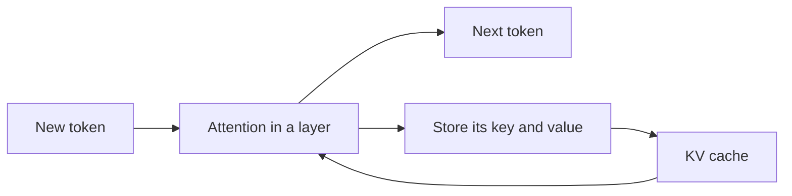

## What did the crash actually fill?

Nour went back to the launch-day log. The engine had printed one line before it stopped: the memory for the cache was full. Ahmad asked a fair question. "What is in this cache, and why does a model need to keep it at all?"

This chapter answers both from zero. By the end you can say what the KV cache holds and compute its size from a model's configuration file. You can also predict how it changes with longer context, fewer KV heads or 8-bit values.

## Why a model keeps old work

To write the next token, a model looks back at all the earlier tokens and decides which ones matter. This is called <GlossaryTerm term="attention" definition="The step in which a model compares the token it is writing with all earlier tokens, to decide which ones to use." />. For each earlier token, the model has made two short lists of numbers. The **key** is like a label on a drawer: it says what the token is about. The **value** is what is inside the drawer. The new token asks a question, the **query**, compares it with every key, and collects the values of the best matches.

A model has many <GlossaryTerm term="layers" definition="The stacked steps of a model. The 8B model in this chapter has 32." />, and every layer does this separately. So every earlier token needs a key and a value in every layer. They never change once made, because an earlier token does not change when a later one is added.

That suggests a saving. Without a cache, each new token would force the model to rebuild the keys and values of the whole text. Take a 2,000-token prompt and a 300-token answer. The model would process 2,000 + 2,001 + 2,002 and so on up to 2,299 tokens, which is 644,850 token-passes. With a cache it processes the prompt once and then one new token per step, about 2,300 token-passes. That is about 280 times less work.

The diagram shows what happens in one layer for each new token.



The layer reads all the old keys and values from the cache, uses them to help produce the next token, and then adds the new token's own key and value. The cache only grows during a chat, and every layer repeats this loop with its own part of it.

<BigWordAlert term="KV cache" plainEnglish="The keys and values of every token the model has already read, kept in GPU memory so the model does not compute them again for each new token." whyItMatters="It makes generation fast, but it uses memory that grows with every token of every open chat. This is the memory that filled Nour's GPU." />

The cache saves time by spending memory, and memory is the scarce resource on a GPU. So the next question is how much memory it takes.

## The size of one token

First, one more idea: heads. Inside a layer, attention runs several times side by side, and each run is an <GlossaryTerm term="attention head" definition="One of the attention runs inside a layer. Each head has its own query, key and value lists." />. The **head size** is how many numbers are in each of a head's lists. Heads times head size gives the <GlossaryTerm term="hidden size" definition="The length of the main list of numbers the model keeps for each token." /> of the model. Our model has 32 attention heads with a head size of 128, so its hidden size is 32 × 128 = 4,096.

Each token stores a key and a value, in every layer, for every KV head, each a list of numbers whose length is the head size. Multiply the parts:

**bytes per token = 2 × layers × KV heads × head size × bytes per value**

The 2 is for the key and the value. A <GlossaryTerm term="KV head" definition="One set of key and value lists inside a layer. Several attention heads can share one KV head. The config file calls the count num_key_value_heads." /> is one such set in a layer, and a model can have fewer of them than attention heads. The bytes per value is 2 for 16-bit numbers.

Take the 8B model from this module. Its configuration file lists 32 layers, 32 attention heads, 8 KV heads and a hidden size of 4,096. Some files do not list the head size, so you work it out: hidden size ÷ attention heads = 4,096 ÷ 32 = 128. At 16 bits:

2 × 32 × 8 × 128 × 2 = 131,072 bytes per token.

This is exactly 128 KiB. A <GlossaryTerm term="KiB" definition="A kibibyte: 1,024 bytes. A GiB is 1,073,741,824 bytes. This course uses decimal GB for memory." /> is 1,024 bytes. A chat of 32,768 tokens holds 32,768 × 131,072 = 4,294,967,296 bytes, which is 4 GiB, or about 4.29 GB. From here on, GB means decimal gigabytes.

Context length multiplies the cache in a straight line: double the tokens, double the cache.

| Tokens in the chat | Cache for one chat | Note |
|---|---|---|
| 1,000 | about 0.13 GB | a short question and answer |
| 8,192 | about 1.07 GB | a long document |
| 32,768 | about 4.29 GB | Nour's launch-day chat |
| 131,072 | about 17.18 GB | more than the 16.06 GB of weights |

Look at the last row. One chat of 131,072 tokens, a length some models of this shape are built for, holds more cache than the weights. A long chat, not a large crowd, can fill the GPU.

```quiz
type: mcq
question: "A different open model has 40 layers, 32 attention heads, 8 KV heads and a head size of 128, and stores 16-bit values. How much KV cache does one token take?"
options:
  - "160 KiB per token"
  - "640 KiB per token"
  - "80 KiB per token"
  - "128 KiB per token"
correct: 0
explanations:
  - "Right. 2 × 40 × 8 × 128 × 2 = 163,840 bytes, which is 160 KiB. The 2 is for key and value, and the 8 is the KV heads."
  - "This uses all 32 attention heads. The cache stores one key and value set per KV head, so the count is 8. With 32 the answer would be 640 KiB, four times too much."
  - "This leaves out the factor of 2. A token needs both a key and a value, so dropping it gives 80 KiB, half the real size."
  - "This is the running example's answer. That model has 32 layers, and this one has 40. Check the shape in the question before you reuse an old result."
```

## Fewer KV heads: MHA, GQA and MQA

Why does the model have 8 KV heads when it has 32 attention heads? It is a design choice with a name for each setting.

In the original design, <GlossaryTerm term="multi-head attention (MHA)" definition="Every attention head has its own keys and values. It is the oldest design." />, each of the 32 heads keeps its own keys and values. Our model would need 2 × 32 × 32 × 128 × 2 = 524,288 bytes, or 512 KiB per token, four times more. A 32,768-token chat would take about 17.18 GB. <GlossaryTerm term="Multi-query attention (MQA)" definition="All attention heads share one set of keys and values. It gives the smallest cache." /> goes the other way: one KV head for all, 16 KiB per token, 0.54 GB per chat.

<GlossaryTerm term="Grouped-query attention (GQA)" definition="A middle design: attention heads form groups, and each group shares one set of keys and values." /> sits between them. Our model has 32 heads in 8 groups of 4, so the cache is 32 ÷ 8 = 4 times smaller than the multi-head version. You can read this ratio from a configuration file: attention heads divided by KV heads.

Why can heads share keys and values? Each head keeps its own query, so the heads still ask different questions. The keys and values are the labels and contents of the text, and several heads can read the same ones. The price is less variety between heads, which can cost some quality.

The GQA paper measured it. A large test model scored 47.2 with multi-head attention, 47.1 with GQA and 46.6 with multi-query attention. Both shared designs were about 5 to 6 times faster. GQA kept almost all the quality, so many newer open models use it.

## What you can and cannot change

Layers, KV heads and head size are fixed by training. Three things stay under your control: the bytes per value, the tokens you hold, and how well memory is packed (chapter 11.5).

The first is the most direct. Store the cache in <GlossaryTerm term="FP8" definition="A number format that uses 8 bits, one byte, for each value. It takes half the space of 16 bits and holds fewer exact digits." />, one byte per value, and 128 KiB per token becomes 64 KiB. One 32,768-token chat drops from 4.29 GB to 2.15 GB. The vLLM v0.32.0 docs say only that this reduces memory significantly, and give no accuracy number. The halving is our arithmetic, and the quality is yours to test.

Before the interactive model, test the idea with a case where two changes pull in opposite directions.

```predict
prompt: "A model has the same layers and head size as Nour's, but 16 KV heads instead of 8. Its cache is stored in FP8, 1 byte per value. Nour's 16-bit version took 4.29 GB for a 32,768-token chat. How big is the chat now?"
options:
  - id: half
    label: "About 2.15 GB, since FP8 halves the cost of every value"
  - id: same
    label: "About 4.29 GB, as twice the heads cancels the halved bytes"
correctOptionId: same
explanation: "Doubling the KV heads doubles the cache to 8.59 GB. FP8 halves it again to 4.29 GB. Each input is a multiplier, so the two changes cancel."
```

<InteractiveCanvas slug="kv-cache-per-token" />

**What this shows.** How three settings of a model's shape (layers, KV heads and bytes per value) multiply into the cache per token, and how the length of the chat multiplies that into one chat. The head size stays fixed at 128. The defaults (32 layers, 8 KV heads, 2 bytes, a chat of 32,768 tokens) give 128 KiB per token and 4.29 GB per chat. The bars compare this model with 32 KV heads (17.18 GB) and with one KV head (0.54 GB).

**Try this.** Double the KV heads from 8 to 16. The cache doubles to 256 KiB per token and one chat to 8.59 GB, because the size is a plain product. Set bytes per value to 1 (FP8). The cache halves to 64 KiB per token and 2.15 GB per chat, with the same layers, heads and head size. Raise the tokens in the chat from 32,768 to 131,072. The cache per token stays at 128 KiB, but one chat grows four times, from 4.29 GB to 17.18 GB, more than the 16.06 GB of weights.

**What changed.** Each input is a multiplier. Doubling the KV heads doubled the cache, and halving the bytes halved it. Set 16 KV heads and 1 byte together and the cache is 128 KiB and 4.29 GB, the answer to the prediction. The chat length is a multiplier too, but it scales the chat and not the size per token: four times the tokens is four times the chat.

**Limits of the model.** One sequence of the length you choose, with a fixed head size of 128, no paging overhead, no activations and no storage for FP8 scale numbers.

```quiz
type: mcq
question: "Yousef serves the 8B model on a 64 GB GPU and keeps 10% of it back. The 16.06 GB of weights leave room for 9 chats of 32,768 tokens at 16 bits, and 18 are needed. The model cannot be retrained or replaced. Which change alone makes 18 chats fit?"
options:
  - "Quantize the weights to 8 bits"
  - "Cut the head size from 128 to 64 in the config file"
  - "Store the cache in FP8, one byte per value"
  - "Raise the KV heads from 8 to 16 for more room"
correct: 2
explanations:
  - "Halving the weights frees 8.03 GB. The cache space grows from 41.54 GB to 49.57 GB, about 11 chats, not 18. The cache per token stays at 128 KiB."
  - "The head size is part of the trained model. Changing the config file would not shrink the cache of the model you have; it would break the model."
  - "Right. One byte per value halves the cache per token from 128 KiB to 64 KiB. The same 41.54 GB then holds about 19 chats. The change is safe only if a quality test on your own questions passes."
  - "More KV heads means more keys and values per token. This doubles the cache, so only about 4 chats would fit."
```

## Failure modes and debugging

- **Using attention heads in the formula.** The formula needs KV heads. Using 32 instead of 8 makes the answer four times too big.
- **Forgetting the 2.** Keys and values both count. Without the 2 the answer is half the real size.
- **Mixing GB and GiB.** 4 GiB is 4.29 GB. Say which one you mean, or the numbers will not match the engine's log.
- **Expecting weight quantization to shrink the cache.** The formula has no weight term. Smaller weights free memory, but they do not change the bytes per token.
- **Switching to an FP8 cache without a quality test.** Test on your own questions first, as chapter 11.6 explains.

## In the interview

To show you understand the KV cache, state the formula, plug in the numbers, and say what changes it. Answer aloud first, then open each question.

<FaqGroup title="Practice questions">
<FaqItem question="What is the KV cache, and why do we need it?">

The KV cache stores the keys and values that attention computes for every token the model has read, in every layer. Earlier tokens do not change, so we compute their keys and values once and reuse them, about 280 times less work in my 2,000-token example. The price is memory: for an 8B model with 8 KV heads, each token takes 128 KiB, so the cache grows with every token of every open chat.

**Follow-up probes:**

- What would you do if the cache does not fit?
- Does the cache change the answer the model gives?

</FaqItem>
<FaqItem question="How much memory does a 32,768-token chat need for an 8B model?">

Use 2 × layers × KV heads × head size × bytes. For 32 layers, 8 KV heads, head size 128 and 16-bit values, that is 2 × 32 × 8 × 128 × 2 = 131,072 bytes, or 128 KiB per token. Times 32,768 tokens gives about 4.29 GB, on top of the 16.06 GB of weights. With an FP8 cache it halves to 2.15 GB, if a quality check passes. Twenty such chats need about 85.9 GB.

**Follow-up probes:**

- Which of these numbers can you read from the model's config file?
- What would change if the model used multi-head attention?

</FaqItem>
<FaqItem question="What are GQA and MQA, and why do they matter for serving?">

Both reduce how many keys and values a layer stores. Multi-head attention keeps one set per head, 512 KiB per token for our model. GQA shares one set per group of heads, so 8 groups give 128 KiB, 4 times smaller. MQA uses a single set, 16 KiB, 32 times smaller, with a small quality loss reported. A smaller cache means more chats per GPU, so I would check the KV heads in the config when choosing a model.

**Follow-up probes:**

- Can you switch a model from 8 KV heads to 1 when you serve it?
- Why did newer models choose GQA over MQA?

</FaqItem>
</FaqGroup>

**Next:** GPU memory budgeting and sizing: weights, cache and reserve in one budget, so you can say how many users fit and what a million tokens costs.
