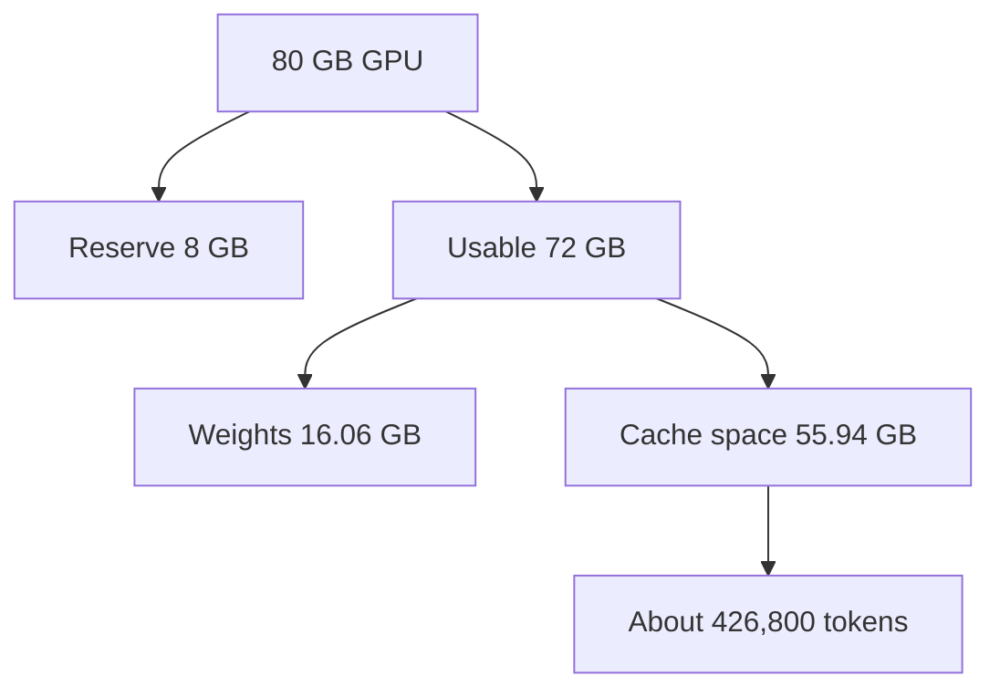

## "Just buy a bigger GPU"

The day after the crash, a manager at Wadi Labs asked Nour a reasonable question: "Do we need a bigger GPU, or a second one?" Nour did not know. The only number Nour had was 16.06 GB for the weights, and that number had already proved useless.

A guess would cost real money either way. A second GPU doubles the bill. A bigger one costs more per hour. And a wrong fix leaves the crash in place. What Nour needed was a **budget**: a short calculation that shows where every gigabyte goes, and which change moves the result most.

By the end of this chapter you can build that budget for any model and GPU, turn it into a number of users, check a plan against it, and estimate what a million tokens costs. These steps are the core of the "will it fit?" interview answer.

## Four things share the memory

<BigWordAlert term="GPU memory budget" plainEnglish="A plan that splits the memory of one GPU between the model's weights, the KV cache, temporary working memory and a reserve, and shows what is left for users." whyItMatters="Only the part left for the KV cache grows with users and chat length. If you know that part, you can say how many users fit before anyone connects." />

You met the four items in 11.1. Here are the sources for the shares. The paper that introduced paged memory measured a 13-billion-parameter model on a 40 GB GPU: about 65% of memory held the weights (26 GB), close to 30% held the KV cache, and the rest was <GlossaryTerm term="activations" definition="The temporary numbers a model produces while it works on one step. They are used and then thrown away." />. The documents of another open-source engine give the same identity: total memory is the weights, plus the KV cache, plus working buffers, plus activations.

Nour's model has a different split: 16.06 GB of weights on 80 GB is 20%. That leaves much more room for the cache than the paper's model had. Yet the room is still finite, and long chats can use all of it.

An engine does not use all the memory. It has a setting for the share it may use. In vLLM v0.32.0 the default is 0.92. The engine checks how much the activations need when it starts, and gives the rest of its share to the cache. The documents of the other engine advise keeping 5 to 8 GB free for activations. This chapter uses a round 10% reserve, which is 8 GB on an 80 GB GPU.

## The budget in four lines

The calculation is short.

1. Usable memory = GPU memory × share. For 80 GB and 0.9, that is 72 GB. The other 8 GB is the reserve.
2. Memory left for the cache = usable memory − weights. That is 72 − 16.06 = 55.94 GB.
3. Tokens the cache can hold = memory left ÷ bytes per token. That is 55.94 GB ÷ 131,072 bytes, about 426,800 tokens.
4. Chats that fit = tokens the cache can hold ÷ tokens per chat.

The diagram follows the first three lines.



The weights come off first and never change. What is left is the cache space, and the last box turns bytes into tokens, which is the unit users care about. A real engine prints this number for you. At start-up vLLM logs the size of its cache in tokens and the number of requests of a given length it can hold. In its own documents, a pool of 643,232 tokens and a limit of 40,960 tokens per request gives a maximum concurrency of 15.70, because 643,232 ÷ 40,960 = 15.70.

## Plan in tokens, not users

"We have 20 users" is not a requirement. Twenty users could hold 2,000 tokens each or 32,768 tokens each, and the memory needed is 16 times different. The cache holds about 426,800 tokens, and what matters is how many tokens your users hold at the same moment.

The same pool can serve very different crowds. It holds 13 chats of 32,768 tokens (426,784 ÷ 32,768 = 13.02). It holds 213 chats of 2,000 tokens, and 416 chats of 1,024 tokens. So when someone asks "how many users can one GPU serve?", the right first answer is a question: "How long are their chats?"

This is exactly what happened to Nour. The demo held about 3,000 tokens in total. Launch day asked for up to 655,360 (20 × 32,768). The GPU could hold 426,800. The demand was 1.5 times the supply.

## Check a plan against the budget

For 20 users at 32,768 tokens, the cache needs 20 × 4.29 = 85.9 GB, and 55.94 GB is available. It is short by 85.9 − 55.94 = 29.96 GB. Now look at the fixes, each with its arithmetic and its price.

| Fix | Result | What it costs |
|---|---|---|
| Cache in FP8 | needs 42.95 GB, fits with 12.99 GB spare | quality must be tested |
| Cap chats at 16,384 tokens | needs 42.95 GB, fits | long chats are cut off |
| 13 users per GPU | two GPUs serve the 20 | the GPU bill doubles |
| A 160 GB GPU | 127.94 GB for the cache | higher cost per hour |

The last row deserves a prediction. Doubling the GPU memory does not double the number of chats, because the weights stay the same size. The next question tests that idea.

```quiz
type: mcq
question: "Huda has a 48 GB GPU and the 8B model: 16.06 GB of weights and 131,072 bytes of cache per token. She keeps 10% of the GPU back. Four users each hold 65,536 tokens. Does it fit?"
options:
  - "Fits: 43.2 GB is usable and the chats need 34.36 GB"
  - "Fits: 48 GB holds 366,000 tokens and 262,144 are needed"
  - "Does not fit: 34.36 GB are needed and 27.14 GB are left"
  - "Does not fit: 68.72 GB are needed and 27.14 GB are left"
correct: 2
explanations:
  - "This forgets the weights. After the reserve, 43.2 GB is usable, and 16.06 GB of that is already taken, leaving 27.14 GB."
  - "This forgets the weights and the reserve. The cache space is 27.14 GB, about 207,000 tokens, and 262,144 tokens are needed."
  - "Right. Four users hold 262,144 tokens, which is 262,144 × 131,072 = 34.36 GB. The cache space is 48 × 0.9 − 16.06 = 27.14 GB. It is short by 7.22 GB."
  - "The verdict is right but the need is doubled. The 131,072 bytes per token already include both keys and values, so they must not be counted again."
```

## Cost per million tokens

A budget also leads to a price. Once you know how many tokens a GPU makes, the cost follows from the GPU's hourly price.

cost per million tokens = price per hour ÷ (tokens per second × 3,600) × 1,000,000

In this example only, the GPU costs 2 dollars an hour and the server makes 2,500 tokens a second. Then 2 ÷ (2,500 × 3,600) × 1,000,000 = 2 ÷ 9,000,000 × 1,000,000 = about 0.22 dollars per million tokens. These numbers are the example's own, not real prices.

Two things change the answer a lot. First, the tokens per second must be measured under realistic load, at the delay you promise users, not in a quiet test. Second, a GPU is not busy all hour. If the GPU is busy half the time, divide by 0.5, and the cost per million tokens doubles to 0.44 dollars. Input and output tokens may also cost differently, because prefill and decode use the GPU in different ways. Compute them separately, or state your assumed mix.

This links back to the budget. A fix that fits more users on the same GPU, such as an FP8 cache, can raise tokens per second and lower the price per token. It does so only if the engine can keep the larger batch busy and the quality test passes.

## Try the budget yourself

Before the interactive model, predict what a bigger GPU buys.

```predict
prompt: "Nour's 80 GB GPU holds 13 chats of 32,768 tokens. A teammate suggests a GPU with twice the memory, 160 GB, same model and 10% kept back. How many such chats fit?"
options:
  - id: more
    label: "About 29: more than double, as the weights stay 16.06 GB"
  - id: double
    label: "About 26: exactly double, since the memory is twice as large"
correctOptionId: more
explanation: "The cache space is 160 × 0.9 − 16.06 = 127.94 GB, not twice 55.94 GB. Divided by 4.29 GB per chat, that is about 29 chats. The weights are a fixed cost, so more memory buys more than its share."
```

<InteractiveCanvas slug="gpu-memory-budget" />

**What this shows.** Whether a crowd of chats fits in the memory left after the weights and the reserve. The defaults are 20 users with 32,768 tokens each, on an 80 GB GPU with a 16-bit cache. The cache needs 85.9 GB, while 80 × 0.9 − 16.06 = 55.94 GB is available. The verdict is out of memory by 29.96 GB, and the most users that fit is 13.

**Try this.** Set the GPU memory to 160 GB: the available space becomes 127.94 GB, the 20 users fit with 42.04 GB to spare, and the most users that fit is 29, not 26. Then return to 80 GB and set the cache bytes per value to 1: the need halves to 42.95 GB, it fits with 12.99 GB to spare, and 26 users fit.

**What changed.** Doubling the GPU added 72 GB of usable memory, but the weights still took 16.06 GB. The cache space grew from 55.94 GB to 127.94 GB, about 2.3 times. Halving the bytes per value halved what the users need, which has the same effect as doubling the space.

**Limits of the model.** The canvas shows one GPU, the example's 10% reserve, no waste from paging or fragmentation, weights that stay at 16 bits, and every user holding all their tokens at the same time. Real engines add small overheads, so leave some margin.

```quiz
type: mcq
question: "Lina has a 48 GB GPU and a 7B model with 14.5 GB of 16-bit weights and the same shape as Nour's, so 131,072 bytes of cache per token at 16 bits. She keeps 10% of the GPU back and stores the cache in FP8. How many chats of 8,192 tokens fit?"
options:
  - "53 chats: (43.2 − 14.5) GB ÷ 0.54 GB per chat"
  - "26 chats: the same sum, but with 16-bit cache values"
  - "62 chats: (48 − 14.5) GB ÷ 0.54 GB, with no reserve"
  - "80 chats: 43.2 GB ÷ 0.54 GB, with no weights"
correct: 0
explanations:
  - "Right. The cache space is 48 × 0.9 − 14.5 = 28.7 GB. An FP8 chat takes 8,192 × 65,536 bytes = 0.54 GB. So 28.7 ÷ 0.54 = 53.5, which means 53 chats."
  - "This uses 16-bit values, which double the chat to 1.07 GB. The question says the cache is stored in FP8, so each chat takes 0.54 GB."
  - "This forgets the 10% reserve. The reserve is memory the engine keeps, so only 43.2 GB is usable, not 48 GB."
  - "This forgets the weights. The 14.5 GB of weights sit in the usable memory first, so only 28.7 GB is left for the cache."
```

## Failure modes and debugging

- **Stopping at the weights.** This is Nour's mistake. The weights say whether the model loads, not whether users fit.
- **Counting users, not tokens.** Ask for the context length before any capacity number.
- **Forgetting the reserve.** An engine with no free memory fails on the next request. Use the engine's real share, such as 0.92, or a round 0.9 for estimates.
- **Trusting a quiet test.** A cost or speed measured with three users says little about launch day.
- **Ignoring waste.** The budget here assumes perfect packing. Older servers wasted most of their cache memory, as 11.5 shows. Leave margin until you have measured your own engine.

<Callout type="tip" title="Say the units aloud">
Name GB or GiB, bits or bytes, tokens or users every time you give a number. Most estimation mistakes in interviews are unit mistakes.
</Callout>

## In the interview

"Will it fit?" is the question this chapter prepares you for. Interviewers listen for the order of your steps: weights, reserve, cache space, tokens, then users. They also listen for units and for a fix with its trade-off. Answer aloud first, then open each question.

<FaqGroup title="Practice questions">
<FaqItem question="Will an 8B model fit on one 80 GB GPU for 20 users with 32,768-token chats?">

No. The weights take 16.06 GB, and with 10% kept back the cache space is 80 × 0.9 − 16.06 = 55.94 GB. Each chat needs 32,768 × 128 KiB, about 4.29 GB, so 20 chats need about 85.9 GB. It is short by about 30 GB, and only 13 chats fit. I would store the cache in FP8, which needs about 43 GB and fits, after checking quality on our own questions. If the quality test fails, I would cap the context length or use two GPUs.

**Follow-up probes:**

- What would you check first if the engine still ran out of memory?
- How does your answer change if users average 4,000 tokens, not 32,768?

</FaqItem>
<FaqItem question="How do you plan GPU capacity for a chat product?">

I plan in tokens held at once, not in users. First I take the cache space, which is usable memory minus the weights, and divide it by the bytes per token. For our example that is about 426,800 tokens. Then I divide by the tokens each user will hold, from real logs. At 32,768 tokens that is 13 users per GPU, and at 2,000 tokens it is 213. I leave margin for peaks and for waste, and I would add limits on admission so that a spike cannot exceed the pool.

**Follow-up probes:**

- Where would you get the real number of tokens per user?
- What do you do when the peak is much higher than the average?

</FaqItem>
<FaqItem question="How would you estimate the cost of a million tokens?">

I use cost = GPU price per hour ÷ (tokens per second × 3,600) × 1,000,000. As an example only, at 2 dollars an hour and 2,500 tokens a second, that is about 0.22 dollars per million tokens. The tokens per second must be measured under realistic load at the delay we promise, not in a quiet test. I also divide by how busy the GPU is: at 50% busy, the cost doubles. Input and output tokens may cost differently, so I would compute them separately.

**Follow-up probes:**

- Which change would lower this cost most, and what is its trade-off?
- Why is a quiet-test throughput number misleading?

</FaqItem>
</FaqGroup>

**Next:** Continuous batching, PagedAttention and prefix caching: how engines pack the cache and the batch so that one GPU serves many more users.
