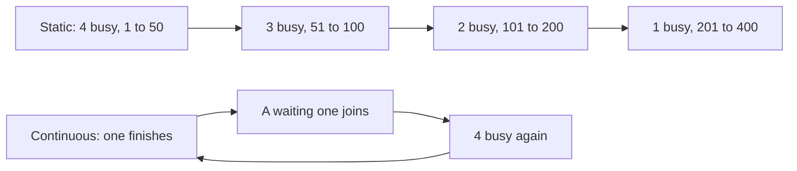

## Most of the memory was empty

Nour's team at Wadi Labs (a fictional remote software team of 12) did the sums from 11.4. The 80 GB GPU leaves 55.94 GB for the KV cache, which at 131,072 bytes a token is room for 13 chats of 32,768 tokens. Then Nour looked at the real chats. A few were long, and most were far shorter.

The server still said it was full at 13 chats, because the first engine set aside the full 32,768 tokens for every chat when it opened. Most of that room sat empty. Two more losses hid nearby: short requests waited behind long ones, and every chat computed the same long system prompt again.

This chapter gives one fix for each loss: <GlossaryTerm term="continuous batching" definition="Running many requests together, and deciding after every step which leave and which join, instead of waiting for a whole group to finish." /> for the waiting, paged memory for the empty reservations, and prefix caching for the repeated work. By the end you can say what each saves, what it costs, and which symptom points to which fix.

## Waiting for the slowest request

The simplest way to batch is to collect a few requests, start them together and return only when all are done. This is static batching. Picture a batch with four slots. Its requests need 50, 100, 200 and 400 output tokens, and the batch runs until the slowest one ends. Before you read the sum, predict how much of the paid-for slot time does useful work.

```predict
prompt: "A static batch has 4 slots, one per request. The requests need 50, 100, 200 and 400 output tokens, and the batch runs until the longest one ends. What share of the slot-steps does useful work?"
options:
  - id: busy
    label: "Nearly all, since the four requests run side by side"
  - id: idle
    label: "About half, since slots idle once a request ends"
correctOptionId: idle
explanation: "The batch runs 400 steps, so 4 × 400 = 1,600 slot-steps are paid for. Useful work is 50 + 100 + 200 + 400 = 750. That is 750 ÷ 1,600, about 47%."
```

That idle time is the cost of static batching, and a request that arrives just after the start waits up to 400 steps. Continuous batching schedules every step, not every request. After each step the scheduler asks two questions. Did anyone finish? Then free their memory. Did anyone arrive? Then add them to the next step. The paper that introduced the idea called it iteration-level scheduling. The diagram compares the two.



The top row is the static batch, with the step ranges: busy slots fall as requests end. The bottom loop is continuous batching: a waiting request takes each freed slot, so all four stay busy. The paper reported 36.9 times the throughput of a request-level baseline in 2022. Read that as history, not as a promise.

A new problem appears when a request arrives with a 10,000-token prompt. Its prefill (11.2) is one large job, and if it runs in a single step, the 50 chats that are mid-answer freeze. <GlossaryTerm term="Chunked prefill" definition="Splitting a long prompt into pieces and processing one piece per step, next to the running decodes." /> fixes this. The engine sets a <GlossaryTerm term="token budget" definition="The most tokens the engine processes in one step, counting decode tokens and prompt tokens." />, puts every running decode into the step first, and fills the rest of the budget with prompt tokens.

Take a budget of 2,048 tokens. Fifty chats are decoding, so 1,998 are left for the new prompt in each step. Since 10,000 ÷ 1,998 is just over 5, the prompt needs 6 steps, and the 50 chats keep getting a token in all 6. The cost lands on the new request: its TTFT now includes 6 steps. The vLLM v0.32.0 docs describe the same trade-off: a smaller budget gives a steadier stream, and a larger one a faster first token.

## Empty reservations and PagedAttention

<BigWordAlert term="PagedAttention" plainEnglish="A way to store the KV cache in small fixed-size blocks that do not have to sit next to each other. A block is handed out only when a chat's tokens need it." whyItMatters="It stops the server from reserving memory that no token will ever use, so more chats fit at once. It is just as important to know what it does not fix." />

The older way to store a chat's cache is one contiguous slab, sized for the longest chat allowed. Nobody knows how long a chat will be, so the engine reserves the maximum. In the vLLM paper's chart for older servers, only 20.4% to 38.2% of KV memory held real token states, so 61.8% to 79.6% was wasted. vLLM used 96.3%, so 3.7% was wasted. The project's announcement rounds this to "60 to 80% waste". These are the paper's test traces, not your traffic.

PagedAttention stores the cache in fixed-size blocks instead. In vLLM v0.32.0 a block holds 16 tokens. A <GlossaryTerm term="block table" definition="A list kept for each chat that says which blocks of GPU memory hold its tokens, in order." /> maps each chat to its blocks, which need not be neighbours. A new block is handed out only when the last one fills, so the only waste left is the unused part of the last block.

Follow one chat of 40 tokens. The blocks are numbered by where they sit in memory.

```text
Block table of chat A (40 tokens)
  tokens 1 to 16   -> block 7
  tokens 17 to 32  -> block 2
  tokens 33 to 40  -> block 9
Block 9 holds 8 tokens, 8 are empty.
Token 41 fills block 9. Token 49
needs a new block: any free one,
say block 4.
```

The blocks are not neighbours, and only the last one has empty room, at most 15 tokens. A slab sized for 32,768 tokens would leave 32,728 empty for this chat. In the running example one block is 16 × 131,072 = 2,097,152 bytes, about 2 MiB. The average Wadi Labs chat held 6,000 tokens, so reserving 32,768 left 26,768 tokens empty, which is 3.51 GB for one chat.

Paging has a price: the block table, and an attention step that reads blocks that are not neighbours. It also does not create memory. If the real tokens exceed the pool, the server must still queue new chats or preempt running ones, which means stopping a chat and freeing its cache (11.8).

## See the empty room

Make your prediction before you open the canvas: how much memory do 20 requests use if each reserves 32,768 tokens but averages 6,000?

<InteractiveCanvas slug="paged-kv-allocation" />

**What this shows.** The memory 20 requests need under contiguous reservation and under 16-token blocks, and the share wasted in each. At the defaults, contiguous reservation holds 85.90 GB and paged blocks 15.73 GB, exactly what the tokens use.

**Try this.** Lower the reserved context from 32,768 to 8,192 tokens. Contiguous falls from 85.90 GB to 21.47 GB, while paged stays at 15.73 GB, so the gap shrinks. Set the average tokens used to 100. Paged shrinks to 0.29 GB and contiguous stays at 85.90 GB, and paged now wastes 10.7% because 100 tokens fill 7 blocks of 16 (112 tokens).

**What changed.** The reserved context moves only the contiguous figure. The average length moves only the paged figure, because blocks follow the tokens in use.

**Limits of the model.** Every request has the same average length, and prefix sharing is not modelled. The paper's 61.8% to 79.6% also counts fragmentation.

```quiz
type: mcq
question: "Sara's server reserves 4,096 tokens per chat, and 40 chats are open, but they average 1,000 tokens each. A token takes 131,072 bytes. About how much KV memory does switching to 16-token blocks free?"
options:
  - "About 0.4 GB, since one chat frees 3,088 tokens of room"
  - "About 32 GB, as 43 GB reserved turns into 10.6 GB"
  - "Nothing, since paging does not change the bytes per token"
  - "About 16 GB, as 21.5 GB reserved turns into 5.3 GB"
correct: 3
explanations:
  - "This counts one chat, not 40. One chat frees 4,096 - 1,008 = 3,088 tokens, which is 3,088 × 131,072 = 0.40 GB. The other 39 chats free the same amount each."
  - "This counts keys and values twice. The 131,072 bytes per token already include both, so 43 GB and 10.6 GB are double the real 21.5 GB and 5.3 GB."
  - "Paging does not change the bytes per token. It changes how many tokens are set aside. The empty reservation is what goes away."
  - "Right. Reserved: 40 × 4,096 × 131,072 = 21.5 GB. Paged: 1,000 tokens need 63 blocks of 16, which is 1,008 tokens, so 40 × 1,008 × 131,072 = 5.3 GB. The difference is about 16 GB."
```

## Repeated work and prefix caching

Wadi Labs' assistant starts every prompt with the same 1,536-token system prompt: rules, tone and a list of tools. Every request computes the same keys and values for it, and 20 chats store 20 copies of the same cache.

<GlossaryTerm term="Prefix caching" definition="Keeping the KV blocks of a prompt prefix after a request ends, and reusing them when a new request starts with exactly the same tokens." /> keeps those blocks and reuses them, so a new request skips the prefill for the shared part. In vLLM v0.32.0 it is on by default, and each block is identified by a <GlossaryTerm term="hash" definition="A short fingerprint computed from some data. Different data gives a different fingerprint." /> of its own tokens plus everything before it. SGLang v0.5.22, the other open-source engine, does the same with RadixAttention, a tree keyed by token sequences.

The saving is easy to size. 1,536 × 131,072 = 201,326,592 bytes, about 0.20 GB per copy. Twenty copies take 4.03 GB, so sharing one saves 19 copies, 3.83 GB, and skips the prefill of 19 × 1,536 = 29,184 tokens.

How often does it hit? One research paper reported hit rates of 52.4% and 74.1% in a public chat service after a month, so measure your own. A hit needs an exact match that starts at the first token. Two prompts that are identical for 1,536 tokens but differ at token 1 share nothing. In a shared service one <GlossaryTerm term="tenant" definition="One customer or team that shares a server with others." /> must not reach another's cached prompt, so vLLM supports cache salts that keep caches apart.

```quiz
type: mcq
question: "Yesterday's prompts at Wadi Labs began with 1,024 rule tokens, then a date line of 16 tokens, then 512 more rule tokens, then the user's question. Today only the date differs. Prefix caching is on and a block holds 16 tokens. How many of the 96 rule blocks can today's first request reuse?"
options:
  - "64 blocks, the ones before the date line"
  - "96 blocks, since the rule text did not change"
  - "32 blocks, the ones after the date line"
  - "0 blocks, since the whole prompt is not identical"
correct: 0
explanations:
  - "Right. The 64 blocks before the date line match yesterday's. The date block differs, and every block after it is identified by text that includes the date, so those 32 blocks differ too."
  - "The rule text after the date is the same, but a block matches only when everything before it matches too. The new date breaks the chain, so those 32 blocks are computed again."
  - "These are the blocks that cannot hit. They come after the changed date, so their identity differs from yesterday's even though their own tokens are the same."
  - "The prompt starts with 1,024 identical tokens, so those 64 blocks do match. Prefix caching reuses the shared start and recomputes only from the first difference."
```

So put the fixed text first and the changing text last, and never inside the rules.

## Splitting the phases

Prefill is compute-heavy and decode is memory-heavy (11.2), and on one GPU they interfere. Disaggregated serving puts them on different GPUs. Prefill GPUs process the prompt and send the KV cache to decode GPUs, so each side can be tuned on its own.

It does not improve raw throughput. The research systems behind the idea measured <GlossaryTerm term="goodput" definition="The highest request rate that still meets latency targets for a set share of requests, for example 90%." />. One served 7.4 times more requests, or met 12.6 times tighter targets, under that rule. The vLLM v0.32.0 docs mark the feature experimental and say it does not improve throughput. Its benefits are tuning TTFT and the gaps between tokens separately, and keeping the slowest gaps short. The cost is moving the KV cache between GPUs.

## Failure modes and debugging

- **Hit rate near zero:** the changing text comes first in the prompt. Move it to the end.
- **Chats freeze when a long prompt arrives:** chunked prefill is off, or the token budget is very large. Lower it and watch TPOT.
- **Out of memory with short chats:** the engine reserves too much per chat. Check how the cache is allocated before you buy a bigger GPU.
- **Disaggregation added cost and no gain:** the targets were already met. Measure goodput before and after, not tokens per second.

## In the interview

A good answer on these techniques gives the problem each one fixes, a number, and its cost. Answer aloud first, then open each question.

<FaqGroup title="Practice questions">
<FaqItem question="What does paging do for the KV cache, and what does it not do?">

Paging stores each chat's cache in fixed 16-token blocks, handed out as tokens arrive, instead of one slab sized for the longest chat. In the vLLM paper, older servers used only 20.4% to 38.2% of KV memory for real tokens, and vLLM used 96.3%. In my example, 20 chats that average 6,000 tokens need 15.73 GB paged against 85.9 GB reserved. Paging does not create memory, though, so I would still set admission limits.

**Follow-up probes:**

- How big is one block for a model that takes 131,072 bytes per token?
- Why might a larger block size hurt short chats?

</FaqItem>
<FaqItem question="Explain continuous batching, and say what chunked prefill adds.">

Static batching waits for the slowest request. With outputs of 50, 100, 200 and 400 tokens, only 750 of 1,600 slot-steps, 47%, do useful work. Continuous batching schedules every step, so finished requests leave and waiting ones join. Chunked prefill then keeps a long prompt from stalling the running chats: with a budget of 2,048 and 50 decodes, a 10,000-token prompt takes 6 steps while the 50 chats keep streaming. The price is a later first token for the new request.

**Follow-up probes:**

- What happens to TPOT if you raise the budget to 16,384?
- How would you choose the budget for a chat product?

</FaqItem>
<FaqItem question="A teammate wants to split prefill and decode onto separate GPUs to double throughput. What do you say?">

It targets goodput under latency targets, not raw throughput. The vLLM v0.32.0 docs call the feature experimental and say it does not improve throughput. Research systems reported 7.4 times more requests within the targets, but that is a goodput figure on specific workloads, and the KV cache must move between GPUs. I would try chunked prefill and a smaller token budget first, and measure goodput before and after.

**Follow-up probes:**

- How do you define goodput?
- What would you measure to show that prefill and decode were interfering?

</FaqItem>
</FaqGroup>

**Next:** Quantization, speculative decoding and FlashAttention: three ways to make the same model smaller or faster, and what each one changes.
