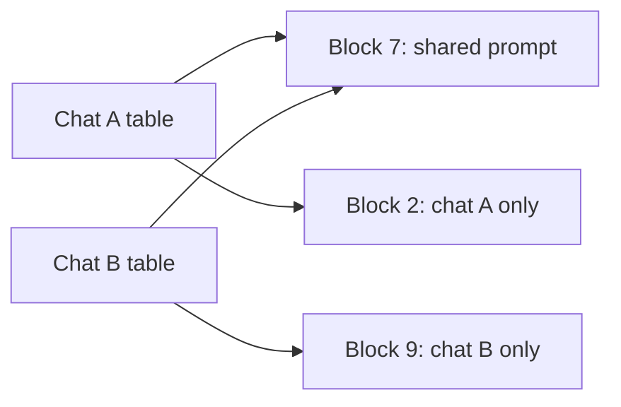

## Most of the memory was empty

Nour's team at Wadi Labs (a fictional remote software team of 12) did the sums from 11.4. The 80 GB GPU holds 16.06 GB of weights. That leaves 55.94 GB for the KV cache, which at 131,072 bytes a token is room for 13 chats of 32,768 tokens. Then Nour looked at the real chats. The average one held only 6,000 tokens.

The server still said it was full at 13 chats. The first engine the team tried reserved the full 32,768 tokens for each chat at the start, and most of that room sat empty. Two more losses hid nearby. Short requests waited behind long ones, and every chat computed the same long system prompt again from scratch.

This chapter gives one fix for each loss. <GlossaryTerm term="Continuous batching" definition="A way of running many requests together in which the server decides after every step which requests leave and which join, instead of waiting for a whole group to finish." /> fixes the waiting. Paged memory fixes the empty reservations. Prefix caching fixes the repeated work. By the end you can say what each one saves, what it costs, and which symptom points to which fix.

## Waiting for the slowest request

The simplest way to batch is to collect a few requests, start them together and return only when all of them are done. This is static batching. Suppose four requests need 50, 100, 200 and 400 output tokens. The batch runs 400 steps, because the slowest request sets the pace. The 50-token request finished long ago, but its slot sits idle. Of 1,600 token slots paid for (4 × 400), only 750 do useful work (50 + 100 + 200 + 400). That is 47%. A request that arrives just after the start waits up to 400 steps.

Continuous batching changes the unit of scheduling from the request to the step. After every step the scheduler asks two questions. Did anyone finish? Then remove them and free their memory. Did anyone arrive? Then add them to the next step. The research paper that introduced the idea called it iteration-level scheduling. It reported 36.9 times the throughput of a request-level baseline at the same latency, on one very large model in 2022. Read that as history, not as a promise. The direction still holds: short requests leave early, and waiting requests join at once.

A new problem appears. A request arrives with a 10,000-token prompt. Its prefill (11.2) is one large job. If it runs in a single step, the 50 chats that are mid-answer all wait for it, and their text freezes. <GlossaryTerm term="Chunked prefill" definition="Splitting a long prompt into pieces and processing one piece per step, next to the running decodes, so the decodes keep moving." /> splits the large job. The engine sets a <GlossaryTerm term="token budget" definition="The most tokens the engine will process in one step, counting both the decode tokens of running chats and the prompt tokens of new ones." />. The scheduler puts every running decode into the step first, one token each. It then fills the rest of the budget with prompt tokens, and a prompt that does not fit is cut into chunks.

Take a budget of 2,048 tokens. Fifty chats are decoding, so they use 50 of it. That leaves 1,998 for the new prompt in each step. Since 10,000 ÷ 1,998 is just over 5, the prompt needs 6 steps, and the 50 chats keep getting a token in all 6. The cost lands on the new request: its first token waits for 6 steps instead of one. The vLLM docs describe the same trade-off. A smaller budget gives steadier time between tokens, and a larger one gives a faster first token. In vLLM v0.32.0 chunked prefill is on by default, and the default budget runs from 2,048 to 16,384 tokens, set by the GPU and by how you run the engine.

## Empty reservations and PagedAttention

<BigWordAlert term="PagedAttention" plainEnglish="A way to store the KV cache in small fixed-size blocks that do not have to sit next to each other. A block is handed out only when a chat's tokens need it." whyItMatters="It stops the server from reserving memory that no token will ever use, so more chats fit at once. Interviewers ask what it fixes and, just as often, what it does not fix." />

The older way to store a chat's cache is one contiguous slab, sized for the longest chat allowed. Nobody knows how long a chat will be, so the engine reserves the maximum. The vLLM paper measured what this wastes. In its chart for older servers, only 20.4% to 38.2% of KV memory held real token states, so 61.8% to 79.6% was wasted. In the same chart vLLM used 96.3%, so 3.7% was wasted. You will often see "60 to 80% waste". That wording comes from the project's announcement, which rounds the bars. Both come from the paper's own test traces, not from your traffic.

PagedAttention stores the cache in small fixed-size blocks instead. In vLLM v0.32.0 a block holds 16 tokens. For each chat, a <GlossaryTerm term="block table" definition="A short list kept for each chat that says which physical blocks of GPU memory hold its tokens, in order. The blocks can be anywhere." /> lists which blocks hold its tokens. The blocks need not be neighbours. A new block is handed out only when the last one fills. So the only waste left is the unused part of each chat's last block.

In the running example, one block is 16 × 131,072 = 2,097,152 bytes, which is 2 MiB across all layers. A chat wastes at most 15 tokens, about 1.9 MiB. Compare that with the average Wadi Labs chat, which left 32,768 - 6,000 = 26,768 tokens empty. That is 26,768 × 131,072 = 3.51 GB for one chat. Block size is a choice. SGLang v0.5.22 defaults to a page size of 1 token, and vLLM uses 16. The paper found that larger blocks hurt on short sequences, because more of the last block goes unused.

The diagram shows two chats and their block tables.



Memory is handed out in 16-token pieces wherever they are free. Each chat reads its blocks through its own table, and two chats can point at one block when their tokens are identical, as block 7 shows. The price is the table, and an attention kernel that reads blocks that are not neighbours. Paging also does not create memory. If the real tokens exceed the pool, the server must still queue or preempt, which chapter 11.8 covers.

## See the empty room

Before you move the controls, make a prediction about the default case.

```predict
prompt: "Each of 20 chats has 32,768 tokens of room reserved when it starts, but the average chat holds 6,000 tokens. About what share of the reserved memory sits empty?"
options:
  - id: small
    label: "About 18%, a small loss"
  - id: most
    label: "About 82%, most of it"
correctOptionId: most
explanation: "1 - 6,000 ÷ 32,768 is about 0.82. Contiguous reservation sets aside the full room for every chat, so about 82% of the 85.9 GB holds nothing."
```

<InteractiveCanvas slug="paged-kv-allocation" />

**What this shows.** The memory that 20 requests need under two schemes: contiguous reservation of the full context, and 16-token blocks. It also shows the share wasted in each. You set the number of requests, the reserved context and the average tokens used. One token takes 131,072 bytes. At the defaults, contiguous reservation holds 85.90 GB and paged blocks hold 15.73 GB, which is exactly what the tokens use.

**Try this.** First, lower the reserved context from 32,768 to 8,192 tokens. Contiguous falls from 85.90 GB to 21.47 GB while paged stays at 15.73 GB, so the gap shrinks. Second, from the defaults, set the average tokens used to 100. Paged falls to 0.29 GB and wastes 10.7%, because 100 tokens fill 7 blocks of 16, which is 112 tokens. Contiguous stays at 85.90 GB.

**What changed.** Moving the reserved context changes only the contiguous figure, because it holds the full reservation whether or not the tokens ever arrive. Moving the average length changes the paged figure, because blocks follow the tokens in use.

**Limits of the model.** Every request has the same average length, and prefix sharing is not modelled. The paper's 61.8% to 79.6% for older servers also counts fragmentation between reservations, which this model leaves out. Treat the contiguous figure as an illustration.

```quiz
type: mcq
question: "Hamza's server reserves 4,096 tokens per chat, and 40 chats are open, but they average 1,000 tokens each. A token takes 131,072 bytes. About how much KV memory does switching to 16-token blocks free?"
options:
  - "About 5 GB, which is what the 40 chats really use"
  - "About 21 GB, because paged chats need almost no memory"
  - "Nothing, since paging does not change the bytes per token"
  - "About 16 GB, as 21.5 GB reserved turns into 5.3 GB in blocks"
correct: 3
explanations:
  - "5 GB is what the chats hold after the switch, not what is freed. The freed amount is the reservation minus that."
  - "Paged chats still hold their tokens. 40 chats of about 1,000 tokens need about 5.3 GB, so not all 21 GB is freed."
  - "Paging does not change the bytes per token. It changes how many tokens are set aside. The empty reservation is what goes away."
  - "Right. Reserved: 40 × 4,096 × 131,072 = 21.5 GB. Paged: 1,000 tokens need 63 blocks of 16, which is 1,008 tokens, so 40 × 1,008 × 131,072 = 5.3 GB. The difference is about 16 GB."
```

## Repeated work and prefix caching

Wadi Labs' assistant starts every prompt with the same 1,536-token system prompt: rules, tone and a list of tools. Every request computes the same keys and values for it. That wastes compute, and it stores 20 copies of the same cache for 20 chats.

<GlossaryTerm term="Prefix caching" definition="Keeping the KV blocks of a prompt prefix after a request ends, and reusing them when a new request starts with exactly the same tokens." /> keeps those blocks and reuses them. A new request that starts with the same tokens skips the prefill for the shared part. In vLLM each block is identified by a hash of its own tokens plus everything before it. Automatic prefix caching is on by default in v0.32.0. SGLang does the same with RadixAttention, a tree keyed by token sequences. It drops the least recently used leaves first, and it is on by default in v0.5.22.

The saving is easy to size. 1,536 × 131,072 = 201,326,592 bytes, about 0.20 GB for one copy. Twenty separate copies take 4.03 GB. One shared copy takes 0.20 GB, so 19 copies are saved, which is 3.83 GB. Prefill for 19 × 1,536 = 29,184 tokens is skipped as well.

How often does it hit? One research paper reported hit rates of 52.4% and 74.1% in a public chat service after a month. That is one service, so measure your own. Two rules decide your hits. The match must be exact, and it must start at the first token. Put the fixed text first and the changing text last. A date or a user name in the first line gives every request a different first block, and the hit rate falls toward zero.

Prefix caching has costs too. Cached blocks use memory until the engine evicts them. Only exact prefixes hit. And in a shared service one tenant's cached prompt should not be reachable by another, so vLLM supports cache salts that keep caches apart.

```quiz
type: mcq
question: "Wadi Labs' prompt begins with the line 'Current time: 14:03:22', then a 1,536-token system prompt that never changes. Prefix caching is on, yet the hit rate is near zero. What is the best fix?"
options:
  - "Raise the block size from 16 to 32 tokens so blocks hold more"
  - "Move the changing time line to the end, after the fixed prompt"
  - "Turn on chunked prefill so the long prompt is split into steps"
  - "Store the KV cache in FP8 so that more cached blocks fit"
correct: 1
explanations:
  - "The first block still contains the time, and each block's identity depends on everything before it, so every block would still differ."
  - "Right. With the fixed text first, the first 1,536 tokens are identical for every request, so those blocks match. The time line comes last and is the only part computed fresh."
  - "Chunked prefill spreads the work over steps. It does not change which blocks match."
  - "FP8 halves the bytes per token, but the blocks would still differ at the first token, so there would still be no hits."
```

## Splitting the phases

Prefill is compute-heavy and decode is memory-heavy (11.2). When both run on the same GPU they interfere, because a prefill slows the decodes next to it. Disaggregated serving puts the two phases on different GPUs. The prefill GPUs process the prompt and send the KV cache to decode GPUs, which carry on. Each side can be tuned on its own.

What does it improve? Not raw throughput. The research systems behind the idea measured <GlossaryTerm term="goodput" definition="The highest request rate a GPU can serve while a set share of requests, for example 90%, still meet their latency targets." />. One of them served 7.4 times more requests, or met 12.6 times tighter latency targets, under that rule. The vLLM v0.32.0 docs mark the feature experimental and say it does not improve throughput. Their listed benefits are tuning first-token time and time between tokens separately, and controlling the tail of time between tokens. The cost is moving the KV cache between GPUs.

Here is an invented example of the difference. A server finishes 10 requests a second, but only 70% meet both latency targets, which is below the 90% bar. At 6 requests a second, 92% meet them, so goodput is 6. If separating the phases lets the same GPUs reach 8 requests a second at 92%, goodput rises to 8. Tokens per second may hardly have moved. Try chunked prefill and a smaller token budget first. They are settings. Disaggregation adds a second pool of GPUs and a transfer path.

## Failure modes and debugging

- **Hit rate near zero:** the changing text comes first in the prompt. Move it to the end.
- **Chats freeze when a long prompt arrives:** chunked prefill is off, or the token budget is very large. Lower it and watch time between tokens.
- **Out of memory with short chats:** the engine reserves too much per chat. Check how the cache is allocated before you buy a bigger GPU.
- **Disaggregation added cost and no gain:** the targets were already met. Measure goodput before and after, not tokens per second.

## In the interview

These three techniques are the standard answer to "how does an engine serve more users on one GPU?" Interviewers want the problem each one fixes, a number, and its cost. Answer each question aloud first, then open it.

<FaqGroup title="Practice questions">
<FaqItem question="What does paging do for the KV cache, and what does it not do?">

Paging stores each chat's cache in fixed 16-token blocks, handed out as tokens arrive, instead of one slab sized for the longest chat. In the vLLM paper, older servers used only 20.4% to 38.2% of KV memory for real tokens, and vLLM used 96.3%. In my example, 20 chats that average 6,000 tokens need 15.73 GB paged, against 85.9 GB reserved. Paging does not create memory, though. If the real tokens exceed the pool, the server still has to queue or preempt, so I would still set admission limits.

**Follow-up probes:**

- How big is one block for a model that takes 131,072 bytes per token?
- Why might a larger block size hurt short chats?

</FaqItem>
<FaqItem question="Explain continuous batching, and say what chunked prefill adds.">

Static batching waits for the slowest request. With outputs of 50, 100, 200 and 400 tokens, only 750 of 1,600 token slots, 47%, do useful work. Continuous batching schedules every step, so finished requests leave and waiting ones join. The risk is a long prompt stalling running chats. Chunked prefill puts running decodes first and fills the rest of a token budget with prompt chunks. With a budget of 2,048 and 50 decodes, a 10,000-token prompt takes 6 steps while the 50 chats keep streaming. The trade-off is a later first token for the new request.

**Follow-up probes:**

- What happens to time between tokens if you raise the budget to 16,384?
- How would you choose the budget for a chat product?

</FaqItem>
<FaqItem question="A teammate wants to split prefill and decode onto separate GPUs to double throughput. What do you say?">

I would say it targets goodput under latency targets, not raw throughput. The vLLM v0.32.0 docs call the feature experimental and say it does not improve throughput. Their benefit is tuning first-token time and time between tokens separately. Research systems reported 7.4 times more requests within the targets, but that is a goodput figure on specific workloads. It also adds a KV cache transfer between GPUs. I would try chunked prefill and a smaller token budget first, and measure goodput before and after.

**Follow-up probes:**

- How do you define goodput?
- What would you measure to show that prefill and decode were interfering?

</FaqItem>
</FaqGroup>

**Next:** Quantization, speculative decoding and FlashAttention: three ways to make the same model smaller or faster, and what each one changes.
