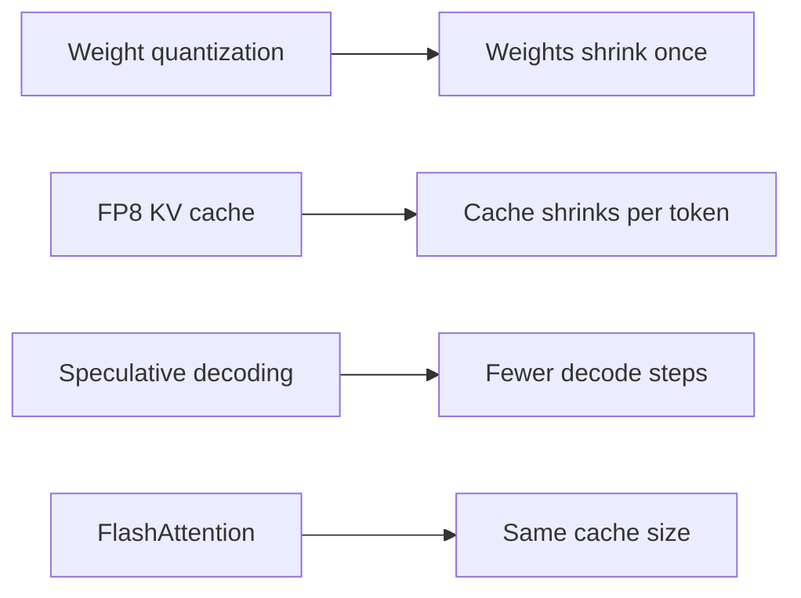

## Three ideas, and one of them is wrong

Karim, on Nour's team at Wadi Labs (a fictional remote software company of about 40 people), wants more long chats on the GPU and faster answers. Three ideas reach the team channel in one hour. Huda says 4-bit weights. Omar says an FP8 KV cache. Reem says "turn on FlashAttention and the cache gets smaller". All three are real techniques. One person is wrong about what the technique does.

This chapter shows what each technique changes (bytes, steps, or neither) and what it risks. By the end you can pick a technique for a goal and defend the choice with arithmetic.

## Quantization: fewer bits per number

<BigWordAlert term="Quantization" plainEnglish="Storing the numbers of a model with fewer bits, for example 8 or 4 bits instead of 16. The numbers become less exact, and they take less memory." whyItMatters="It is the quickest way to cut memory, but it can quietly hurt answer quality. A good answer says which numbers you shrink, how much you save, and how you check quality." />

Three groups of numbers can be shrunk, and they save different things. The **weights** are the fixed 16.06 GB. The **activations** are the temporary numbers inside a step. The **KV cache** is the cost per token. Smaller weights help once. A smaller KV cache helps every token of every chat.

The arithmetic for weights is short. The model has 8,030,261,248 weights. At 16 bits, which is 2 bytes each, they take 16.06 GB. At 8 bits they take 8.03 GB. At 4 bits they take about 4.02 GB, plus a small extra number for each group of weights. That extra number is a **scale**: it tells how big one step of the 4-bit values is. Smaller weights also make each decode step faster, because every step reads them (11.2).

Three methods have names. An outlier is a value far larger than the others, and the first method below handles those separately.

| Method | One idea |
|---|---|
| LLM.int8() | Keeps rare outlier values in 16 bits, runs the rest in 8. Paper: no loss up to 175 billion parameters. |
| GPTQ | Converts a trained model in one pass to 3 or 4 bits per weight. Its paper reports negligible accuracy loss. |
| AWQ | Finds the roughly 1% of weights that matter most, using the activations, and protects them by scaling. |

FP8 stores each number in 8 bits, in a floating-point format that keeps both small and large values. The vLLM v0.32.0 docs (vLLM is an open-source serving engine) say FP8 gives a 2 times smaller model and up to 1.6 times higher throughput with minimal accuracy impact. They give no test setup for the 1.6, so treat it as an upper claim. FP8 compute needs a recent GPU, and older ones run it as weight-only.

The same docs suggest 4-bit weights for servers with few queries per second. They also ask for <GlossaryTerm term="calibration data" definition="A few hundred sample inputs run through the model once, so the quantization method can pick good scales." />, and suggest 512 samples.

The KV cache can be shrunk too. An FP8 KV cache stores 1 byte per value instead of 2, so a token falls from 128 KiB to 64 KiB (11.3), before the small cost of storing scales. The vLLM v0.32.0 docs say only that it can reduce memory significantly. The halving is our arithmetic. Without calibration the scales default to 1.0, and the docs recommend calibrating with a dataset.

The SGLang v0.5.22 docs (SGLang is a second open-source engine) warn that a quantized cache can be extremely slow if dequantization is not done inside the same GPU step as the attention work. Dequantization turns the 8-bit values back into larger numbers to compute with. As a separate step, it cancels the gain.

## Which lever is bigger?

Do not guess. Count chats. The room for the cache is the GPU memory times 0.9, minus the weights. On the 80 GB GPU that is 72 GB minus the weights, and one 32,768-token chat takes 4.29 GB at 16-bit and 2.15 GB at FP8.

| Change | Room for KV | 32,768-token chats |
|---|---|---|
| 16-bit weights and KV | 55.94 GB | 13 |
| FP8 KV cache only | 55.94 GB | 26 |
| 8-bit weights only | 63.97 GB | 14 |
| 8-bit weights and FP8 KV | 63.97 GB | 29 |
| 4-bit weights only | 67.98 GB | 15 |

On this GPU the weights are a small part of the memory, so shrinking them adds one or two chats. Shrinking the KV cache doubles the chats. The best lever shrinks the larger cost.

```quiz
type: mcq
question: "Karim's second machine has a 24 GB GPU. With the same 10% reserve and 16-bit weights and KV, one 32,768-token chat fits. Which single change fits the most such chats?"
options:
  - "FP8 KV cache, which halves each chat from 4.29 GB to 2.15 GB"
  - "8-bit weights, which free 8.03 GB of the 16.06 GB"
  - "4-bit weights, which free about 12.05 GB of the 16.06 GB"
  - "FlashAttention, which avoids the large attention matrix"
correct: 2
explanations:
  - "The room is 21.6 - 16.06 = 5.54 GB. At 2.15 GB a chat, that holds 2 chats, fewer than 4-bit weights give."
  - "The room becomes 21.6 - 8.03 = 13.57 GB, which is 3 chats. Better than FP8 KV here, but not the best."
  - "Right. The room becomes 21.6 - 4.02 = 17.58 GB, which is 4 chats at 4.29 GB. On a small GPU the weights are the big cost, so cutting them wins."
  - "FlashAttention does not change what the cache stores, so the room stays at 5.54 GB and only 1 chat fits."
```

## Quality: what the sources warn about

<Callout type="warning" title="A benchmark score is not a test of your task">
Smaller numbers are less exact, so quality can fall. GPTQ reports reasonable accuracy at 2 bits only in extreme settings, so 3 and 4 bits are the normal range. A report from a large-model provider says that FP8 without a cap on its scale factors occasionally produced corrupted responses even though benchmark scores stayed strong. Run your own questions, including your known hard cases, before and after quantizing, and look at the worst answers, not only the average. The vLLM v0.32.0 docs also tell you to measure accuracy yourself.
</Callout>

## Speculative decoding: save steps, not bytes

Decode makes one token per step, and each step reads all the weights (11.2). That is slow when the GPU has spare compute. <GlossaryTerm term="Speculative decoding" definition="A way to speed up decode. A small model guesses several tokens ahead, and the large model checks all the guesses in one step, keeping the correct ones." /> uses that spare compute. A small <GlossaryTerm term="draft model" definition="The small, fast model that guesses the next few tokens. It only needs to be right often." /> proposes g tokens. The large target model scores all g + 1 positions in one pass, keeps the longest correct prefix and adds one token of its own. The paper proves that the text is statistically the same as the target alone would produce, so answer quality does not change.

The loop repeats until the answer ends. Two numbers decide the gain. The <GlossaryTerm term="acceptance rate" definition="The chance a drafted token is kept by the target model, written a. A token only counts if every token before it was kept." /> a is how often the target agrees with a guess. The cost c is the time of one draft token as a share of one target step. The paper found c below 0.05 in its experiments.

Expected tokens per target step is (1 - a^(g+1)) ÷ (1 - a). The walltime factor, the speed-up on the clock, divides that by (g × c + 1). With a = 0.8, g = 4 and c = 0.05, the tokens are (1 - 0.8^5) ÷ 0.2 = 3.36. The cost term is 4 × 0.05 + 1 = 1.2. So the factor is 3.36 ÷ 1.2 = 2.80. The paper shows that some g gives a gain whenever a is greater than c.

The method also uses extra arithmetic. In the paper's example, a = 0.8 and g = 5 with a free draft gives 3.69 times the speed for 1.63 times the operations. The vLLM v0.32.0 docs aim the feature at medium-to-low traffic where decode is memory-bound. That fits the theory, which assumes spare compute. We expect a server near its compute limit to gain less, but we did not check a measured case.

```predict
prompt: "At a = 0.80 and c = 0.05 the factor is 2.80 with 4 draft tokens. You raise the draft tokens g from 4 to 10. What happens to the factor?"
options:
  - id: little
    label: "It rises only a little, since each extra draft is less often kept"
  - id: lot
    label: "It rises a lot, because each step now yields many more tokens"
correctOptionId: little
explanation: "The factor goes from 2.80 to 3.05, about 9% more. Tokens per step rise from 3.36 to 4.57, but the drafting cost rises from 1.2 to 1.5 target steps, and each extra draft token is less likely to be kept because it needs every token before it to be kept."
```

<InteractiveCanvas slug="speculative-decoding-gain" />

**What this shows.** The expected tokens per target step and the walltime factor against plain decoding. At the defaults, a = 0.80, g = 4 and c = 0.05, the target yields 3.36 tokens per step and the factor is 2.80.

**Try this.** Lower the acceptance rate from 0.80 to 0.50. Tokens per step fall from 3.36 to 1.94 and the factor from 2.80 to 1.61, so the same draft pays back much less. Keep acceptance at 0.50 and 4 draft tokens, and raise the draft cost from 0.05 to 0.40. Tokens per step stay at 1.94 but the factor drops to 0.75 and the verdict turns to Slower, because each round now takes 2.60 target steps of time and yields only 1.94 tokens.

**What changed.** Acceptance changes how many tokens each draft is worth. Draft cost changes only the time spent drafting. Push both, to acceptance 0.50 and draft cost 0.40 as in the second experiment, and the verdict turns to Slower: the factor is 0.75, below 1.00. Plain decoding makes one token per target step, and this draft makes 1.94 tokens in 2.60 steps of time.

**Limits of the model.** This is the paper's idealised model: each token is accepted independently with the same probability, and the costs are fixed. Real gains depend on how busy the server is and how well the draft matches the target.

```quiz
type: mcq
question: "Two draft models serve the same target, and both draft 4 tokens per step. Draft X is accepted 70% of the time and costs 0.05 of a target step per token. Draft Y is accepted 90% of the time and costs 0.25. Which gives the larger speed-up?"
options:
  - "Draft Y, because it keeps 4.10 tokens per step against 2.77"
  - "Draft X, 2.31 times against 2.05, because Y's drafting costs more"
  - "They tie, because both drafts leave the target's output unchanged"
  - "Draft Y, 3.28 times against 2.64, because drafting is paid once per step"
correct: 1
explanations:
  - "Draft Y does keep more tokens per step, but the count ignores the time spent drafting. Y's cost term is 4 × 0.25 + 1 = 2.0, which cuts 4.10 to 2.05."
  - "Right. X: (1 - 0.7^5) ÷ 0.3 = 2.77 tokens, and the cost term is 4 × 0.05 + 1 = 1.2, so 2.31. Y: (1 - 0.9^5) ÷ 0.1 = 4.10 tokens, and the cost term is 2.0, so 2.05. The cheaper draft wins."
  - "The output text is the same in both cases, but the time is not. Identical output says nothing about speed."
  - "The draft costs c for each drafted token, so a step pays g × c, not c. Y pays 4 × 0.25 = 1.0 per step, not 0.25, and that gives 2.05, not 3.28."
```

## FlashAttention: how attention reads memory

Attention compares every token with every earlier token. Done naively, it builds a large grid of scores, writes it to the GPU's main memory and reads it back. That is slow, because main memory is slow compared with the small fast memory on the chip. FlashAttention computes the same exact result in small tiles that stay in the fast memory, so the large grid is never written out. It is not an approximation. Its paper counts up to 9 times fewer main-memory accesses in one figure.

Now the point of the section, and it is our own reasoning, not a sentence from the paper. The paper is about the large score grid, not about what a model stores per token. The KV cache size formula from 11.3 has no term that FlashAttention touches. What does change the cache is fewer KV heads (GQA or MQA), a shorter context, fewer bytes per value, and paging. The vLLM v0.32.0 README lists FlashAttention as an attention kernel (a small GPU program that does the attention work), separate from paged KV management. So Reem's idea speeds up attention but does not shrink the cache.

## Choosing for a goal

The diagram sorts the four techniques by what they change. Three change bytes or steps. One changes how memory is read.



Weights shrink once, however many chats there are. The cache shrinks for every token of every chat, so it is the bigger lever when many long chats are open. Speculation shrinks nothing, and FlashAttention leaves the cache the same size.

| Goal | Reach for | Watch for |
|---|---|---|
| More long chats at once | FP8 KV cache | Quality, calibration, speed of dequantization |
| Fit a model or cut weight reads | 8-bit or 4-bit weights | Quality, GPU support |
| Faster streaming at low traffic | Speculative decoding | Spare compute, a good draft |
| Faster attention on long prompts | FlashAttention | It does not shrink the cache |

## Failure modes and debugging

- **Benchmarks pass, users complain:** the benchmark is not your task. Compare worst-case answers on your own questions.
- **KV quantization made it slower:** dequantization may run as a separate step outside the attention work. Check the engine docs for your format.
- **Speculation gave no gain:** acceptance is low, or the server is busy. Measure a, and compare it with c.
- **A format fails to load:** the GPU may not support it. Check the engine docs for your GPU.

## In the interview

Each of these topics has a number and a trap. The trap to avoid is crediting a technique with something it does not do. Answer each question aloud first, then open it.

<FaqGroup title="Practice questions">
<FaqItem question="Would you quantize the weights or the KV cache first?">

I would count chats. On an 80 GB GPU with the 8B model, the room for the cache is 55.94 GB, which holds 13 chats of 32,768 tokens. An FP8 KV cache doubles that to 26, while 8-bit weights add only one. On a 24 GB GPU the weights dominate, and 4-bit weights fit 4 chats against 2 for FP8 KV. Either way I would test quality on our own questions, not only a benchmark.

**Follow-up probes:**

- What could go wrong with an uncalibrated FP8 KV cache?
- Why can a benchmark hide damage from quantization?

</FaqItem>
<FaqItem question="Explain speculative decoding and when it helps.">

A small draft model guesses g tokens and the large model checks all of them in one pass, keeping the longest correct prefix. Expected tokens per step are (1 - a^(g+1)) ÷ (1 - a), and the speed-up divides that by (g × c + 1). With a = 0.8, g = 4 and c = 0.05 that is 3.36 tokens and 2.80 times. It helps when decode is memory-bound and compute is spare, so mostly at low or medium traffic. It fails when acceptance is low or the draft is expensive.

**Follow-up probes:**

- When is a draft model not worth running?
- Does speculative decoding change the output text?

</FaqItem>
<FaqItem question="Does FlashAttention reduce the KV cache?">

No. It changes how attention reads memory, not what the cache stores. It computes exact attention in tiles, so the large score grid never goes to main memory. The cache size is 2 × layers × KV heads × head size × bytes per value × tokens, and none of those terms change. That is my own reasoning from the formula, not a sentence in the paper, and I would say so. To shrink the cache I would use fewer KV heads, a shorter context, FP8 values or paging.

**Follow-up probes:**

- Which of those four options costs the least quality?
- Where would FlashAttention help a long-prompt workload?

</FaqItem>
</FaqGroup>

**Next:** Beyond one GPU, and choosing how to serve: what to do when the model does not fit on one GPU, and whether to run the engine yourself at all.
