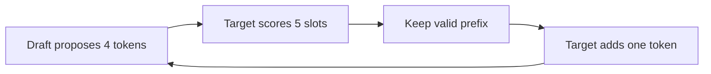

## Three ideas, and one of them is wrong

Karim, on Nour's team at Wadi Labs (a fictional remote software team), wants more long chats on the GPU and faster answers. Three ideas reach the team channel in one hour. Huda says 4-bit weights. Omar says an FP8 KV cache. Reem says "turn on FlashAttention and the cache gets smaller". All three are real techniques. One person is wrong about what the technique does.

This chapter shows what each technique changes: bytes, steps, or neither. It also shows what each one risks. By the end you can pick a technique for a goal and defend the choice with arithmetic.

## Quantization: fewer bits per number

<BigWordAlert term="Quantization" plainEnglish="Storing the numbers of a model with fewer bits, for example 8 or 4 bits instead of 16. The numbers become less exact, and they take less memory." whyItMatters="It is the quickest way to cut memory, but it can quietly hurt answer quality. Interviewers want to hear which numbers you shrink, how much you save, and how you check quality." />

Three groups of numbers can be shrunk, and they save different things. The **weights** are the fixed 16.06 GB. The **activations** are the temporary numbers inside a step. The **KV cache** is the cost per token. Smaller weights help once. A smaller KV cache helps every token of every chat.

The arithmetic for weights is short. The model has 8,030,261,248 weights. At 16 bits, which is 2 bytes each, they take 16.06 GB. At 8 bits they take 8.03 GB. At 4 bits they take about 4.02 GB, before the small extra numbers that store each group's scale. Smaller weights also speed up decode, because every step reads them (11.2). At about 2 TB/s, reading 16.06 GB takes at least 8 ms, and reading 8.03 GB takes at least 4 ms. These are ceilings from arithmetic, not measured speeds.

The methods have names, and you need one idea for each. LLM.int8() keeps a few <GlossaryTerm term="outlier" definition="A value far larger than the others. A few outliers can wreck an 8-bit scale, so the method keeps them in 16 bits." /> values in 16 bits and runs the rest in 8 bits. Its paper reports no loss in quality up to 175 billion parameters. GPTQ quantizes a trained model in one pass to 3 or 4 bits per weight. Its paper reports about four GPU hours for a 175-billion-parameter model, with negligible accuracy loss. AWQ protects the roughly 1% of weights that matter most, found by looking at the activations, and scales them before cutting the rest.

FP8 uses 8-bit floating-point numbers. The vLLM docs say it gives a 2 times smaller model and up to 1.6 times higher throughput with minimal accuracy impact. They give no test setup for the 1.6, so treat it as an upper claim. FP8 compute also needs a recent GPU, and older ones run it as weight-only. The docs suggest 4-bit weights for servers with few queries per second, where decode waits on memory, and they ask for <GlossaryTerm term="calibration data" definition="A few hundred sample inputs run through the model once, so the quantization method can pick good scales. The vLLM docs suggest 512 samples for 4-bit weights." />.

The KV cache can be shrunk too. An FP8 KV cache stores 1 byte per value instead of 2, so a token falls from 128 KiB to 64 KiB (11.3), before the small cost of storing scales. The engine docs say only that it can reduce memory significantly. The halving is our arithmetic. Without calibration the scales default to 1.0, and the docs recommend calibrating with a dataset. You can also keep sensitive layers at full precision. SGLang's docs warn that the cache can be extremely slow if dequantization is not fused into the attention kernel, which cancels the gain.

## Which lever is bigger?

Do not guess. Count chats. The room for the cache is the GPU memory times 0.9, minus the weights. The chats that fit are the room divided by the bytes per chat. For the 80 GB GPU the room is 72 GB minus the weights, and one 32,768-token chat takes 4.29 GB at 16-bit and 2.15 GB at FP8.

| Change | Room for KV | 32,768-token chats |
|---|---|---|
| 16-bit weights and KV | 55.94 GB | 13 |
| FP8 KV cache only | 55.94 GB | 26 |
| 8-bit weights only | 63.97 GB | 14 |
| 8-bit weights and FP8 KV | 63.97 GB | 29 |
| 4-bit weights only | 67.98 GB | 15 |

On this GPU the weights are a small part of the memory, so shrinking them adds one or two chats. Shrinking the KV cache doubles the chats. The best lever is whichever shrinks the larger cost for your numbers.

```quiz
type: mcq
question: "Karim's second machine has a 24 GB GPU. With the same 10% reserve and 16-bit weights and KV, one 32,768-token chat fits. Which single change fits the most such chats?"
options:
  - "FP8 KV cache, which halves each chat from 4.29 GB to 2.15 GB"
  - "8-bit weights, which free 8.03 GB of the 16.06 GB"
  - "4-bit weights, which free about 12.05 GB of the 16.06 GB"
  - "FlashAttention, which avoids the large attention matrix"
correct: 2
explanations:
  - "The room is 21.6 - 16.06 = 5.54 GB. At 2.15 GB a chat that is 2 chats, fewer than 4-bit weights give."
  - "The room becomes 21.6 - 8.03 = 13.57 GB, which is 3 chats. Better than FP8 KV here, but not the best."
  - "Right. The room becomes 21.6 - 4.02 = 17.58 GB, which is 4 chats at 4.29 GB. On a small GPU the weights are the big cost, so cutting them wins."
  - "FlashAttention does not change what the cache stores, so the room stays at 5.54 GB and only 1 chat fits."
```

## Quality: what the sources warn about

Smaller numbers are less exact, so quality can fall. The sources say this plainly. GPTQ reports reasonable accuracy at 2 bits only in extreme settings, which is why 3 and 4 bits are the normal range. A large-model report from a model provider warns that FP8 without a cap on its scale factors occasionally produced corrupted responses even though benchmark scores stayed strong. Its authors compared the score distributions of 100,000 responses, not one average score.

<Callout type="warning" title="A benchmark score is not a test of your task">
Run your own questions, including your known hard cases, before and after quantizing. Look at the worst answers, not only the average. The vLLM docs also tell you to measure accuracy yourself.
</Callout>

## Speculative decoding: save steps, not bytes

Decode makes one token per step, and each step reads all the weights (11.2). That is slow when the GPU has spare compute. <GlossaryTerm term="Speculative decoding" definition="A way to speed up decode. A small, fast model guesses several tokens ahead, and the large model checks all the guesses in a single step, keeping the correct ones." /> uses that spare compute. A small <GlossaryTerm term="draft model" definition="The small, fast model that guesses the next few tokens. It does not need to be right, only right often." /> proposes g tokens. The large target model scores all g + 1 positions in one pass. It keeps the longest correct prefix and adds one token of its own. The paper proves the output has the same distribution as the target alone.



The loop repeats until the answer ends. Two numbers decide the gain. The <GlossaryTerm term="acceptance rate" definition="The chance a drafted token is kept by the target model. Written a. A token only counts if every token before it was kept." /> a is how often the target agrees with a guess. The cost c is the time of one draft token as a share of one target step. The paper found c below 0.05 in its experiments.

Expected tokens per target step is (1 - a^(g+1)) ÷ (1 - a). The walltime factor divides that by (g × c + 1). With a = 0.8, g = 4 and c = 0.05, the tokens are (1 - 0.8^5) ÷ 0.2 = 3.36. The cost term is 4 × 0.05 + 1 = 1.2. So the factor is 3.36 ÷ 1.2 = 2.80. The paper shows that a gain exists when a is greater than c. The method also uses extra arithmetic. In the paper's example, a = 0.8 and g = 5 with a free draft gives 3.69 times the speed for 1.63 times the operations.

That extra arithmetic is why the vLLM docs aim the feature at medium-to-low traffic where decode is memory-bound. The paper's formula assumes there is enough compute to check g + 1 positions with no extra time. A server already near its compute limit has less to spare.

```predict
prompt: "At a = 0.80 and c = 0.05 the factor is 2.80 with 4 draft tokens. You raise the draft tokens g from 4 to 10. What happens to the factor?"
options:
  - id: little
    label: "It rises only a little, as later drafts rarely survive"
  - id: lot
    label: "It rises a lot, since each step now yields many more tokens"
correctOptionId: little
explanation: "The factor goes from 2.80 to 3.05, about 9% more. Tokens per step rise from 3.36 to 4.57, but the drafting cost rises from 1.2 to 1.5 target steps, and each extra token is less likely to be kept."
```

<InteractiveCanvas slug="speculative-decoding-gain" />

**What this shows.** The expected tokens per target step and the walltime factor against plain decoding, for an acceptance rate, a number of draft tokens and a draft cost. At the defaults, a = 0.80, g = 4 and c = 0.05, the target yields 3.36 tokens per step and the factor is 2.80.

**Try this.** First, lower the acceptance rate from 0.80 to 0.50. Tokens per step fall from 3.36 to 1.94 and the factor from 2.80 to 1.61. Second, raise the draft cost from 0.05 to 0.50 with acceptance 0.80 and 4 draft tokens. Tokens per step stay at 3.36 but the factor drops to 1.12, because drafting now takes 2 target steps of time.

**What changed.** Acceptance changes how many tokens each draft is worth. Draft cost does not change the tokens kept, only the time spent drafting them. Both move the factor, in opposite ways.

**Limits of the model.** This is the paper's idealised model. Each token is accepted independently with the same probability, and the costs are fixed. Real gains depend on how busy the server is, on the task and on how well the draft matches the target.

```quiz
type: mcq
question: "Another team's draft model is accepted 50% of the time (a = 0.50), proposes 4 tokens per step and costs 0.40 of a target step per token. What does the formula give?"
options:
  - "About 0.75 times the speed, so slower than plain decoding"
  - "About 1.94 times faster, because each step yields 1.94 tokens"
  - "About the same speed, because the output matches the target's"
  - "About 5 times faster, because 4 tokens are drafted each step"
correct: 0
explanations:
  - "Right. Tokens per step are (1 - 0.5^5) ÷ 0.5 = 1.94. The cost term is 4 × 0.4 + 1 = 2.6. The factor is 1.94 ÷ 2.6 = 0.75, so the draft costs more than it saves."
  - "1.94 tokens per step ignores the drafting time. Dividing by 2.6 turns it into 0.75."
  - "The output distribution is the same, but the time is not. Identical output says nothing about speed."
  - "Drafted tokens are only kept while they match, and each costs time. The most a step can give is 5 tokens, and here the average is 1.94."
```

## FlashAttention: how attention reads memory

Attention compares every token with every earlier token. Done naively, it builds a large grid of scores and writes it to the GPU's main memory, then reads it back. That is slow because the main memory is slow compared with the small fast memory on the chip. FlashAttention computes the same exact result in small tiles that stay in the fast memory, so the large grid is never written out. It is not an approximation. Its paper counts up to 9 times fewer main-memory accesses in one figure, and attention memory grows linearly with length instead of with its square.

Now the point of the section. FlashAttention changes how attention reads memory, not what the cache stores. The KV cache size formula from 11.3 has no term that FlashAttention touches. The things that do change the cache are fewer KV heads (GQA or MQA), a shorter context, fewer bytes per value (quantization), and paging, which removes waste. The vLLM README lists FlashAttention as one of the attention kernels, separately from paged KV management. So Reem's idea speeds up attention but does not shrink the cache.

## Choosing for a goal

| Goal | Reach for | Watch for |
|---|---|---|
| More long chats at once | FP8 KV cache | Quality, calibration, fused kernels |
| Fit a model or cut weight reads | 8-bit or 4-bit weights | Quality, GPU support |
| Faster streaming at low traffic | Speculative decoding | Spare compute, a good draft |
| Faster attention on long prompts | FlashAttention | It does not shrink the cache |

## Failure modes and debugging

- **Benchmarks pass, users complain:** the benchmark is not your task. Compare worst-case answers on your own questions.
- **KV quantization made it slower:** dequantization may sit outside the attention kernel. Check that the kernel is fused.
- **Speculation gave no gain:** acceptance is low, or the server is busy. Measure a, and compare it with c.
- **A format fails to load:** the GPU may not support it. Check the engine docs for your GPU.

## In the interview

Interviewers like these topics because each has a number and a trap. The trap is usually a technique credited with something it does not do. Answer each question aloud first, then open it.

<FaqGroup title="Practice questions">
<FaqItem question="Would you quantize the weights or the KV cache first?">

I would count chats. The room for the cache is 0.9 times the GPU memory, minus the weights. On an 80 GB GPU with the 8B model, that is 55.94 GB, which holds 13 chats of 32,768 tokens. An FP8 KV cache doubles that to 26, while 8-bit weights add only one. On a 24 GB GPU the weights dominate, and 4-bit weights fit 4 chats against 2 for FP8 KV. Either way I would test quality on our own questions, not only a benchmark.

**Follow-up probes:**

- What could go wrong with an uncalibrated FP8 KV cache?
- Why can a benchmark hide damage from quantization?

</FaqItem>
<FaqItem question="Explain speculative decoding and when it helps.">

A small draft model guesses g tokens and the large model checks all of them in one pass, keeping the longest correct prefix. Expected tokens per step are (1 - a^(g+1)) ÷ (1 - a), and the speed-up divides that by (g × c + 1). With a = 0.8, g = 4 and c = 0.05 that is 3.36 tokens and 2.80 times. It helps when decode is memory-bound and compute is spare, so mostly at low or medium traffic. It fails when acceptance is low or the draft is expensive.

**Follow-up probes:**

- When is a draft model not worth running?
- Does speculative decoding change the output text?

</FaqItem>
<FaqItem question="Does FlashAttention reduce the KV cache?">

No. It changes how attention reads memory, not what the cache stores. It computes exact attention in tiles so the large score grid never goes to main memory, which speeds attention up and cuts its temporary memory. The cache size is 2 × layers × KV heads × head size × bytes per value × tokens, and none of those terms change. To shrink the cache I would use fewer KV heads, a shorter context, FP8 values or paging. For the 8B example that is 131,072 bytes per token at 16-bit and 65,536 bytes at FP8.

**Follow-up probes:**

- Which of those four options costs the least quality?
- Where would FlashAttention help a long-prompt workload?

</FaqItem>
</FaqGroup>

**Next:** Beyond one GPU, and choosing how to serve: what to do when the model does not fit on one GPU, and whether to run the engine yourself at all.
