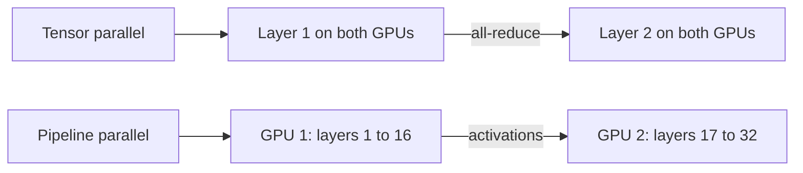

## Two questions from the product lead

The internal assistant at Wadi Labs (a fictional remote software company of about 40 people) now works well on one GPU. Then the product lead sends two messages in one day. First: "Hard questions need a much bigger model, around 70 billion parameters. Will it run on our GPU?" Second: "Why are we running GPUs at all? Can't we call an API?"

Both are fair. The first is a memory question, and you already have the tools for it. The second is a decision with trade-offs, and it needs a method more than an opinion.

## When one GPU is not enough

The bigger open model has 70,553,706,496 weights. At 16 bits, which is 2 bytes each, that is 141.1 GB. An 80 GB GPU cannot hold it. Even if it could, the weights are only part of the budget from 11.4, because the cache still needs room.

One way out is smaller weights. At 8 bits the weights take 70.55 GB. They fit on one GPU, but the room left is 80 × 0.9 - 70.55 = 1.45 GB. That barely holds one short chat. So fitting the weights is not the same as being able to serve users. The other way out is to split the model across GPUs. At the top of the range, a 405-billion-parameter model at 16 bits needs 810 GB, more than the 640 GB in eight 80 GB GPUs. One model provider's report ran its model across 16 GPUs on two machines, and also used FP8 as a second route.

<BigWordAlert term="Tensor parallelism" plainEnglish="Splitting each layer of a model across several GPUs, so every GPU holds a slice of every weight matrix and the GPUs combine their results at each layer." whyItMatters="It lets a model that is too big for one GPU run on a few, and it frees cache room on each GPU. A good answer says when you would use it and what it costs." />

In tensor parallelism, each layer is cut into slices. Every GPU computes its own slice of the same layer, then the GPUs combine their results with an <GlossaryTerm term="all-reduce" definition="A step in which every GPU sends its partial result to the others and all of them end up with the combined total." />. This happens in every layer, for every token. So the GPUs talk constantly, and they need fast links, which in practice means inside one machine. The attention heads are split too, so each GPU does the work of its own heads. The vLLM v0.32.0 docs say its implementation includes a published tensor-parallel scheme of this kind.

The split frees memory. With 4 GPUs, each holds a quarter of the weights. Each GPU also keeps the keys and values of its own heads, so the cache is shared out as well (our reading of the split). The room in the table is therefore cache room, and it adds up across the GPUs.

| Tensor-parallel size | Weights per GPU | Room for KV per GPU |
|---|---|---|
| 1 | 141.11 GB | Does not fit |
| 2 | 70.55 GB | 1.45 GB |
| 4 | 35.28 GB | 36.72 GB |
| 8 | 17.64 GB | 54.36 GB |

The room is 72 GB (80 GB minus the 10% reserve) minus the weights per GPU. Two GPUs fit the weights and leave almost nothing for chats. Four give real room. The cost is the all-reduce time in every layer, and four GPUs to pay for. Chapter 11.9 turns this room into tokens and chats.

```quiz
type: mcq
question: "A model has 34 billion weights at 16 bits. The team has 48 GB GPUs and keeps 10% of each in reserve. They use tensor parallelism across 2 GPUs. About how much memory is left for the KV cache on each GPU?"
options:
  - "About 14 GB each, since 48 GB minus 34 GB is left"
  - "About 9.2 GB each, since 43.2 GB minus 34 GB is left"
  - "About 43.2 GB each, since the weights are stored once"
  - "None, because 68 GB of weights cannot be spread over two GPUs"
correct: 1
explanations:
  - "This forgets the reserve. Each GPU can use 48 × 0.9 = 43.2 GB, not 48 GB."
  - "Right. The weights are 34 × 2 = 68 GB, so each GPU holds 34 GB. Each GPU can use 43.2 GB, which leaves 43.2 - 34 = 9.2 GB for the cache."
  - "Tensor parallelism splits the weights, so each GPU holds half, not a full copy."
  - "Splitting the weights across GPUs is exactly what tensor parallelism does. Two 43.2 GB budgets hold 68 GB."
```

## The other split: pipeline parallelism

**Pipeline parallelism** cuts the model by layers instead of inside them. For a 32-layer model, GPU 1 might hold layers 1 to 16 and GPU 2 layers 17 to 32. A batch is cut into small micro-batches that flow through the stages, so both GPUs stay busy. Idle time at the start and end is called the pipeline bubble. In the pipeline-parallel training paper the bubble was small with at least 4 times as many micro-batches as stages. The GPUs only pass activations at a stage boundary, so they can sit on different machines with slower links.

The diagram shows what each split cuts. Tensor parallelism cuts inside every layer, so both GPUs work on every layer and meet after it. Pipeline parallelism cuts between layers, so each GPU owns a block of layers and hands its result to the next.



Both parallelism papers are about training. Serving engines reuse the same splits. The vLLM v0.32.0 docs give a short rule. If the model fits on one GPU, you probably do not need distributed inference. If it fits in one machine, use tensor parallelism. If not, use tensor parallelism inside each machine and pipeline parallelism across them. Without fast links between GPUs, prefer pipeline parallelism.

The takeaway: split the model only as far as memory forces you. More traffic on a model that fits is solved by running more copies, not by splitting. Many copies bring load balancing and start-up time, which this module does not cover.

## What serving engines give you

You will not write the scheduler. You will choose an engine. The two open-source engines this module uses are vLLM, from a university research lab and now maintained by a community, and SGLang, from academic researchers. GPU vendors and model hubs also ship their own serving engines.

The engines share most of what you learned in 11.2 to 11.6: continuous batching, paged KV memory, prefix caching, chunked prefill, quantization and speculative decoding. Both run tensor parallelism, and vLLM also lists pipeline parallelism. Both run an HTTP server with a chat API shaped like hosted providers', so existing client code can point at it. Details differ, and two settings show how much.

| Setting | vLLM v0.32.0 | SGLang v0.5.22 |
|---|---|---|
| Cache block size | 16 tokens | Page size of 1 token |
| Memory share | 0.92 of the GPU | Computed from the GPU |

Defaults move between releases, so pin the version and read the startup log. vLLM prints the cache size in tokens and the maximum concurrency it can offer. One safety note: the vLLM v0.32.0 docs say its API-key option does not protect every endpoint. Put your own gateway in front, a service that every request passes through and that checks who is calling.

## Self-host or call a hosted API?

Nour's team scored both options on five criteria, from 1 to 5, where a higher score is better for that option. These scores are the example's own judgement, not measurements.

| Criterion | Hosted API | Self-hosted |
|---|---|---|
| Data stays in network | 2 | 5 |
| Low cost at volume | 2 | 4 |
| Low team effort | 5 | 1 |
| Fast to launch | 5 | 2 |
| Latency and version control | 2 | 5 |

Each score is multiplied by a weight: 1 nice to have, 2 important, 3 very important. With every weight at 2, the hosted API scores 2 × (2 + 2 + 5 + 5 + 2) = 32. The self-hosted engine scores 2 × (5 + 4 + 1 + 2 + 5) = 34. The gap is small, so the weights decide.

Cost needs its own arithmetic. From 11.4, a GPU at 2 dollars an hour producing 2,500 tokens a second costs 2 ÷ (2,500 × 3,600) × 1,000,000 = 0.22 dollars per million tokens when it is always busy. At 25% busy the same GPU costs 0.89. Say a hosted API charges 0.50 dollars per million tokens. All of these are invented numbers. Self-hosting is cheaper only above 0.22 ÷ 0.50 = 44% utilization, and that leaves out the people who run it.

The team now raises two weights from 2 to 3: Fast to launch, and Low cost at volume. Work out the new totals before you open the canvas.

```predict
prompt: "With every weight at 2, the totals are 32 for the hosted API and 34 for the self-hosted engine. Fast to launch and Low cost at volume both go from weight 2 to weight 3. Who leads now?"
options:
  - id: api
    label: "The hosted API takes the lead, because it wins on launch speed"
  - id: self
    label: "The self-hosted engine keeps the lead, since cost favours it too"
correctOptionId: self
explanation: "Fast to launch adds 5 points to the hosted API and 2 to the self-hosted engine. Low cost at volume adds 2 and 4. So the hosted API goes from 32 to 39, and the self-hosted engine from 34 to 40."
```

<InteractiveCanvas slug="self-host-or-api" />

**What this shows.** Two total bars for the hosted API and the self-hosted engine, with the leader and the margin, and one weight control for each criterion. Each total is the sum of weight × score. At the defaults the self-hosted engine leads, 34 to 32.

**Try this.** Raise Data stays in network to 3. The self-hosted engine pulls ahead, 39 to 34, because it scores 5 where the hosted API scores 2. Keep that, then raise Low team effort and Fast to launch to 3. Now the hosted API leads, 44 to 42: two criteria it wins outweigh the one you raised first.

**What changed.** Raising a weight adds the same extra points times the score, so it favours whoever scores higher on that criterion. The leader flips when the criteria you raise are ones the other option wins by enough. Raise only Fast to launch and the hosted API leads, 37 to 36. Raise Low cost at volume as well and the self-hosted engine leads again, 40 to 39.

**Limits of the model.** The scores and weights are the example's own judgement for one team and one assistant, and the model treats them as exact. It leaves out model quality, reliability, a provider's contract terms and the break-even volume. Real choices rest on your own numbers, not on a score.

```quiz
type: mcq
question: "The team at Sahel Relief (a fictional NGO) sets these weights: data stays in network 3, low cost at volume 1, low team effort 3, fast to launch 2, latency and version control 1. Using the chapter's scores, which option leads?"
options:
  - "The self-hosted engine, 34 to 32, as with equal weights"
  - "The self-hosted engine, 39 to 34, as data control matters most"
  - "The two tie, because the raised weights cancel the lowered ones"
  - "The hosted API, 35 to 31, as effort and launch outweigh data"
correct: 3
explanations:
  - "34 to 32 is the result with every weight at 2. These weights are different, so the totals change."
  - "39 to 34 is the result of raising only the data weight. Here effort and launch are weighted high too."
  - "The totals are different, so they do not tie. Work them out: hosted API 6 + 2 + 15 + 10 + 2, self-hosted 15 + 4 + 3 + 4 + 5."
  - "Right. Hosted API: 3 × 2 + 1 × 2 + 3 × 5 + 2 × 5 + 1 × 2 = 35. Self-hosted: 3 × 5 + 1 × 4 + 3 × 1 + 2 × 2 + 1 × 5 = 31. The criteria the hosted API wins carry more weight."
```

## Failure modes and debugging

- **The model loads but every request is slow or preempted:** the weights fit and the cache does not. Compute the room per GPU, as in the table.
- **Tensor parallelism got slower than expected:** the GPUs are linked over slow connections. Keep tensor parallelism inside one machine.
- **The self-hosted bill beats the API in a spreadsheet and loses in reality:** utilization was assumed at 100%. Measure how busy the GPU is.
- **The engine's port is open to the internet:** an API key is not enough. Add a gateway that authenticates every route.

## In the interview

Two questions that pair well are "will it fit?" and "should we run it ourselves?" Strong answers give the arithmetic, name the trade-off, and say what they would measure. Answer each question aloud first, then open it.

<FaqGroup title="Practice questions">
<FaqItem question="A 70-billion-parameter model does not fit on one 80 GB GPU. What are your options?">

First the arithmetic: 70.55 billion weights at 2 bytes is 141.1 GB. I could quantize to 8 bits, which gives 70.55 GB, but that leaves only 1.45 GB for the cache with a 10% reserve, so it barely serves anyone. Better is tensor parallelism across 4 GPUs in one machine: 35.28 GB of weights each and 36.72 GB of room each. If the model needed more than one machine I would add pipeline parallelism across machines. The costs are synchronization time in every layer and four GPUs to pay for.

**Follow-up probes:**

- Why keep tensor parallelism inside one machine?
- What does pipeline parallelism cost, and what is its bubble?

</FaqItem>
<FaqItem question="How would you choose between serving engines?">

Both open-source engines I would shortlist share the core features: continuous batching, paged KV, prefix caching, chunked prefill, quantization and an API-compatible server. So I would not choose on the feature list. I would test our model and GPU on a replay of our own traffic and compare goodput, the requests served per second while meeting our latency targets. I would pin the engine version, because defaults such as the memory share (0.92 in vLLM v0.32.0) change between releases. I would read the startup log for the cache size in tokens before trusting any capacity number.

**Follow-up probes:**

- What would you put in the benchmark traffic?
- How would you upgrade the engine safely?

</FaqItem>
<FaqItem question="Should we self-host a model or call a hosted API?">

I would score both on data control, cost at steady volume, team effort, time to launch and control of latency and version, and weight the criteria with the team. With equal weights, my example scores 34 for self-hosting and 32 for the API, so the weights decide. Then I would check cost with real utilization. At 2 dollars an hour and 2,500 tokens a second, a GPU costs 0.22 dollars per million tokens when busy and 0.89 at 25% busy, so against an API at 0.50 it needs about 44% utilization to win, before counting engineers. Self-hosting also means someone is on call and upgrades the engine. A hosted API sends prompts outside the network and can change the model under you.

**Follow-up probes:**

- Which criterion would make you choose self-hosting even at low volume?
- How could you mix both, for example a small model on your own GPU and a hosted API for hard questions?

</FaqItem>
</FaqGroup>

**Next:** Admission control and capacity in tokens: how to stop a launch-day crowd from running a server out of memory, and how to plan capacity in tokens instead of users.
