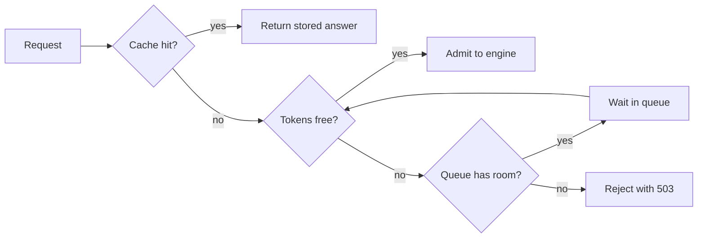

## Thirty people and one stand-up

Wadi Labs (a fictional remote software team) fixed its memory budget with paging and FP8, and the assistant ran well for a week. Then, at a Monday stand-up, thirty people pasted long documents into the assistant at the same moment. The server ran out of memory and restarted, and every chat was lost.

Nour checked the capacity. The cache room from 11.4 is 55.94 GB, and 55,940,000,000 ÷ 131,072 is about 426,800 tokens. Nour rounded down to 420,000 to keep a margin. Each document chat promised about 16,384 tokens. Thirty of them need 30 × 16,384 = 491,520 tokens, which is 71,520 more than the server has. No amount of tuning makes 491,520 fit in 420,000. The server needed a way to say "not yet".

<BigWordAlert term="Admission control" plainEnglish="Deciding, before a request starts, whether the server has room for it now. If it does, the request runs. If not, it waits in a queue or is turned away." whyItMatters="Without it, a crowd takes the server down for everyone. With it, a crowd only waits. Interviewers ask how you protect a GPU server, and the answer is a number, not a feeling." />

## Count tokens, not requests

In 11.4 you planned capacity in tokens held at once, not in users. Admission control uses the same unit. A request promises the tokens it may hold: its prompt plus the most new tokens it is allowed to write. Here that is 14,384 + 2,000 = 16,384. You cannot promise anything if you do not cap the output length, so always set a maximum.

The server then admits a request only while the promised tokens stay under a limit, which is a share of capacity. The limit is below 100% because chats grow while they run, and the headroom absorbs that growth. With a 90% limit, the server may promise 420,000 × 0.9 = 378,000 tokens. Then 378,000 ÷ 16,384 is 23.07, so 23 requests are admitted and 7 wait. For full 32,768-token chats the same limit allows 378,000 ÷ 32,768 = 11.5, so 11 chats, not the 13 from 11.4. The two fewer are headroom on purpose.

In 9.6 you limited concurrent model calls with a semaphore. A semaphore counts requests. That is right only if every request is the same size. A semaphore of 23 would waste room on short chats, and it would let 23 chats of 32,768 tokens in, which need 753,664 tokens. A token counter fixes both problems. Here is a small sketch that you read, not a library. It was run with 30 requests of 16,384 tokens, and it printed the number admitted, the number refused and the tokens promised:

```python
class TokenBudget:
    def __init__(self, capacity: int, limit_percent: int = 90):
        self.allowed = capacity * limit_percent // 100
        self.promised = 0

    def try_admit(self, prompt_tokens: int, max_new_tokens: int) -> bool:
        need = prompt_tokens + max_new_tokens
        if self.promised + need > self.allowed:
            return False
        self.promised += need
        return True

    def release(self, prompt_tokens: int, max_new_tokens: int) -> None:
        self.promised -= prompt_tokens + max_new_tokens
```

```text
23 7 376832
```

Calling `release` when a request ends frees its tokens, and the next waiting request can enter. In a real service this counter sits in the gateway in front of the engine, and it needs a lock or an async-safe design.

## The engine's own limits

The engine has its own limits too, and both engines have the same four kinds.

| What it limits | vLLM v0.32.0 | SGLang v0.5.22 |
|---|---|---|
| Requests at once | `--max-num-seqs` (256 or 1,024, by GPU) | `--max-running-requests` |
| Tokens per step | `--max-num-batched-tokens` (2,048 to 16,384) | `--chunked-prefill-size` |
| Memory for cache | `gpu_memory_utilization`, 0.92 | `--mem-fraction-static` |
| Waiting queue | `--max-num-queued-reqs`, none by default | `--max-queued-requests`, none by default |

Look at the last row. In vLLM v0.32.0 the queue is unbounded by default. A spike then grows the wait for everyone, because waiting time is part of time to first token (11.2). Setting a cap fixes this. At the cap, new requests are rejected with HTTP 503, so a client can try elsewhere. vLLM also has a cap on prompt tokens waiting for prefill. Its docs give the formula: the target time to first token times the prefill throughput. In an invented example, 2 seconds at 10,000 prompt tokens a second gives a cap of 20,000 tokens.

A bounded queue is <GlossaryTerm term="backpressure" definition="Telling callers to slow down or go elsewhere when a service is full, instead of piling up work without limit." />. The 503 is not a failure to hide. It is the server saying it is full. The client should retry after a delay with jitter, as in 9.4, and show a clear "busy, try again" message rather than hang.

The diagram shows the full path of a request, with the cache from chapter 9.5 in front.



Every request leaves in one of three ways: answered from the cache, run on the GPU, or refused with a clear message. A refusal at the edge is cheaper than a crash in the middle.

```quiz
type: mcq
question: "Tamer's logs show preemption warnings every few seconds and KV usage near 100%. His gateway promises 100% of capacity to admitted requests. What is the best first change?"
options:
  - "Lower the admission limit to 90%, leaving room for growth"
  - "Raise the queue cap so that more requests can wait for a slot"
  - "Raise the maximum sequences so that more chats run together"
  - "Add client retries so that refused requests run again at once"
correct: 0
explanations:
  - "Right. Chats grow as they write. A limit of 100% leaves no room, so memory runs out and the engine preempts. A lower limit keeps promises under capacity."
  - "A longer queue holds waiting requests but does nothing about the running ones that fill the cache."
  - "The engine docs list the opposite: lower the maximum sequences. More chats at once means more cache needed."
  - "Retries without a delay add more load to a full server and make the pressure worse."
```

## When memory runs out anyway

Admission control is a promise, and promises can be wrong. The engine also has a last resort. When the cache has no free blocks, the scheduler preempts a running request: it evicts the request's blocks, and later runs it again from the start. In vLLM v0.32.0 the default is to recompute, not to swap the cache to CPU memory, because recompute is cheaper in that design. A preempted request redoes its prefill, so its latency jumps.

Treat preemption as a safety net and not as a plan. The vLLM docs list four remedies: raise the memory share, lower the maximum sequences or the token budget, and add tensor parallelism or pipeline parallelism. SGLang logs "KV cache pool is full. Retract requests" and says about one retraction a minute is acceptable. It also describes the opposite fault: token usage low while the queue is long means the scheduler is too cautious. Watch two numbers in vLLM's metrics, requests running and KV cache usage.

## Rate limits count tokens too

One user can still take the whole pool. A limit on requests per minute treats a 1,024-token question and a 32,768-token paste as equal, but the paste is 32 times as large (32,768 ÷ 1,024 = 32). So limit by tokens. Cap the tokens a user may have in flight, and the tokens a user may send per minute. A per-user cap of 32,768 tokens in flight means one user can hold at most one full-length chat.

## Caches: the cheapest request

The cheapest request is the one the GPU never sees. Chapter 9.5 showed an exact-match cache that returns a stored answer with no model call. Its example had a 25% hit rate. Apply it here: of 30 requests, 7 or 8 hit, so about 22 or 23 reach the GPU, and the 23 free slots admit them all. The key must still include the model and prompt version, or you serve stale answers. A semantic cache catches rephrased questions, but it has the wrong-match and data-leak risks from 9.5, so scope it per tenant.

Do not confuse this with prefix caching (11.5). A response cache skips the whole request. Prefix caching skips only part of the prefill and still decodes the answer. Both lower the load on the GPU, at different layers.

## See how many get in

Before you move the controls, predict the default case.

```predict
prompt: "The server has 420,000 tokens of KV capacity and a 90% admission limit. Thirty chats of 16,384 tokens arrive at once. How many are admitted now?"
options:
  - id: twentythree
    label: "23, since 378,000 tokens may be promised"
  - id: twentyfive
    label: "25, since 420,000 ÷ 16,384 is about 25.6"
correctOptionId: twentythree
explanation: "The limit allows 420,000 × 0.9 = 378,000 tokens. Dividing by 16,384 gives 23.07, so 23 are admitted. Dividing the full capacity ignores the headroom."
```

<InteractiveCanvas slug="admission-control-tokens" />

**What this shows.** How many of the arriving requests the server admits and how many wait, for a capacity in tokens and a limit. It also shows what would happen with no control. At the defaults, 23 are admitted and 7 queued. Without control, the 30 need 491,520 tokens, which is 71,520 over capacity.

**Try this.** First, lower the admission limit from 90% to 70%. The server promises 294,000 tokens, so 17 are admitted and 13 queue, which leaves more room for each request to keep growing. Second, from the defaults, halve the tokens each request holds, from 16,384 to 8,192. The limit now allows 46, which is more than the 30 that arrived, so all 30 are admitted and nobody queues.

**What changed.** The limit decides how many tokens may be promised, and the request size decides how many requests share them. Lower limits or bigger requests mean fewer admitted and more waiting. Smaller requests mean the same room serves more.

**Limits of the model.** This is a snapshot: no request finishes while it is taken, and no preemption is modelled. Real engines also cap the number of sequences, and requests grow as they generate, which is why the limit is below 100%. The capacity is the example's, rounded to 420,000 tokens.

```quiz
type: mcq
question: "A server has 300,000 tokens of KV capacity and an 80% admission limit. Twenty-five requests of 12,288 tokens arrive together. What does admission control do, and what would no control have done?"
options:
  - "Admits 24 and queues 1, since 300,000 ÷ 12,288 is about 24"
  - "Admits 20 and queues 5, since 240,000 ÷ 12,000 is 20"
  - "Admits 19 and queues 6; all 25 would be 7,200 tokens over capacity"
  - "Admits 19 and queues 6; all 25 would still fit within capacity"
correct: 2
explanations:
  - "This ignores the 80% limit. The server may promise only 300,000 × 0.8 = 240,000 tokens."
  - "This rounds 12,288 down to 12,000. Use the real size: 240,000 ÷ 12,288 is 19.5, so 19."
  - "Right. 240,000 ÷ 12,288 is 19.5, so 19 are admitted and 6 queue. Without control the 25 need 25 × 12,288 = 307,200 tokens, which is 7,200 over 300,000."
  - "The admitted number is right, but 307,200 tokens are more than 300,000, so they would not fit."
```

## Failure modes and debugging

- **Out of memory under a crowd:** no token limit, or a limit of 100%. Count promised tokens and leave headroom.
- **Long queue, low cache usage:** the limits are too strict. Raise the limit or the running cap, and watch preemptions.
- **Clients hang during a spike:** the queue is unbounded. Set a cap so the server answers 503.
- **503 storms:** clients retry at once. Add backoff with jitter.

## In the interview

The question is usually "your server crashes when many users arrive. What do you do?" A strong answer names the unit (tokens), gives the arithmetic, and says what happens to the requests that do not fit. Answer each question aloud first, then open it.

<FaqGroup title="Practice questions">
<FaqItem question="Thirty users arrive together and your model server runs out of memory. How do you prevent that?">

I would plan in tokens. The cache holds about 420,000 tokens, and each long request promises 16,384, so 30 need 491,520 and are 71,520 over. I would put a token budget at the gateway with a 90% limit, so it promises at most 378,000 tokens. That admits 23 and queues 7. I would bound the queue and answer 503 beyond it, so clients retry with backoff. I would also cap the output length, because a request cannot promise tokens it may write without a limit.

**Follow-up probes:**

- Why is the limit below 100%?
- What should a client do with a 503?

</FaqItem>
<FaqItem question="What happens when the KV cache is full, and what would you change?">

The engine preempts a running request, evicts its blocks and later recomputes it. In vLLM v0.32.0 the default is recompute, not swap. It works, but each preempted request redoes its prefill, so latency jumps. The remedies in the docs are a higher memory share, fewer maximum sequences, a smaller token budget, or more parallelism. I would first check whether admission promises too much, because preemption should be rare. SGLang says about one retraction a minute is acceptable.

**Follow-up probes:**

- Which two metrics would you watch?
- What does it mean if the queue is long but cache usage is low?

</FaqItem>
<FaqItem question="Where do caches fit in capacity planning?">

A cache removes load before it reaches the GPU. An exact-match response cache returns a stored answer with no model call. At a 25% hit rate, 22 or 23 of 30 simultaneous requests reach the GPU, so the capacity I plan for is lower. The key must include the model and prompt version, or I serve stale answers. A semantic cache raises the hit rate but can return a wrong near-match or leak data, so I would scope it per tenant. Prefix caching is different: it saves prefill work inside the engine and still decodes.

**Follow-up probes:**

- What goes into a safe cache key?
- Would you plan capacity on the cached or the uncached rate?

</FaqItem>
</FaqGroup>

**Next:** Interview drill: will this deployment fit? A five-step method for estimating, aloud and with units, whether a model, a GPU and a number of users fit together.
