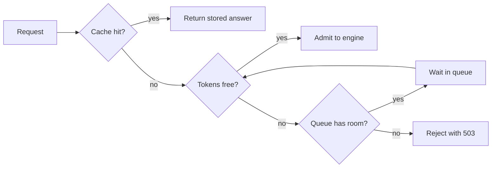

## Thirty people and one team meeting

Wadi Labs (a fictional remote software team of 12) opened its assistant to its engineers and to colleagues in support and operations, about 40 people in all. After the launch-day crash it had moved to paged memory (11.5), so the engine no longer reserved 32,768 tokens up front for every chat, and it kept the cache in 16-bit while the team tested FP8. The assistant ran well for a week. Then, at the Monday meeting, thirty people pasted long documents into it at once. The cache filled. The engine had to stop running chats and redo their work later, and the requests behind them waited in a queue with no limit. First words took minutes, running chats stalled, and clients began to time out.

Nour checked the capacity. The cache room from 11.4 is 55.94 GB, and at 131,072 bytes a token, 55,940,000,000 ÷ 131,072 is about 426,800 tokens. Nour rounded down to 420,000 to keep a margin. Each document chat promised about 16,384 tokens. Thirty of them need 30 × 16,384 = 491,520 tokens, which is 71,520 more than the server has. No amount of tuning makes 491,520 fit in 420,000. The server needed a way to say "not yet".

<BigWordAlert term="Admission control" plainEnglish="Deciding, before a request starts, whether the server has room for it now. If it does, the request runs. If not, it waits in a queue or is turned away." whyItMatters="Without it, a crowd slows everyone down and forces chats to be redone. With it, extra requests wait in line or get a clear refusal, and admitted chats keep their speed. A good answer to 'how do you protect a GPU server?' is a number, not a feeling." />

## Count tokens, not requests

In 11.4 you planned capacity in tokens held at once, not in users. Admission control uses the same unit. A request promises the tokens it may hold: its prompt plus the most new tokens it is allowed to write. Here that is 14,384 + 2,000 = 16,384. You cannot promise anything if you do not cap the output length, so always set a maximum.

The server then admits a request only while the promised tokens stay under a limit, which is a share of capacity. The limit is below 100% because the count is an estimate: blocks round each chat up, buffers take some memory, a gateway may count tokens differently from the engine, and a cap on output may not be enforced. The headroom absorbs those errors. The count is capacity × limit ÷ tokens per request, rounded down. Try it on another case: 20,000-token requests at an 80% limit allow 420,000 × 0.8 = 336,000 tokens, and 336,000 ÷ 20,000 = 16.8, so 16 requests.

In 9.6 you limited concurrent model calls with a semaphore, which counts requests. That is right only if every request is the same size. A semaphore of 16 would let in 16 chats of 32,768 tokens, which need 524,288 tokens, more than the whole pool. A token counter fixes this.

Admission control is for a spike above the planned peak. It does not make a steady load fit. If the steady peak is above capacity, a queue only moves the wait onto people who stay in it. Then change the bytes, the context length or the number of GPUs, as 11.9 shows.

Before you move the controls, work out the default case yourself.

```predict
prompt: "The server has 420,000 tokens of KV capacity and a 90% admission limit. Thirty chats of 16,384 tokens arrive at once. How many are admitted now?"
options:
  - id: twentythree
    label: "23, since the limit holds back 10%"
  - id: twentyfive
    label: "25, since all the capacity can be promised"
correctOptionId: twentythree
explanation: "The limit allows 420,000 × 0.9 = 378,000 tokens. Dividing by 16,384 gives 23.07, so 23 are admitted. Dividing the full capacity ignores the headroom."
```

<InteractiveCanvas slug="admission-control-tokens" />

**What this shows.** How many arriving requests the server admits and how many wait, and what no control would have done. At the defaults, 23 are admitted and 7 queued. Without control, the 30 need 491,520 tokens, which is 71,520 over capacity.

**Try this.** Lower the admission limit from 90% to 70%. The server will promise 294,000 tokens, so 17 are admitted and 13 queue, leaving more spare room for counting errors. Halve the tokens each request holds, from 16,384 to 8,192. The limit now allows 46, which is more than the 30 that arrived, so all 30 are admitted and nobody queues.

**What changed.** The limit decides how many tokens may be promised, and the request size decides how many requests share them. Lower limits or bigger requests mean fewer admitted. Smaller requests mean the same room serves more.

**Limits of the model.** This is a snapshot: no request finishes while it is taken, and no preemption is modelled. Real engines also cap the number of sequences. The limit sits below 100% because the token count is an estimate. The capacity is the example's, rounded to 420,000 tokens.

```quiz
type: mcq
question: "A server has 300,000 tokens of KV capacity and an 80% admission limit. Twenty-five requests of 12,288 tokens arrive together. What does admission control do, and what would no control have done?"
options:
  - "Admits 24 and queues 1, since 300,000 ÷ 12,288 is about 24"
  - "Admits 20 and queues 5, since 240,000 ÷ 12,000 is 20"
  - "Admits 19 and queues 6; all 25 would be 7,200 tokens over capacity"
  - "Admits all 25 and queues none, since 25 requests fit in 300,000 tokens"
correct: 2
explanations:
  - "This ignores the 80% limit. The server may promise only 300,000 × 0.8 = 240,000 tokens."
  - "This rounds 12,288 down to 12,000. Use the real size: 240,000 ÷ 12,288 is 19.5, so 19."
  - "Right. 240,000 ÷ 12,288 is 19.5, so 19 are admitted and 6 queue. Without control the 25 need 25 × 12,288 = 307,200 tokens, which is 7,200 over 300,000."
  - "25 × 12,288 = 307,200, which is more than 300,000, so all 25 would not fit. The limit would also stop admission at 240,000."
```

## The same count in code

Read this small sketch; it is not a library. In a real service the counter sits in the gateway, the service in front of the engine that every request passes through. The second block sends 30 requests of 16,384 tokens and prints the admitted, the refused and the tokens promised.

```python
class TokenBudget:
    def __init__(self, cap, pct):
        self.limit = cap * pct // 100
        self.promised = 0

    def try_admit(self, prompt, new):
        need = prompt + new
        if self.promised + need > self.limit:
            return False
        self.promised += need
        return True

    def release(self, prompt, new):
        self.promised -= prompt + new
```

```python
budget = TokenBudget(420_000, 90)
ok = 0
for _ in range(30):
    if budget.try_admit(14_384, 2_000):
        ok += 1
print(ok, 30 - ok, budget.promised)
```

```text
23 7 376832
```

Calling `release` when a request ends frees its tokens for the next one. A real counter must also stay correct when two requests arrive at the same moment, so it needs a lock, which lets only one request change the counter at a time.

## The engine's own limits

The engine has its own limits too: four kinds, under different names. The SGLang names are the closest match, not an exact one.

| What it limits | vLLM v0.32.0 | SGLang v0.5.22 |
|---|---|---|
| Requests running | `--max-num-seqs` (256 or 1,024, by GPU) | `--max-running-requests` |
| Tokens per step | `--max-num-batched-tokens` (2,048 to 16,384, by GPU) | `--max-prefill-tokens` (16,384) and `--chunked-prefill-size` |
| Memory for cache | `--gpu-memory-utilization` (0.92) | `--mem-fraction-static` |
| Queue limit | `--max-num-queued-reqs` (off) | `--max-queued-requests` (off) |

Do not memorise flags. Remember the three knobs: how many requests run, how many tokens go through in one step, and how much memory the cache gets. Defaults move between releases, so read the startup log.

In the last row, the vLLM v0.32.0 queue limit is off by default, so the queue has no end. A spike then grows the wait for everyone, because waiting time is part of time to first token (11.2). The limit counts requests in flight, running plus waiting. At the limit, new requests are rejected with HTTP 503, so a client can try elsewhere.

A bounded queue is <GlossaryTerm term="backpressure" definition="Telling callers to slow down or go elsewhere when a service is full, instead of piling up work without limit." />. The 503 is the server saying it is full. The client should retry after a delay with jitter, as in 9.4, and show a clear "busy, try again" message rather than hang.

The diagram shows the full path of a request, with the cache from chapter 9.5 in front.



Every request leaves in one of three ways: answered from the cache, run on the GPU, or refused with a clear message. A clear refusal at the edge is cheaper than a stalled chat in the middle.

When the cache is full, the engine can <GlossaryTerm term="preempt" definition="To stop a running request, throw away its cache blocks to free memory, and run it again later from the start." /> a request. Two dashboard numbers show what is happening: requests waiting and KV cache usage.

```quiz
type: mcq
question: "Tamer's dashboard shows 60 requests waiting, KV cache usage near 40% and no preemptions. The gateway promises at most 50% of capacity to admitted requests. What is the best first change?"
options:
  - "Raise the admission limit toward 85%, so that more requests run at once"
  - "Raise the queue cap, so that even more requests can wait for a slot"
  - "Lower the maximum sequences, so that fewer chats run together"
  - "Add a second GPU, so that the cache doubles in size"
correct: 0
explanations:
  - "Right. Requests wait while 60% of the cache sits idle, so the limit is too strict. A limit of 85% still leaves headroom for counting errors."
  - "The queue is already long. A bigger cap lets more requests wait longer and does nothing about the idle cache."
  - "Fewer chats at once lengthens the queue. Lowering the maximum sequences is a remedy for a cache that is too full, which is the opposite fault."
  - "Memory is not short, because 60% of the cache is idle. A second GPU is a large cost that fixes a fault this server does not have."
```

## When memory runs out anyway

Admission control is a promise, and promises can be wrong. The engine also has a last resort. When the cache has no free blocks, the scheduler preempts a running request: it evicts the request's blocks, and later runs it again from the start. In vLLM v0.32.0 the default is to recompute, not to swap the cache to CPU memory, because recompute is cheaper in that design. A preempted request redoes its prefill, so its latency jumps.

Treat preemption as a safety net, not a plan. The vLLM v0.32.0 docs list remedies: raise the memory share, lower the maximum sequences or the token budget, or add parallelism. SGLang v0.5.22 logs "KV cache pool is full. Retract requests" (retract is its word for preempt), and its docs say about one retraction a minute is acceptable. The docs also describe the opposite fault: token usage low while the queue is long means the scheduler is too cautious.

## Rate limits count tokens too

One user can still take the whole pool. A limit on requests per minute treats a 1,024-token question and a 32,768-token paste as equal, but the paste is 32 times as large. So limit by tokens: the tokens a user may have in flight, and the tokens a user may send per minute. A per-user cap of 32,768 tokens in flight lets one user hold one full-length chat.

## Caches: the cheapest request

The cheapest request is the one the GPU never sees. The exact-match cache from 9.5 returns a stored answer with no model call. At its 25% hit rate, 7 or 8 of 30 requests hit, so about 22 or 23 reach the GPU, and the limit admits all of them. The key must include the model and prompt version. A semantic cache has the risks from 9.5, so scope it per tenant, meaning per customer or team. Prefix caching (11.5) is different: it skips part of the prefill and still decodes the answer.

## Failure modes and debugging

- **Long waits and redone chats under a crowd:** no token limit, or a limit of 100%. Count promised tokens and leave headroom.
- **Long queue, low cache usage:** the limits are too strict. Raise the limit or the running cap, and watch preemptions.
- **Clients hang during a spike:** the queue has no cap. Set one so the server answers 503.
- **503 storms:** clients retry at once. Add backoff with jitter.

## In the interview

One form of the question is "your server crashes when many users arrive. What do you do?" A strong answer names the unit (tokens), gives the arithmetic, and says what happens to the requests that do not fit. Answer each question aloud first, then open it.

<FaqGroup title="Practice questions">
<FaqItem question="Thirty users arrive together and your model server runs out of memory. How do you prevent that?">

I would plan in tokens. The cache holds about 420,000 tokens, and each long request promises 16,384, so 30 need 491,520 and are 71,520 over. On a paged engine that shows up as preemptions and a growing queue, not always a crash. I would put a token budget at the gateway with a 90% limit, so it promises at most 378,000 tokens. That admits 23 and queues 7. The limit stays below 100% because my count is an estimate: blocks round up, buffers need memory and tokenizers differ. I would bound the queue and answer 503 beyond it, so clients retry with backoff, and cap the output length so every request can promise its tokens. That protects against a spike. If 30 long chats were the normal load, I would change the bytes or the GPUs instead.

**Follow-up probes:**

- Why is the limit below 100%?
- What should a client do with a 503?

</FaqItem>
<FaqItem question="What happens when the KV cache is full, and what would you change?">

The engine preempts a running request, evicts its blocks and later recomputes it. In vLLM v0.32.0 the default is recompute, not swap, so each preempted request redoes its prefill and latency jumps. The remedies in the docs are a higher memory share, fewer maximum sequences, a smaller token budget, or more parallelism. I would first check whether admission promises too much, because preemption should be rare.

**Follow-up probes:**

- Which two metrics would you watch?
- What does it mean if the queue is long but cache usage is low?

</FaqItem>
<FaqItem question="Where do caches fit in capacity planning?">

A cache removes load before it reaches the GPU. At a 25% hit rate, an exact-match response cache means 22 or 23 of 30 simultaneous requests reach the GPU. The key must include the model and prompt version, or I serve stale answers. A semantic cache raises the hit rate but can return a wrong near-match or leak data, so I would scope it per tenant. Prefix caching only saves prefill work inside the engine.

**Follow-up probes:**

- What goes into a safe cache key?
- Would you plan capacity on the cached or the uncached rate?

</FaqItem>
</FaqGroup>

**Next:** Interview drill: will this deployment fit? A five-step method for estimating, aloud and with units, whether a model, a GPU and a number of users fit together.
