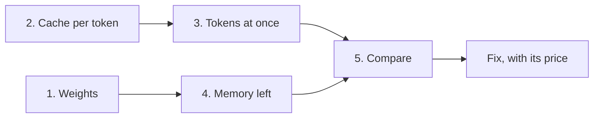

## "Probably" is not an answer

The interviewer said one sentence to Tamer: "A team wants to serve an 8-billion-parameter model to 12 people on one 48 GB GPU. Will it fit?" Tamer smiled and said, "Probably. 8B is a small model." The interviewer nodded and asked, "How much memory does one 16,384-token chat take?" Tamer had no number. The round moved on, and the question was not forgotten.

"Will it fit?" is arithmetic you can do on paper. The interviewer wants to hear the steps, the units, and a fix that has a price. By the end of this chapter you can do the estimate in five steps and about two minutes, and say what to change when the answer is "no".

<BigWordAlert term="Fit estimate" plainEnglish="A short calculation, done before anything is run, that says whether a model and its users' chats fit in the memory of the GPUs you have. It is done in bytes and tokens." whyItMatters="It is the question behind 'why did the server crash?' and 'how many GPUs do we need?'. An answer with arithmetic shows you can plan capacity. A fix with its price shows you can act on it." />

## The five steps

Every fit estimate uses the same five steps, in the same order. Say them aloud at the start as a map: "I will check the weights, the cache per token, the tokens held at once, the memory left, and then compare." The interviewer then knows where you are going.

Step 1 is the weights: the number of parameters times the bytes for each one. Write bytes, not bits: 16-bit is 2 bytes, 8-bit is 1, and 4-bit is half a byte. Weights are a fixed cost. They do not grow when more people arrive.

Step 2 is the <GlossaryTerm term="KV cache" definition="The keys and values that attention computed for every earlier token of a chat. The server stores them so it does not recompute them for each new token. They grow with every token." /> per token. The formula from 11.3 is 2 × layers × KV heads × head size × bytes per value. The 2 is one key and one value for each token.

Step 3 is the tokens held at once: users times the longest chat each one will hold. Multiply by step 2 and you have the cache the load needs, in bytes.

Step 4 is the memory left. Take the GPU memory, keep 10% back for activations and the engine, and subtract the weights. The 10% is this module's example choice: the vLLM v0.32.0 default is 0.92, and a real engine prints its own cache size at start-up. Use GB as 1,000,000,000 bytes throughout. Divide what remains by step 2 to get the capacity in tokens.

Step 5 is the comparison. If the need is below what is left, it fits, and you say by how much. If not, say how short it is, and pick a fix.

| Step | You ask | You compute |
|---|---|---|
| 1. Weights | How big is the fixed part? | parameters × bytes each |
| 2. Cache per token | What does one token cost? | 2 × layers × KV heads × head size × bytes |
| 3. Tokens at once | What is the load? | users × longest chat, then × step 2 |
| 4. Memory left | What can the cache use? | GPU × 0.9 - weights |
| 5. Compare | Does the need fit in what is left? | need versus left, then a fix |

The diagram shows how the steps connect. Steps 1 and 4 give the supply side. Steps 2 and 3 give the demand side. They meet only at the comparison. Step 2 is used on both sides, so counting in tokens lets you say "11 chats of this length" instead of only "29 GB".



## Worked example 1: a model that is slightly too much

Reem's team at Najm Microfinance (a fictional lender) wants to serve 12 loan officers on one 48 GB GPU. Each keeps a chat of up to 16,384 tokens. The model has 8,190,735,360 parameters, 36 layers, 8 KV heads and head size 128, all at 16-bit.

```text
1. Weights
   8,190,735,360 × 2 bytes = 16.38 GB
2. KV cache per token
   2 × 36 × 8 × 128 × 2 = 147,456 bytes
3. Tokens held at once
   12 × 16,384 = 196,608 tokens
   × 147,456 bytes = 28.99 GB needed
4. Memory left
   48 × 0.9 = 43.2 GB
   43.2 - 16.38 = 26.82 GB
   ÷ 147,456 = 181,874 tokens
   = 11 chats of 16,384
5. Compare
   28.99 GB > 26.82 GB
   Short by 2.17 GB. No.
```

In the interview you lead with the answer: "No. Twelve chats need 28.99 GB of cache and only 26.82 GB is left, so it is short by 2.17 GB. Eleven chats fit." Then you give the reason, and then the fix.

The gap is small, so several fixes work, and the canvas below checks two of them. Storing the cache in <GlossaryTerm term="FP8" definition="A number format that uses 1 byte per value instead of 2. Used for the KV cache, it halves the bytes per token." /> halves step 2 to 73,728 bytes. The price is quality, so test on your own data. A cap of 14,336 tokens per chat also works: 12 × 14,336 tokens need 25.37 GB. The price is a changed product, because a longer document no longer fits.

Admission control is not the fix here. The twelve officers are the planned peak, so a queue would leave one of them waiting every day.

## Worked example 2: a model that is bigger than the GPU

Now a bigger model: 70,553,706,496 parameters at 16-bit. For the cache, use this example's own shape: 80 layers, 8 KV heads, head size 128. The load is 10 chats of 32,768 tokens, and each GPU has 80 GB with 10% kept back.

```text
1. Weights
   70,553,706,496 × 2 = 141.11 GB
   One GPU: 80 × 0.9 = 72 GB. Too small.
   The weights alone do not fit.
2. KV cache per token
   2 × 80 × 8 × 128 × 2 = 327,680 bytes
3. Tokens held at once
   10 × 32,768 = 327,680 tokens
   × 327,680 bytes = 107.37 GB needed
4. Memory left, by number of GPUs
   2 GPUs: 144 - 141.11 = 2.89 GB
     = 8,827 tokens: one 8,192 chat
   4 GPUs: 288 - 141.11 = 146.89 GB
     = 448,280 tokens: 13 chats
5. Compare on 4 GPUs
   107.37 GB < 146.89 GB
   Fits, with 39.52 GB spare.
```

The lesson is in step 4. Weights that fit are only half of "fits". Two GPUs hold the weights and leave 2.89 GB, so the deployment starts and cannot serve anyone. Splitting each layer across GPUs is <GlossaryTerm term="tensor parallelism" definition="Splitting the matrices inside each layer across several GPUs, so each GPU holds a part of every layer. The GPUs must exchange results at each layer, so they need fast links." />, covered in 11.7. It also shares the cache between the GPUs. The price is cost and speed: four GPUs cost four times as much and exchange results at every layer, which this estimate ignores.

## Your turn

Do this one on paper before you open the check. Say the five steps aloud, whether it fits, and two fixes.

<FaqGroup title="Your turn: check your working">
<FaqItem question="Karim's team has a model with 7,248,023,552 parameters, 32 layers, 8 KV heads and head size 128, all at 16-bit. They have one 24 GB GPU with 10% kept back and want 3 chats of 32,768 tokens. Does it fit, and what are two fixes?">

It does not fit. The weights are 14.50 GB. The cache is 131,072 bytes per token, and three chats hold 98,304 tokens, which need 12.88 GB. The GPU gives 21.6 GB, so 7.10 GB is left, which holds 54,198 tokens, about 1.65 chats. It is short by 5.78 GB.

Two fixes work. An FP8 cache needs 6.44 GB, which fits in 7.10 GB with 0.66 GB spare. Weights at 8-bit take 7.25 GB, which leaves 14.35 GB, so 12.88 GB fits with 1.47 GB spare. Both margins are thin, and both change the model's numbers, so a quality test comes first.

</FaqItem>
</FaqGroup>

## See it run

The canvas replays worked example 1, the 12 loan officers at Najm Microfinance on one 48 GB GPU, one message per step. It then checks two fixes the same way. First predict which fix leaves more spare room.

```predict
prompt: "Najm's 12 loan officers need 28.99 GB of cache, and 26.82 GB is left. An FP8 cache and 8-bit weights both make it fit. Which single change leaves more spare room?"
options:
  - id: weights
    label: "8-bit weights, which halve the 16.38 GB the weights take"
  - id: fp8
    label: "The FP8 cache, which halves the 28.99 GB the chats need"
correctOptionId: fp8
explanation: "The FP8 cache cuts the need to 14.50 GB, which leaves 26.82 - 14.50 = 12.32 GB spare. The 8-bit weights free only 8.19 GB, so 35.01 GB is left against 28.99 GB needed, which is 6.02 GB spare. Halving the larger cost saves more."
```

<InteractiveCanvas slug="deployment-fit-steps" />

**What this shows.** Each step of the estimate as one message, with the arithmetic beside it. The weights are 16.38 GB and the cache is 147,456 bytes per token. Twelve chats of 16,384 tokens hold 196,608 tokens and need 28.99 GB. The GPU gives 43.2 GB, so 26.82 GB is left, room for 11 chats, and the cache is short by 2.17 GB. The last messages check an FP8 cache and 8-bit weights with the same steps.

**Try this.** Before you open the message called The GPU reports what is free, predict how many chats of 16,384 tokens the memory left can hold. Then check the chips: 11. The twelfth does not fit. Open the messages called Check the first fix with the same steps and Check the second fix the same way, and compare the spare room: 12.32 GB for the FP8 cache and 6.02 GB for 8-bit weights.

**What changed.** The FP8 cache halved step 2, from 147,456 to 73,728 bytes, and the need fell from 28.99 GB to 14.50 GB. The 8-bit weights halved step 1, from 16.38 GB to 8.19 GB, and the memory left rose from 26.82 GB to 35.01 GB. Both fit. The cache was the larger cost, so halving it left more room.

**Limits of the model.** It uses one GPU, the example's 10% reserve and 16-bit values unless a fix changes them. It leaves out paging waste, fragmentation, prefix sharing and the speed of the answers, so a real server needs more headroom than the arithmetic shows. The 12 officers and the 16,384-token chats are the example's own numbers.

Now check the method in a new case.

```quiz
type: mcq
question: "Sara plans 7 users with chats of up to 20,000 tokens on one 24 GB GPU, with 10% kept back. The model has 7 billion parameters at 16-bit (14 GB), 28 layers, 4 KV heads and head size 128, and a 16-bit cache. What is the right verdict?"
options:
  - "It fits: the cache needs 8.03 GB, and 10 GB remain after weights"
  - "It fits: the cache needs 4.01 GB, below the 7.6 GB left over"
  - "It does not fit: the cache needs 8.03 GB, and 7.6 GB is left over"
  - "It does not fit: the cache needs 56.2 GB, as 28 heads store keys"
correct: 2
explanations:
  - "The 10% reserve was skipped. The GPU gives 24 × 0.9 = 21.6 GB, so 21.6 - 14 = 7.6 GB remain after the weights, not 10 GB."
  - "This leaves out the 2 for keys and values, which halves the cache. The real figure is 2 × 28 × 4 × 128 × 2 = 57,344 bytes per token, so 140,000 tokens need 8.03 GB."
  - "Right. 7 × 20,000 = 140,000 tokens × 57,344 bytes = 8.03 GB. The memory left is 21.6 - 14 = 7.6 GB. It is short by 0.43 GB."
  - "The model has 4 KV heads, not 28, so the cache is 57,344 bytes per token. Counting all 28 heads makes it seven times too large."
```

## Mistakes that cost points

- **Counting users, not tokens.** The last practice question below shows one pool serving 44, 11 or 5 chats.
- **Planning for the average chat.** The server must survive the peak mix of long and short chats, not the mean.
- **A slip in one step.** Leave out the 2 for keys and values, skip the 10% reserve, write 16 for bytes instead of 2, or mix GB with GiB, and every later number is wrong. Mixing GB and GiB gives an error of about 7%.
- **A fix with no price.** FP8 cache needs a quality test. A second GPU doubles the cost. A shorter context changes the product. Admission control makes some people wait, so it suits a spike, not a steady peak.

```quiz
type: mcq
question: "Reem's model has 12 billion parameters at 16-bit, and the GPU has 24 GB with 10% kept back. The estimate for the cache of all users is 3 GB. Which single change makes the deployment fit?"
options:
  - "Store the cache in FP8, which cuts the 3 GB estimate to 1.5 GB"
  - "Serve half as many users at once, which cuts the 3 GB to 1.5 GB"
  - "Run a second copy of the model on a second GPU, which adds 24 GB"
  - "Store the weights in 8 bits, which cuts them from 24 GB to 12 GB"
correct: 3
explanations:
  - "The cache is not the problem. The weights alone are 12 billion × 2 = 24 GB, above the 21.6 GB the GPU can use, so no cache change can help."
  - "Fewer users shrink only the cache. The weights alone already overflow the 21.6 GB usable, so the deployment still fails."
  - "A second copy needs its own full 24 GB of weights on its own GPU, and each GPU can use only 21.6 GB. Copies add users, not room for one model. Splitting one model across GPUs (11.7) is what adds room."
  - "Right. At 8 bits the weights are 12 GB, which leaves 21.6 - 12 = 9.6 GB. That is enough for the 3 GB cache, with 6.6 GB spare."
```

<Callout type="tip" title="Check the weights first">
If the weights alone are above the memory you can use, stop at step 1. No change to the cache, the users or the context can help. Only smaller weights or more GPUs can.
</Callout>

## In the interview

A question like this can come as "will it fit?", "why did it crash under load?" or "how many GPUs do we need?" All three are the same five steps. Lead with the number, give the reason in a sentence, and end with a fix and its price. Say each answer aloud first, then open the model answer.

<FaqGroup title="Practice questions">
<FaqItem question="A teammate says an 8-bit 7B model is only 7 GB, so a 16 GB GPU is plenty. Do you agree?">

Not for long chats. The weights are 7,248,023,552 × 1 byte, 7.25 GB. A 16 GB GPU with 10% kept back gives 14.4 GB, so 7.15 GB is left for the cache. At 131,072 bytes per token that is about 54,565 tokens: one chat of 32,768 tokens, or six of 8,192. The weights fit, but the cache sets the limit, so I would ask how long the chats are.

**Follow-up probes:**

- Which line does the engine print at startup that lets you check this number?
- Which two fixes leave both the weights and the cache format unchanged?

</FaqItem>
<FaqItem question="You are given a model you have never seen. How do you find its KV cache size per token?">

I open its config and read the layers, KV heads, hidden size and attention heads. The hidden size is the width of the model's main vector of numbers. If the head size is missing, it is the hidden size divided by the attention heads: 5,120 ÷ 40 = 128. With 40 layers and 8 KV heads, the cache is 2 × 40 × 8 × 128 × 2 = 163,840 bytes per token. With 40 KV heads it would be five times more, so I always read the KV heads line.

**Follow-up probes:**

- Why does the number of attention heads alone not give the cache size?
- What do you check before storing this cache in FP8?

</FaqItem>
<FaqItem question="Your estimate says it fits, but under load the server keeps preempting requests. What did you miss?">

Most likely I planned for the average chat, not the peak mix. If the cache holds 150,000 tokens, 20 users at 6,000 tokens each hold 120,000, which looks fine. But if 4 users paste documents of 32,768 tokens, the total is 131,072 + 16 × 6,000 = 227,072, which is 77,072 over. The engine then preempts and recomputes requests, which costs latency. I would plan for the peak mix and add a token limit for spikes.

**Follow-up probes:**

- What does the engine do by default when the cache runs out, and what does that cost?
- How would you find out the real mix of chat lengths before launch?

</FaqItem>
<FaqItem question="Users grow from 8 to 20 next month. Which fix do you reach for first?">

I redo the numbers first, for the 36-layer model from this chapter on a 40 GB GPU. After the weights and the reserve, 19.62 GB is left. Eight chats of 8,192 tokens need 9.66 GB and fit, but twenty need 24.16 GB, short by 4.54 GB. This growth is permanent, so a queue would leave four people waiting every day. I would start with an FP8 cache, which halves the need to 12.08 GB, after a quality test, with a second GPU as the fallback.

**Follow-up probes:**

- What would you test before turning on an FP8 cache?
- What would make you choose the second GPU instead?

</FaqItem>
<FaqItem question="How would you estimate the cost per million tokens of a self-hosted model?">

I divide the GPU's hourly cost by the tokens it makes in an hour, then scale to a million. In an invented example, 2 dollars an hour at 2,500 tokens per second is about 0.22 dollars per million, and 0.44 if the GPU is busy half the time. The tokens per second must be measured under real load, not copied from a benchmark.

**Follow-up probes:**

- Why can a bigger batch lower this cost, and what does it do to each user's wait?
- What would you compare this number with before choosing to self-host?

</FaqItem>
<FaqItem question="A manager asks: how many users can this GPU serve? What do you say?">

I say it depends on the chat length, and I answer in tokens. In example 1, the cache holds 181,874 tokens. That serves 44 chats of 4,096 tokens, 11 of 16,384, or 5 of 32,768. So I ask for the longest chat the product allows, give one number for that case, and offer a cap on chat length if they want more users.

**Follow-up probes:**

- What cap on chat length would let 20 users fit on this GPU?
- How does a limit on tokens differ from a limit on users?

</FaqItem>
</FaqGroup>

**Next:** A short quiz checks the whole module, and then the gate asks you to size a deployment in writing.
