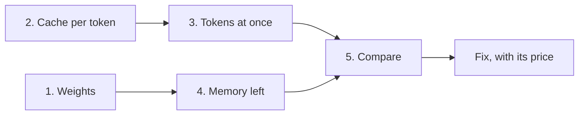

## "Probably" is not an answer

The interviewer said one sentence to Tamer: "A team wants to serve an 8-billion-parameter model to 12 people on one 48 GB GPU. Will it fit?" Tamer smiled and said, "Probably. 8B is a small model." The interviewer nodded and asked, "How much memory does one 16,384-token chat take?" Tamer had no number. The round moved on, and the question was not forgotten.

"Will it fit?" is one of the most predictable questions in an AI engineering loop, and it is arithmetic you can do on paper. The interviewer does not need the exact answer. They want to hear the steps, the units, and a fix that has a price.

By the end of this chapter you can do the estimate in five steps and in about two minutes. You can also say what to change when the answer is "no", and what that change costs.

<BigWordAlert term="Fit estimate" plainEnglish="A short calculation, done before anything is run, that says whether a model and its users' chats fit in the memory of the GPUs you have. It is done in bytes and tokens." whyItMatters="It is the question behind 'why did the server crash?' and 'how many GPUs do we need?'. An answer with arithmetic shows you can plan capacity. A fix with its price shows you can act on it." />

## The five steps

Every fit estimate uses the same five steps, in the same order. Say them aloud at the start, as a map: "I will check the weights, the cache per token, the tokens held at once, the memory left, and then compare." The interviewer then knows where you are going and can help you early.

Step 1 is the weights: the number of parameters times the bytes for each one. At 16-bit, each parameter takes 2 bytes. At 8-bit it takes 1, and at 4-bit it takes half a byte. Weights are a fixed cost. They do not grow when more people arrive.

Step 2 is the <GlossaryTerm term="KV cache" definition="The keys and values that attention computed for every earlier token of a chat. The server stores them so it does not recompute them for each new token. They grow with every token." /> per token. The formula from 11.3 is 2 x layers x KV heads x head size x bytes per value. The 2 is one key and one value for each token.

Step 3 is the tokens held at once: users times the longest chat each one will hold. Multiply by step 2 and you have the cache the load needs, in bytes.

Step 4 is the memory left. Take the GPU memory, keep 10% back for activations and the engine, and subtract the weights. Divide what remains by step 2 to get the capacity in tokens.

Step 5 is the comparison. If the need is below what is left, it fits, and you say by how much. If not, say how short it is, and pick a fix.

| Step | You ask | You compute |
|---|---|---|
| 1. Weights | How big is the fixed part? | parameters x bytes each |
| 2. Cache per token | What does one token cost? | 2 x layers x KV heads x head size x bytes |
| 3. Tokens at once | What is the load? | users x longest chat, then x step 2 |
| 4. Memory left | What can the cache use? | GPU x 0.9 - weights |
| 5. Compare | Does the need fit in what is left? | need versus left, then a fix |

The diagram shows how the steps connect. Steps 1 and 4 give the supply side. Steps 2 and 3 give the demand side. They meet only at the comparison.



Step 2 is used on both sides. Divide the memory left by it to get the capacity in tokens, and multiply the tokens at once by it to get the need. Counting in tokens lets you say "13 chats of this length" instead of only "85 GB".

## Units and the reserve

Three habits keep the arithmetic honest. First, use GB as 1,000,000,000 bytes throughout. A GiB is 1,073,741,824 bytes, so 4 GiB is about 4.29 GB, as in 11.3. Mixing the two gives an error of about 7%.

Second, write the bytes for each value. 16-bit is 2 bytes. FP8 and INT8 are 1 byte. Writing "16" and multiplying as if it were bytes makes the answer eight times too large.

Third, say how much you keep back. In this module's examples the reserve is 10%, so you multiply the GPU memory by 0.9. This is the example's own choice. The default share in vLLM v0.32.0 is 0.92, and real engines report their own cache size in tokens at startup. Use 0.9 on paper because it is easy to do in your head, and say that you are doing so.

## Worked example 1: a model that is slightly too much

Reem's team at Najm Microfinance (a fictional lender) wants to serve 12 loan officers on one 48 GB GPU. Each keeps a chat of up to 16,384 tokens. The model has 8,190,735,360 parameters, 36 layers, 8 KV heads and head size 128, all at 16-bit.

```text
1. Weights:      8,190,735,360 x 2 = 16,381,470,720 bytes = 16.38 GB
2. KV per token: 2 x 36 x 8 x 128 x 2 = 147,456 bytes (144 KiB)
3. Tokens held:  12 x 16,384 = 196,608 tokens
                 196,608 x 147,456 = 28.99 GB needed
4. Memory left:  48 x 0.9 = 43.2 GB; 43.2 - 16.38 = 26.82 GB
                 26.82 GB / 147,456 bytes = 181,874 tokens = 11 chats
5. Compare:      28.99 GB > 26.82 GB. Short by 2.17 GB. No.
```

In the interview you lead with the answer: "No. Twelve chats need 28.99 GB of cache and only 26.82 GB is left, so it is short by 2.17 GB. Eleven chats fit." Then you give the reason, and then the fix.

The gap is small, so several fixes work. Storing the cache in <GlossaryTerm term="FP8" definition="A number format that uses 1 byte per value instead of 2. Used for the KV cache, it halves the bytes per token." /> halves step 2 to 73,728 bytes. The need falls to 14.50 GB, which leaves 12.32 GB spare, and 22 chats now fit. The price is quality: the engine documents say FP8 saves memory, and they advise calibrating and testing on your own data. Halving is our arithmetic, not a measured result. Admission control is the other fix. Admit 11 chats and queue the twelfth, which changes nothing in the model and costs one person a wait.

## Worked example 2: a model that is bigger than the GPU

Now a bigger model: 70,553,706,496 parameters at 16-bit. For the cache, use this example's own shape: 80 layers, 8 KV heads, head size 128. The load is 10 chats of 32,768 tokens, and each GPU has 80 GB with 10% kept back.

```text
1. Weights:      70,553,706,496 x 2 = 141.11 GB
   One GPU: 80 x 0.9 = 72 GB. 141.11 > 72. Stop here: the weights alone do not fit.
2. KV per token: 2 x 80 x 8 x 128 x 2 = 327,680 bytes
   Two GPUs:     2 x 72 = 144 GB; 144 - 141.11 = 2.89 GB left
                 2.89 GB / 327,680 = 8,827 tokens: one chat of 8,192 tokens
   Four GPUs:    4 x 72 = 288 GB; 288 - 141.11 = 146.89 GB left
                 146.89 GB / 327,680 = 448,280 tokens = 13 chats of 32,768
3. Tokens held:  10 x 32,768 = 327,680 tokens x 327,680 = 107.37 GB
5. Compare:      107.37 GB < 146.89 GB. Fits on four GPUs, 39.52 GB spare.
```

The lesson is in the middle line. Weights that fit are only half of "fits". Two GPUs hold the weights and leave 2.89 GB, which serves one short chat. That is a deployment that starts and then cannot serve anyone. Splitting each layer's weights across GPUs is <GlossaryTerm term="tensor parallelism" definition="Splitting the matrices inside each layer across several GPUs, so each GPU holds a part of every layer. The GPUs must exchange results at each layer, so they need fast links." />, covered in 11.7. It also shares the cache between the GPUs, which is why the four-GPU pool is so much larger.

The price is cost and speed: four GPUs cost four times as much and must exchange results at every layer. This estimate ignores that traffic.

## Your turn

Karim's team has a model with 7,248,023,552 parameters, 32 layers, 8 KV heads and head size 128, all at 16-bit. They have one 24 GB GPU with 10% kept back. They want 3 chats of 32,768 tokens. Do the five steps on paper, say whether it fits, and find two fixes. Then read on.

Here is the check. The weights are 14.50 GB. The cache is 131,072 bytes per token. Three chats hold 98,304 tokens, which need 12.89 GB. The GPU gives 24 x 0.9 = 21.6 GB, so 21.6 - 14.50 = 7.10 GB is left, which holds 54,198 tokens, about 1.65 chats. It does not fit. It is short by 5.78 GB, and only one chat is safe.

Two fixes work. FP8 for the cache needs 6.44 GB, which fits in 7.10 GB with 0.66 GB spare. Weights at 8-bit take 7.25 GB, which leaves 14.35 GB, so 12.89 GB fits with 1.47 GB spare. Both margins are thin, and both change the numbers the model computes with, so a quality test comes first.

## See it run

The canvas follows the same five steps on the running example from this module: Nour's team at Wadi Labs (a fictional remote software team) and 20 long chats on one 80 GB GPU. The cache is short, and the last steps pick a fix. First predict the fix.

```predict
prompt: "Nour's 20 chats of 32,768 tokens need more cache than the 55.94 GB left on the GPU. Which single change makes all 20 fit?"
options:
  - id: fp8
    label: "Store the KV cache in FP8, 1 byte per value"
  - id: cap
    label: "Cap every chat at 24,576 tokens, three quarters of the old limit"
correctOptionId: fp8
explanation: "FP8 halves the bytes per token, so 20 chats need 42.95 GB, below 55.94 GB. The cap gives 20 x 24,576 = 491,520 tokens, which need 64.42 GB, still 8.49 GB too much."
```

<InteractiveCanvas slug="deployment-fit-steps" />

**What this shows:** each step of the estimate as one message, with the arithmetic beside it. The weights are 16.06 GB, the cache is 131,072 bytes per token, and 20 chats hold 655,360 tokens, which need 85.9 GB. The GPU gives 80 x 0.9 = 72 GB, so 55.94 GB is left, room for 13 chats. Since 85.9 GB is more than 55.94 GB, it is short by 29.96 GB.

**Try this:** First, stop before step 7 and predict the verdict, then compare 85.9 GB with 55.94 GB. Second, at step 9 the bytes per value drop from 2 to 1. Predict how many chats fit now, then check the chips. The answer is 26.

**What changed:** the cache per token halved, from 131,072 to 65,536 bytes. The need fell from 85.9 GB to 42.95 GB, and the verdict flipped from short by 29.96 GB to 12.99 GB spare. The room for chats doubled, from 13 to 26. The weights did not change at all.

**Limits of the model:** it uses one GPU, the example's 10% reserve and 16-bit weights. It leaves out paging waste, fragmentation, prefix sharing and the speed of the answers, so a real server needs more headroom than the arithmetic shows. The 20 chats and the 32,768-token context are the example's own numbers.

Now check the method in a new case.

```quiz
type: mcq
question: "Sara plans 7 users with chats of up to 20,000 tokens on one 24 GB GPU, with 10% kept back. Her model has 7 billion parameters at 16-bit (14 GB), 28 layers, 4 KV heads and head size 128, and a 16-bit cache. What is the right verdict?"
options:
  - "It fits: the cache needs 8.03 GB, and 10 GB are free after the weights"
  - "It fits: the cache needs 4.01 GB, which is below the 7.6 GB left over"
  - "It does not fit: the cache needs 8.03 GB, and only 7.6 GB is left over"
  - "It does not fit: the cache needs 56.2 GB, because 28 heads store keys"
correct: 2
explanations:
  - "The 10% reserve was skipped. The GPU gives 24 x 0.9 = 21.6 GB, so 21.6 - 14 = 7.6 GB remain after the weights, not 10 GB."
  - "This leaves out the 2 for keys and values, which halves the cache. The real figure is 2 x 28 x 4 x 128 x 2 = 57,344 bytes per token, so 140,000 tokens need 8.03 GB."
  - "Right. 7 x 20,000 = 140,000 tokens x 57,344 bytes = 8.03 GB. The memory left is 21.6 - 14 = 7.6 GB. It is short by 0.43 GB."
  - "The model has 4 KV heads, not 28, so the cache is 57,344 bytes per token. Counting all 28 heads makes it seven times too large."
```

## Mistakes that cost points

These seven mistakes cost candidates the most. Each one is a step above, done wrongly.

- **Counting users, not tokens.** The cache in example 1 holds 181,874 tokens. That is 44 chats of 4,096 tokens, 11 of 16,384, or 5 of 32,768. Same memory, different user counts.
- **Forgetting the 2.** Keys and values are both stored. Leave out the 2 and every cache number is half the truth.
- **Mixing bits and bytes.** 16-bit means 2 bytes. 8-bit means 1 byte.
- **Mixing GB and GiB.** 4 GiB is 4.29 GB. Compare like with like.
- **Forgetting the reserve.** Using all 80 GB makes a no look like a yes.
- **Planning for the average chat.** The server must survive the peak mix of long and short chats, not the mean.
- **A fix with no price.** FP8 cache needs a quality test. A second GPU doubles the cost. A shorter context changes the product. Admission control makes some people wait.

<Callout type="tip" title="Check the weights first">
If the weights alone are above the memory you can use, stop at step 1. No change to the cache, the users or the context can help. Only smaller weights or more GPUs can.
</Callout>

```quiz
type: mcq
question: "Reem's model has 12 billion parameters at 16-bit, and her GPU has 24 GB with 10% kept back. Her estimate for the cache of all her users is only 3 GB. Which single change makes the deployment fit?"
options:
  - "Store the cache in FP8, which cuts her 3 GB estimate to 1.5 GB"
  - "Cap each chat at half its length, which cuts the cache to 1.5 GB"
  - "Serve half as many users at once, which cuts the cache to 1.5 GB"
  - "Store the weights in 8 bits, which cuts them from 24 GB to 12 GB"
correct: 3
explanations:
  - "The cache is not the problem. The weights alone are 12 billion x 2 = 24 GB, above the 21.6 GB the GPU can use, so no cache change can help."
  - "A shorter context shrinks only the cache. The weights are 24 GB and stay above the 21.6 GB usable, so it still does not fit."
  - "Fewer users shrink only the cache. The weights alone already overflow the 21.6 GB usable, so the deployment still fails."
  - "Right. At 8 bits the weights are 12 GB, which leaves 21.6 - 12 = 9.6 GB. That is enough for the 3 GB cache, with 6.6 GB spare."
```

## In the interview

Expect this question in one of three forms: "will it fit?", "why did it crash under load?", or "how many GPUs do we need?" All three are the same five steps. A strong answer leads with the number, gives the reason in a sentence, and ends with a fix and its price. Practise by saying each answer aloud with a pen in your hand, then open the model answer.

<FaqGroup title="Practice questions">
<FaqItem question="A teammate says an 8-bit 7B model is only 7 GB, so a 16 GB GPU is plenty. Do you agree?">

Not for long chats. The weights are 7,248,023,552 parameters x 1 byte, 7.25 GB. A 16 GB GPU with 10% kept back gives 14.4 GB, so 7.15 GB is left for the cache. At 131,072 bytes per token that is about 54,565 tokens: one chat of 32,768 tokens, or six of 8,192. The weights fit easily, but the cache sets the limit. I would ask how long the chats are before agreeing. An FP8 cache would double the room to about 109,130 tokens.

**Follow-up probes:**

- Which line does the engine print at startup that lets you check this number?
- Which two fixes leave both the weights and the cache format unchanged?

</FaqItem>
<FaqItem question="You are given a model you have never seen. How do you find its KV cache size per token?">

I open its config and read the layers, the KV heads, the hidden size and the attention heads. If the head size is not listed, it is the hidden size divided by the attention heads. For 40 layers, 8 KV heads, hidden size 5,120 and 40 attention heads, the head size is 128. The cache is 2 x 40 x 8 x 128 x 2 = 163,840 bytes per token, 160 KiB, so a 32,768-token chat holds 5.37 GB. If the KV heads equalled the attention heads, it would be 819,200 bytes, five times more, so I always read the KV heads line.

**Follow-up probes:**

- Why does the number of attention heads alone not give the cache size?
- What do you check before storing this cache in FP8?

</FaqItem>
<FaqItem question="Your estimate says it fits, but under load the server keeps preempting requests. What did you miss?">

Most likely I planned for the average chat, not the peak mix. Say the cache holds 150,000 tokens. Twenty users at an average of 6,000 tokens hold 120,000 tokens, which looks fine. But if 4 users paste long documents and hold 32,768 tokens each, that is 131,072 tokens, and the other 16 hold 96,000 more. The total is 227,072 tokens, which is 77,072 over. The engine then preempts and recomputes requests, which costs latency. I would plan for the peak mix, leave headroom for the engine, and add a token limit that queues the extra requests.

**Follow-up probes:**

- What does the engine do by default when the cache runs out, and what does that cost?
- How would you find out the real mix of chat lengths before launch?

</FaqItem>
<FaqItem question="Users grow from 8 to 20 next month. Which fix do you reach for first?">

I redo the numbers first. Take the 36-layer model from this chapter on a 40 GB GPU. After the weights and the reserve, 19.62 GB is left, about 133,046 tokens. Eight chats of 8,192 tokens need 9.66 GB, which is fine. Twenty chats need 24.16 GB, short by 4.54 GB, a gap of only 1.23 times. A small fix is enough. Admission control at 16 chats uses 131,072 tokens, 19.33 GB, and queues the other four. FP8 for the cache halves the need to 12.08 GB. A second GPU doubles the room and the cost. I would start with admission control because it changes no model numbers.

**Follow-up probes:**

- What does a user see when the 17th chat arrives?
- What would make you choose the second GPU instead?

</FaqItem>
<FaqItem question="How would you estimate the cost per million tokens of a self-hosted model?">

I divide the GPU's hourly cost by the tokens it makes in an hour, then scale to a million. In an example with 2 units per hour and 2,000 tokens per second, an hour gives 2,000 x 3,600 = 7,200,000 tokens. So 2 / 7,200,000 x 1,000,000 = 0.278 units per million. If the GPU is busy only half the time, I divide by 0.5, and the cost doubles to 0.556. The tokens per second must be measured under real load and the latency target, not copied from a benchmark. Input and output tokens may cost differently, because prefill and decode use the GPU differently.

**Follow-up probes:**

- Why can a bigger batch lower this cost, and what does it do to each user's wait?
- What would you compare this number with before choosing to self-host?

</FaqItem>
<FaqItem question="A manager asks: how many users can this GPU serve? What do you say?">

I say it depends on the chat length, and I answer in tokens. In example 1, the cache holds 181,874 tokens. That serves 44 chats of 4,096 tokens, 11 of 16,384, or 5 of 32,768. It is the same memory with very different user counts. So I ask for the longest chat the product allows, give one number for that case, and offer a cap on chat length or a token limit if they want more users.

**Follow-up probes:**

- What cap on chat length would let 20 users fit on this GPU?
- How does a limit on tokens differ from a limit on users?

</FaqItem>
</FaqGroup>

**Next:** A short quiz checks the whole module, and then the gate asks you to size a deployment in writing.
