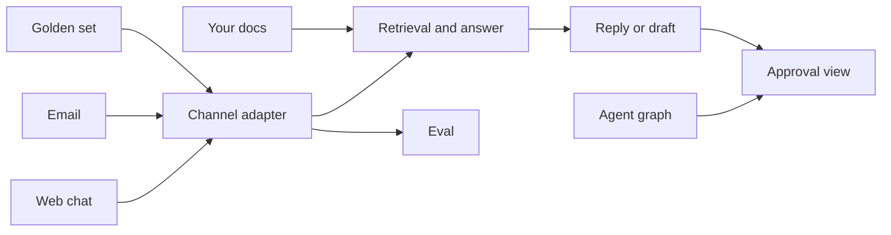

## What you will have at the end

By the end of this chapter you will have one repository for your project where a single `pytest -q` run proves everything the capstone promises: retrieval with citations, a golden set of at least 20 questions, a regression eval, an agent whose risky tool waits for a human, an async endpoint with retries and a timeout, one structured log line per request, web chat and email behind one channel adapter, email replies that wait for approval, a small web UI, and a faithfulness check. All of it runs with no API key and no mail account.

Interviewers care about this for a simple reason. In a deep dive they ask "How do you know it works?", and in a hands-on round they ask you to write pieces of exactly this code. A repository where the tests answer the first question is the best evidence you can bring.

This chapter does not contain a solution. You already wrote most of the code in chapters 3.5, 5.5, 7.6 and 9.6. Here you get the plan, the new interfaces, the acceptance tests, and hints in prose.

<BigWordAlert term="Acceptance test" plainEnglish="A test that checks a promise the whole project makes, such as 'the service works with no API key', rather than one small function." whyItMatters="Acceptance tests turn a capstone's must-haves into something a mentor, or an interviewer, can check in one command." />

## What you need

A laptop with Python 3.11 or later and the virtual environment from your build chapters. You need no new packages. If you completed chapters 7.6 and 9.6, everything is installed. If not, `pip install -r requirements.txt` downloads about 10 MB for pytest, fastapi, httpx, uvicorn and langgraph with their dependencies, about 45 MB installed (measured on 2026-10-22). No model is downloaded and no API key is used.

## How the pieces connect

The capstone adds a few small files to what you built. The diagram shows the request path and where the new parts sit.



Three things to notice. First, every message passes through the channel adapter, and so does every golden question. A bug in how you clean an email therefore shows up in your evaluation, which is exactly what you want. Second, retrieval feeds both the service and the evaluation, so a change to chunking changes both, and your golden labels with them. Third, the approval view is where both kinds of pause meet: a drafted email reply and a risky tool call. One place to approve is easier to test, and easier to defend in an interview, than two.

## The new interfaces

Keep every interface from the build chapters as it is: `chunk_words`, `HashingEmbedder`, `InMemoryVectorStore`, `load_chunks`, `FakeLLM`, `answer`, the metric functions, `evaluate`, `build_graph`, `call_with_retries` and `create_app(llm, store)`. The capstone adds these, for the service, the logs and the faithfulness check:

```text
app/main.py           class AsyncAdapter: __init__(self, llm: LLM); async def complete(self, prompt: str) -> str
                      def build_default_app() -> FastAPI   (loads data/docs, uses the fake model unless MODEL_BACKEND says otherwise)
                      app = build_default_app()            (so "uvicorn app.main:app" works)
app/logs.py           def log_event(event: str, **fields) -> None   (one JSON line on the logger "rag_agent_service", level INFO)
app/faithfulness.py   def is_faithful(ans: Answer, retrieved: list[Chunk], min_overlap: float = 0.6) -> bool
                      def evaluate_answers(store, llm, golden: list[dict], k: int = 3) -> dict[str, float]
                      (keys "faithfulness" and "citation_rate", each the share of golden questions)
tests/conftest.py     fixtures golden and docs_dir
```

Hints, in prose. `AsyncAdapter` wraps the synchronous `FakeLLM` so `create_app` can await it; its `complete` just returns the wrapped model's answer. `build_default_app` reads the environment variable `MODEL_BACKEND`, defaulting to `fake`, and raises a clear error for any value you have not built an adapter for. `log_event` builds a dictionary from the event name and the fields and logs it with `json.dumps`; call it exactly once per request, in a `finally` block, so errors are logged too. Log ids, counts and timings, never the question text.

Sessions 5 and 6 add the channels and the routes the web UI calls:

```text
app/channels.py   @dataclass(frozen=True) class Message: channel: str; thread_id: str; sender: str; text: str; subject: str = ""; message_id: str = ""
                  @dataclass(frozen=True) class Reply: channel: str; thread_id: str; to: str; subject: str; text: str
                  class Channel(Protocol): name: str; needs_approval: bool
                      def receive(self, raw: dict) -> Message
                      def format_reply(self, message: Message, ans: Answer) -> Reply
                      def deliver(self, reply: Reply) -> None
                  class FakeChat:  name "chat", needs_approval False; raw {"session_id", "user", "text"}; sent: list[Reply]
                  class FakeEmail: name "email", needs_approval True; raw {"message_id", "thread_id", "from", "subject", "body"}; sent: list[Reply]
                  def get_channel(name: str) -> Channel   (a new instance; KeyError for an unknown name)
app/evaluate.py   def question_text(item: dict) -> str   (an item with "raw" is read through its channel's receive; otherwise item["question"])
                  def evaluate_by_channel(store, golden: list[dict], k: int = 3) -> dict[str, dict[str, float]]
                  (one entry per channel, same keys as evaluate; evaluate and evaluate_by_channel both use question_text)
app/approvals.py  the reply graph and the record of decided approvals
app/main.py       build_default_app() also sets app.state.channels = {"chat": FakeChat(), "email": FakeEmail()}
app/static/index.html   the web UI, with regions id="chat", id="inbox" and id="approvals"
```

```text
POST /channels/{name}/messages   raw message -> 200 {"thread_id", "status": "answered", "reply": {"answer", "citations"}, "approval_id": null}
                                             or 202 {..., "status": "awaiting_approval", "approval_id": "<id>"}; 404 for an unknown channel
GET  /inbox                      [{"thread_id", "channel", "sender", "subject", "status", "draft"}], status "awaiting_approval", "sent" or "rejected"
GET  /approvals                  pending only: [{"id", "kind": "reply" or "tool", "summary"}]
POST /approvals/{id}             {"decision": "approve" or "reject"} -> 200 {"id", "status": "approved" or "rejected"}; 404 unknown; 409 already decided
GET  /                           the page in app/static/index.html
```

For `is_faithful`, start with a cheap lexical rule. An answer with no citations is faithful only if it is the "I don't know" answer. Every citation must be one of the retrieved chunks. Then take the answer's content words (lowercase, citation brackets removed, stopwords dropped) and check that at least `min_overlap` of them appear in the cited chunks' text. This rule has a real limit, which 13.3 asks you to report: it cannot see negation. "A rollback needs approval" passes against a chunk that says "A rollback needs no approval", because every content word is present.

For `FakeEmail.receive`, read the body line by line and stop at the first line that starts a signature or quoted history: a line that is `-- ` (two dashes and a space; accept it without the space too, because many editors trim it), a line starting with `>`, or a line starting with "On " and ending with "wrote:". Keep what came before, stripped. `format_reply` for email adds "Re: " to the subject unless it is already there, puts the answer first, then a "Sources:" list with one citation id per line, then your project's sign-off. A chat reply is just the answer text with its inline citations. `deliver` on a fake channel appends the reply to `sent`, and nothing leaves your laptop. Only `receive`, `format_reply` and `deliver` may depend on the channel. Retrieval, `answer()` and your agent take the message's text only: if any of them branches on the channel name, the adapter has leaked.

Put the `/channels/{name}/messages` route in `app/main.py`, next to the routes `create_app` gives you, and send the cleaned text down the same answer path, with the same retries, timeout and semaphore. Take the raw message as a plain dictionary, so an unknown channel gets its 404 before any validation; then let the channel's `receive` reject a malformed message, and return that as a 422 `validation_error`. Only asynchronous channels appear in `/inbox`, one row per thread with its latest draft. Log one line for each request that passes validation, and log each approval decision as its own line with the approval id and the decision, never the draft. With the fake model, a draft can start in the middle of a sentence, because it copies the first sentence of a chunk; that is expected, and a real model behind the adapter fixes it.

For the email approval, reuse the pattern from chapter 7.6 with a second small graph: a node that drafts the reply, a node that does nothing but call `interrupt()` with the draft, and a node that delivers it. Use the channel name and the message id as the graph's thread id, so the approval id can simply be that id, and a second email on the same thread gets an approval of its own. Keep a small dictionary of decided approvals, so a second decision returns 409 instead of resuming the graph again. A plain dictionary of drafts without a graph also passes the tests, but then you have two approval mechanisms to explain in your defence.

## The staged plan

Seven sessions of about 60 to 75 minutes. Commit at the end of each one, so a power cut never costs more than a session.

<Steps title="Seven sessions from Bustan Books to your project">
<Step title="Session 1: documents and retrieval" stepNumber="1">

Copy your `rag-agent-service` repository into a new repository named for your project, for example `nakhla-knowledge-bot`. Keep the `app/` and `tests/` names so every interface still lines up. Activate the environment:

```bash
python -m venv .venv
source .venv/bin/activate        # macOS or Linux
.venv\Scripts\activate           # Windows
pip install -r requirements.txt
```

Replace the three Bustan Books files in `data/docs/` with the 6 to 10 documents you write for %%product.name%%. Update the questions and expected chunk ids in `tests/test_rag.py` so they ask about your documents. Done when `pytest -q tests/test_rag.py` passes.

</Step>
<Step title="Session 2: golden set and regression eval" stepNumber="2">

Print your chunks with their ids, then write at least 20 questions in `data/golden.jsonl`, each with the ids that answer it and a `"channel"` field. Every item keeps a `"question"`: for an email item, it is the question as the person meant it, so a reader of the file can follow it. Write questions the way your users would type them, including a few with words that do not appear in the documents. Mark at least five as `"email"` and give each of those a `"raw"` field: a whole fake email with a subject, a signature and some quoted history, in the shape `FakeEmail.receive` reads. Ask at least three questions twice, once as chat and once as email, with the same labels. The evaluation reads the raw email, not the `"question"` field, so greetings such as "Hi team" stay in what retrieval sees, as they would in real use. Add `tests/conftest.py` and `tests/test_capstone_data.py` from below. Run `python -m app.evaluate`, then set the thresholds in `tests/test_eval_regression.py` a little below your first numbers. Done when `pytest -q -m eval` passes.

</Step>
<Step title="Session 3: the agent and its approval step" stepNumber="3">

Rename the two tools in `app/agent.py` to your project's safe and risky tools, with a small in-memory table of fake records. Validate the risky tool's arguments with Pydantic. Adapt `tests/test_agent.py` so it still proves three things: the risky tool does not run before approval, runs once after approval, and does not run after a rejection. Done when `pytest -q tests/test_agent.py` passes.

</Step>
<Step title="Session 4: the default app and structured logs" stepNumber="4">

Write `app/main.py` and `app/logs.py`, and call `log_event` once per request in your `/ask` handler, with `channel="chat"`. Make sure `/ask` returns the "I don't know" answer with empty citations when no chunk passes the score threshold, as `answer()` does. Add `tests/test_capstone_service.py` and `tests/test_capstone_logs.py`. Done when both pass and `uvicorn app.main:app` starts.

</Step>
<Step title="Session 5: web chat and email channels" stepNumber="5">

Write `app/channels.py` with `FakeChat`, `FakeEmail` and `get_channel`, add `evaluate_by_channel` to `app/evaluate.py`, and add the `/channels/{name}/messages` route. A chat message is answered and delivered at once. An email message gets a drafted reply that waits for approval. Log one line per message with the channel, ids, counts and timings, never the body, the subject or the sender's address. If you build your project's third channel, add it to `get_channel` and to `CHANNELS` in the test. Make `evaluate` use `question_text` too, so the overall and per-channel numbers come from the same text. Add `tests/test_capstone_channels.py`, then set `MIN_RECALL_PER_CHANNEL` a little below your lowest channel. If email is far below chat at first, print the cleaned text of each email item before you change anything else. Done when it passes.

</Step>
<Step title="Session 6: the web UI" stepNumber="6">

Add the `/inbox` and `/approvals` routes, then write `app/static/index.html` and serve it at `/`. Put three to five sample emails in `data/inbox/`, and give yourself a way to post them to the service for a demo: a small script or a "Load sample emails" button. Make your risky tool's pause appear in the same approval view, with kind `"tool"`; you decide how a message starts it, for example a rule on the message text or a button in the chat panel. Add `tests/test_capstone_ui.py`, and write one test of your own that approves your risky tool through `/approvals`. Then open the page in a browser at phone width and work through the UI checklist below. Done when the tests pass and every box is ticked.

</Step>
<Step title="Session 7: faithfulness, README and a clean run" stepNumber="7">

Write `app/faithfulness.py` and add `tests/test_capstone_eval.py`. Write the README: what the service does, install, `pytest -q`, `python -m app.evaluate`, how to start the service and open the UI, and how to load the sample emails. Then clone your repository into a new folder, follow only your README, and run the full suite. Done when it passes there too.

</Step>
</Steps>

## The acceptance tests

Copy these files exactly. If you already have a `tests/conftest.py`, add the two fixtures to it.

```python
# tests/conftest.py
import json
from pathlib import Path

import pytest

DATA = Path(__file__).resolve().parent.parent / "data"


@pytest.fixture(scope="session")
def golden() -> list[dict]:
    lines = (DATA / "golden.jsonl").read_text(encoding="utf-8").splitlines()
    return [json.loads(line) for line in lines if line.strip()]


@pytest.fixture(scope="session")
def docs_dir() -> str:
    return str(DATA / "docs")
```

```python
# tests/test_capstone_data.py
from app.ingest import load_chunks


def test_golden_set_has_at_least_20_questions(golden):
    assert len(golden) >= 20
    assert len({item["id"] for item in golden}) == len(golden)
    for item in golden:
        assert item["question"].strip() and item["relevant"], item["id"]


def test_every_relevant_chunk_exists(golden, docs_dir):
    chunk_ids = {c.id for c in load_chunks(docs_dir)}
    for item in golden:
        missing = set(item["relevant"]) - chunk_ids
        assert not missing, f"{item['id']} points at missing chunks {missing}"
```

```python
# tests/test_capstone_service.py
import os

from fastapi.testclient import TestClient

from app.embedding import HashingEmbedder
from app.llm import FakeLLM
from app.main import AsyncAdapter, build_default_app
from app.service import create_app
from app.store import InMemoryVectorStore


def test_runs_without_any_api_key(monkeypatch, golden):
    for name in list(os.environ):
        if "KEY" in name.upper() or "TOKEN" in name.upper():
            monkeypatch.delenv(name)
    client = TestClient(build_default_app())
    body = client.post("/ask", json={"question": golden[0]["question"]}).json()
    assert body["citations"], body


def test_no_matching_chunk_means_i_dont_know():
    empty_store = InMemoryVectorStore(HashingEmbedder())
    client = TestClient(create_app(AsyncAdapter(FakeLLM()), empty_store))
    body = client.post("/ask", json={"question": "Can I get a refund?"}).json()
    assert body["citations"] == []
    assert "don't know" in body["answer"].lower()
```

```python
# tests/test_capstone_logs.py
import json
import logging

from fastapi.testclient import TestClient

from app.main import build_default_app


def test_ask_writes_one_structured_log_line(caplog, golden):
    caplog.set_level(logging.INFO, logger="rag_agent_service")
    question = golden[0]["question"]
    TestClient(build_default_app()).post("/ask", json={"question": question})
    lines = [r.getMessage() for r in caplog.records if r.name == "rag_agent_service"]
    assert len(lines) == 1
    event = json.loads(lines[0])
    for key in ("event", "request_id", "latency_ms", "retrieved", "citations", "outcome"):
        assert key in event, key
    assert question not in lines[0]  # never log the raw question
```

```python
# tests/test_capstone_eval.py
import pytest

from app.embedding import HashingEmbedder
from app.faithfulness import evaluate_answers
from app.ingest import load_chunks
from app.llm import FakeLLM
from app.store import InMemoryVectorStore

MIN_FAITHFULNESS = 0.95
MIN_CITATION_RATE = 0.90


@pytest.mark.eval
def test_golden_answers_are_faithful_and_cited(golden, docs_dir):
    store = InMemoryVectorStore(HashingEmbedder())
    store.add(load_chunks(docs_dir))
    scores = evaluate_answers(store, FakeLLM(), golden, k=3)
    assert scores["faithfulness"] >= MIN_FAITHFULNESS, scores
    assert scores["citation_rate"] >= MIN_CITATION_RATE, scores
```

The channel tests check the adapter, the golden set's coverage, the per-channel floor and the log line. The sample email is about restarts, but the tests only check the cleaning, so keep it as it is whatever your project. Copy the two files exactly; the only lines you edit are the two constants marked as yours, `CHANNELS` and `MIN_RECALL_PER_CHANNEL`.

```python
# tests/test_capstone_channels.py (part 1 of 2)
import pytest

from app.channels import FakeChat, FakeEmail, get_channel
from app.rag import Answer

RAW_EMAIL = {
    "message_id": "m-101",
    "thread_id": "t-17",
    "from": "dana@example.org",
    "subject": "Restart rules",
    "body": "Who has to approve a restart?\n\nThanks,\nDana\n-- \nDana Haddad, platform team\n"
    "\nOn Monday, Nour wrote:\n> Restarts need no approval.\n",
}


def test_email_is_cleaned_before_the_agent_sees_it():
    message = FakeEmail().receive(RAW_EMAIL)
    assert (message.channel, message.thread_id, message.sender) == ("email", "t-17", "dana@example.org")
    assert message.subject == "Restart rules"
    assert "Who has to approve a restart?" in message.text
    assert "platform team" not in message.text  # the signature
    assert "Restarts need no approval" not in message.text  # quoted history


@pytest.mark.parametrize("quote", ["On Monday, Nour wrote:\n> Restarts need no approval.\n", "> Restarts need no approval.\n"])
def test_quoted_history_goes_even_without_a_signature(quote):
    message = FakeEmail().receive({**RAW_EMAIL, "body": "Who has to approve a restart?\n\n" + quote})
    assert "Restarts need no approval" not in message.text
    assert "wrote:" not in message.text


def test_only_the_email_channel_needs_approval():
    assert FakeChat().needs_approval is False
    assert FakeEmail().needs_approval is True
    assert get_channel("email").name == "email"
    with pytest.raises(KeyError):
        get_channel("fax")


def test_email_reply_keeps_the_thread_and_lists_sources():
    channel = FakeEmail()
    message = channel.receive(RAW_EMAIL)
    reply = channel.format_reply(message, Answer(text="The on-call engineer approves it. [deploys#2]", citations=["deploys#2"]))
    assert (reply.to, reply.thread_id, reply.subject) == ("dana@example.org", "t-17", "Re: Restart rules")
    assert "Sources:" in reply.text and "deploys#2" in reply.text.split("Sources:")[1]
    assert channel.sent == []  # formatting a reply never sends it
```

```python
# tests/test_capstone_channels.py (part 2 of 2, same file)
import json
import logging

from fastapi.testclient import TestClient

from app.embedding import HashingEmbedder
from app.evaluate import evaluate_by_channel
from app.ingest import load_chunks
from app.main import build_default_app
from app.store import InMemoryVectorStore

CHANNELS = {"chat", "email"}  # add your third channel's name if you build one
MIN_RECALL_PER_CHANNEL = 0.80  # set a little below your lowest channel


def test_golden_set_covers_every_channel(golden):
    channels = [item.get("channel", "chat") for item in golden]
    assert set(channels) <= CHANNELS, set(channels) - CHANNELS
    assert channels.count("email") >= 5
    for item in golden:
        if item.get("channel") == "email":
            assert "raw" in item, f"{item['id']} needs the raw email"


@pytest.mark.eval
def test_every_channel_keeps_its_recall(golden, docs_dir):
    store = InMemoryVectorStore(HashingEmbedder())
    store.add(load_chunks(docs_dir))
    by_channel = evaluate_by_channel(store, golden, k=3)
    assert {"chat", "email"} <= set(by_channel), by_channel
    for channel, scores in by_channel.items():
        assert scores["recall_at_k"] >= MIN_RECALL_PER_CHANNEL, (channel, scores)


def test_email_log_line_has_the_channel_but_no_body_or_address(caplog, golden):
    caplog.set_level(logging.INFO, logger="rag_agent_service")
    raw = {**RAW_EMAIL, "from": "sam@example.org", "body": golden[0]["question"]}
    TestClient(build_default_app()).post("/channels/email/messages", json=raw)
    lines = [r.getMessage() for r in caplog.records if r.name == "rag_agent_service"]
    assert len(lines) == 1
    assert json.loads(lines[0])["channel"] == "email"
    assert golden[0]["question"] not in lines[0]
    assert "sam@example.org" not in lines[0]
```

The UI tests check the HTTP contract the page uses, not how the page looks. You check the look yourself with the UI checklist below.

```python
# tests/test_capstone_ui.py (part 1 of 2)
from fastapi.testclient import TestClient

from app.main import build_default_app


def send_email(golden, thread_id):
    app = build_default_app()
    client = TestClient(app)
    raw = {"message_id": f"m-{thread_id}", "thread_id": thread_id, "from": "sam@example.org",
           "subject": "A question", "body": golden[0]["question"] + "\n-- \nSam"}
    return app, client, client.post("/channels/email/messages", json=raw)


def inbox_thread(client, thread_id):
    return next(t for t in client.get("/inbox").json() if t["thread_id"] == thread_id)


def test_page_has_chat_inbox_and_approvals():
    page = TestClient(build_default_app()).get("/")
    assert page.status_code == 200
    assert page.headers["content-type"].startswith("text/html")
    for region in ('id="chat"', 'id="inbox"', 'id="approvals"'):
        assert region in page.text, region


def test_chat_answers_at_once(golden):
    raw = {"session_id": "s-1", "user": "sam", "text": golden[0]["question"]}
    response = TestClient(build_default_app()).post("/channels/chat/messages", json=raw)
    assert response.status_code == 200
    body = response.json()
    assert body["status"] == "answered" and body["approval_id"] is None
    assert body["reply"]["citations"], body
```

```python
# tests/test_capstone_ui.py (part 2 of 2, same file)
def test_email_reply_waits_then_sends_once(golden):
    app, client, response = send_email(golden, "t-1")
    sent, body = app.state.channels["email"].sent, response.json()
    assert response.status_code == 202 and body["status"] == "awaiting_approval"
    assert sent == []
    assert inbox_thread(client, "t-1")["status"] == "awaiting_approval"
    assert inbox_thread(client, "t-1")["draft"]
    assert body["approval_id"] in [a["id"] for a in client.get("/approvals").json()]
    decided = client.post(f"/approvals/{body['approval_id']}", json={"decision": "approve"})
    assert decided.json()["status"] == "approved"
    assert len(sent) == 1 and sent[0].thread_id == "t-1"
    again = client.post(f"/approvals/{body['approval_id']}", json={"decision": "approve"})
    assert again.status_code == 409 and len(sent) == 1
    assert body["approval_id"] not in [a["id"] for a in client.get("/approvals").json()]


def test_rejected_reply_is_never_sent(golden):
    app, client, response = send_email(golden, "t-2")
    client.post(f"/approvals/{response.json()['approval_id']}", json={"decision": "reject"})
    assert app.state.channels["email"].sent == []
    assert inbox_thread(client, "t-2")["status"] == "rejected"


def test_unknown_names_are_404_with_structured_errors():
    client = TestClient(build_default_app())
    for response in (client.post("/channels/fax/messages", json={}),
                     client.post("/approvals/missing", json={"decision": "approve"})):
        assert response.status_code == 404
        assert "code" in response.json()["error"]
```

With the fake model, faithfulness is close to 1.0 by construction, because it copies a sentence from the top chunk. The test is still worth having: it checks the citation path end to end, and the day you plug in a real model behind `MODEL_BACKEND`, an unfaithful answer fails the build.

Together with your earlier files, these are the tests that must pass:

| Test file | What it proves | From |
|---|---|---|
| `test_rag.py` | Chunking, search and cited answers on your documents | 3.5 |
| `test_metrics.py`, `test_eval_regression.py` | Metrics are right; quality has a floor | 5.5 |
| `test_agent.py` | The risky tool waits for approval | 7.6 |
| `test_service.py` | Validation, retries, timeout, semaphore | 9.6 |
| `test_capstone_*.py` | Golden set, no key, logs, channels, UI contract, faithfulness | 13.2 |

## Verify

Run only the new acceptance tests first, then everything. On the reference repository used to check this chapter (a Nakhla Systems corpus with 6 documents and 20 golden questions), the new tests gave this result. Your timing will vary.

<TerminalBlock title="Run the capstone acceptance tests" cwd="nakhla-knowledge-bot">
  <TerminalLine type="prompt">pytest -q tests/test_capstone_data.py tests/test_capstone_service.py tests/test_capstone_logs.py tests/test_capstone_eval.py</TerminalLine>
  <TerminalLine type="output">6 passed in 2.13s</TerminalLine>
  <TerminalLine type="prompt">pytest -q tests/test_capstone_channels.py tests/test_capstone_ui.py</TerminalLine>
  <TerminalLine type="output">13 passed in 2.59s</TerminalLine>
</TerminalBlock>

Then run `pytest -q` for the whole suite. The exact count depends on your earlier test files; the line must end in `passed` with no `failed` or `error`.

Now break it on purpose, to see that the golden set is tied to your chunking. In `app/ingest.py`, change the default `size` of `load_chunks` from 60 to 120 and run `pytest -q tests/test_capstone_data.py`. Bigger chunks mean fewer chunks, so some labelled ids no longer exist. On the reference repository it failed like this:

```text
E           AssertionError: q03 points at missing chunks {'deploys#2'}
1 failed, 1 passed in 0.75s
```

Your id will be different. Put the size back and the test passes again. The lesson for your report: every time you change chunking, you must re-label the golden set, or your metrics measure the wrong thing.

Break the email cleaning too. In `FakeEmail.receive`, remove the two rules for quoted history (the `>` lines and the "On ... wrote:" line), keep the signature rule, and run `pytest -q tests/test_capstone_channels.py`. On the reference repository both quote cases failed:

```text
E       AssertionError: assert 'Restarts need no approval' not in 'Who has to ...no approval.'
2 failed, 6 passed in 2.31s
```

Quoted history is not only untidy. The old reply said restarts need no approval, which contradicts the current runbook, and without the rule it reaches retrieval as part of the question. Put the rules back and all 8 tests pass.

If something fails, check the most common mistakes first:

- **`FileNotFoundError` for `data/golden.jsonl` or `data/docs`.** A path was written relative to the folder you ran from. Build paths from `__file__`, as `conftest.py` does, and do the same where `build_default_app()` loads `data/docs`. Then run pytest from the repository root.
- **An email reply is sent before anyone approves it.** The draft node calls `deliver`, or the node that calls `interrupt()` does something above the call. This is the 7.6 trap again: on resume, the paused node runs from its first line. Keep `deliver` in its own node after the pause.
- **The log test finds 0 lines or 2 lines.** Zero usually means a different logger name or a level below INFO is filtered; use `logging.getLogger("rag_agent_service")` and `logger.info`. Two means `log_event` is called in more than one place; keep one call in the handler's `finally` block.

<Callout type="warning" title="No real data in a public repository">
Your documents and golden questions are fictional. Keep them that way. Never commit a real API key, even in a test; the no-key test exists to prove you never need one.
</Callout>

## The UI checklist

The tests prove the contract. These boxes prove the page is usable, so tick them in a browser, not in your head. Open the UI with the browser window narrowed to about 375 pixels, or with your browser's device view.

- [ ] The chat panel has a labelled text box and a Send button; Enter also sends, and Send is disabled while an answer is on its way
- [ ] A chat answer shows its citation ids, and the "I don't know" answer is shown plainly, not as an error
- [ ] A 422, 502 or 504 from the service shows its error message in the panel instead of a blank space
- [ ] Each inbox thread shows the sender, the subject, the drafted reply and its status in words (waiting for approval, sent or rejected), not by colour alone
- [ ] Each pending approval says what will happen if approved: who gets the reply, or which tool runs with which arguments
- [ ] After Approve or Reject, the item leaves the list and the inbox status changes without reloading the page
- [ ] Every control can be reached and used with the Tab, Enter and Space keys, with a visible focus outline
- [ ] At 375 pixels wide nothing scrolls sideways and no text is cut off
- [ ] The page loads no external scripts, fonts or images, so it works offline

Interviewers who open your repository will try the UI before they read the code. Keep it plain and working rather than pretty and half done.

## Acceptance criteria

- [ ] My repository has 6 to 10 fictional documents for my project in `data/docs/`
- [ ] `data/golden.jsonl` has at least 20 questions, each labelled with existing chunk ids
- [ ] The risky tool pauses for approval, and `tests/test_agent.py` proves it does not run before approval or after a rejection
- [ ] `/ask` validates input, retries transient failures, has a timeout, limits concurrency and returns structured errors
- [ ] Each `/ask` request writes exactly one JSON log line with no raw question text
- [ ] Web chat and email go through one channel adapter, and retrieval, `answer()` and my agent never branch on the channel name
- [ ] An email reply waits in the approval view, is sent once after approval, and is never sent after a rejection
- [ ] My golden set has at least five raw emails, and the evaluation reports recall for each channel
- [ ] My UI at `/` passes the UI checklist, and my risky tool's approval appears in the same view
- [ ] `pytest -q` passes from a fresh clone, following only my README, with no API key set
- [ ] I saw the chunk-size failure, put the size back and the tests pass again

## Submit your progress

```openquestion
prompt: "Paste the link to your capstone repository. Optionally, paste the last line of your full pytest -q run and name your project."
required: true
minWords: 0
allowSpeechInput: true
allowUrl: true
urlRequired: true
urlLabel: "Repository link"
urlHint: "A link your mentor can open. If your repository is private, add your mentor as a reader."
modelAnswer: "The runbook bot project, Nakhla Ops, for Nakhla Systems. My full pytest -q run ends in passed with no failures, from a fresh clone and with no API key set. Web chat and email both work, and an email reply waits in the approval view until the on-call engineer approves it. The README has the install, test, eval, run and sample email commands."
```

**Next:** Evaluate and write the report: run the eval, find one failure, fix it and show the numbers.
