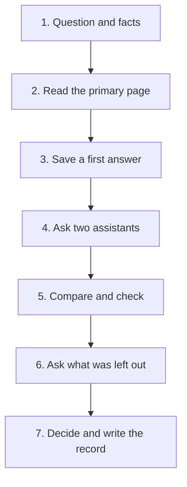

Razan chose a free plan for her sports club's shared calendar after one fast answer. The answer said the plan was free for any group. A month later she found the limit: ten people, and her club's committee has fourteen. The page that said so had been public the whole time. She had not opened it.

This chapter is the practice for chapters 5.2 and 5.3. You will research one real decision the way Yara did, and you will keep a one-page record that shows how you decided. The record matters more than the decision. A mentor, a teammate, or you in six months can read it and see why you chose what you chose. Nothing new is taught here. If a step feels unclear, go back to the chapter that taught it.

## Before you start

You need about 60 minutes, in one sitting or two. A phone with a browser is enough, and so is a laptop. You also need a place to write: a notes app, a paper notebook, or a text file in your own repository, as chapter 2.4 advised. Keep the record in a file you own, not only in a chat history.

You need two assistants for step 4. At the time of writing (checked 2026-10-25), good choices are chat assistants such as Gemini, ChatGPT and Claude, and Claude is for people aged 18 or over. Try each one to see that it opens for you, at your age, on your device, as chapter 2.3 taught. If only one opens, ask it in two new chats and add a normal web search. That is weaker, because one model tends to repeat itself, so the primary pages must do more of the confirming.

Apply the privacy check from chapter 2.2 to everything you write for an assistant. Would you be fine if a stranger read it? Never paste passwords, keys, client files or another person's personal details. For the same reason, do not choose a decision about a person, such as whether to accept or reject someone.

Choose a small, real decision that you will make in the next month. Good examples are which free plan to use, which library to build on, which program or course to join, or which tool to adopt for your project. A good decision has an answer that a primary page can check, such as a plan page, a rules page or a repository. A decision that only depends on taste is not a good fit. If you have no decision, a laptop or an account, use the provided case below. It is always available, and it needs only your phone.

## The steps



**Step 1. Write the question and your facts.**

Write one question that a page can answer, such as "Which free plan fits my group of 14?" Avoid "What is best?", because best for whom is the thing you are trying to find out. Then write five short lines of your own facts: your hours, your money, your device, your deadline and your level. These are your constraints, the facts you cannot change this month. Beginners often leave out the one fact that decides the choice, such as "I have no payment card". Read your lines once and ask which fact would remove an option.

**Step 2. Read the primary page and note the date.**

Find the page that the owner publishes: the plans page, the rules page, the repository, the licence file or the release notes. Write down its name, the date printed on it if there is one, and today's date. Copy the two or three sentences that matter most. Watch for two slips. One is reading a blog post about the product instead of the product's own page. The other is reading only the headline numbers and skipping the small print, where limits, card requirements and pauses usually sit.

**Step 3. Save a first answer.**

Open a fresh chat with one assistant and ask only your bare question, with none of your facts. Save the answer as it is, with the name of the tool and the date. This is your first answer. It matters because, at the end, you will compare it with your researched answer, and the difference is the evidence that slowing down was worth it. It is tempting to ask again and overwrite the first answer, or to skip this step because you already know what you think. Do not.

**Step 4. Ask two assistants with your facts.**

Write your question again with your five lines inside it. Send exactly the same text to assistant A and assistant B, each in a fresh chat. Ask each one to say which page you should confirm its claims on. Save both answers with the tool and the date. Avoid pasting the answer of A into B and asking "do you agree?". That invites a yes, and it makes the two answers look more independent than they are.

**Step 5. Compare, then check what matters on the page.**

Make a small table with one row for each claim that could change your decision: the claim, what A said, what B said, and what the page says. Mark each row as the same or different, and mark the page result as right, wrong or not on the page. Include at least one row where A and B agree. Remember from chapter 5.3 that disagreement shows where to look first, and agreement on a fact that matters still needs the page. Do not write "they agree, so it is right".

**Step 6. Ask what was left out.**

Go back to one of the assistants and ask the three questions from chapter 5.3, in neutral words. What did you leave out? What would change your answer? What is the strongest case against it? Do not ask "is this right?" or "are you sure?". Check every new claim on the primary page, because what an assistant adds can be wrong too. New points can sound careful and still be wrong, so do not accept them on tone.

**Step 7. Decide and write the record.**

Write your decision in one sentence, then the two main reasons, each tied to one of your facts or one sentence on a page. Then write what would change your decision: a number, a date or a rule. Put everything on one page, using the table below. Keep each part short. Long copied answers make a record hard to read. Write what each assistant claimed in your own words, in a line or two, and keep the page sentences exact.

| Part | What to write |
|---|---|
| 1. Question | One sentence |
| 2. My facts | Your five lines |
| 3. First answer | The tool, the date, and what it said in two sentences |
| 4. Assistant A | The tool, the date, and the claims that matter |
| 5. Assistant B | The same |
| 6. Differences and agreements | What differed, and one fact both said that you checked |
| 7. Pages read | The name, the date, the sentence you relied on, and right, wrong or changed |
| 8. What was left out | What the assistant added, and what you checked |
| 9. Decision | The decision, two reasons, and what would change it |

## A worked example

Yara's record shows the whole task. Her question was: "Which open-source program can I realistically join this year, with 8 hours a week?" Her facts were short. She has 8 hours a week, an old laptop and a phone. She is new to open source, she wants one real project, and she cannot pay for tools.

She read the pages first. The Hacktoberfest 2026 page, read on 2026-10-25, says that pull requests no longer count toward rewards. It says credit now comes from livestream check-ins, DEV challenges and events. The Google Summer of Code FAQ says contributors must be 18 or older, and either students or beginners in open source. It says projects are about 90, 175 or 350 hours, and most run 12 weeks. The stipend page lists a "West Bank and Gaza" row. Then she saved her first answer: four pull requests in October for a T-shirt, and GSoC for students only.

She sent her facts to two assistants in separate chats. They differed on who may join GSoC, so she looked there first and found that the FAQ allowed beginners as well as students. They agreed on the four pull requests, and the page showed that this was wrong. She did not stop at the agreement. Asked what was left out, one assistant named the warning about AI-written proposals and the forms that need proof of residency. She found both on the FAQ. She also noticed what no page answered: whether a payment could reach her, and the dates for next year.

Her decision was a plan, not a promise. She would not plan around Hacktoberfest rewards this year. She would prepare for a 90-hour GSoC project, which is 7.5 hours a week over 12 weeks and fits her 8. She would write to the program to ask about payment before she counted on the stipend, and she would write her own proposal. Three things would change her decision. One is no dates for the next round that fit her year. Another is an answer that a payment cannot reach her. The third is her weekly hours falling below 7.5. In this example, reading the pages took her about 20 minutes. The first answer would have sent her to a reward that no longer exists.

## The provided case

Use this case if you have no decision of your own. Leen is a fellow who wants to host her portfolio site for free. The site is a static site, which means it is ready-made pages with no database. It has six pages and is 15 MB in total. She expects about 50 visits a month, and each visit loads about 2 MB. She deploys from GitHub, wants the site to open at her own web address, and does not have a payment card. Her question is: "Where should I host my portfolio site for free?"

The two hosts and the two plan pages below are fictional, and the answers are invented. Both pages were read on 2026-10-25. Do steps 5 to 7 on this material: compare the answers with the pages, ask yourself what was left out, and write the record.

> **First answer (no facts):** Use Pagebox. It is free, has unlimited bandwidth and includes a custom domain.
>
> **Assistant A (with Leen's facts):** Pagebox is the best fit. Its free plan has unlimited bandwidth, a custom domain, deploys from GitHub and needs no card.
>
> **Assistant B (with Leen's facts):** Pagebox and Stackport both fit. Both have free plans with custom domains and no card. I would pick Pagebox for its simpler setup. Its free plan gives 20 GB of bandwidth a month.

| Pagebox plans page (fictional, read 2026-10-25) |
|---|
| Free plan: 1 site, 1 GB storage, 20 GB bandwidth a month, deploys from GitHub. |
| A card is required at sign-up. The Free plan is never charged. |
| Custom domains: Pro plan and above. |

| Stackport plans page (fictional, read 2026-10-25) |
|---|
| Free plan: 5 sites, 500 MB storage, 100 GB bandwidth a month, deploys from GitHub. |
| No card needed. Custom domains are included on every plan. |
| Sites with no visit for 30 days are paused, and start again on the next visit. |

Leen's own numbers help you check the limits. Her site is 15 MB, and 50 visits of about 2 MB is about 100 MB, which is 0.1 GB. Compare those with each plan's storage and bandwidth. Then ask which of Leen's facts removes an option.

## What to hand in

Hand in your one-page record in the nine parts of the table in step 7. For your own decision, write the record about your own question. For the provided case, write the record about Leen's question, using only the material above.

A strong record is short and honest. It shows the first answer, so a reader can see what changed. It names the pages with dates. It marks at least one agreement that you checked. It ends with a decision and a condition that would change it. If nothing changed between your first answer and your researched answer, say so, and say what the checks confirmed. That is still a result, because now you know.

```openquestion
prompt: "Write your decision record in nine parts: 1) the question, 2) your facts, 3) the first answer with the tool and the date, 4) assistant A, 5) assistant B, 6) where they differed and one agreement you checked, 7) the primary pages with dates and what each confirmed or changed, 8) what was left out, 9) your decision, two reasons and what would change it. Use your own decision, or Leen's provided case."
required: true
minWords: 150
allowSpeechInput: true
allowUrl: true
urlRequired: false
urlLabel: "Link (optional)"
urlHint: "A link to your record: a file in your repository, a notes page or a voice note. The provided case needs no link."
modelAnswer: "Mentor key for Leen's hosting case: differences: A says Pagebox has unlimited bandwidth and B says 20 GB; the Pagebox page says 20 GB, so B is right and A is wrong. Agreement checked: both say Pagebox needs no card and includes a custom domain; the page says a card is required at sign-up and custom domains start at the Pro plan, so both are wrong, and Leen has no card and wants her own address. Left out: neither assistant mentioned Stackport's rule that a site with no visit for 30 days is paused; the Pagebox card rule was also left out. Limits: her site is 15 MB and about 0.1 GB of bandwidth a month, far below 500 MB and 100 GB on Stackport, and below 1 GB and 20 GB on Pagebox, so limits do not decide it. Decision: Stackport, because it needs no card and includes her own address, with the pause rule noted. What would change it: a change to Stackport's free plan, or a need for a site that never pauses. The page read dates are 2026-10-25. The first answer said Pagebox; the researched answer says Stackport, and that is what changed. Accept any record that finds the two shared mistakes on Pagebox, checks them on the page, and decides Stackport with a condition. The common wrong answer picks Pagebox because both assistants agree on it, or averages the two bandwidth numbers. Model answer for a different case. Razan runs a sports club newsletter for 140 members, two newsletters a month, so 280 emails a month. First answer: Mailmint, free for 2,000 emails a month. Assistants A and B (with her facts) both said Mailmint. Pages read on 2026-10-25: the Mailmint Free plan allows 100 contacts and 500 emails a month, and puts its logo in each email; the Postpal Free plan allows 300 contacts and 1,000 emails a month, with no logo. The two assistants agreed, and the page showed they were wrong: 140 members are more than Mailmint's 100 contacts. Left out: the contact limit. Decision: Postpal, since 140 contacts and 280 emails fit its limits. What would change it: more than 300 members, or more than 1,000 emails a month."
```

## How your mentor will read it

Your mentor reads the record with this table. The topic can be anything. What counts is whether the habits are visible in the page.

| Part | Met | Partly | Not yet |
|---|---|---|---|
| Research first | Question, at least three of your own facts, and at least one primary page named with the date read | Facts or a page named, but not both, or a page with no date | Neither facts nor a page |
| Two answers compared | Both assistants named with the date, and at least three claims compared | Both named, but fewer than three claims compared | Only one assistant, or no comparison |
| Claims checked on the page | At least three claims marked right, wrong or not on the page, with its own words, including one where A and B agreed | Two claims checked, or none where they agreed | No claim checked on a page |
| Left out and decision | What was left out is stated, and the decision has reasons and a condition that would change it | A decision with reasons but no condition, or a thin left-out part | No decision |

**Pass rule:** your record passes when no part is "Not yet" and at least three parts are "Met". A record that treats the agreement of two assistants as proof cannot pass, whatever else it holds.

Expect a question or two back from your mentor, such as "Which claim changed your decision?" or "Where did the assistants agree and the page disagree?" Answer with something you can point to: a row in your table, a sentence on a page, a date. A written reply or a voice note both work.

**Next:** Slowing down to understand: five graded cases, including AI answers to check.
