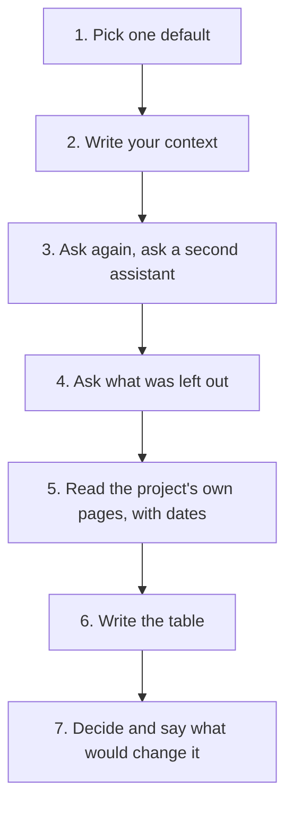

Ayman, from 6.3, builds a small web tool for his school library. It records which student borrowed which book. The one-line answer he got about the database was: "PostgreSQL, the most popular and reliable choice for web apps." He almost wrote it into his plan. Then he remembered this module. The answer was common. Nobody had yet asked whether it was his.

In this chapter you do what Ayman did, on one default in your own project. A default can be a database, a cache, a queue, a framework or a place to host. You write down what you asked and give the assistant your facts. You compare answers, read the project's own pages and end with a table that says when each option wins. This chapter teaches nothing new. It is the practice for 6.2 to 6.5. It is worth 60 minutes because a table like this is the most reusable thing you will write all month. You can use it in interviews, in your capstone and in your next team meeting.

## Before you start

You need one default from your own project, or the provided case below. You also need two chat assistants, for example Gemini, ChatGPT or Claude. Claude is for people aged 18 or over, so use two of the others if you are younger. Everything here works in a phone browser. If a tool does not open or runs out of free use, use the second tool. Or do steps 5 to 7 with the answers given in the provided case.

Do the privacy check from 2.2 before you paste anything. Never paste passwords, keys, a client's files or other people's personal data. You do not need any of them here. Describe your project with facts and numbers, such as "about 40 loans a day", not with its data. A good test is the stranger test: would you be fine if a stranger read this?

Put your work in a file you own, as you learned in 2.4. A notes page or a text file in your repository is enough. Write the date next to every page you read, because licences, versions and prices change.



## The steps

**1. Pick one default.** Choose a place in your project where an assistant gave you an answer, or would, and ask the question in your own words. Save the question and the first answer exactly as they came, word for word. Look for answers that sound like "the best" or "the most popular". Do not improve the question before you save the first answer. Then you cannot see what the default was, and the whole exercise loses its starting point.

**2. Write your context in five facts.** Write what the thing does all day, how big it is, who builds and runs it and what it may cost. Add which rules apply, such as a licence or where it runs. Give each fact a number or a plain yes or no. Look for facts that could change the answer. A frequent slip is to write goals, such as "it should be fast and scalable". A goal does not narrow anything. "About 40 loans a day, one program writing" does.

**3. Ask again with your context, then ask a second assistant.** Paste the five facts into a new question. Ask the same of a second assistant. Write down where the two answers differ. Disagreement tells you where to check first, as you learned in 5.3. Agreement does not end the check, because different assistants often make the same mistake. Do not simply take the answer you like better. Take the disagreement as your list of things to look up.

**4. Ask what was left out.** To each assistant, ask three things, in neutral words: what did you leave out, what would change your answer, and what is the strongest case against it? These questions are the course's own method, from 5.3, and no study has tested them. They still give you more to check. Avoid asking "are you sure?". As 2.2 said, the same assistant tends to agree with you.

**5. Read the project's own pages.** For each option that is still standing, open the page the project itself publishes: its documentation, its licence page or its release notes. Write the date you read it and one line from it that matters for your context. If the page, or an assistant, gives you a number from a company about its own product, label it a vendor claim. People often read a blog post or a summary and call it the source, or forget the date.

**6. Write the table.** Make one row for each option. Give each row three cells and a source: when it wins, when it loses, and the page and date. Use your context facts inside the cells, so that "one program writes" appears in a cell and not just "it is simple". A table of features is the usual trap. A feature list does not say when. The table must say when.

**7. Decide.** Write your pick, the one fact that changed the answer, and what would change your mind. Add one thing you will measure on your own data if you are unsure. Do not end with "it depends". You are allowed to be unsure, but you still pick, and you say what would change the pick.

## A worked example

Here is Ayman's table for the library tool, told in the order he did it. His default was PostgreSQL, from the first answer above. For step 2, he wrote five facts. The tool has three users: the librarian and two volunteers. It records about 40 loans a day, which is 14,600 loans in a year (40 times 365). It runs as one small program on the library's old computer, with no server. He builds and runs it alone, a few evenings a week. The library pays nothing for it. The librarian wants a monthly list of loans per class.

In step 3, he asked two assistants with those facts. The first said SQLite is enough, but it also suggested PostgreSQL "for growth". The second said SQLite and gave no reason to move. They disagreed on one thing: whether growth matters now. In step 4, he asked each what it had left out. Both said that SQLite is a poor fit if many programs write at once, or if programs on other computers send it commands over a network. One added that he should check SQLite's own advice on websites.

For step 5, he opened SQLite's page on appropriate uses and its page on write-ahead logging, and the PostgreSQL documentation. He wrote the date by each. The SQLite pages say that SQLite works well when writer concurrency is low and that there is one writer at a time. They say that if many programs send commands over a network, or many write at once, a client and server database is the better fit. They call fewer than about 100,000 hits a day a conservative fit for a website. Ayman wrote that last number as the project's own advice about itself, not a law.

His table had two rows. SQLite wins when one program writes, the file stays on one computer and no server is wanted. It loses when several programs write at the same time, or when other computers need to reach the data. PostgreSQL wins when several programs read and write at once, over a network, with transactions. It loses when you do not want to run a server, which is his case. In step 7, he picked SQLite. The fact that changed the answer was "one program writes, on one computer, with no server". What would change his pick: a second program that writes, a second computer that needs the data, or traffic far beyond SQLite's own guide. He added that he would time the monthly list on a copy with a year of made-up loans. Notice that PostgreSQL was not wrong. It was the common answer, and for his context it was more than he needed.

## The provided case

If you have no project, no laptop or no account, work on this case. It is always available, and it is graded the same way. Yara's Qasir, the link shortener from 3.3, needs a place to keep click events for a weekly report. Here are Qasir's facts. The numbers are from this example.

| Fact | Qasir |
|---|---|
| What it does | Saves one row per click on a short link; one Sunday report: clicks per link, per day, top 10 links |
| Size | About 2,400 links and 90,000 clicks a week, so about 4.7 million rows a year (90,000 times 52 is 4,680,000) |
| Who writes | One program, the Qasir app |
| Machine | One small rented server that also runs the app and its PostgreSQL database, where the links already live |
| Cost | About $6 a month in total, so no second server |
| Team | Yara alone, about 8 hours a week |
| Rules | Click rows hold no names; they are kept for 12 months |

Yara asked an assistant which database to use for the click events. It answered: 'Use ClickHouse. It is the fastest database for analytics, so it is the right choice for your click events. It will handle millions of clicks.' She does not yet know whether that fits Qasir. Write the whole exercise for her. Restate the default and add her facts. Say where a second assistant might disagree. Name the pages to read: the ClickHouse, PostgreSQL and DuckDB documentation, and the ClickBench page for the limits of the benchmark. Then build the table. You may use the module's pages for the facts about each option. You must also say what you would measure on a copy of the data before you decide.

## What to hand in

Hand in one page with five parts. First, your question and the first answer, word for word. Second, your five context facts. Third, where the two assistants agreed and where they disagreed, and what they said they had left out. Fourth, your table of when each option wins, with the page and the date read for each row, and any vendor number labelled as a vendor claim. Fifth, your pick, the fact that changed the answer, and what would change your mind.

```openquestion
prompt: "Hand in your page with five parts, for your own default or for Yara's click events. 1) The question and the first answer, word for word. 2) Five context facts with numbers. 3) Where two assistants disagreed and what they left out. 4) Your table of when each option wins, with the page and date for each row. 5) Your pick, the fact that changed the answer, and what would change your mind."
required: true
minWords: 160
allowSpeechInput: true
allowUrl: true
urlRequired: false
urlLabel: "Link (optional)"
urlHint: "A link to your notes page or repository file that holds the table. The provided case needs no link."
modelAnswer: "Mentor key for Yara's click events: the answer must restate the default (ClickHouse, 'the fastest for analytics') and then give Qasir's facts: about 90,000 clicks a week across all its links, about 4.7 million rows a year, one program writing, one small server shared with PostgreSQL, about $6 a month, Yara alone, one Sunday report. The table needs at least two options, for example PostgreSQL and ClickHouse (DuckDB is a fair third), each with when it wins, when it loses and a page with a date. ClickHouse wins when many people run totals over very many rows and a separate server is affordable; its own docs credit column storage, compression and parallel cores, and name no weak jobs. PostgreSQL wins here because it already runs, one program writes, and the report is weekly. The ClickBench page limits what the AI's claim can mean: one flat table of about 100 million rows, queries one at a time, made by the ClickHouse team. The decision may differ: keeping the events in PostgreSQL is acceptable, and so is a weekly export read by DuckDB, as long as it follows from the stated numbers and says what would change it, such as report queries that run all day, far more rows, or a second program that needs the data. A good answer also says what to measure: time the report query on a copy with a year of made-up clicks. The common wrong answer picks ClickHouse because the AI said it is the fastest, or because of a benchmark, with no table and no link to Qasir's numbers; it cannot pass. Model answer for a different case. Rahaf asked which cache for the club's attendance app and was told Redis. Her facts: about 400 members check in at weekends, staff read the list a few times a day, one rented server, she builds it alone, and she sells the app to nobody. A second assistant said Valkey. They disagreed on licence. She read Redis's licence page and the Linux Foundation's Valkey announcement, with dates. Her table: Redis wins when she wants its newer data types or buys its service; Valkey wins when she needs a permissive BSD licence or her host lists it; either wins for a plain cache that she keeps for herself. She picked either and kept the one her host offers. The fact that changed the answer was that she does not sell the app. She would revisit if she starts hosting for other clubs, because the licence would then matter."
```

## How your mentor will read it

A mentor reads your page with this table. Your default can be about anything, and your answer can differ from the mentor's own. What counts is whether the reasoning and the evidence are visible.

| Part | Met | Partly | Not yet |
|---|---|---|---|
| Context stated | Five facts or more, each with a number or a plain yes or no, covering what it does, size, who runs it, cost and rules | Three or four facts, or facts without numbers | Fewer than three facts, or only goals |
| Answers compared | The first answer word for word, the answer with context, a second assistant's answer, and where they disagreed | Three of those four | Fewer than three of those four |
| Project pages read | At least two project pages, each with the date read, and every vendor number labelled as a vendor claim | Pages named, but one date is missing or one vendor number is not labelled | No project page, only assistant answers |
| Table of when each wins | At least two options, each with when it wins, when it loses and its page | Two options, but a cell is missing | One option, or no table |
| Decision | A pick that follows from the context, the fact that changed the answer, and what would change the pick | A pick and the changing fact, but not what would change it | A pick with no link to the context, such as "it is the fastest" |

**Pass rule:** your page passes when no part is "Not yet" and at least three parts are "Met", and two of those are the project pages and the table.

Once you submit, the mentor sends back one or two short questions. Expect something like: "Which fact changed the answer, and where on the page did you read it?" or "What would you measure first?" Answer by pointing to what you can show: a line in your table, a date, a page. Write your reply, or record a voice note.

**Next:** Context and defaults: five graded cases, including AI answers to check.
