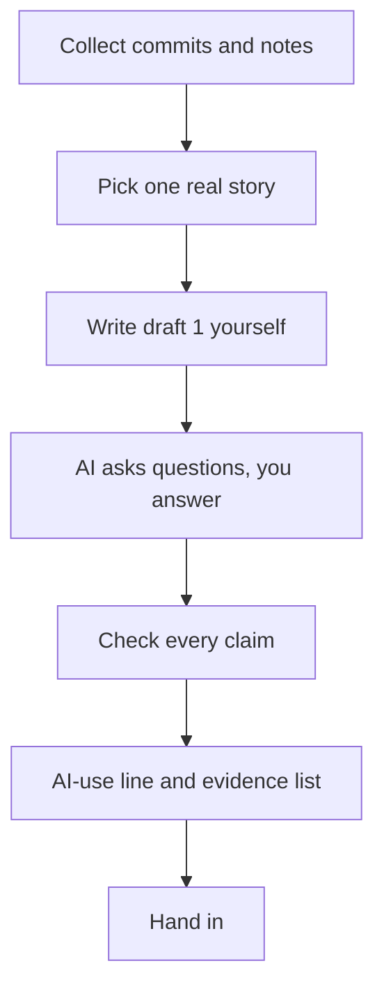

Haya spent a week on a lending tracker for her old school library. On Sunday she had six commits, some notes in her phone and a feeling that nothing she did was worth a post. Then she remembered the one afternoon that went wrong: the barcode scan failed on 6 of her first 20 tries. That afternoon is the post.

This chapter is practice. It teaches nothing new. You use what chapters 10.2 to 10.6 taught, on one real week of your own work. You finish with a post, a list of what you checked, an honest AI-use line and the files that show the post is yours. If you have no project this week, use the provided case further down. It is complete, so nobody needs a laptop, a repository or an account.



The diagram shows the order of the steps. The order matters. Your own draft comes before the AI sees anything, and the check comes after the last edit.

## Before you start

You need one week of your own work: a list of commits and any notes you wrote, such as your lab log from chapter 4.5. You can read your commits in a browser. Open your repository on the GitHub website and choose the list of commits. This works on a phone. If you have no commits from this week, or no laptop or account, use the provided case below instead. It is complete and counts the same.

You also need a chat assistant such as Gemini, ChatGPT or Claude, at the time of writing (checked 2026-10-25). Use one that opens for you at your age. If none opens, the fallback is a person: ask a classmate or your mentor to read your first draft and ask you three questions about it. The post is still yours either way.

Do the privacy check from chapter 2.2 before you paste anything into a tool. Your post and your notes must not contain passwords, keys, client names, other people's messages or their personal data. If a note mentions a person, leave the name out or ask first. Commit lists can show names and email addresses, so look at what you are about to copy before you copy it.

## The steps

**Step 1: collect the week.** Open your commit list and your notes, and copy the lines you will work from into one file called `notes.md`. Write the date at the top of each entry. Include the commits that look boring. Look for the places where you wrote a message that says what changed, and the places where a message says only "update". The common mistake is to collect only the good parts. The week you actually had is the only week you can write about honestly.

**Step 2: pick one real story.** Choose one event from the week that has a cause and a result. A bug you found, a choice you made between two ways, a test that failed, or a day when a power cut ended your lab early. Write it in one sentence: what happened, and what you did about it. The common mistake is to choose the biggest feature. A feature is a list of facts. A story has a moment where something went differently from what you expected, and that is what a reader remembers and can use.

**Step 3: write draft 1 yourself.** Write 250 to 400 words, in your own words, with simple English. Include at least one number from your notes and at least one thing that went wrong. Do not ask an AI for any text yet. Save the draft as `draft-1.md` in your repository folder and commit it with a message that says what it is. This file is the first piece of evidence that the post is yours, and it is the one people most often skip. The common mistake is to open the chat assistant first, because the blank page feels slow. Write badly if you must. You will fix it in step 4.

**Step 4: let the AI ask, and you answer.** Give the assistant your draft and a request like the one in chapter 10.2. Ask it to fix grammar and unclear sentences, to keep your words and to add no facts or numbers. Then ask it for three questions about places where a reader who has never seen your project would be lost. Answer the three questions in your own words in a file called `ai-questions.md`, and add the answers to a second draft. Save `draft-2.md`. The common mistake is to let the assistant answer its own questions. The answers have to come from your notes, because only you know what happened.

**Step 5: check every claim.** Make a small table with two columns. In the first, list each number, date and event in your post. In the second, write the commit or the note that proves it. If a claim has no proof, either remove it or find the proof. Compare the AI's edit with your draft line by line, because an edit for grammar can change a number or add a word like "fast" or "always". The common mistake is to read only the new version. It reads smoothly, so the changes hide.

**Step 6: self-edit with the signs list.** Read your draft once more with the list in chapter 10.5. Look for lines that could be about any project: big words about importance, vague sources, a chatbot phrase left in the text, a source you did not open. Replace each one with something only you could know, such as a number, a page you read or a mistake you made. The common mistake is to swap a fancy word for a plainer word and believe the line is fixed. If the line has no fact, it is still empty.

**Step 7: write the AI-use line and the evidence list.** First write a list of every task the AI did this week. Then turn it into the three-part line from chapter 10.3: the tool, what it did, and what you checked. Next, list at least three files or commits with dates that show the post growing. They can be your notes, `draft-1.md`, `ai-questions.md`, `draft-2.md`, the final post, and the commits behind the story. The common mistake is to write "AI was used" or "all my own work". Neither tells a reader anything true they can use.

Posting publicly is your choice. A private draft that only your mentor reads is accepted for this task. If you do publish, adapt the post for one platform as chapter 10.2 describes, and follow that platform's rules on AI help, which can change.

## A worked example

Haya opened her commit list on Sunday afternoon. It showed six commits. On Monday she added a books table and a list page. On Tuesday she added a barcode scan with the phone camera. On Wednesday she added a page to edit a book's title. On Thursday she wrote a test that scans a known barcode and finds its book. On Friday she committed "Fix: try the scan again once before showing an error". On Saturday she wrote a README that says how to scan and when it fails. She collected these lines and her notes into `notes.md`. One line from Tuesday read: "Scan failed on 6 of my first 20 tries in the library, mostly near the window."

She considered three stories: the books table, the test, and the failing scans. She chose the failing scans. It had a cause she found, which was glare near the window, and a result that she measured. After the fix, 2 of the next 20 scans failed. She wrote draft 1 in 40 minutes without any AI. It was 310 words and it said, in her plain English, "I thought the camera was broken. It was the sunlight." She saved it and committed it with the message "Add draft 1 of week 4 post".

Then she asked a chat assistant to fix grammar, keep her words, add no facts and ask three questions. The assistant asked who does the scanning, what "fails" means (no result or the wrong book), and how she counted the 20 tries. She answered from her notes: the librarian scans, "fails" means no result, and she counted by hand with a pen on paper. The grammar edit changed "6 of 20" into "about a third". That is close to 6 of 20 but it is not her number, and a reader could not check it against her notes. She restored the number. She also found that the assistant had added the sentence "Barcodes are a vital part of modern libraries". She deleted it. It was the kind of line her signs list warned her about.

Her AI-use line read: "I used a chat assistant to fix grammar in my second draft and to ask me three questions about my first. I wrote the code and the draft, answered the questions from my notes, and checked each number against my commits and notes." Her evidence list had five items with dates: her notes, draft 1, her answers file, draft 2, and the Friday fix commit. She kept her post private for her mentor and decided to publish the next one.

## The provided case

If you have no project this week, use Anwar's week. Anwar builds an order board for a small café. A tablet near the counter shows which orders are being prepared. Staff tap a Ready button when an order is done, and a screen by the door shows ready orders in large text. Anwar writes English as his second language. His week is below, and every fact you need is in this chapter.

| Day | Commit message | Files | Lines added | Lines removed |
|---|---|---|---|---|
| Mon | Add orders table and a page that lists orders | 3 | 96 | 0 |
| Tue | Add Ready button that marks an order ready | 2 | 48 | 3 |
| Wed | (no commit) | 0 | 0 | 0 |
| Thu | Fix: ignore a second Ready press for the same order | 2 | 21 | 7 |
| Fri | Add test: a double Ready press changes the order once | 1 | 34 | 0 |
| Sat | Show ready orders in large text on the customer screen | 3 | 72 | 15 |
| Sun | README: how to run the board and what it does not do | 1 | 58 | 2 |

Anwar's notes, in his words. Monday: "Orders table has an id, a name and a status. The page lists orders. Tablet goes to the café next week." Tuesday: "Ready button works. I tested it by hand with 5 orders." Wednesday: "Power cut. No lab." Thursday: "I tried it on the café's slow wifi. I pressed Ready and nothing happened, so I pressed again. The order then showed twice on the screen. I expected once. The button sent two requests. A chat assistant explained the error message about a duplicate row. I wrote the fix myself: the board ignores a second Ready press for the same order." Friday: "Wrote a test: press Ready twice, the order changes once. It passes." Saturday: "Large text for the customer screen. A friend who works at the café said the back table could not read it, so I made it bigger." Sunday: "README done. Known gap: if the wifi is off, the board shows old orders. I did not fix this."

AI use this week, as Anwar remembers it. On Thursday the assistant explained one error message, and Anwar wrote the fix. After his first draft, he asked it to fix grammar and to ask him three questions, and he saved the questions and his answers. He asked it to write no code and no post text.

A friend suggests this headline: "I built a café system that handles 200 orders an hour." Your task: write the post about Thursday's bug, make the claim check, and write Anwar's AI-use line and evidence list. Then say which parts of the friend's headline Anwar should remove, and why.

## What to hand in

Hand in five parts. First, the post itself, about 250 to 400 words, in your own voice. Second, the claim check: every number and event in the post, matched to a commit or a note. Third, your AI-use line, in three parts. Fourth, your authorship evidence: at least three files or commits with their dates. Fifth, one thing you checked and corrected, such as a number the AI changed or a line you replaced with a fact.

For Anwar's case, write the same five parts about the Thursday bug, and also say what you would remove from the friend's headline. You may dictate your answer with your phone's microphone, and you may add a link to your post file or a private draft.

```openquestion
prompt: "Hand in your post pack, or your pack for Anwar's provided case. For your own week, include five parts. 1) The post, about 250 to 400 words. 2) A claim check: each number or event in the post matched to a commit or a note. 3) Your AI-use line: the tool, what it did, and what you checked. 4) Your authorship evidence: at least three files or commits with their dates. 5) One thing you checked and corrected. For Anwar's case, do the same five parts for Thursday's bug, and say which parts of his friend's headline he should remove and why."
required: true
minWords: 300
allowSpeechInput: true
allowUrl: true
urlRequired: false
urlLabel: "Link (optional)"
urlHint: "A link to your post file, your repository folder or a private draft. Anwar's case needs no link."
modelAnswer: "Mentor key for Anwar's case: the post tells Thursday's bug and uses only true facts. On the café's slow wifi he pressed Ready, nothing seemed to happen, he pressed again, and the order showed twice, because the button sent two requests. His fix makes the board ignore a second Ready press for the same order, and Friday's test presses twice and checks that the order changes once. Acceptable extras: the Wednesday power cut, the large text on Saturday, the known gap from Sunday that the board shows old orders when the wifi is off. The claim check ties each claim to the Thursday note and commit, the Friday test commit or the Sunday README note. The AI-use line names the assistant, says it explained one error message on Thursday, asked three questions about his first draft and fixed grammar in the second, and says he wrote the fix and the post and checked every claim against his commits and notes. The evidence list has at least three dated items, such as the Thursday note, draft 1 before any AI, the file with the questions and his answers, and the Friday test commit. The headline: remove '200 orders an hour', because he tested with 5 orders by hand and has no test of 200; and soften 'system', because the board lists orders and marks them ready. The common wrong answers are to keep the 200, to write that the board works on any wifi, which the Sunday gap contradicts, or to write 'no AI used'. Model answer for a different case. Wafa builds a menu page for a school canteen. Post: 'On Tuesday the menu page showed yesterday's soup. I thought my code was wrong. It was my phone's saved page. I added a note to refresh and a version number in the page address. I checked it on three phones.' Claim check: Tuesday note, the commit 'Add version number to the menu page address', and her note that she tried three phones. AI-use line: 'A chat assistant asked me three questions about my first draft and fixed grammar in the second. I wrote the code and the post and checked each claim against my commits and notes.' Evidence: notes dated Tuesday, draft 1 dated Wednesday, her answers file, draft 2 and the commit. Corrected: the assistant had changed 'three phones' to 'several devices', and she restored the number."
```

## How your mentor will read it

A mentor reads your pack with this table. It works for your own week and for Anwar's case, because it asks whether the habits are there, not whether the project is large.

| Part | Met | Partly | Not yet |
|---|---|---|---|
| True to the commits | Every number and event in the post is matched to a commit or note in the claim check | All but one matched | Two or more are unmatched, or one number is invented |
| One story, your voice | One real event with a number and a surprise or a mistake, in plain words | A story, but two or more generic lines remain | No real event, only general statements |
| AI-use line | Tool, what it did and what you checked, all specific | Two of the three parts | One part or none, or "all my own work" when AI helped |
| Authorship evidence | At least three dated files or commits that show the post growing | Two items | Fewer than two items |
| Nothing faked or private | No invented number, no bought activity, no secret, no private data | One claim worded more strongly than the commits show, such as "fast", but nothing invented or private | Any invented number, fake activity or private data |

**Pass rule:** your pack passes when no part is "Not yet" and at least three parts are "Met", one of them "True to the commits". A pack with a faked number, bought activity or private data cannot pass, however good the rest is.

After you submit, your mentor replies with one or two short questions. For example: "Which sentence did the AI change, and how did you check it?" or "Where in your notes is the day you found the bug?" A good reply points to something you can show, such as a line in a file, a dated commit or a number in your notes. You can answer in writing or in a voice note.

**Next:** Check yourself on useful content, authorship, commit history and fake activity with a short quiz.
