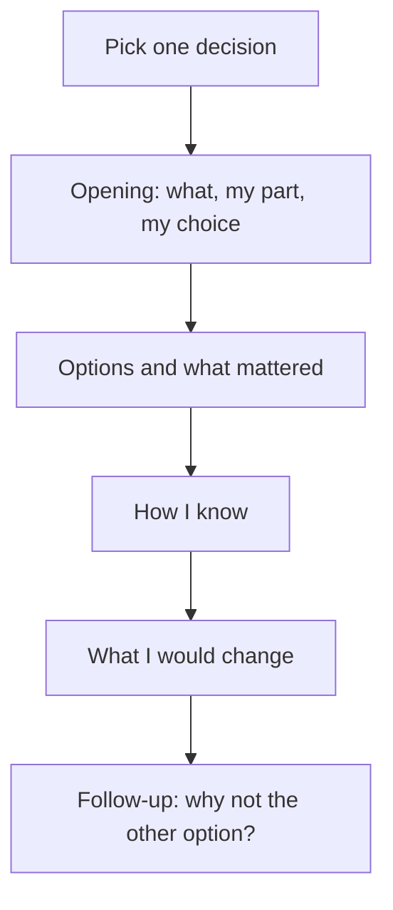

## Your turn

Ehab's capstone passed. Then his mentor asked one more question: "You kept the group's sign-up list in a database, not in a spreadsheet. Why?" Ehab had the answer in his decision record. But he had never said it aloud, and he spent ten seconds reading his own notes before he began. The answer was good. The pause made it sound like someone else's.

This chapter is practice for that moment. A mentor, a client, a hiring manager or a teammate will ask you why you made a choice in your project. They will ask in the first minute, and they will ask again in a different way. You will pick one decision from your capstone and defend it in a short conversation. You can have that conversation with the AI interviewer, if you add a key of your own, or you can write it down. Both ways complete the step.

A defence is not a speech about everything you built, and it is not an argument that you were right. It is a short conversation about one decision. The person asking wants to know three things. Did you make the decision? Do you understand it? Do you know how you know it worked? A good defence can include "I did not measure that" and "I would change this". Those answers show an honest builder, and an honest answer is a strong one.

## What the interviewer looks for

The AI interviewer asks about your project with three focuses. The first is your best technical work: the hardest part that you did yourself, and how you know it works. The second is the five whys. The interviewer asks "why" about your decision, up to three times. It stops when your answer rests on a fact about your project, such as your hours, your users or a day in your log. The third is impact: what changed because of your decision, and how you know.

The interviewer may also flag habits. "Vague ownership" means you say "we" and cannot say what you did. "Unsupported number" means a figure with no source. "Pseudo-story" means something you usually do, told as if it were one event. "Invented reason risk" means a neat reason that you may not have had at the time. "Jargon without explanation" means a term you cannot explain in plain words. A flag is not a failure. It points to the place where you should add a fact, or say "I do not know".

## Before you start

You need your capstone open: your plan, your log, and your decision record from part 6. Pick a time when you have 20 to 30 minutes and a quiet place. A phone is enough. The interviewer block opens in the browser, and you can speak your answers with the microphone if typing is slow.

The interview is optional, and no part of the pass depends on it. The interviewer needs a key that you add yourself in the block. A key is a secret code that lets a program use a service in your name. The block uses OpenRouter, so the key comes from there. Using a key can cost money, so set a spending limit on it or skip the interview. The block tells you where to add the key. Never paste the key into a chat, a repository, a note or your answer below. If a key ever leaks, treat it as stolen, cancel it and make a new one, as chapter 4.5 taught for lab logs. If you have no key, do not want to spend money, or the block does not open on your phone, skip the interview and use the written defence. It completes the same step, and you lose nothing.

Do the privacy check from chapter 2.2 before you type anything. Use roles instead of names, such as "a clinic manager" and not her name. Do not paste passwords, keys, client data or anything about real patients, customers or students. Paste at most 50 to 150 words about your project. The interviewer is an AI, so it can misjudge. Treat its comments as questions to think about, as you did with AI critique in module 9, and decide for yourself which ones are right.

## The steps

Seven steps take you from a decision to a defence. The diagram shows the order, and the numbered steps explain each one.



Reading the diagram: no step says "prove that you were right". The last step is the question a mentor asks to test whether you understood the options you did not choose. A defence is built from facts you can point to, in an order that a listener can follow.

1. **Pick one decision.** Choose a choice that had at least two real options. Use the decision record from part 6, or a trade-off from your plan.

Choose a decision where you can name the option you did not take. "I used GitHub" is not a decision. "I kept the queue number in the database and not in memory" is a decision. Many people pick the biggest part of their project instead. Pick the one you can explain best from memory, because the defence is short.

2. **Write your opening in three sentences.** Say what you built, what your part was, and which option you chose.

Say "I" for what you did and "we" only for what a team did. If an AI assistant wrote a part, say so, and say how you checked it before you kept it. A frequent slip is an opening that describes the whole project in general words. The interviewer asked about one decision, so start there.

3. **Name the options and what mattered.** Say at least two options and the facts that decided between them.

These facts are your context from module 6: your numbers, your users, your hours, and the primary page that you read. Say what mattered then, not what you now wish had mattered. A frequent slip is a reason that sounds wise but that you did not have at the time. If the real reason was that the other option was too hard to run alone, say so. That is a good reason.

4. **Say how you know.** Point to evidence: a log day, a test, a recording, or a primary page and the day you read it.

A number needs a source. If you did not measure something, say "I did not measure that", and say how you would. A frequent slip is to guess a number to sound sure. An interviewer who hears a number with no source will ask where it came from, and "I made it up" ends the conversation.

5. **Say what you would change.** Give one specific change, and say what would make you change the decision.

"I would work harder" is not a change. "I would test with two screens before I said it was ready" is a change. Say what would change your decision: more users, a measured slow response, a rule that moved. This shows that your choice depends on facts and not on habit.

6. **Practise the follow-up: why not the other option?** Your mentor will ask this after your defence.

Take the option you rejected and give its best case honestly. Then say why your facts still point the other way. Do not call the other option bad. Most rejected options are good for someone else's context, and saying so shows that you understand the choice.

7. **Say "I do not know" when it is true.** The interviewer is told to accept it.

Some questions will go past what you know. "I do not know, and this is how I would find out" is a full answer. It is better than a smooth guess, because a guess that sounds sure is how mistakes reach other people, as you saw in chapter 11.3.

## A worked example

Bayan lives in a student building. She wrote a small page that shows which of the 12 laundry machines are free About 60 students use it. Her decision was where to keep the status of each machine. Her first version kept the 12 statuses in one text file that the page rewrote after every tap. An AI assistant had said that was the simplest choice for a small page. Later she moved the statuses into a database.

Here is her defence. Her opening was short. "I built a page where students mark a laundry machine as free or busy. I wrote the page and the database part. An assistant helped with the first draft of the page, and I checked each line against the documentation before I kept it. The decision I will defend is that I keep the machine status in a database and not in a text file."

Then she gave the options and what mattered. "The text file needs no setup, and I could start in ten minutes. But about 60 students tap from their phones, and two of them can tap at the same moment. On day 12 I tested this with two friends. We both marked machine 4 within a second. With the text file, one change disappeared. With the database, both changes were kept in order, and the page showed the last one. That mattered more than the setup time, because a wrong sign that says a machine is free sends a student up three floors for nothing."

She said how she knew, and where her knowledge stopped. "I know about the lost change from my day 12 log entry. I did not measure how often two students will tap at the same moment in real use. I only know that they can. I would measure it by counting changes that arrive within a few seconds of each other over one week."

She said what she would change. "I would limit how fast one phone can send changes. I did not do that, and one student tapped the same machine ten times on day 19. I would also change my decision if the building had five machines and ten students. Then a text file would be enough."

Her mentor asked the follow-up: "Why not keep the text file and add a lock?" Bayan answered: "A lock could work. I read about file locks on day 13, and I could not explain them well enough to trust them in my page. My rule from module 7 is to keep nothing I cannot explain. The database already did the job. If I had a reason to avoid the database, I would learn about locks."

Here is what Bayan did. She named two options and the fact that decided between them. She pointed to a log day for what she knew and said plainly what she had not measured. Her change was specific, and she said what would change her decision. In the follow-up she gave the other option a fair hearing, and she used her own rule to explain her choice. She never said she was sure. She said what she knew and where it stopped, and that is what the interviewer is looking for.

## The provided case

If you have no project, defend Ibrahim's decision from the capstone. You do not need the capstone open. Every fact you need is here, and every number is made up for the case.

Ibrahim's clinic queue app has to keep one number: the current queue number. He chose to keep it in the database table that the app already uses. His other options were a variable in the app's memory, and Redis. Here is his context. The desk computer restarts every night and sometimes in a power cut. The clinic manager's written rule says that numbers start again at 1 at 07:30 each morning and must not be lost or repeated during the day. A normal morning has about 40 patients. Two screens, one in the waiting room and one at the nurse's desk, each ask for the current number every 5 seconds. That is 24 asks a minute in all. One volunteer looks after the app, and nobody can run a second service.

Here is what he knows. On day 21 the app ran for one morning on the desk computer with two volunteers and made-up patient numbers. It gave out 38 numbers, and the screen showed the right number all morning except for one minute when the Wi-Fi dropped. Two assistants had both told him to use Redis or memory, and he did not take their agreement as proof. Here is what he did not measure: how the app behaves with more than two screens, and how long the desk computer takes to restart.

Write his defence as he would give it, using steps 2 to 6. Say who did what, including the fact that a chat assistant wrote his first queue code on day 3. Give the options and the facts. Say how he knows and what he did not measure. Give one specific change, and say what would change his decision. Then answer the follow-up: "Why not Redis?"

## Practice with the AI interviewer

This drill asks about one decision in your project and follows your answer with questions about your part and your reasons. It is the same kind of conversation as a mentor's follow-up. Paste 50 to 150 words about your project and your decision when the drill asks for them, with roles instead of names. If you are using the provided case, paste a short summary of Ibrahim's decision in your own words.

Never paste your full name, phone number, email, address, ID numbers, passwords, keys, client or employer names, or other people's details. If you do not have a key, the written task below completes this step.

```aiinterview
title: "Defend your project and one decision"
opening: "Tell me about one decision in your project that you made and can defend. What did you build, what was your part, and which option did you choose?"
focus: [best-technical, five-whys, impact]
context: project
maxTurns: 10
whyDepth: 3
required: false
rubric: "A strong defence names one real decision: what the learner built, their own part, the options they had, what mattered at the time, and how they know it worked, or an honest 'I did not measure that'. It also says what they would change and what would make them change the decision. Probes: for best technical work, ask for the hardest part the learner did themselves and how they know it works; for the five whys, ask 'Why this option and not the other?' up to three levels, taking each answer back to a fact about their project such as their hours, their users or a day in their log; for impact, ask what changed because of the decision and how they know. If the answer says 'we', ask 'What was your part?'. After any number ask 'Where does that number come from?'. If the learner says AI wrote a part, ask them to explain it in their own words. Stop rules: accept 'I do not know', 'I did not measure that' and 'I kept the AI's suggestion after checking it' as full answers, reply briefly, and ask what they would do or measure next. Never push the learner to guess a number or invent a reason. Scoring: judge features, not length. An honest gap with a plan to measure scores higher than an unsupported number. Quote the learner's words as evidence. Use these flag names when they apply: vague ownership, unsupported number, pseudo-story, invented reason risk, jargon without explanation. Tone: kind and direct, about the answer and not the person. If the evidence is thin, suggest how the learner could get it, for example by checking a log day or reading a primary page."
```

## What to hand in

Write your defence in about 200 words or more. If you did the interview, add one piece of feedback that you will act on and why, or why you disagree with it. You can dictate your answer with your phone's microphone, and you may add a voice note link as well.

```openquestion
prompt: "Defend your project and one decision, or Ibrahim's decision about where to keep the current queue number, in your own words. Write at least 200 words. Include five parts. First, your opening: what was built, what your part was, and which option you chose. Second, the options you had and the facts that mattered at the time. Third, how you know: a log day, a test or a primary page with its date, or an honest 'I did not measure that'. Fourth, one specific thing you would change and what would change your decision. Fifth, your answer to 'Why not the other option?'. If you did the AI interview, add one piece of feedback that you will act on and why, or why you disagree with it."
required: true
minWords: 200
allowSpeechInput: true
allowUrl: true
urlRequired: false
urlLabel: "Link (optional)"
urlHint: "A voice note your mentor can open without signing in, or your decision record or repository."
modelAnswer: "Mentor key for Ibrahim's case: Opening: a clinic queue app; he wrote the app and the database part, a chat assistant wrote the first queue code on day 3, and he now explains it line by line; he chose to keep the current number in the database. Options and facts: a variable in memory, Redis, or the database; the desk computer restarts every night and in power cuts; numbers restart at 1 at 07:30 and must not be lost or repeated; about 40 patients a morning; two screens asking every 5 seconds, which is 24 asks a minute; one volunteer who can look after one service. How he knows: day 21, one morning on the desk computer with two volunteers and made-up numbers, 38 numbers given out and the right number on screen except for one minute when the Wi-Fi dropped; the clinic manager's written rule that numbers must survive a power cut. He did not measure more than two screens or the restart time, and says so. One change: a lab that restarts the desk computer on purpose and checks the number, or a test with more screens. He would change the decision for many clinics or screens, or a measured slow database. Why not Redis: it is fast and common, and its best case is many screens and heavy traffic; but it is a second service to run and keep alive, 24 asks a minute is small, and nobody can run it. Why not memory: the number is lost in a power cut. Accept another decision if it uses this context and names the clinic's rule. Common wrong answer: 'Redis, because it is the standard', an invented number such as 'it handles 10,000 users', or 'we' for everything. Model answer for a different case. Manar, a freelance developer, builds an invoice tool. I built a small invoice tool for freelancers. I wrote the invoice and totals code. An AI assistant drafted the first version of the totals, and I checked each line against my own hand calculation before keeping it. The decision I defend is that I store every amount as a whole number of cents, not as a decimal number. The options were decimals, text, and whole cents. Decimals can give totals such as 0.30000000000000004 in some languages, and my test on day 9 showed an odd total on an invoice. Text cannot be added. Whole cents add exactly. I know this from my day 9 log entry, where 0.1 plus 0.2 gave an odd result with decimals. I did not measure how often it would matter on real invoices. I would add a test with 50 line items. I would change the decision if I had to handle currencies with no cents, because then a library may be better than my own code. Why not decimals with rounding? Rounding every line hides the error, but the total of the rounded lines can differ by a cent from the rounded total, and a client would see that. I do not know whether every language has a decimal type that avoids this, and I would check the documentation of the one I use."
```

## How your mentor will read it

Your mentor reads your defence part by part. There is no single right decision. They look for the parts, and for whether each part could stand one more "why?".

| Part | Met | Partly | Not yet |
|---|---|---|---|
| Opening | What was built, your own part with "I" and "we" in the right places, and the option you chose, in three sentences | Two of the three, or a general description of the project | Only a general description, or "we" for everything |
| Options and reasons | At least two options and the facts that decided between them, tied to your context | Options are named but the reason is general | One option only, or a reason that is not about your project |
| How you know | A log day, a test or a primary page with its date, or an honest "I did not measure that" with how you would | Evidence is named but has no source | A number you cannot source, or no evidence |
| Change and follow-up | One specific change, what would change the decision, and an honest answer to "Why not the other option?" | Two of the three | "Work harder" as the change, or the other option dismissed with no reason |

**Pass rule:** your defence passes when no part is "Not yet" and at least three parts are "Met".

After you submit, your mentor sends you one question: "Why not the other option?" It asks about the option you rejected, and it is the question from step 6. You answer in writing or in a voice note. Your reply is part of this step, so look for it after you submit. If you used the AI interview, your mentor also reads the feedback you chose to act on. This shows how you used the tool, and not only what it said.

**Next:** 11.8 Course checklist and your AI-as-enabler toolkit
