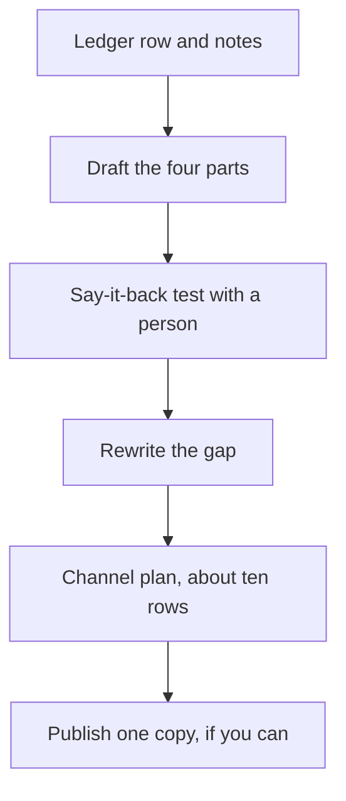

## Why you write this now

In the last three chapters you saw why a post matters, how to share it, and where it lives. Now you write it. This is the first piece of your kit that is a full piece of writing instead of a line. A founder who clicks your link will read it slowly, and will form a view of how you think.

The post feeds three later things. It becomes the first item on the Writing page of your website, which you plan in chapter 8.6. It becomes a link on your LinkedIn profile, in the Featured section from module 7. And it becomes one of the pieces a mentor can pick in the capstone, so every number in it must trace to a row in your ledger. Write nothing here that you could not defend aloud in module 9.

Plan about 55 minutes. Most fellows need two sittings: one for the draft and one for the say-it-back test and the channel plan. A post of about 600 to 1,000 words is a good size. That is a suggestion from this course, not a rule. A shorter post that is clear beats a longer one that is not.

## What you produce

- One post about work of your own, saved as a text file or a note, with a date.
- A say-it-back record: who read it, what they said back, and what you changed.
- A channel plan of about ten rows, each with a version and a link line.

The pieces connect like this. The numbers come first, the test with a person comes before the plan, and publishing is the last step.



## The post template

Copy this into your private notes and fill it in. The opening comes last in the writing, even though it comes first on the page.

```text
TITLE (names the result, not the topic):
DATE:

OPENING (2 or 3 sentences): the problem, then the result, then "here is how I know".

1. THE PROBLEM
   Who felt it. How big it was. What it cost. One real example.

2. WHAT I TRIED
   What I did. What I chose not to do, and why.
   My part: ...   Others' part: ...
   How I tested it: ...

3. THE NUMBERS
   Before: ...   After: ...   Window: ...   Source (ledger row): ...
   What else changed in that time: ...

4. WHAT I WOULD CHANGE
   One honest limit, or one thing I would do differently next time.

AI-USE LINE (only if AI helped): ...
FIRST PUBLISHED LINE (on every copy): First published at [my page], on [date].

SAY-IT-BACK RECORD
   Listener (a role, not a name): ...
   What they said back: ...
   What I changed because of it: ...
```

## The channel plan template

Make one row for each place you will share the post. The first row is always your own page, or the README of a repository until your site exists.

| # | Channel | Version | Link line | Checked on my phone on | Planned date |
|---|---|---|---|---|---|
| 1 | My own page | The original | It is the home | | |
| 2 | | | | | |

The version is one of four: a full copy with a canonical link, a short version with a link, a link only, or a personal message. The link line says how a reader gets back to your page: a canonical field you have seen on your screen, or the "first published at" line with the address.

## Worked example: Areej's post

Areej is a fictional fellow, and her numbers are illustrative. She chose her load test on Campus Board, her four-person study project. She had the ledger row open before she wrote a word, and she started with the numbers, not the opening.

Her numbers part came first. She copied the test set-up from her ledger. It was the same k6 script before and after. The load was a constant arrival of 50 requests per second for 2 minutes. The database was the same seeded one of 10,000 events, on the same laptop. The target was p95 under 200 ms. Before, p95 was 820 ms and the target failed. After, it was 95 ms and the target passed. Error rate stayed under 1 percent in both runs. Writing these lines first meant she could not drift into claims the ledger did not hold. She also noted what could not be measured: it was a laptop, not production.

Then she wrote the problem. She did not start with how Campus Board began. She wrote what the problem was: the events list endpoint was slow under load. She named who wrote what: a teammate wrote the endpoint, and she added the cache and wrote the test.

Next came what she tried. She explained the 30-second cache in two sentences, and then the test set-up, so a reader could repeat it. She kept her own part and her teammate's part apart.

Last came what she would change. She wrote that a list can be up to 30 seconds old, so a new event might not appear at once. She also said she tested on seeded data, so next time she would test against a copy of production data. She did not hide either limit. That is what makes the 820 to 95 result easier to believe.

Only then did she write the opening: "My events list took 820 ms at p95 under load. A 30-second cache cut it to 95 ms. Here is the test that shows it." Here is how the finished post reads in outline:

> **Same script, same data: what a 30-second cache did to our p95**
> My events list took 820 ms at p95 under load. A 30-second cache cut it to 95 ms. Here is the test that shows it.
> The problem: [the slow list, who felt it]. What I tried: [the cache, the test set-up, my part and my teammate's]. The numbers: [820 ms to 95 ms, the window, the source]. What I would change: [test on a copy of production data; lists can be 30 seconds old].
> I used an AI tool to restructure my notes into sections; every number and decision is mine and I checked each one.
> First published at [her page], on [date].

Her classmate then read the post and said it back: "She made the list faster by keeping a copy for 30 seconds, and proved it with the same test before and after." That was close, but it did not mention that the copy can be old. Areej added one sentence on why. She planned to test with a second listener on another day, because one listener is a small sample.

## Areej's channel plan

Areej planned ten rows, as in chapter 8.3. Her own site is row 1, and it holds the original. DEV and Medium get full copies, each with its canonical setting and the "first published at" line. A short LinkedIn post and LinkedIn Featured link to the original. The Campus Board README and her GitHub profile README get a line and a link. The coding club's chat and her cohort chat get one line and the link, and the club's organisers agreed first. The last row is a personal message to her former teaching assistant, who had asked about load testing. She answers his question first and adds the link. She did not use Hashnode or Substack, because their canonical settings are unverified.

## Using AI on your own material

You may use an AI tool to help structure your post. It is good at three things: proposing sections and a title, pointing at long or vague sentences, and checking that all four parts are present. It must not add a number, a result or an experience you do not have. If it adds one, delete it.

Paste only your own material: a ledger row or your case study, plus your notes. Use roles instead of names, such as "a delivery company" or "my team lead". Never paste your full name, phone, email, address, ID numbers, passwords, keys, client or employer names, or private company data. Here is a prompt you can adapt.

```text
Here is a ledger row and my notes about one piece of my work.
Propose a title that names the result, and four sections:
the problem, what I tried, the numbers, what I would change.
Use only the facts and numbers I gave you. Do not add any.
Point out every sentence longer than 25 words and every empty phrase.
```

Do the say-it-back test with a person, not a tool. A tool already knows what you meant, so it cannot show you what the page fails to say. After the tool's help, do the empty-sentence edit from module 6: for each sentence, ask what a reader could check in it. If the answer is nothing, cut it or replace it with a fact. Then check every number against your ledger again. If AI helped, add the one-line AI-use statement from chapter 8.2.

## If you have no work you may publish, or no laptop

Some fellows have no work they are allowed to share yet. Others have only a phone. You can still finish this chapter in full.

If you have no work of your own to write about, use Areej's material. Write her post from the facts above: the problem, the test set-up, the numbers, the stale-data trade-off and the change she would make. Add no number that is not listed. Still make your own channel plan, because it is about your own channels. Say in your note that you used Areej's material.

If you work on a phone, write in your notes app. A post is plain text. Run the say-it-back test by sending the text to a classmate or a family member and asking for a short voice note. Make the channel plan as a list in your notes, with one line per channel. You can try each platform on your phone for the "checked on" column. You do not need to publish anything to finish this chapter.

If you can publish, do. A first real copy on one channel is worth more than a perfect plan. It is strongly encouraged but not required.

## Common mistakes and how to spot them

The first mistake is opening with history. If your first paragraph says when and why the project started, move the problem and the result above it. Test it by asking whether a reader who stops after three sentences knows what you did.

The second mistake is a number without its source. If a number has no ledger row, window or test behind it, it does not belong in the post. Write the honest version: "I did not measure that; here is how I would."

The third is "we". If you wrote "we cut the time", ask what your part was. Write it as "I wrote the cache; a teammate wrote the endpoint." Readers trust a clear split more than a shared credit.

The fourth is writing a tutorial instead of a post. A tutorial teaches a reader how to do something. A post about your work tells what you did, what happened and what you would change. Keep the tutorial for another day.

The fifth is a copy with no way home. Look at every row of your channel plan and ask how a reader gets back to your page. If you cannot answer, add the "first published at" line.

The sixth is trusting a setting you have not seen. If you plan a canonical setting on a platform, you should have seen the field on your screen. Where you have not, rely on the line.

The seventh is the story of Diala. She kept her only copy on one platform and lost it with her account. Row 1 of your plan is your own page for this reason. Keep a copy of the text in your private notes as well.

Last, do not run your post through a humaniser. Detectors are known to mislabel second-language English. The better protection is a post full of specifics that a reader can check.

## Acceptance criteria

- All four parts are present: the problem, what I tried, the numbers, what I would change.
- Every number is in my ledger, with its window and source, or the post says "not measured".
- The language is plain: short sentences, active verbs, no empty sentences from the module 6 checklist.
- The AI-use line is present if AI helped.
- A say-it-back record shows a listener, what they said, and one change I made.
- The channel plan has about ten rows, each with a version and a link line, and I tried each channel on my phone.
- I rely on no canonical setting I have not seen on my screen.

## Where to keep it, and what comes next

Keep the draft, the say-it-back record and the channel plan in your private notes, next to your ledger. Only the finished post is public, and only if you choose to publish it. Do not store passwords or keys with it.

The next chapter, 8.6, plans the website that will hold this post. In the gate, 8.8, you record your say-it-back result and describe your channel plan. In the capstone, module 9, a mentor may pick any number in your post, and you will show where it came from.
