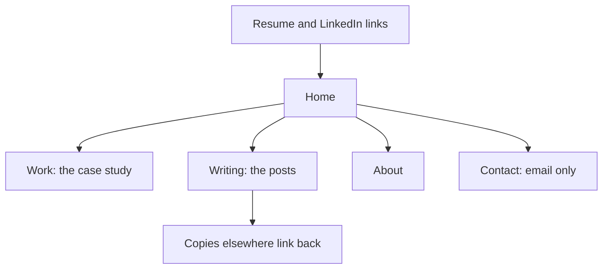

## Why you plan the site now

You now have, or soon will have, three things worth showing. They are a case study from module 5, a post from chapter 8.5, and a set of numbers in your ledger. They need one home that you control. That home is a small personal site. A visitor who opens your resume link or your LinkedIn Featured section should land on it, read your case study, and open your latest post.

This chapter is a plan, not a build. You write down the pages, the host and the specifics before you make anything. That order saves time. Most weak personal sites fail for the same reason Diala's did: someone picked a template first, filled it with words second, and never decided what only they could say. A plan forces the decision before the template does.

Plan for about 35 minutes. The plan is required. Putting the site live is strongly encouraged, but it is optional. Some fellows have a laptop only when the power is on, or cannot reach a host from their phone. A complete plan counts in full at the gate.

## What you produce

One page of notes called the website plan. It has seven parts. Copy the template below into your private notes and fill it in.

```text
WEBSITE PLAN

HOST: (a free static host)
LIMIT THAT MATTERS MOST FOR ME: ...
CHECKED ON: (date I read the host's limits page)
ADDRESS: a free address from the host (no paid domain needed)

PAGES
  Home: (one line about me, two proofs with links)
  Work: (my case study, and which other work I link to)
  Writing: (my posts, newest first, each with a date)
  About: (a few lines about me, one personal detail used once)
  Contact: (email only)

WHICH CASE STUDY AND WHICH POST GO WHERE
  Case study: ...   on page: ...
  Post: ...         on page: ...

WHAT MAKES IT MINE (at least four specifics)
  1. ...  2. ...  3. ...  4. ...

ORIGINALS RULE: my posts are published here first; other places link back.
UPDATE PLAN: once a month I will ...
PRIVACY: email only; no phone number; no home address; names removed from screenshots.
TEST PAGE: made live on (date) / not yet
```

The picture below shows where the site sits in your kit. Your resume and profile point to the site. The site holds the originals. Other places point back to it.



## Worked example: Areej's plan

Areej is a fictional fellow, and her numbers are illustrative. She works through the plan one part at a time.

She starts with the host. She chooses GitHub Pages. She already uses GitHub every day, and it gives a free `github.io` address. She reads the limits page and writes down the one that matters for her. The published site can be up to 1 GB. The host is not meant for sites that mainly sell things or provide software as a service. Her site is a personal portfolio, so it fits. She writes "checked 2026-10" next to it. She does not buy a domain.

Next, the pages. Home carries her one-line promise: "A full-stack developer who measures before and after, and writes it down." It also has two proofs, each with a link. One is the report that went from 4.6 s to 0.41 s at p95. The other is the cache that went from 820 ms to 95 ms at p95. Work holds the public version of her case study, with the company name removed, and a link to the Campus Board repository. Writing holds her post and its date. About has a few lines on the coding club. It also mentions the football notebook she has kept since she was 12. The notebook appears here once and nowhere else on the site. Contact is an email address only.

Then she decides which case study and which post go where. The case study, "From 4.6 seconds to 0.41: fixing a slow report with one index", lives on the Work page. The post, "Same script, same data: what a 30-second cache did to our p95", lives on the Writing page. The Home page links to both, so a visitor who reads only the first screen can reach either in one tap.

After that, the specifics. She lists five. A real image of the redacted dashboard chart. The before and after query plans as screenshots. A date on every post. The 4.6 s to 0.41 s result with its window and source, "14 days before and after, team dashboard". And an honest mistake: she tested the cache on seeded data only, and next time she would use a copy of production data. She has no stock photos and no slogan. The test for each item is simple: could anyone else have put this on their site? If yes, it is not a specific.

Her originals rule is one sentence: every post is published on this site first, and every copy elsewhere says "First published at" and links back. Her update plan is small: once a month she adds one dated item, opens every link on her phone, and updates the "last updated" date. Her privacy line says email only, no phone number, no home address, and names removed from every screenshot, as her lead agreed when she asked about the chart.

Last, she plans a test page. She will make a repository, add one page that says hello, turn on the host, and open the address on her phone. She will do this before she builds anything else. She also plans to try one site generator, which is a tool that builds pages from her Markdown notes. She will keep it only if the test page deploys without trouble. Otherwise she will use plain HTML files, which also work.

## Using AI on your own material

An AI tool can help you turn lines from your career arc document into a page outline. Paste only your own lines, without names, phone numbers, emails, addresses or employer names. Ask it to propose what each of the five pages should hold, and to point to any sentence a stranger could not check. Here is a prompt to adapt.

```text
Here are lines from my career arc document (no names or contact details).
Propose an outline for five pages: Home, Work, Writing, About, Contact.
Use only the facts I gave you. Do not add numbers or experience.
Mark any line that a stranger could not check.
```

The words on the page stay yours. The tool can suggest a structure, but it cannot supply your number, your screenshot or your mistake. If it writes a sentence you could not defend aloud, cut it. Do not run your page text through a humaniser. Detectors are known to mislabel second-language English, so passing one is not a goal, and a humaniser changes style, not facts. If AI helped you draft, check every fact and say so on the page.

## If you have no work yet, or no laptop

If you have no case study or post of your own yet, use Areej's. Plan her site from the facts above, and say in your note that you did. Then write one line about what you will put on your own site once you have your own work. Your plan is still complete if it names the pages and the specifics you expect to have.

If you work only on a phone, write the plan in your notes app. You can read a host's limits page on your phone and note the date. You can also write each page as plain text now and publish it later when you have a laptop. If a host does not open on your phone, record that in your note and ask your mentor. The plan does not depend on the site being live.

If you can put the site live, start with the test page only. A real address that opens on a stranger's phone is worth more than a plan. Follow the host's own guide on your screen, because the screens change.

## Common mistakes and how to spot them

The first mistake is starting with a template. If you choose a design before you know what your pages say, you will fill it with filler. Write the page notes first.

The second is too many pages. If your plan has a page you cannot keep current, remove it. Five pages that are true and dated beat ten that are stale.

The third is a case study that nobody can reach. Check that your Home page links to your case study, and that your resume link opens a page that works.

The fourth is a vague specific. "My projects" is not a specific. "The before and after query plans, as images, each with its date" is.

The fifth is a limit you did not read. Before you rely on a host, read its limits page and write the date. Vercel Hobby, for example, is for personal, non-commercial use only. A plan that cannot say which limit matters is not finished.

The sixth is private detail in public. Do not put a phone number, a home address, a customer name or a company's real table names on the site. Use an email address you are happy to make public. Ask permission before you show anything from a team or client.

The seventh is changing addresses. Once you share a page, do not rename it. Every resume, profile and copy that points to it would break, as Diala's resume link did. Decide the addresses now: one for Work, one for Writing, one for each post.

The last is a paid domain you think you need. A free `github.io` or `pages.dev` address is enough for this course. You can add a domain later.

## Acceptance criteria

- Five pages are planned, each with what goes on it.
- I have said which case study and which post go on which page.
- A free host is chosen, with the limit that matters most and the date I checked it.
- At least four specifics are listed, and none could be on anyone's site.
- The originals rule, the update plan and the privacy rule are written.
- No paid domain is required.
- The test page is made live, or I have written "not yet" and why.

## Where to keep it, and what comes next

Keep the plan in your private notes, next to your post and your channel plan. The plan is private. The site is public only when you publish it.

In the gate, chapter 8.8, you describe the pages of your plan, your host and its check date. In module 9, the site address will be one of the links a mentor tests on a phone. If your site is not live, the mentor reads the plan instead.
