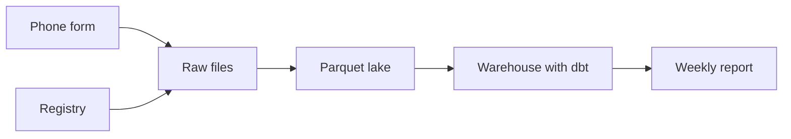

<BigWordAlert term="Data pipeline" plainEnglish="The set of steps that moves data from where it is created to where people use it, and checks it on the way." whyItMatters="When a number in a report looks wrong, the pipeline is where you look. A pipeline you can trace and test lets you answer 'is this real?' by looking, not by guessing." />

## A number that jumped

Hala is 26 and works part time for Mizan, a small NGO that publishes a weekly food-basket report. She works from home and plans her day around the hours when the power is on. She is the junior data engineer, which means she looks after the files and tables behind the report. Hala, Mizan and every person, market and number in this course are fictional, and all the data is synthetic.

Mizan's volunteers visit eight markets, M01 to M08. Each day they record the price of 12 everyday items with a form on their phones. The items are flour, rice, lentils, sugar, cooking oil, tomatoes, potatoes, onions, eggs, milk powder, tea and bread. The form uploads the prices when the phone finds a connection. The basket cost of a market is what those 12 items add up to. Families and partner community kitchens use the weekly report to decide where to shop.

On Tuesday 17 March, Omar writes to Hala. Omar is the programme officer. He reads the report every week and he is not technical. He asked for an early look at the new week, so Hala refreshed the report on Tuesday evening with the two days so far. The line for M02, Sea Gate Market, now says 203.50 shekels. Last week it said 135.65. That is a rise of 67.85 shekels, about 50 percent, in one week.

Omar asks one question. Did prices rise at M02, or is something wrong with the data? He must know before he tells the kitchens that M02 has become expensive. If the rise is real, kitchens may choose to shop elsewhere. If it is not real, families lose time and money for nothing.

## Three suspects and no way to choose

Hala has three suspects. The price rise could be real. The report could be wrong, because the query behind it has a mistake. Or the data could be wrong somewhere between the phone and the report. She cannot tell which one it is.

```predict
prompt: "Omar's line for M02 rose from 135.65 to 203.50 shekels in one week. With no other information, which explanation is more likely?"
options:
  - id: fault
    label: "A fault in the data steps"
  - id: real
    label: "A real price rise at one market"
correctOptionId: fault
explanation: "A fault is not certain, but it is the first thing to check. In the clean version of this data, which you will build in this course, no market's basket changes by more than 2.7 percent from one week to the next. A rise of about 50 percent at one market would be very unusual. The rest of the module shows how to look for the fault in a calm, ordered way."
allowRetry: true
```

A wrong number is not only an embarrassment. Mizan's partner kitchens plan their shopping from this report. A kitchen that cooks for several hundred people a week may buy flour, rice and oil in one trip on Wednesday. If the report says M02 became 50 percent dearer, that kitchen may drive to a market that is further away and pay for the fuel. If the report is wrong, the kitchen pays that cost for nothing, and it also learns not to trust the next report.

The trouble is that Hala has no way to look. The report comes from one SQL file that reads a folder of upload files. There are no tests. Nothing counts the rows at each stage. If she asks how many reports M02 sent on Tuesday, she must work it out by hand from the raw files. She tries, and it takes her two hours. She sends Omar a careful message that says she does not know yet.

Nothing here is a failure of skill. Hala writes good SQL. The problem is that nobody can see inside the pipeline. A pipeline is a chain of steps, and a number at the end is only as good as every step before it. When one step breaks, the number looks the same as a good one. You only find the break if the steps are built so that you can check them one at a time.

## What this course builds

In this course you build that pipeline, on your own laptop, with no cloud account and no paid service. The first diagram shows the whole thing from left to right. Read it as a story of one price report: it starts on a volunteer's phone and ends as a line in Omar's report.



Here is what to notice. Two kinds of source feed the raw files: the phone form, and the registry of markets and volunteers that Karam built. Raw files are kept exactly as they arrive. The lake stores them again as Parquet, a file format that engines read column by column. The warehouse turns them into tested tables, and only the last box is what Omar sees. Each arrow is a place where you can count rows and ask a question. That is what makes a number traceable.

You work in two places. You read, answer questions and use the interactive pictures on your phone, in short sessions. You build on a laptop, with a few hours of quiet time and a power supply. After one small download in chapter 1.4, every practical step runs without the internet, so a weak connection or a power cut does not stop the build. Each build chapter gives you a task, the tests your work must pass, and the real output you should see. It never gives you the answer, so the thinking stays with you.

You will build every box, in order. You will write SQL that joins and counts without fooling you. You will design the tables with one clear meaning for each row. You will store files in a format that engines read quickly, and build a small warehouse with tests. Then you will make it survive the problems of real data: late uploads, duplicates, a rerun after a power cut and a new field. You will add a scheduler with retries, protect the volunteers' personal data, and finish with a second pipeline of your own.

The order of the course follows how a pipeline grows. Modules 2 to 4 are about SQL and the shape of tables. A join that multiplies rows is one easy way to get a wrong number, and you will see it in module 2. Modules 5 to 8 turn raw files into a pipeline that gives the same answer when you run it twice. Module 9 schedules the work and handles failure. Module 10 explains streaming and clusters as ideas. Modules 11 and 12 cover checks, privacy and interviews, and module 13 is the capstone.

The data has these problems on purpose. About 8 percent of the reports arrive one to three days late. About 3 percent are sent twice. A few have a price of 0 or no item code. One volunteer has no connection for three days and then uploads everything at once. A market moves to a new area, and a phone number changes. A script that you run makes the same data on every computer, so your numbers match the course.

## Why this matters for the job

Data teams are often small. One person may look after the sources, the pipeline and the tables behind a report. In an interview you may be asked to write SQL that does not double count. You may be asked to design a small model, or to explain how you would make a job safe to run again. In a real job you are asked, sooner or later, why a number is wrong.

This course teaches those skills by building one working pipeline, so that you can show it and explain it. It cannot promise you a job. Chapter 1.2 says plainly what postings ask for and what we do not know. What it can give you is a project you built yourself, with tests, numbers and decisions you can defend.

## What this module covers

Module 1 has four more chapters. Chapter 1.2 tells the data engineer's job from the jobs around it, and traces Omar's number back to the stage that broke. Chapter 1.3 draws the map of a pipeline and asks the question that decides how often it should run. Chapter 1.4 sets up your workspace with one small download and makes Mizan's raw data. Chapter 1.5 is the gate, where you explain the role and the pipeline in your own words.

You will follow Hala through the whole course. Omar reads her reports and asks the questions that matter. Yasmin, the volunteer coordinator, owns the registry of markets and volunteers. Karam, a volunteer developer, built the phone form and the registry. Each of them needs something different from the pipeline, and that is part of the job.

<LearningObjectives items={["Explain what a data engineer does and how the job differs from the roles around it", "Trace a wrong number back to the stage that broke, and say who owns that stage", "Place each part of a pipeline on the data lifecycle", "Ask how fresh data must be, and decide whether a daily batch is enough", "Set up a workspace that runs offline after one small download, and make Mizan's raw data"]} />

## Key words

| Word | Plain English |
|---|---|
| **Source** | The place where data is first created, such as a phone form or an app |
| **Raw data** | Data kept exactly as it arrived, before anyone cleans or changes it |
| **Batch** | A group of records that are processed together, on a schedule |
| **Freshness** | How old the data is when someone uses it |

## What is in this module

| Chapter | You will practise |
|---|---|
| 1.2 | Telling the data engineer's job from its neighbours, and tracing a wrong number |
| 1.3 | Placing a pipeline on the data lifecycle, and deciding how fresh data must be |
| 1.4 | Installing the pinned tools, making the raw data and passing the setup check |
| 1.5 | Explaining the role and the pipeline you will build |

**Next:** What a data engineer does, and how Hala traces Omar's number back to the stage that broke.
