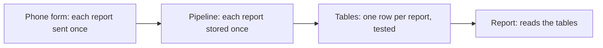

## Tuesday night, 21:40

Hala has the power for two more hours, so she starts with a plan. Omar's number for M02 is 203.50 shekels, and last week it was 135.65. She will not guess. She will <GlossaryTerm term="trace" definition="Follow a result backwards through the steps that made it, until you find the step where it first went wrong." /> the number, one stage at a time, and write down what each stage shows.

A stage here is one place where data is held or changed. Omar's report is one stage. The tested tables behind it are a second. The pipeline that fills those tables is a third. The phone form and the registry, where the data is created, are the fourth. Hala asks the same question at each one: does this stage agree with the stage before it? The first stage that does not agree is where the fault entered.

This way of working is the core of the job. It also shows why the job has neighbours. Four different people could own those four stages, and each one needs to know what the others promise.

## The job in one paragraph

Data engineers build and look after the systems that move data from where it is created to where people use it, and keep it correct on the way. One useful map of the work has five parts. Data is created, stored, brought in, changed and served. You will meet this map again in chapter 1.3. For now it is enough to see that the job is about the path the data takes. It is also about the checks that keep each part of that path honest.

Notice what is missing from this description. It does not say "writes dashboards" or "trains models". Those are real jobs, but they belong to the neighbours. A data engineer makes sure the right rows are in the right place, once, on time, with the personal parts protected. That is less visible than a chart, and it matters more than people expect when the chart is wrong.

## The jobs around it

An analyst answers questions with data. A data scientist builds models from data. An analytics engineer shapes clean, tested tables for others to use. A data engineer builds the pipelines and systems that deliver the data. A backend engineer builds the application that creates it. In small teams one person does several of these.

The dbt documentation describes analytics engineers as people who model data so that others can answer their own questions. They spend their time transforming, testing, deploying and documenting data. The US Bureau of Labor Statistics describes data scientists as people who collect and analyse data, build and test models, and turn findings into recommendations. The boundaries between these roles are blurry, and job postings for analytics engineers and data engineers often ask for the same skills.

| Role | The job in one line | At Mizan |
|---|---|---|
| Analyst | Answers questions with data | Builds and checks the weekly report |
| Data scientist | Builds models from data | Not needed yet; might one day forecast prices |
| Analytics engineer | Shapes clean, tested tables for others | Looks after the tables behind the report |
| Data engineer | Builds the pipelines that deliver the data | Looks after the path from raw files to tables |
| Backend engineer | Builds the application that creates the data | Karam, who built the phone form and the registry |

At Mizan the team is Hala, part time. So Hala wears three hats, one after another: analyst, analytics engineer and data engineer. Karam owns the backend work, and nobody does the data scientist's job yet. That is normal for a small NGO, a clinic or a shop that has one person for all the data. The roles in the table do not say who a person is. They say which question you are answering at that moment, and which stage you can fix.

## What postings ask for

Before you spend weeks on a skill, it is fair to ask whether anyone wants it. In October 2026 we read 25 public postings for data engineers and analytics engineers, and scanned 90 roles from 51 company boards. The counts below are how many named each skill. They are a sample of public postings, not a census, and they come mostly from larger software and finance companies in North America and Europe. They say nothing about freelance or NGO work.

| Skill named in the posting | Of 25 read in full | Of 90 scanned |
|---|---|---|
| SQL | 22 | 62 |
| Python | 21 | 64 |
| Data modelling | 16 | 52 |
| A named cloud data warehouse | 15 | 49 |
| dbt | 12 | 29 |
| An orchestrator such as Airflow | 12 | 32 |
| Spark | 8 | 38 |
| A streaming engine such as Kafka | 5 | 32 |

SQL and Python were named in most postings, then data modelling, testing, a cloud data warehouse, dbt and an orchestrator. Spark and streaming tools were named less often in roles without a senior title. This is why the first modules of this course go deep on SQL and modelling, and why Spark and Kafka appear later as ideas and not as installs.

Now the honest part. Many data engineering postings ask for around three years of experience, and some are limited to certain countries. Of the 25 we read, only 10 said remote, and several of those named a country or region. A portfolio project and clear explanations help, but we cannot promise a job. What this course can promise is that you will have built something real, with tests and numbers, that you can explain.

## Predict, then trace

Look back at the four stages. Hala checks the tables behind the report first, because that is the stage closest to Omar's number. She finds that the query is correct and its checks pass. Before you see the trace, make a prediction about what that tells her.

```predict
prompt: "The query behind Omar's report is correct, and its checks pass. Does that mean 203.50 is the right number?"
options:
  - id: query
    label: "Yes, a correct query gives a right answer"
  - id: rows
    label: "No, the rows under it may be wrong"
correctOptionId: rows
explanation: "A query is only as good as the rows it reads. A correct query on wrong rows gives a wrong number, and it gives it with full confidence. A test checks the assumptions someone wrote down, so a passing test cannot clear a problem nobody thought to test. This is why Hala keeps going upstream."
allowRetry: true
```

The canvas below is Hala's trace. It has four lanes, one for each stage, and each lane belongs to a role. Step through it slowly. At each step, ask what the stage found and what it ruled out.

<InteractiveCanvas slug="wrong-number-trace" />

**What this shows:** a wrong number traced back through four stages. A different role checks each stage, until one stage fails its check against the stage before it.

**Try this:** before step 2, predict what the table behind the report holds, then check. Next, find the first step where you can see that the data is wrong and not the code. Last, imagine that the phone form had sent Tuesday twice, and say what would change at steps 6 and 7.

**What changed:** at each step the note says what a stage found and what it ruled out. The query was cleared at step 2, the source at step 6, and the pipeline job was found at step 7. After the fix the report shows 135.50.

**Limits of the model:** this is one trace with one cause. Real wrong numbers can have several causes, and a repeated day is one of many. How far a repeated day moves a figure depends on the query.

## Doing the sum by hand

You can check the trace with a short SQL query. Hala's early query added up each day's prices and divided by the number of days that have data. The table behind it had Monday once and Tuesday twice. This DuckDB query builds those three rows and runs her formula.

```sql
WITH day_totals(day, total) AS (
    VALUES (DATE '2026-03-16', 135.00),
           (DATE '2026-03-17', 136.00),
           (DATE '2026-03-17', 136.00)
)
SELECT count(*) AS rows, count(DISTINCT day) AS days,
       sum(total) AS added_up, sum(total) / count(DISTINCT day) AS weekly_figure
FROM day_totals;
```

```text
rows | days | added_up | weekly_figure
3 | 2 | 407.00 | 203.5
```

Here is the reasoning. There are 3 rows but only 2 different days. The formula adds all three totals, 407.00, and divides by the 2 days. Without the repeat the same formula gives 271.00 divided by 2, which is 135.50. The query did exactly what it says. The fault is in the rows. Notice also how a short week makes the error large. With five days of data, one repeated day would lift the figure by a fifth. With two days it lifts it by half.

The diagram shows the other half of the lesson: what each stage promises to the next one. A trace works because every stage can state its promise in one sentence and check it with a count.



What to notice is that each promise is about one thing and can be checked by counting. If a promise is broken, the stage after it inherits the damage and cannot see it. That is why Hala starts at the report and walks back until a promise fails.

## Where people go wrong

The first mistake is to fix the number and leave the cause. An analyst who sees 203.50 could divide by three days, or remove duplicates inside the report query. The number would look right this week. The doubled rows would stay in the tables, and the next query that reads them would be wrong too. A fix belongs at the stage where the fault entered.

The second mistake is to blame the nearest person. The person who sends you the number is not the cause. In the trace, nobody did anything careless. A power cut stopped a job, a person reran it, and the job had no rule for a second run. That is a fault in how the system was built, not in a person.

The third mistake is to read a job as a list of tools. A posting with a long list of names is asking, in the end, for people who keep data correct. The data travels from its source to its readers, and they check it on the way. The tools differ from one team to the next. The trace you just did works with any of them.

## The trade-off: one person or four

On a small team one person can trace a number from the report to the form in an evening, as Hala did. There is no waiting for someone to reply. The cost is that nobody checks your work, and you can miss a fault because you built it. On a larger team the stages have separate owners. A fault is found by a second pair of eyes, but every handoff needs a clear promise, or each person assumes the other checked.

You would choose differently depending on size and risk. A shop with one weekly report can live with one person. A clinic reporting to a funder needs the stages to be written down, even when one person does them all. In both cases the habit is the same: say what each stage promises, and count at the boundary.

## Try it on your data

Pick one number you read this week in a bill, a school mark or a price list. Write the four stages that produced it, from the place the data was created to the page you saw. Then write, for each stage, one count or check that could catch a fault. For Mizan, do the same for Omar's report: write the four stages in your own words and the first question you would ask at each one.

## Check your understanding

```quiz
type: mcq
question: "Nadia manages a clinic. Her monthly report says 1,200 appointments. The booking app's own count says 600. The report equals the table behind it at 1,200, and the pipeline stored 1,200 rows. Nobody has counted the app's export file. What is the best next check?"
options:
  - "Divide the report total by 2, since the app says 600"
  - "Rewrite the report query, since the report is the last stage"
  - "Count the rows in the export file the app gave the pipeline"
  - "Ask the clinic to recount every appointment by hand"
correct: 2
explanations:
  - "That makes this month look right and hides the cause. The doubled rows stay in the tables and the next report is wrong again."
  - "The report already equals the table, so the query reads its rows correctly. The difference between 600 and 1,200 appeared before the report."
  - "Right. The numbers agree from the report back to the stored rows and first disagree with the app. Counting the export file shows whether the app sent 600 or the pipeline stored the rows twice."
  - "The app has already counted 600 appointments. A hand count would repeat work and would not show which stage added the extra rows."
```

**Next:** The map of a pipeline: where each part sits on the data lifecycle, and how often a batch job should run.
