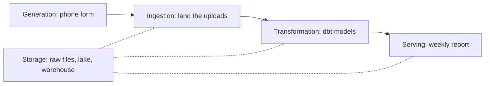

## Can the table be live?

Yasmin is the volunteer coordinator at Mizan. She owns the registry of markets and volunteers, and she reads a small daily table of the reports that have not arrived yet. When a market is missing, she phones its volunteer. On Wednesday she writes to Hala: "Can this table be live? I would like to see reports the moment they come."

Hala does not say yes or no. She asks a different question: "What will you do differently if the table is fresher?" Yasmin thinks. She checks the table a few times a day, whenever the power is on and she has a quiet minute. She phones a volunteer if a report is more than a day old. A table that is a few hours old would give her the same decisions as a table that is a few seconds old.

That small conversation is the whole lesson. Fresh is not the same as better. How fresh the data must be is a requirement, like a price or a deadline, and a data engineer gets it by asking. The answer decides the design, the cost and how much can go wrong at night.

## The lifecycle as a map

Before you decide how often to run a pipeline, it helps to have a map of the whole path the data takes. Joe Reis and Matt Housley describe one in their 2022 book, Fundamentals of Data Engineering. It has five stages: generation, storage, ingestion, transformation and serving. We use their stage names as a map for this course, and nothing more.

Generation is where data is created. Ingestion is bringing it into your system. Transformation is changing it into something people can use. Serving is handing it to the people who need it. In our picture, storage sits under the other four, because data has to rest somewhere between steps. The table shows where each stage lives at Mizan, and where you build it.

| Stage | At Mizan | You build it in |
|---|---|---|
| Generation | The phone form and Karam's registry | Not built by you; you make test data in chapter 1.4 |
| Storage | Raw files, the Parquet lake, the DuckDB warehouse | Modules 5 and 7 |
| Ingestion | The job that lands each day's uploads | Modules 5, 6 and 8 |
| Transformation | SQL and dbt models that clean, join and add up | Modules 2 to 4 and 7 |
| Serving | The weekly report that opens on a phone | Module 9 |

The last column shows the order of the course. You learn to transform first, in SQL (modules 2 to 4), because you can try it on the raw files straight away. Then you learn to store data (module 5), bring it in safely (module 6), transform it as code with tests (module 7), handle late data (module 8), and run and serve it (module 9).

## Batch and streaming at a glance

There are two ways to move data through the stages. One is batch, from the key words of chapter 1.1. The other is <GlossaryTerm term="streaming" definition="Processing each record soon after it arrives, instead of waiting to collect a group." />, where the system runs all the time and handles each record as it comes. Batch is simpler to build, to rerun and to test. Streaming gives data that is seconds old. It needs a system that stays up and copes with records that arrive late or out of order.

Mizan's data has a feature that settles the question for now. The phone form uploads when the phone finds a connection. So the data already arrives in batches: a few files a day, sometimes late. A streaming system downstream would not make the data fresher than those uploads. Batch is the honest choice, and you will meet streaming as an idea in module 10.

One more point from the research on late data: an event has a time when it happened and a time when we received it. They differ. Late records are normal, so a pipeline needs a rule for how long it waits, and what it does when something arrives after that. A table can be fresh and still be incomplete. About 8 percent of Mizan's reports arrive one to three days after the day they describe, and one market's volunteer sends three days at once. Freshness tells you how recently the pipeline ran. It does not tell you that every report has arrived.

## Freshness is a number you can ask for

Freshness, the word from chapter 1.1, becomes a number when you ask one question: how old can the data be when someone uses it? Write the answer as a number of hours. For Yasmin it is 24: a report older than a day is a reason to phone. For Omar's weekly report it is much longer, because he reads it once a week. For a solar partner who asked for live battery readings, which chapter 10.1 returns to, the answer might be minutes.

Once you have the number, a batch schedule is mostly arithmetic, and the arithmetic has one easy trap. The data in Yasmin's table was taken when the last run started. The next section asks you to work out how old that data can get at worst, before you see the rule.

## Predict, then play

Hala runs the job every 6 hours, and a run takes 30 minutes. Yasmin needs data that is no more than 24 hours old.

```predict
prompt: "Hala runs the job every 6 hours and a run takes 30 minutes. At worst, how old can the data in Yasmin's table be?"
options:
  - id: plus-run
    label: "Up to 6.5 hours: the gap plus the run"
  - id: gap-only
    label: "Up to 6 hours: the time between the runs"
correctOptionId: plus-run
explanation: "The table shows data taken when the last finished run started. Just before the next run finishes, that data is the gap (6 hours) plus one run (30 minutes) old, which is 6.5 hours. Forgetting the run time is an easy mistake, and it matters most when the gap is long."
allowRetry: true
```

Use the canvas to test the schedule against Yasmin's need. Change one input at a time and watch the verdict.

<InteractiveCanvas slug="batch-freshness" />

**What this shows:** in batch, the age of the data is bounded by the time between runs plus the run time. When the need is a deadline, a slower schedule can be enough, and running more often only adds runs.

**Try this:** set run every to 24 hours and see the plan miss the 24 hour need by half an hour. Then raise the need to 36 hours and see once a day become enough. Last, set a one hour gap with a 120 minute run and see the runs wait for each other.

**What changed:** the sentence under the sliders names the new worst-case age and says whether the plan now meets the need. It also gives the new number of runs a day.

**Limits of the model:** it assumes every run succeeds and takes the same time, and that the data is taken when a run starts. It ignores late reports and the cost of running more often on a small laptop.

## A worked example with numbers

Here is the same arithmetic as a few lines of Python, so you can try schedules that the canvas does not offer. The function uses the rule from the canvas, and the loop checks four schedules against Yasmin's 24 hours.

```python
def worst_case_age_hours(run_every_hours, run_minutes):
    """The oldest the data can be just before the next run finishes."""
    return run_every_hours + run_minutes / 60


schedules = [("every hour", 1, 10), ("every 6 hours", 6, 30), ("every 12 hours", 12, 30), ("once a day", 24, 30)]
for name, every, minutes in schedules:
    age = worst_case_age_hours(every, minutes)
    print(f"{name:15} worst age {age:5.2f} h   runs a day {24 / every:4.1f}   meets 24 h: {age <= 24}")
```

```text
every hour      worst age  1.17 h   runs a day 24.0   meets 24 h: True
every 6 hours   worst age  6.50 h   runs a day  4.0   meets 24 h: True
every 12 hours  worst age 12.50 h   runs a day  2.0   meets 24 h: True
once a day      worst age 24.50 h   runs a day  1.0   meets 24 h: False
```

The reasoning is in the last column. Three schedules meet the need, and only one of them is cheap. A run every 12 hours meets it with 2 runs a day, and an hourly job meets it with 24. For a laptop that sleeps or loses power, 22 extra runs a day are 22 more chances for a job to stop half way. Once a day fails by half an hour, and that half hour is the run time. A job that starts at 06:00 and ends at 06:30 gives data that is 24.5 hours old just before it finishes.

## Count at every boundary

The map has a second use: it shows where to count. Every arrow between two stages is a place where rows can go missing or appear twice. A pipeline that counts rows at each boundary finds a fault on the day it happens. One that does not finds out when someone notices a wrong number.

<RealWorldEvent title="Test results lost to a spreadsheet limit" when="September and October 2020" summary="In England, lab test results were passed as text files into spreadsheet templates that used an older file format. Each template held about 65,000 rows. Once a template was full, further cases were left out. About 16,000 confirmed cases were missing from the daily figures between 25 September and 2 October 2020. They were added later." lesson="A file format has limits. A pipeline should count rows between each stage, so that a missing batch shows up on the day it happens." />

You will use the same habit. When you generate Mizan's data in chapter 1.4, the generator writes 2,712 lines. Later, the landing job stores 2,699 good lines and sets 13 bad lines aside. The check is a sum: 2,699 plus 13 is 2,712. If a boundary count does not add up, you know which arrow to look at.

The diagram puts the stages on one picture. Storage sits under the others because every stage reads from it and writes to it.



What to notice: the solid arrows are the path of one report, and the dotted lines show that each stage keeps its result in storage. A count belongs on every solid arrow. When you plan a build, you can ask of each box which promise it makes and which count proves it.

## Where people go wrong

The first mistake is to treat "real time" as the default. It sounds modern, and it is usually expensive, because the system must run all the time and recover from every failure without a person. If nobody changes a decision when the data is fresher, the extra work buys nothing. Ask what the reader will do with the answer.

The second mistake is to measure freshness by when the job ran. A job can finish at 06:30 and still miss a market that uploads at 09:00. Freshness is about the data, not the clock on the server. In the worked example, "once a day" fails by the run time, and a late upload fails the same check in a different way.


## The trade-off: batch, small batches, or streaming

Batch buys simplicity. You can rerun a day, count its rows and compare it with the day before. It costs freshness: the data is as old as the gap plus the run. Running more often in small batches is a middle choice. It cuts the age of the data, and it adds runs that can fail. Streaming gives the lowest age, and it costs a system that runs all the time and a team that can look after it.

You would choose differently when the decision cannot wait. A fraud check on a payment, or a sensor that switches off a pump, needs seconds. A weekly report for families does not. For Mizan a batch every 12 hours or less meets Yasmin's need, and a daily run is enough for Omar.

## Try it on your data

Pick a report that you use or build, such as a daily sales sheet or a school attendance list. Ask its reader how old the data can be before it stops being useful, and what they would do differently with fresher data. Write the answer as a number of hours. Then work out the worst-case age for the schedule you have today, using the gap plus the run time.

## Check your understanding

```quiz
type: mcq
question: "Bilal runs a bakery and wants daily sales numbers. His sales sheet is copied into a report every 12 hours, and the copy takes 45 minutes. The shop owner says the numbers must never be more than 12 hours old. Which statement matches the facts?"
options:
  - "The report misses the need, as its worst case is 12.75 hours"
  - "The report meets the need, because the gap is exactly 12 hours"
  - "The report meets the need, because a copy of 45 minutes is short"
  - "The report misses the need, because copies should run every hour"
correct: 0
explanations:
  - "Right. The worst-case age is the gap plus the run: 12 hours plus 45 minutes is 12.75 hours, which is more than the 12 hours the owner allows."
  - "The gap is only part of the age. The data is still 45 minutes older when a run is about to finish, so 12 hours is not the worst case."
  - "A short run still counts. The need is 12 hours and the worst case is 12.75, so even a short run can break the limit when the gap already uses all of it."
  - "Nothing in the facts asks for hourly copies. A run every 11 hours would meet the 12 hour need with 11.75 hours, with no need to run more often."
```

**Next:** Set up your workspace and make the raw data: one small install, the setup check, and Mizan's generator.
