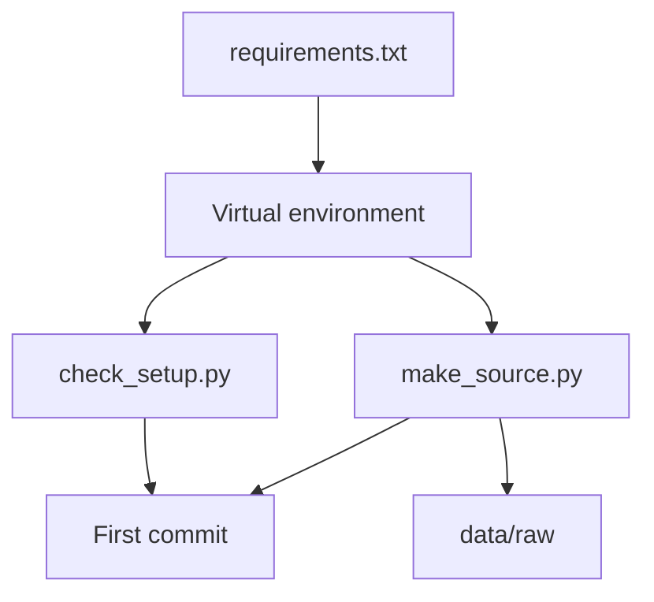

## Why Hala starts with the tools

Hala cannot trace a number she cannot reproduce. Last month her query ran on her laptop and failed on Karam's, because his copy of DuckDB was older. Their sample files also covered different days, so the totals never matched. They spent an evening on the tools and learned nothing about the data.

This chapter stops that from happening to you. By the end you have three things. You have a project folder that runs offline, and tools that match the versions in this course. You also have Mizan's raw data on your disk, with the same counts as every other learner. Last, you pass the entry check for the course: a setup script and three short warm-ups.

**What you need.** A laptop with about 4 GB of memory, running Windows, macOS or Linux. Python 3.11 or later, and Git. An internet connection for one install: about 41 MB to download, and about 121 MB on disk once installed. About 40 minutes. After the install, every practical step in this course runs without the internet.

## Where the project is now

Nothing exists yet. You start from an empty folder. At the end of the chapter it holds four files you wrote or copied and one folder of generated data, as the tree shows.

```text
mizan-prices/
  .gitignore
  requirements.txt
  make_source.py
  scripts/check_setup.py
  data/raw/            made by make_source.py, kept out of Git
```

## Three decisions, and what each one costs

The first decision is to pin exact versions. `requirements.txt` names DuckDB 2.0.0, dbt-core 1.12.6, dbt-duckdb 1.11.0 and pytest 9.1.1, as checked in October 2026. A database file written by DuckDB 2.0 cannot be opened by older versions, so everyone in the course must use the same one. A loose range would give two learners two versions on two different days. The cost is that you do not get fixes by accident: you decide when to move up.

One note on dbt. The default install, `pip install dbt`, is the newer version 2, which is a different program. Do not use it here. When you run `dbt --version`, dbt prints a line that says version 2 is available. That is a message and not an error. This course pins dbt Core 1.12, which has active support until July 2027, and chapter 7.2 says more about the newer version.

The second decision is to keep the project and the virtual environment at short folder paths. A <GlossaryTerm term="virtual environment" definition="A private folder of Python packages for one project, so that its versions cannot clash with other projects." /> holds the packages for this project only. Windows limits a full file path to 260 characters unless long paths are switched on, and that needs administrator rights. In our tests, an environment inside a deep folder (about 128 characters) failed in two ways. With pip the install stopped with a "no such file" error. With a different installer the install passed, and then dbt crashed on its first parse because one file in an installed package was too deep to open. So this course uses `C:\de\venv` for the environment and `C:\de\mizan-prices` for the project. On macOS and Linux the long-path limit does not apply, but use the same layout in `~/de` so that the commands match.

The third decision is to generate the data with a script and a fixed seed. A <GlossaryTerm term="seed" definition="A starting number for a random sequence. The same seed gives the same sequence, so the same script makes the same data every time." /> makes the script's random choices repeatable. That is why your numbers will match the numbers in this course: 2,712 lines, 2,633 distinct reports, and so on. Real data from a real NGO would carry real names and phone numbers. A small hand-written file would have none of the problems the course teaches. A seeded generator gives you safe data that still has the problems.

## What you add

The diagram shows the order of the work. The requirements file builds the environment. Two scripts then run inside it: one checks the tools, and one makes the data. The first commit saves both scripts and the file, but not the data.



What to notice: the data is not in the commit, because the script can make it again at any time. Only the recipe is saved. That is a habit you keep for the whole course: save the code that makes the data, not the data itself.

## The task

You will do eight small steps. Each step has a reason, a command and something to check before you move on. Commands are given for PowerShell on Windows and for bash on macOS and Linux. Type the commands from the project folder unless a step says otherwise.

### 1. Make the folders and start Git

Create the project folder, move into it and start a Git repository. Everything you commit from now on goes in this repository.

```powershell
mkdir C:\de
cd C:\de
mkdir mizan-prices
cd mizan-prices
git init
```

```bash
mkdir -p ~/de/mizan-prices
cd ~/de/mizan-prices
git init
```

### 2. Make the virtual environment

Create the environment at the short path and switch it on. Your prompt should show `(venv)` afterwards. If `python` is not found on Windows, try `py` instead.

```powershell
python -m venv C:\de\venv
C:\de\venv\Scripts\Activate.ps1
python --version
```

```bash
python3 -m venv ~/de/venv
source ~/de/venv/bin/activate
python --version
```

<Callout type="warning" title="If PowerShell refuses to run Activate.ps1">
Windows may say that running scripts is disabled. You can skip the activation and type the full path `C:\de\venv\Scripts\python` instead of `python` in every command. Or allow scripts for this window only with `Set-ExecutionPolicy -Scope Process -ExecutionPolicy RemoteSigned`, which lasts until you close the window.
</Callout>

The version should be 3.11 or later. The course was tested on 3.12.10. If yours is older, install a newer Python before you go on, because DuckDB 2.0.0 needs 3.11 or later.

### 3. Write requirements.txt and install

Create `requirements.txt` with exactly these four lines, then install them. This is the one download in the course. Pip fetches about 41 MB in about 64 files, and the packages take about 121 MB on disk. If the connection drops, run the same command again.

```text
duckdb==2.0.0
dbt-core==1.12.6
dbt-duckdb==1.11.0
pytest==9.1.1
```

```bash
python -m pip install -r requirements.txt
```

### 4. Write the setup check and run it

Create `scripts/check_setup.py` with the code below, exactly as shown. It reads the version of each package from Python's own records and compares it with the pinned list. When something is wrong it prints one line that says what to run, and it exits with code 1. A check that tells you the fix is worth more than one that only says "error".

```python
"""Check that Python and the pinned packages are installed, and that the data exists.

Run:  python scripts/check_setup.py
Add --require-data to fail when data/raw has not been generated yet.
"""
import argparse
import sys
from importlib import metadata
from pathlib import Path

# The exact versions from requirements.txt.
PINNED = {"duckdb": "2.0.0", "dbt-core": "1.12.6", "dbt-duckdb": "1.11.0", "pytest": "9.1.1"}


def fail(message):
    print(f"FAIL: {message}")
    sys.exit(1)


def main():
    parser = argparse.ArgumentParser()
    parser.add_argument("--data", default="data", help="folder made by make_source.py")
    parser.add_argument("--require-data", action="store_true")
    args = parser.parse_args()

    version = sys.version.split()[0]
    print(f"Python {version}")
    if sys.version_info < (3, 11):
        fail(f"Python 3.11 or later is needed, you have {version}.")
    print("OK python version")

    for name, wanted in PINNED.items():
        try:
            found = metadata.version(name)
        except metadata.PackageNotFoundError:
            fail(f"{name} is not installed. Run: pip install -r requirements.txt")
        if found != wanted:
            fail(f"{name} is {found} but this course needs {wanted}. Run: pip install -r requirements.txt")
        print(f"OK {name} {found}")

    items = Path(args.data) / "raw" / "items.csv"
    if items.exists():
        print(f"OK data folder found: {items.parent.as_posix()}")
    elif args.require_data:
        fail(f"{items} not found. Run: python make_source.py")
    else:
        print("NOTE data folder not found yet. Run: python make_source.py")


if __name__ == "__main__":
    main()
```

Run it from the project folder. The Python version on your line will be your own. Before the data exists, the last line is a note and not a failure.

```bash
python scripts/check_setup.py
```

```text
Python 3.12.10
OK python version
OK duckdb 2.0.0
OK dbt-core 1.12.6
OK dbt-duckdb 1.11.0
OK pytest 9.1.1
NOTE data folder not found yet. Run: python make_source.py
```

### 5. Check that dbt can read a project

A version check is not enough for dbt. `dbt --version` works even when the install is broken, as the long-path case showed. The real test is to ask dbt to parse a project. Make a throwaway project outside your repository, with two tiny files, and run `dbt parse`.

```powershell
mkdir C:\de\dbt-check
cd C:\de\dbt-check
```

```bash
mkdir -p ~/de/dbt-check
cd ~/de/dbt-check
```

Create `dbt_project.yml` and `profiles.yml` in that folder with this content. The profile points at an in-memory DuckDB, so nothing is written to disk.

```yaml
# dbt_project.yml
name: setup_check
version: "1.0.0"
profile: setup_check
```

```yaml
# profiles.yml
setup_check:
  target: dev
  outputs:
    dev:
      type: duckdb
      path: ":memory:"
```

```bash
dbt parse --profiles-dir .
```

The first run can take 30 seconds. The times and the folder in your output will be your own. What matters is that there is no error.

```text
12:51:55  Running with dbt=1.12.6
12:51:56  Registered adapter: duckdb=1.11.0
12:51:56  Unable to do partial parsing because saved manifest not found. Starting full parse.
12:51:57  Performance info: C:\de\dbt-check\target\perf_info.json
```

Then go back to the project folder with `cd C:\de\mizan-prices` (or `cd ~/de/mizan-prices`). You will not need `dbt-check` again.

### 6. Write the generator and make the data

Create `make_source.py` with the code below, exactly as shown. It is the longest file you copy in this course, and you do not have to understand every line yet. The next section explains what it does in plain words.

```python
"""Make the fake source data for mizan-prices (all data is synthetic).

Run:  python make_source.py --days 28 --start 2026-03-01 --seed 7 --out data
Same seed, same files, on any computer.
"""
import argparse
import csv
import json
import random
import shutil
import sqlite3
from datetime import date, datetime, time, timedelta
from pathlib import Path

# code, name, category, unit, base price (ILS), drift over 28 days
ITEMS = [
    ("I01", "flour", "grains", "kg", 8.0, 0.06), ("I02", "rice", "grains", "kg", 7.0, 0.03),
    ("I03", "lentils", "pulses", "kg", 9.0, 0.02), ("I04", "sugar", "pantry", "kg", 6.0, 0.04),
    ("I05", "cooking oil", "pantry", "litre", 18.0, 0.05), ("I06", "tomatoes", "vegetables", "kg", 4.0, -0.08),
    ("I07", "potatoes", "vegetables", "kg", 3.5, 0.01), ("I08", "onions", "vegetables", "kg", 3.0, 0.07),
    ("I09", "eggs", "dairy_eggs", "tray of 30", 24.0, 0.03), ("I10", "milk powder", "dairy_eggs", "pack", 35.0, 0.0),
    ("I11", "tea", "pantry", "pack", 14.0, 0.01), ("I12", "bread", "bakery", "pack", 7.0, 0.04),
]
# code, name, area, opens, price factor
MARKETS = [
    ("M01", "Al Nour Market", "Central", "daily", 1.00), ("M02", "Sea Gate Market", "Harbour", "daily", 0.97),
    ("M03", "Fisher Row Market", "Harbour", "daily", 1.05), ("M04", "Old Stone Market", "Old Town", "daily", 0.95),
    ("M05", "Northgate Market", "North", "daily", 1.10), ("M06", "Olive Square Market", "South", "daily", 1.02),
    ("M07", "Hilltop Market", "Hill", "daily", 0.98), ("M08", "Palm Court Market", "Central", "daily", 1.03),
]
MARKET_CHANGES = [("M03", "2026-03-12", "area", "Hill"), ("M06", "2026-03-20", "opens", "Sat to Thu")]
# id, name, market, phone. The second list is the secondary volunteer for a market.
VOLUNTEERS = [
    ("V01", "Amal Haddad", "M01"), ("V02", "Bashir Naim", "M02"), ("V03", "Dina Sabbagh", "M03"),
    ("V04", "Eyad Mansour", "M04"), ("V05", "Farah Qasem", "M05"), ("V06", "Ghazi Aburas", "M06"),
    ("V07", "Hiba Tamimi", "M07"), ("V08", "Imad Zaid", "M08"), ("V09", "Jumana Fares", "M01"),
    ("V10", "Karim Odeh", "M02"), ("V11", "Lubna Rantisi", "M03"), ("V12", "Majd Salem", "M04"),
]
SCHEMA_CHANGE = "2026-03-15"  # from this upload date the form adds the unit field


def phone(volunteer_id, day):
    number = int(volunteer_id[1:])
    if volunteer_id == "V07" and day >= "2026-03-15":
        return "+970-59-000-0207"  # V07 changed phone
    return f"+970-59-000-01{number:02d}"


def write_registry(path, start, as_of):
    """Write the volunteer registry as it was at the end of day as_of."""
    path.parent.mkdir(parents=True, exist_ok=True)
    path.unlink(missing_ok=True)
    db = sqlite3.connect(path)
    db.execute("CREATE TABLE markets(market_code TEXT PRIMARY KEY, name TEXT, area TEXT, opens TEXT, updated_at TEXT)")
    db.execute("CREATE TABLE volunteers(volunteer_id TEXT PRIMARY KEY, full_name TEXT, phone TEXT, market_code TEXT, updated_at TEXT)")
    for code, name, area, opens, _ in MARKETS:
        row = {"area": area, "opens": opens, "updated_at": f"{start}T00:00:00Z"}
        for m, day, field, value in MARKET_CHANGES:
            if m == code and day <= as_of:
                row[field], row["updated_at"] = value, f"{day}T09:00:00Z"
        db.execute("INSERT INTO markets VALUES (?,?,?,?,?)", (code, name, row["area"], row["opens"], row["updated_at"]))
    for vid, name, market in VOLUNTEERS:
        if vid == "V11" and as_of >= "2026-03-22":
            continue  # V11 left and the app hard-deleted the row
        changed = vid == "V07" and as_of >= "2026-03-15"
        updated = "2026-03-15T08:30:00Z" if changed else f"{start}T00:00:00Z"
        db.execute("INSERT INTO volunteers VALUES (?,?,?,?,?)", (vid, name, phone(vid, as_of), market, updated))
    db.commit()
    db.close()
    return len(MARKETS), 11 if as_of >= "2026-03-22" else 12


def write_csv(path, header, rows):
    with open(path, "w", newline="") as f:
        out = csv.writer(f, lineterminator="\n")
        out.writerow(header)
        out.writerows(rows)


def write_small_files(raw, start):
    write_csv(raw / "items.csv", ["item_code", "item_name", "category", "unit"], [i[:4] for i in ITEMS])
    contacts = [(m[0], f"Contact {m[0]}", "committee chair") for m in MARKETS]
    contacts.append(("M02", "Contact M02 b", "stall coordinator"))  # two contacts for one market, on purpose
    write_csv(raw / "market_contacts.csv", ["market_code", "contact_name", "contact_role"], contacts)
    history = []  # every version of every market, valid_from inclusive, valid_to exclusive
    for code, name, area, opens, _ in MARKETS:
        version, from_day = {"area": area, "opens": opens}, start
        for m, day, field, value in sorted(MARKET_CHANGES, key=lambda c: c[1]):
            if m == code:
                history.append([code, name, version["area"], version["opens"], from_day, day])
                version[field], from_day = value, day
        history.append([code, name, version["area"], version["opens"], from_day, ""])
    write_csv(raw / "market_history.csv", ["market_code", "name", "area", "opens", "valid_from", "valid_to"], history)


def volunteer_for(market, day):
    """One volunteer per market, or two taking turns by day of month."""
    people = [v for v in VOLUNTEERS if v[2] == market and not (v[0] == "V11" and day >= "2026-03-22")]
    return people[int(day[8:10]) % len(people)]


def make_reports(rng, start, n_days):
    """Build the list of distinct reports (before dates of upload are chosen)."""
    rows = []
    for k in range(n_days):
        day = (start + timedelta(days=k)).isoformat()
        for code, _, _, _, factor in MARKETS:
            vid, vname, _ = volunteer_for(code, day)
            for item, _, _, _, base, drift in ITEMS:
                if rng.random() > 0.97:
                    continue  # the volunteer skipped this item today
                price = base * factor * (1 + drift * k / 28) * (1 + rng.uniform(-0.03, 0.03))
                when = datetime.fromisoformat(day) + timedelta(hours=rng.randint(5, 12), minutes=rng.randint(0, 59))
                rows.append({"market_code": code, "item_code": item, "price": max(0.5, round(price * 2) / 2),
                             "reported_at": when, "volunteer_id": vid, "volunteer_name": vname,
                             "volunteer_phone": phone(vid, day), "kind": ""})
    n_repeat = round(0.012 * len(rows))
    for i in sorted(rng.sample(range(len(rows)), n_repeat)):  # real repeats: same day, later, new price
        row = dict(rows[i], kind="repeat")
        row["reported_at"] += timedelta(hours=rng.randint(1, 4), minutes=rng.randint(0, 59))
        row["price"] = max(0.5, row["price"] + rng.choice([-1.0, -0.5, 0.5, 1.0]))
        rows.append(row)
    rows.sort(key=lambda r: (r["reported_at"], r["market_code"], r["item_code"]))
    for n, row in enumerate(rows, start=1):
        row["report_id"] = f"r-{n:06d}"
        row["uploaded_at"] = row["reported_at"] + timedelta(minutes=rng.randint(20, 240))
    return rows


def spoil_and_delay(rng, rows, last):
    """Add late uploads, bad rows and duplicate sends. Returns the extra duplicate lines."""
    incident = [r for r in rows if r["market_code"] == "M05" and "2026-03-09" <= r["reported_at"].date().isoformat() <= "2026-03-11"
                and last >= date(2026, 3, 12)]
    for r in incident:  # M05 had no connection, so everything arrives on 12 March
        r["uploaded_at"] = datetime(2026, 3, 12, rng.randint(6, 8), rng.randint(0, 59))
    pool = [r for r in rows if r not in incident and r["reported_at"].date() < last]
    for r in rng.sample(pool, max(0, min(round(0.08 * len(rows)) - len(incident), len(pool)))):
        delay = min(rng.randint(1, 3), (last - r["reported_at"].date()).days)
        r["uploaded_at"] = datetime.combine(r["reported_at"].date() + timedelta(days=delay), time(rng.randint(6, 18), rng.randint(0, 59)))
    bad = rng.sample(range(len(rows)), round(0.005 * len(rows)))
    for n, i in enumerate(sorted(bad)):
        if n % 3 == 0:
            rows[i]["price"] = 0.0
        elif n % 3 == 1:
            rows[i]["price"] = -rows[i]["price"]
        else:
            rows[i]["item_code"] = None
        rows[i]["kind"] += "bad"
    good = [r for r in rows if "bad" not in r["kind"]]
    dups = []
    for r in rng.sample(good, round(0.03 * len(rows))):
        gap = (r["uploaded_at"].date() - r["reported_at"].date()).days
        if min(rng.randint(0, 1), 3 - gap) == 1 and r["uploaded_at"].date() < last:  # next day, never more than 3 days after the report
            when = datetime.combine(r["uploaded_at"].date() + timedelta(days=1), time(rng.randint(6, 18), rng.randint(0, 59)))
        else:
            when = min(r["uploaded_at"] + timedelta(minutes=rng.randint(30, 300)), datetime.combine(r["uploaded_at"].date(), time(23, 59)))
        dups.append(dict(r, uploaded_at=when, kind="dup"))
    return dups


def line(row, upload_date, units):
    z = "%Y-%m-%dT%H:%M:%SZ"
    out = {"report_id": row["report_id"], "market_code": row["market_code"], "item_code": row["item_code"],
           "price": float(row["price"]), "reported_at": row["reported_at"].strftime(z), "uploaded_at": row["uploaded_at"].strftime(z),
           "volunteer_id": row["volunteer_id"], "volunteer_name": row["volunteer_name"], "volunteer_phone": row["volunteer_phone"]}
    if upload_date >= SCHEMA_CHANGE:
        out["unit"] = units.get(row["item_code"])
    return json.dumps(out)


def main():
    p = argparse.ArgumentParser(description="Make synthetic Mizan source data.")
    p.add_argument("--days", type=int, default=28)
    p.add_argument("--start", default="2026-03-01")
    p.add_argument("--seed", type=int, default=7)
    p.add_argument("--out", default="data")
    p.add_argument("--as-of", default=None, help="write the registry as it was at the end of this day")
    p.add_argument("--registry-only", action="store_true")
    a = p.parse_args()
    start = date.fromisoformat(a.start)
    last = start + timedelta(days=a.days - 1)
    raw = Path(a.out) / "raw"
    raw.mkdir(parents=True, exist_ok=True)
    n_markets, n_volunteers = write_registry(raw / "registry.db", a.start, a.as_of or last.isoformat())
    if a.registry_only:
        print(f"registry written: {n_markets} markets, {n_volunteers} volunteers")
        return
    write_small_files(raw, a.start)
    rng = random.Random(a.seed)
    rows = make_reports(rng, start, a.days)
    dups = spoil_and_delay(rng, rows, last)
    units = {i[0]: i[3] for i in ITEMS}
    by_day = {}
    for row in sorted(rows + dups, key=lambda r: (r["uploaded_at"], r["report_id"])):
        by_day.setdefault(row["uploaded_at"].date().isoformat(), []).append(row)
    shutil.rmtree(raw / "uploads", ignore_errors=True)
    for day, day_rows in sorted(by_day.items()):
        folder = raw / "uploads" / f"upload_date={day}"
        folder.mkdir(parents=True)
        cut = (len(day_rows) * 3 + 4) // 5  # two uploads a day: the first holds about 60 percent
        for number, chunk in enumerate([day_rows[:cut], day_rows[cut:]], start=1):
            if chunk:
                (folder / f"batch-{number:02d}.jsonl").write_text("".join(line(r, day, units) + "\n" for r in chunk))
    late = sum(1 for r in rows if r["uploaded_at"].date() > r["reported_at"].date())
    print(f"markets: {n_markets}\nvolunteers in registry: {n_volunteers}\nitems: {len(ITEMS)}\nupload folders: {len(by_day)}")
    print(f"distinct reports: {len(rows)}\nlines written: {len(rows) + len(dups)}\nlate reports: {late}")
    print(f"duplicate sends: {len(dups)}\nbad rows: {sum('bad' in r['kind'] for r in rows)}\ntrue repeats: {sum('repeat' in r['kind'] for r in rows)}")


if __name__ == "__main__":
    main()
```

Run it with the defaults written out, so the command is also a record of the settings. The output is a summary of what the script made. Your numbers must match these exactly.

```bash
python make_source.py --days 28 --start 2026-03-01 --seed 7 --out data
```

```text
markets: 8
volunteers in registry: 11
items: 12
upload folders: 28
distinct reports: 2633
lines written: 2712
late reports: 211
duplicate sends: 79
bad rows: 13
true repeats: 31
```

Now run the setup check again with the new flag. The last line changes from a note to a success. The flag turns a missing data folder into a failure, which is what later chapters need.

```bash
python scripts/check_setup.py --require-data
```

```text
OK data folder found: data/raw
```

### 7. Keep the data out of Git, and make the first commit

Create `.gitignore`. It lists the folders that later chapters fill with generated files. All of them can be made again from code, and some will hold personal data, so none of them belongs in Git.

```text
data/
lake/
state/
logs/
site/
*.duckdb
transform/target/
transform/logs/
.venv/
__pycache__/
.pytest_cache/
transform/.user.yml
```

```bash
git add .gitignore requirements.txt make_source.py scripts/check_setup.py
git commit -m "Add setup check and Mizan source generator"
```

If you keep your work on GitHub, you can push this first commit to a private repository now. Nothing in this chapter needs it.

### 8. Do the three warm-ups

The warm-ups are the entry check for the course. They use only the basics you already know. Write each one in a file called `warmups.py` in the project folder, and check your answer against the expected result. DuckDB can read files directly, for example `FROM read_json('some/folder/*.jsonl')` and `FROM read_csv('items.csv')`. To run SQL from Python, use `duckdb.connect().execute(sql).fetchall()`.

```python
import duckdb

print(duckdb.connect().execute("SELECT 42").fetchall())
```

```text
[(42,)]
```

**Warm-up 1, Python.** Count the lines in `data/raw/uploads/upload_date=2026-03-01/batch-01.jsonl` and in `batch-02.jsonl`, without using DuckDB. Expected: 54 lines and 36 lines, 90 in all.

**Warm-up 2, SQL.** For the two files of upload date 2026-03-01, count the report lines for each market. Order by market code. Expected, 8 rows:

```text
market_code | lines
M01 | 10
M02 | 13
M03 | 11
M04 | 12
M05 | 11
M06 | 11
M07 | 11
M08 | 11
```

**Warm-up 3, SQL with a join.** For the same upload date, join the report lines to `data/raw/items.csv` on the item code. Show the average price for each item name, rounded to 2 decimals, and order by item name. Expected, 12 rows:

```text
item_name | avg_price
bread | 7.06
cooking oil | 18.14
eggs | 24.17
flour | 8.25
lentils | 9.07
milk powder | 35.56
onions | 3.06
potatoes | 3.5
rice | 7.14
sugar | 6.13
tea | 14.14
tomatoes | 4.06
```

If a warm-up is hard, that is useful news and not a failure. Stop here and spend a few evenings on the skill that was hard: Python files and dictionaries, SQL with `GROUP BY` and one `JOIN`, or Git commits. The SQL modules move quickly, so a gap now becomes a wall later. Ask your mentor which refresher they recommend.

## What the generator puts in the data

The script builds 28 days of price reports from 1 March 2026 for 8 markets and 12 items, then spoils the data on purpose. Each day's reports are written into two upload files, `batch-01.jsonl` and `batch-02.jsonl`, in a folder named after the upload date. About 60 percent of the day's lines go into the first file. Each line is one JSON object, which is the format of JSON lines: one record per line.

Here is one real line, from before 15 March. It has an id, the market and item codes, the price in shekels, two timestamps and the volunteer's details. The volunteer's name and phone are personal data, and you will see how the course protects them in modules 6 and 11.

```json
{"report_id": "r-000097", "market_code": "M08", "item_code": "I07", "price": 3.5, "reported_at": "2026-03-02T05:08:00Z", "uploaded_at": "2026-03-02T05:28:00Z", "volunteer_id": "V08", "volunteer_name": "Imad Zaid", "volunteer_phone": "+970-59-000-0108"}
```

The table lists what the script puts into the files, and which module deals with each problem. The counts are for the default 28 days. They change when you change `--days`, because one random sequence builds the whole month.

| In the data | How much | Handled in |
|---|---|---|
| Late uploads | 211 of 2,633 reports (8.0 percent), 1 to 3 days late | Module 8 |
| Duplicate sends | 79 extra lines (3.0 percent) | Modules 3 and 8 |
| Bad rows | 13: 9 with a price of 0 or below, 4 with no item code | Modules 5 and 8 |
| True repeats | 31 new reports for the same market, item and day | Modules 3 and 8 |
| A market with no connection | 37 lines for 9 to 11 March arrive on 12 March | Module 8 |
| A form change | A `unit` field in every line from upload date 15 March | Module 8 |
| Registry changes | M03 moves from Harbour to Hill on 12 March; M06 changes opening days on 20 March; V07 changes phone on 15 March | Modules 4, 6 and 11 |
| A deleted volunteer | V11 is removed from the registry on 22 March | Module 6 |

Two of these need care. A true repeat is not a mistake: it is a volunteer who checked the price again later and recorded a new one, so it must be kept. A duplicate send is the same report sent twice, with the same `report_id`, so one copy must go. Telling them apart is a big part of module 8. The form change is by upload date, not report date: a report made on 14 March and uploaded on 16 March already has a `unit`.

## How you know it worked

There is no test file for this chapter yet. The pytest file for the generator needs a shared fixtures file, which chapter 2.5 gives you, and you will run it there. For now the proof is in four checks. The setup check prints `OK` for Python and the four packages. `dbt parse` finishes without an error. The generator prints the ten lines above with exactly those numbers. And the setup check with `--require-data` ends with `OK data folder found`.

You can also look at the files. The `data/raw` folder holds `items.csv`, `registry.db`, `market_history.csv`, `market_contacts.csv` and an `uploads` folder with 28 dated folders. Each dated folder holds two files, so there are 56 upload files, and the whole data folder is under 1 MB.

### Break it on purpose

Delete `data/raw/items.csv` and run the strict check. It should fail with one line that tells you the repair. On Windows the path in the message uses backslashes.

```bash
python scripts/check_setup.py --require-data
```

```text
FAIL: data\raw\items.csv not found. Run: python make_source.py
```

Now run `python make_source.py` again. The file comes back, the summary shows the same ten numbers, and the check passes. This is what a seed buys you: you can delete the data and make it again without losing anything. The numbers are the same on every computer. The files may differ in tiny ways, such as line endings on Windows, so compare counts and not file bytes.

## If you are stuck

**Hint.** If pip stops with a "no such file" error, or dbt crashes the first time it parses, look at the folder of your environment. If its path is long, make the environment again at `C:\de\venv` (or `~/de/venv`), switch it on and install again.

**Diagnostic.** Run `python -c "import sys; print(sys.prefix)"` and read the path. It should be your short environment path. If it points somewhere else, the environment is not switched on, and `python` is another Python on your computer. Switch it on and run the setup check again.

## Commit your work

Your first commit is already made in step 7. If you changed anything afterwards, such as the warm-ups file, commit it with a message that says what it is.

```text
Add entry warm-ups for Mizan's source data
```

**Next:** The gate for module 1: explain the role and the pipeline you are going to build, in your own words.
