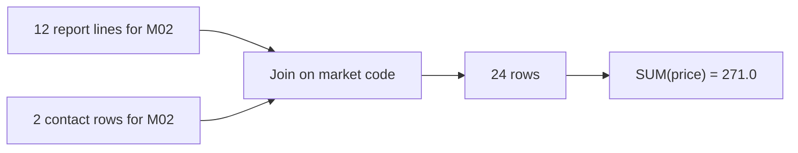

<BigWordAlert term="Fan-out" plainEnglish="When a join returns more rows than the table you started with, because one key matches more than one row on the other side." whyItMatters="Every row still looks normal, so nothing warns you. The extra rows only show up later, when a sum or a count comes out too big." />

## A table with a new column

Yasmin, the volunteer coordinator, phones a market when its reports stop arriving. To do that she needs a name and a number, and the daily table only shows market codes. So Hala adds a contact to the daily table. The table has one row for each market and day, with the count of report lines and the total of their prices. The total is a rough check that Hala watches. If a market's total drops, it has probably missed some items.

The contacts live in a small file, `market_contacts.csv`, with nine rows for eight markets. Hala joins it to the reports on the market code and picks a contact name for each market. She runs the query, checks that it works, and sends the table to Omar and Yasmin. As in every chapter, the people, the markets and the numbers are fictional, and the data is synthetic.

An hour later Omar writes back. He opened the new table and looked at 4 March, a day he remembers, because he phoned M02 about a price that day. The table says that M02 has a total of 271.0 shekels. Omar says that cannot be right. The market told him that their prices added up to about 135.

## What Hala finds

Hala checks the raw files by hand. On 4 March, M02 sent 12 report lines, and their prices add up to 135.5. Omar is right. The new table shows 24 lines and a total of 271.0, which is exactly twice the true figure. She looks at the neighbours: M01 and M03 show 136.5 and 145.0, which look normal. Only M02 is wrong, and it is wrong by exactly a factor of two.

Nothing in the output looks like an error. The query ran in a fraction of a second. No row is damaged. Every price is a real price from a real report. Hala has seen one problem like this before. In module 1 a repeated day lifted a figure by half. This time the files are fine. The doubling happens inside the query, in the join she added an hour ago.

She remembers one detail about the contacts file. Eight markets have one contact each, but M02 has two: a committee chair and a stall coordinator. She wonders whether that matters, and she realises she cannot say. She has never counted the rows of a join before she trusted it.

```predict
prompt: "M02 sent 12 report lines on 4 March. The contacts file has 2 rows for M02. Hala joins the reports to the contacts on the market code. How many rows does the joined result have for M02?"
options:
  - id: twelve
    label: "12 rows, one for each report"
  - id: twentyfour
    label: "24 rows, each report twice"
correctOptionId: twentyfour
explanation: "A join returns one row for every pair of rows that match. Each of the 12 reports matches both contact rows, so the result has 12 x 2 = 24 rows. The price on each row is correct, but the sum counts every price twice: 271.0 instead of 135.5. Chapter 2.2 shows this step by step."
allowRetry: true
```

## What a doubled total can hide

The doubling does more harm than a wrong number on a page. Yasmin reads the daily table to find markets that sent too little. Suppose M02 had sent only half of its items on 4 March. Its true total would be about 68. After the join the table would show about 136, which looks like a normal full day. Yasmin would not phone the volunteer, and the missing reports would stay missing. A wrong total can make a real problem invisible.

That is why Hala is more worried than Omar is. Omar noticed because he happened to know the number. Most readers of a report do not know the number, and they trust the table. A table that is wrong in a quiet way is worse than a table that fails with an error, because an error at least tells you to look.

## Three questions before you trust a join

Hala now asks three questions before she trusts any join, and this module teaches you to ask them too. The first is: what does one row of each table stand for? One row of the reports is one price report. One row of the contacts should be one market, but here it is one contact, and a market can have several. The second is: is the key unique on the side I am joining to? If it is not, rows will multiply. The third is: how many rows do I expect to get back, and how many did I get?

None of the three needs a clever trick. They need you to look at the tables and to count. The habit is small, and it catches the kind of mistake that Hala made. You will practise it in every example in this module: before you run a query, you write down the row count you expect, and then you check it.

## Why this matters for the job

Wrong totals after a join are an easy mistake in reporting work, and they are hard to see. The numbers are plausible, nothing fails, and the person who reads the table often has no way to check. A data engineer who joins two tables is expected to know how many rows the result will have, before running it. That is a habit, and you can learn it.

Interview guides we read describe the SQL round as the gate. They list joins with NULL handling and deduplication among the usual questions. A guide is one source and not a rule, but the skill is also what you need on your first week of real work.

The same trap appears in every kind of data. A clinic joins its appointments to a table of doctors, and a doctor who works in two clinics has two rows, so every appointment is counted twice. A shop joins its orders to a table of customers, and a customer with two addresses doubles every order. A freelance client sees revenue that is twice as high as the bank says. In each case the join did exactly what it was asked to do. The mistake was in not knowing what one row of the second table stood for. In this module you will build it by practising on Mizan's own data. You will also learn why a report can be wrong even when every query behind it runs without an error.

## What the module covers

The diagram shows the case of this chapter in four boxes. Read it from left to right. The reports and the contacts meet at the join. The join returns more rows than the reports alone, and the sum then adds every price twice.



What to notice: the damage happens at the join, and it shows only at the sum. Between those two boxes, every row is correct. The fix therefore belongs before or at the join, and the check belongs right after it: count the rows.

Chapter 2.2 teaches how to predict the rows a join returns, and how inner, left and anti-joins differ. Chapter 2.3 is about aggregation: how NULL changes a count and an average, and why `COUNT(DISTINCT ...)` often hides a problem and does not solve it. Chapter 2.4 shows how to write a long query as named steps, so you can check each one. In chapter 2.5 you write five SQL drills on the raw files, and tests tell you whether your answers are right. Chapter 2.6 is a quiz with one answer from an AI tool to check. Chapter 2.7 is the gate, where you explain a double-counting bug and its fix.

You use the data you made in chapter 1.4. The reports are 2,712 lines in 28 upload folders. The item list has 12 rows, one for each item. The contacts file has the nine contact rows, and the registry has a markets table with eight rows. These four tables are all you need for the whole module. Each chapter also uses a few small made-up tables, such as a clinic or a bakery, so that you see the same idea in a new place.

You work in DuckDB, the database that runs inside your Python program. It reads the raw JSON and CSV files directly, so you do not have to load anything first. The same SQL ideas work in other databases, and where DuckDB differs from the rest, the chapter says so.

<LearningObjectives items={["Predict how many rows a join returns before you run it", "Spot fan-out and fix it before a sum goes wrong", "Aggregate without losing or doubling values, and explain what NULL does to a count and an average", "Count the thing you mean to count", "Write a long query as named steps and check the row count of each step"]} />

## Key words

| Word | Plain English |
|---|---|
| **Join** | Combining the rows of two tables where a column has the same value |
| **Key** | The column that a join uses to match rows, such as the market code |
| **Aggregate** | To combine many rows into one value, such as a sum or a count |
| **NULL** | A missing value; it is not zero and not an empty text |
| **CTE** | A named step inside one query, written with `WITH` |

## What is in this module

| Chapter | You will practise |
|---|---|
| 2.2 | Predicting the rows a join returns, and spotting fan-out |
| 2.3 | NULLs in counts and averages, and double counting |
| 2.4 | Writing a long query as named steps you can check |
| 2.5 | Five SQL drills on Mizan's raw files, graded by tests |
| 2.6 | A quiz on joins, NULLs, double counting and CTEs |
| 2.7 | Explaining a double-counting bug and its fix |

**Next:** Joins and what they do to row counts: how to predict the number before you run the query.
