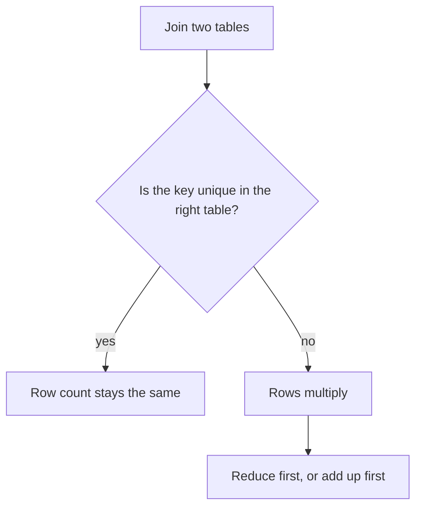

## Counting by hand

Hala wants to find the mistake in her query without staring at 24 rows. So she shrinks the problem. She takes three reports from M02 and the two contact rows for M02, and works out by hand what a join must return. If she can predict the result of the small case, she can explain the large one.

This is also the best way for you to learn joins. Do not run a join and then look at what came back. Count first, predict the number, and only then run the query. When your prediction is wrong, you have found something about the tables that you did not know. That is the moment the learning happens.

## A workbench for this module

You need a place to try queries on Mizan's raw files. Create a file called `workbench.py` in your project folder with the code below. It makes four tables from the data you generated in chapter 1.4: `reports`, `items`, `market_contacts` and `markets`. It also gives you a function, `show`, that runs a query and prints the rows.

```python
"""A workbench for trying SQL on Mizan's raw files.

Start it from the project folder with:  python -i workbench.py
Then call show("SELECT ...") to run a query and print its rows.
"""
import sqlite3

import duckdb

RAW = "data/raw"
con = duckdb.connect()

# Every report line. The two timezone calls turn the timestamps into plain UTC,
# so your computer's time zone cannot move a report to another day.
con.execute(f"""
    CREATE VIEW reports AS
    SELECT * REPLACE (timezone('UTC', reported_at) AS reported_at, timezone('UTC', uploaded_at) AS uploaded_at)
    FROM read_json('{RAW}/uploads/*/*.jsonl', union_by_name = true, hive_partitioning = true)
""")
con.execute(f"CREATE VIEW items AS SELECT * FROM read_csv('{RAW}/items.csv')")
con.execute(f"CREATE VIEW market_contacts AS SELECT * FROM read_csv('{RAW}/market_contacts.csv')")

# DuckDB reads SQLite through an extension that needs a download, so Python copies the markets table.
registry = sqlite3.connect(f"{RAW}/registry.db")
rows = registry.execute("SELECT * FROM markets").fetchall()
registry.close()
con.execute("CREATE TABLE markets(market_code VARCHAR, name VARCHAR, area VARCHAR, opens VARCHAR, updated_at VARCHAR)")
con.executemany("INSERT INTO markets VALUES (?, ?, ?, ?, ?)", rows)


def show(sql):
    """Run a query and print the column names and the rows."""
    cursor = con.execute(sql)
    print(" | ".join(column[0] for column in cursor.description))
    for row in cursor.fetchall():
        print(" | ".join(str(value) for value in row))
```

Start it with `python -i workbench.py`. Python shows the prompt `>>>` and waits for you. Test it by counting the report lines, which must match the 2,712 lines of the generator.

```python
show("SELECT count(*) AS lines FROM reports")
```

```text
lines
2712
```

Python prints a SQL NULL as `None`. You will see that word in some results later. The two timezone calls in the file turn the timestamps into plain UTC, so that your computer's time zone cannot move a report to the next day. Chapter 5.5 shows what goes wrong without them.

## The rule for counting rows

A join looks at every pair made of one row from the left table and one from the right table. It keeps the pairs where the key matches. So for each key value, multiply the number of left rows with that key by the number of right rows with that key. Add the products over all keys and you have the count.

Take the small case. M02 has 3 reports on one day, and the contacts table has 2 rows for M02. For the key M02 the result has 3 x 2 = 6 rows. If the contacts table had one row for M02, the result would have 3 x 1 = 3 rows, the same as the reports. The rows only stay the same when the key is unique on the side you join to.

There are three kinds of join that you will use every week. An inner join keeps only the pairs that match, so a left row with no partner disappears. A left join keeps every left row, and fills the right side with NULL when there is no partner. An <GlossaryTerm term="anti-join" definition="A join that keeps only the rows of one table that have no match in the other. You write it as a left join and keep the rows where the right side is NULL." /> is a left join where you then keep only the unmatched rows, which answers the question "which rows have no partner?".

## Predict, then step through

Before you open the canvas, make the prediction that Hala made.

```predict
prompt: "M02 has 3 price reports on 3 March. The contacts table has 2 rows for M02. How many rows does the inner join on the market code return for M02?"
options:
  - id: six
    label: "6 rows: each report twice"
  - id: three
    label: "3 rows: one for each report"
correctOptionId: six
explanation: "Each of the 3 reports matches both contact rows, so the join returns 3 x 2 = 6 rows. The result would have 3 rows only if the contacts table had a single row for M02."
allowRetry: true
```

The canvas uses a short slice of M02's day: three reports with simple prices, and a contacts table in which M02 has two names. It does not use the real file. Step through it, but stop before step 3 and settle your prediction. The answer is at step 4.

<InteractiveCanvas slug="join-fan-out" />

**What this shows:** a join to a table with a repeated key multiplies the rows that a sum then adds. Nothing is wrong with any single row, but the result has six rows where you started with three, and the total doubles from 24.5 to 49.0.

**Try this:** predict the joined row count before step 3 and check it at step 4. Then imagine that M02 had three contacts, and work out how many rows and what total the join would give. Last, find the step where the problem starts: is it the join or the sum after it?

**What changed:** each step note says which rows matched and why the row count moved. At step 5 the sum adds six prices and gets 49.0, and at step 6 the join to one row per market gets 24.5 again.

**Limits of the model:** three reports and three contact rows keep the picture small. Real tables have thousands of rows, and fan-out hides there because the extra rows look normal. The fix in the last step is one option, and adding up before the join is another.

## Joins on the real data

Now try the rule on Mizan's real files. The report lines have an item code, and the item list has one row for each code. So an inner join should return one row for each report line that has a code. There are 2,712 lines, and 4 of them have no item code. Your prediction is 2,708 for the inner join and 2,712 for the left join.

```python
show("SELECT count(*) AS inner_rows FROM reports AS r JOIN items AS i ON i.item_code = r.item_code")
show("SELECT count(*) AS left_rows FROM reports AS r LEFT JOIN items AS i ON i.item_code = r.item_code")
```

```text
inner_rows
2708
left_rows
2712
```

The two numbers differ by 4, and the anti-join finds those four lines. It takes the left join and keeps the rows where the item list has no partner.

```sql
SELECT r.report_id, r.market_code, r.price
FROM reports AS r
LEFT JOIN items AS i ON i.item_code = r.item_code
WHERE i.item_code IS NULL
ORDER BY r.report_id;
```

```text
report_id | market_code | price
r-000836 | M01 | 24.5
r-001018 | M05 | 20.0
r-001480 | M01 | 24.5
r-002188 | M01 | 6.0
```

An inner join would have hidden these four lines without any message. That is not always wrong. If you only want lines with a known item, the inner join is exactly right. It is a problem when you did not know that rows were leaving. A habit that helps is to compare the row count before and after every join and ask about the difference.

## The real day, step by step

Now the case from chapter 2.1: M02 on 4 March. The reports have 12 lines for M02 on that day, and the contacts file has 2 rows for M02. The rule predicts 12 x 2 = 24 rows. Run the join that Hala wrote, and look at the count and the total.

```sql
SELECT count(*) AS rows_after_join, sum(r.price) AS total_price
FROM reports AS r
JOIN market_contacts AS c ON c.market_code = r.market_code
WHERE r.market_code = 'M02' AND CAST(r.reported_at AS DATE) = DATE '2026-03-04';
```

```text
rows_after_join | total_price
24 | 271.0
```

The prediction was right, and the total is double the true 135.5. The rule also explains the whole contacts join. Seven markets have one contact each, so their rows do not change. M02 has 341 report lines and two contacts, so it adds 341 more rows. The full join should return 2,712 + 341 = 3,053 rows, and it does.

One fix is to reduce the contacts to one row for each market before the join. Here the query keeps the first name in alphabetical order. The count and the total then match the reports alone.

```sql
WITH one_contact AS (
    SELECT market_code, min(contact_name) AS contact_name
    FROM market_contacts
    GROUP BY market_code
)
SELECT count(*) AS rows_after_join, sum(r.price) AS total_price
FROM reports AS r
JOIN one_contact AS c ON c.market_code = r.market_code
WHERE r.market_code = 'M02' AND CAST(r.reported_at AS DATE) = DATE '2026-03-04';
```

```text
rows_after_join | total_price
12 | 135.5
```

The diagram turns the lesson into a question you can ask before any join. Follow it from the top.



What to notice: the question is about the right table's key, and you can answer it with a count before you write the join. If you cannot answer it, run `SELECT key, count(*) FROM table GROUP BY key HAVING count(*) > 1` and look at what comes back.

## Where people go wrong

The first mistake is to trust a sum because nothing failed. A fan-out never raises an error. The only protection is to count rows before and after the join and compare the counts with your prediction.

The second mistake is to put a condition on the right table in the `WHERE` clause of a left join. The `WHERE` runs after the join, and a row with NULL on the right fails the test, so the unmatched rows disappear. The left join silently turns into an inner join. Suppose you list every market with its egg lines on 5 March, including markets with none. This version loses two markets.

```sql
SELECT m.market_code, count(r.report_id) AS egg_lines
FROM markets AS m
LEFT JOIN reports AS r ON r.market_code = m.market_code
WHERE r.item_code = 'I09' AND CAST(r.reported_at AS DATE) = DATE '2026-03-05'
GROUP BY m.market_code
ORDER BY m.market_code;
```

```text
market_code | egg_lines
M01 | 1
M02 | 1
M04 | 1
M06 | 1
M07 | 1
M08 | 1
```

Six rows come back, and M03 and M05 are missing, although the query was meant to keep all eight markets. The fix is to move the conditions on `reports` into the `ON` clause, so that they decide which rows match and no longer remove markets afterwards. With the conditions in `ON`, all eight markets appear, and M03 and M05 show 0. Those two markets are also the answer to the anti-join question "which markets did not report eggs on 5 March?".

The third mistake is to assume a key is unique because it should be. "One contact for each market" was true in Hala's head and false in the file. Check the assumption with a count.

## The trade-off: reduce, add up first, or keep the detail

There are two fixes for fan-out, and a third choice. You can reduce the right table to one row for each key before the join, as above. This is simple, but you lose the second contact. You can add up the left table first and join the result, so that each key appears once on both sides. This keeps all the contacts that you count, but you can no longer show them next to each report. Or you can accept the multiplied rows, if the multiplied rows are what you want, such as a list with one row for each report and contact. In that case you must not add up prices on that list.

The anti-join also has a rival. `NOT EXISTS` expresses "no partner" directly, and many people find it easier to read. Both give the same rows. Use whichever your team reads more easily, and check the row count of either one.

## Try it on your data

Predict the row count of the full join of `reports` and `market_contacts` before you run it, using the rule. Your answer should be 3,053. Then write the question "which markets did not report eggs (I09) on 5 March?" as a left join and an `IS NULL` test. The answer is M03 and M05. If your query returns something else, count the rows of each step.

## Check your understanding

```quiz
type: mcq
question: "Tareq's online shop has 50 orders. The delivery zones table has 3 rows for zone N and 1 row for zone S. 20 orders are in zone N and 30 are in zone S. He joins orders to zones on the zone code with an inner join. How many rows does the result have?"
options:
  - "50 rows, as each order matches once"
  - "60 rows, because only zone N repeats"
  - "150 rows, because 50 orders x 3 rows"
  - "90 rows, because 20 x 3 plus 30 x 1"
correct: 3
explanations:
  - "That is true only if each zone has one row. Zone N has three rows, so its 20 orders are repeated."
  - "Zone N gives 20 x 3 = 60 rows, but the 30 orders in zone S still match their one row. That adds 30 more."
  - "Only zone N has 3 rows. Zone S has 1 row, so its 30 orders are not multiplied by 3."
  - "Right. For each key, count the left rows times the right rows: zone N gives 20 x 3 = 60 and zone S gives 30 x 1 = 30. The total is 90."
```

```quiz
type: mcq
question: "Nadia lists every school class with its Monday absences. There are 10 classes. Her query is 'classes LEFT JOIN absences ON class_id WHERE absences.day = Monday', and it returns 7 rows. Three classes had no absences on Monday. What explains the 7 rows, and what is the fix?"
options:
  - "The left join is wrong; use an inner join so classes without absences stay"
  - "The WHERE removes the classes with no Monday row; move the day test into ON"
  - "The classes table has duplicates; add DISTINCT to the select list"
  - "Three classes are missing from absences; add them to that table first"
correct: 1
explanations:
  - "An inner join drops unmatched classes, so it would also give 7 rows. A left join is the right choice to keep all 10."
  - "Right. The WHERE runs after the join, and the three classes with no Monday row have NULL there, so they fail the test and vanish. With the day test in ON, they stay with a count of 0."
  - "Nothing says the classes table has duplicates, and DISTINCT would not bring back the three missing classes."
  - "Nadia should not change the data to fix a query. A class with no absences is real, and the query must be able to show it."
```

**Next:** Aggregation traps: how NULL changes a count and an average, and why `COUNT(DISTINCT ...)` hides a problem and does not solve it.
