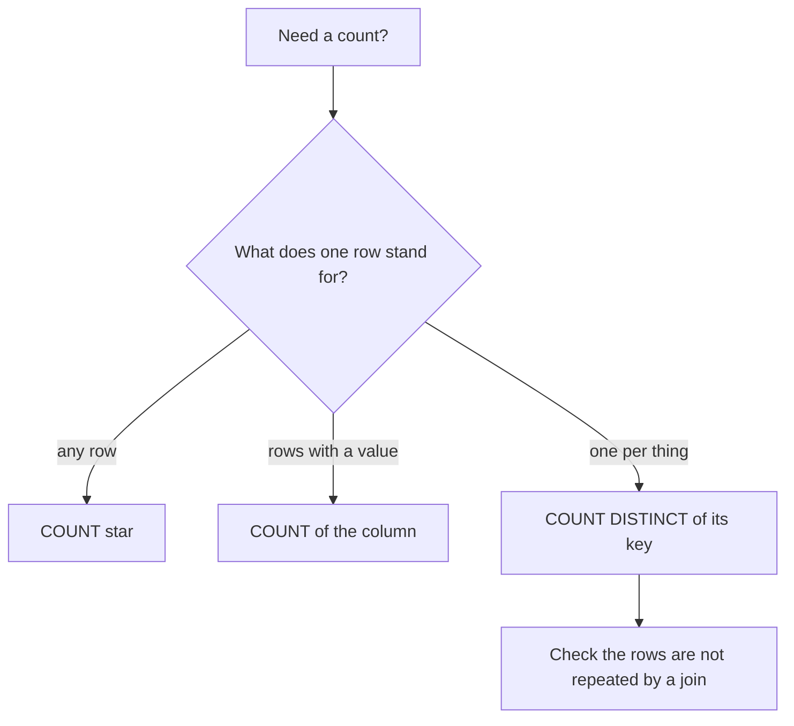

## Three answers to one question

Omar asks Hala a simple question: how many reports arrived late? Hala runs a query and answers 252. Yasmin has her own list, and she answers 211. Both are careful people, and both queries are correct. Omar is confused, and he asks which number he should put in his note.

The answer is that the two of them counted different things. Hala counted report lines that were uploaded on a later day than the day they describe. Yasmin counted reports whose first upload was on a later day. A third count is possible, and it gives 242. By the end of this chapter you will be able to explain all three numbers. You will also know which question you are answering before you write a count.

Aggregation is where small mistakes in the rows become wrong numbers. A count, a sum or an average reads many rows and returns one value. If the rows contain missing values, or the same thing twice, the one value can be wrong while the query is right.

## What NULL does

You met NULL in the key words of chapter 2.1: a missing value that is not zero. The aggregate functions treat it in a few clear ways. `COUNT(*)` counts rows, whatever they contain. `COUNT(column)` counts only the rows where that column is not NULL. `SUM` and `AVG` skip NULL values. And a sum of nothing but NULL is NULL, not 0.

You can see all of this in a small table of a bakery's daily sales. Six days, and the loaf counts are missing on Tuesday and Thursday, when the till was not working. The query asks for the row count, the number of values, the total, the average, and the average if someone turns the missing values into 0.

```sql
WITH sales(day, loaves) AS (
    VALUES ('Sun', 120), ('Mon', 130), ('Tue', NULL), ('Wed', 130), ('Thu', NULL), ('Fri', 140)
)
SELECT count(*) AS rows,
       count(loaves) AS values_present,
       sum(loaves) AS total,
       avg(loaves) AS average,
       avg(coalesce(loaves, 0)) AS average_if_zero
FROM sales;
```

```text
rows | values_present | total | average | average_if_zero
6 | 4 | 520 | 130.0 | 86.66666666666667
```

Read the result slowly. There are 6 rows but only 4 values. The total is 520, and the average is 520 divided by 4, which is 130. The two NULL days did not change the average. When `COALESCE` turns them into 0, the average becomes 520 divided by 6, which is 86.67. The real days did not sell less bread. Two days with unknown sales were counted as days with no sales.

Comparisons need care too. In SQL, `NULL = NULL` is not true. It is NULL, which means "unknown", and a `WHERE` keeps only the rows where the test is true. To find missing values you must write `IS NULL`. Python prints a SQL NULL as `None`.

```sql
SELECT NULL = NULL AS equals, NULL IS NULL AS is_null, sum(x) AS sum_of_nothing, count(x) AS count_of_nothing
FROM (VALUES (CAST(NULL AS INTEGER))) AS t(x);
```

```text
equals | is_null | sum_of_nothing | count_of_nothing
None | True | None | 0
```

On Mizan's data the same rule shows up in a plain count. Four report lines have no item code, and the item code column is NULL for them.

```sql
SELECT count(*) AS lines, count(item_code) AS lines_with_item_code FROM reports;
```

```text
lines | lines_with_item_code
2712 | 2708
```

## Predict, then play

Zero is a tempting fix. A bakery logs the price of flour, and some price cells are empty. The analyst wants the average to "work", so she turns the empty cells into 0 before averaging. Make a prediction before you try it in the canvas.

```predict
prompt: "A bakery's flour log has 20 reports. 15 say 8.00 shekels and 5 have no price. The missing prices are turned into 0 before averaging. What is the average?"
options:
  - id: skipped
    label: "8.00: missing prices are skipped"
  - id: zeros
    label: "6.00: the zeros count as prices"
correctOptionId: zeros
explanation: "Once the missing prices are turned into 0, they are values and AVG includes them: 15 x 8.00 = 120, divided by all 20 reports, is 6.00. If the missing prices stay NULL, AVG skips them and returns 8.00. No real price changed, but the answer fell by a quarter."
allowRetry: true
```

The canvas has three controls: the number of reports, how many have no price, and a switch that turns the missing prices into 0. Every report that has a price says 8.00. Watch the three numbers at the top, not only the bars.

<InteractiveCanvas slug="null-average-trap" />

**What this shows:** AVG and COUNT(price) skip NULL, a 0 is a value, and COUNT(*) counts rows. So a missing price does not move the average, but it makes COUNT(price) smaller than COUNT(*). Turning missing into 0 drags the average down.

**Try this:** switch missing to 0 at the default and see the average fall from 8.00 to 6.00 with no real price changed. Then raise the reports with no price to 10, with the switch on and then off. Last, set 10 reports and 10 with no price, with the switch off, and see AVG(price) become NULL.

**What changed:** the sentence under the controls names the new average and both counts, and says why the average moved or stayed. With the switch off, COUNT(price) is below COUNT(*) and the average is still 8.00.

**Limits of the model:** it uses one true price and no real spread of prices. It shows only how NULL and 0 are treated. It does not tell you whether to skip, fill in or return missing prices to the source, because that depends on why they are missing.

## Double counting after a join

The second trap is the one from chapter 2.1. After a join that fans out, every count and sum is taken over repeated rows. A tempting repair is to add `DISTINCT`. Here is M02 on 4 March after the join to the contacts, with three measures side by side.

```sql
SELECT count(*) AS rows_after_join,
       count(DISTINCT r.report_id) AS distinct_reports,
       sum(r.price) AS total_price,
       sum(DISTINCT r.price) AS total_of_distinct_prices
FROM reports AS r
JOIN market_contacts AS c ON c.market_code = r.market_code
WHERE r.market_code = 'M02' AND CAST(r.reported_at AS DATE) = DATE '2026-03-04';
```

```text
rows_after_join | distinct_reports | total_price | total_of_distinct_prices
24 | 12 | 271.0 | 125.0
```

`COUNT(DISTINCT report_id)` gives 12, which is the right number of reports, so it looks like a fix. It is not. The same join gives a total of 271.0, which is wrong. And `SUM(DISTINCT price)` gives 125.0, which is wrong in a new way. It drops one of every pair of equal prices, such as the rice and the bread at 7.0, and the tomatoes and potatoes at 3.5. The right total is 135.5.

A distinct count is a warning sign here, and not a repair. If `COUNT(*)` and `COUNT(DISTINCT key)` disagree after a join, rows are being multiplied or repeated, and you should find out why. The repair goes into the join, as in chapter 2.2.

<RealWorldEvent title="One audit, several records" when="Reported in 2026" summary="A public audit data site in the United States explained that, before a formal resubmission process existed, a correction was saved as a new full record. One audit can therefore appear several times as separate records. Analysts who add up award amounts or count findings can count the same audit more than once." lesson="Know which version of a record is the current one, and deduplicate on a business key before you total. The site's interim advice was to match on identifiers and keep the most recently accepted record." />

## Count the thing you mean

The three answers to Omar's question come from three definitions, and each one is easy to write. This query computes two of them per report, using a named step, which chapter 2.4 explains.

```sql
WITH per_report AS (
    SELECT report_id,
           min(uploaded_at) AS first_upload,
           max(uploaded_at) AS last_upload,
           min(reported_at) AS reported
    FROM reports
    GROUP BY report_id
)
SELECT count(*) AS reports,
       count(*) FILTER (WHERE CAST(first_upload AS DATE) > CAST(reported AS DATE)) AS first_send_late,
       count(*) FILTER (WHERE CAST(last_upload AS DATE) > CAST(reported AS DATE)) AS any_send_late
FROM per_report;
```

```text
reports | first_send_late | any_send_late
2633 | 211 | 242
```

The table puts the three answers side by side. Each one answers a different question, and each one is the right number for that question.

| Definition | Count | What one row stands for |
|---|---|---|
| Lines uploaded after the report day | 252 | One report line |
| Reports with any send after the report day | 242 | One report |
| Reports whose first send was after the report day | 211 | One report |

The difference between 242 and 211 is 31 reports that were first sent on time and sent again on a later day as a duplicate. The difference between 252 and 242 is 10 reports whose two sends both came on a later day, so each has two late lines. Before you write a count, say in a sentence what one row stands for in the result. Module 4 gives this idea a name. For now, the sentence is enough.

Counting only some of the rows is called conditional aggregation. In DuckDB you can write `COUNT(*) FILTER (WHERE condition)`, which not every database accepts. The portable form is a `CASE`: `SUM(CASE WHEN condition THEN 1 ELSE 0 END)`. Both give the same number. Here is the first form, per market.

```sql
SELECT market_code,
       count(*) AS lines,
       count(*) FILTER (WHERE CAST(uploaded_at AS DATE) > CAST(reported_at AS DATE)) AS late_lines
FROM reports
GROUP BY market_code
ORDER BY market_code;
```

```text
market_code | lines | late_lines
M01 | 335 | 34
M02 | 341 | 24
M03 | 341 | 34
M04 | 341 | 19
M05 | 341 | 58
M06 | 338 | 33
M07 | 333 | 24
M08 | 342 | 26
```

The late lines add up to 252. M05 stands out at 58, because 37 of its lines arrived on 12 March after three days with no connection. The `CASE` version, `SUM(CASE WHEN ... THEN 1 ELSE 0 END)` over all lines, returns the same 252.

The diagram gives a short route to the right count. Follow it from the top.



What to notice: the first question is about the meaning of one row and not about syntax. The last box matters most. A distinct count is correct when you really want one per thing, and wrong when it covers up a join that repeats rows.

## Where people go wrong

The first mistake is `COALESCE(x, 0)` "to be safe". It makes the query run without a NULL in sight, and it quietly changes the average, as the canvas showed. Use it only when 0 is really true, for example a count of items that were not sold.

The second is `COUNT(column)` when you mean `COUNT(*)`. The numbers differ only when the column has NULLs, so the error appears on the day the first NULL arrives. The third is `DISTINCT` as a repair: add it, see a plausible number, and stop looking. The fourth is not saying what you count, so two good people give two good numbers.

## The trade-off: skip, fill in, or go back to the source

When a value is missing you have three choices. You can let the aggregate skip it, which is honest, but it leaves you with fewer values than rows, and you must say so. You can fill it in with a value you choose, such as an average or a default, which keeps the row count but invents data. Or you can go back to the source and ask why it is missing. For a price, a volunteer may have forgotten the cell; for a count of sales, a till may have been off.

You would choose differently by cause. If the value is missing at random and few, skipping is usually fine. If it is missing for a reason that matters, such as a market that never reports eggs, filling in would hide the reason. The safest habit is to count the missing values and report that number next to the average.

## Try it on your data

Run `SELECT count(*), count(item_code) FROM reports` in your workbench and explain the gap of four. Then write the three late counts for yourself. Check that your lines are 252, your reports with any late send are 242 and your reports first sent late are 211. If a number is different, say in one sentence what one row stands for in your query.

## Check your understanding

```quiz
type: mcq
question: "Asma's pharmacy table has 8 rows of stock. The quantity column is 10 in 6 rows and NULL in 2 rows. Which result do the facts support for AVG(quantity) and COUNT(quantity)?"
options:
  - "AVG is 10 and COUNT is 6, because NULL rows are skipped"
  - "AVG is 7.5 and COUNT is 8, because every row is counted"
  - "AVG is 10 and COUNT is 8, because AVG skips but COUNT does not"
  - "AVG is 7.5 and COUNT is 6, because NULL counts as zero in AVG"
correct: 0
explanations:
  - "Right. Both functions skip NULL. Six values of 10 give an average of 10, and COUNT(quantity) counts those 6 values. COUNT(*) would be the one that returns 8."
  - "The average would be 7.5 only if the two NULL rows were turned into 0. They are NULL, so AVG skips them. COUNT(quantity) also skips them."
  - "COUNT(quantity) skips NULL as well. The function that counts all 8 rows is COUNT(*)."
  - "NULL does not count as zero. If it did, the count would be 8, not 6, so this answer contradicts itself."
```

```quiz
type: mcq
question: "Reem runs a water delivery round. The log has 120 lines. 20 deliveries were logged twice with the same delivery id, and the other 80 once, so there are 100 distinct delivery ids. The owner asks how many deliveries were made. Which query answers that?"
options:
  - "COUNT(*) over the log lines, which gives 120"
  - "COUNT(*) minus 40 lines, which gives 80"
  - "COUNT(DISTINCT delivery_id), which gives 100"
  - "COUNT of the 20 repeated ids only, which gives 20"
correct: 2
explanations:
  - "That counts log lines. The 20 repeated deliveries are counted twice, so it overstates the deliveries by 20."
  - "Subtracting 40 would remove both copies of the 20 repeated deliveries, and it leaves 80. They were made, so one copy of each must stay."
  - "Right. One delivery is one id, so the distinct ids are the deliveries: 100. The id is the key of the thing you are counting, and no join is repeating the rows here."
  - "That counts the repeated deliveries only. The owner asked for all deliveries, not just the ones that were logged twice."
```

**Next:** CTEs and queries you can read: how to write a long query as named steps and check the row count of each one.
