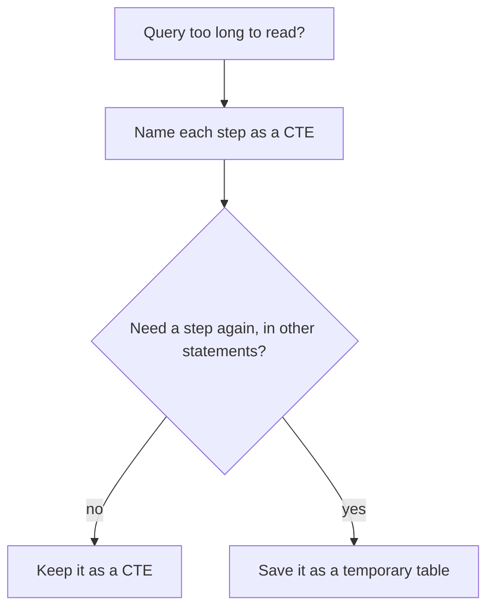

## A cheap basket

Yasmin looks at Hala's new table of basket costs and frowns. On some days, M04 shows a basket far cheaper than every other market. Is M04 really that cheap? Hala opens her query to find out, and she cannot read it.

The query is 40 lines long. It filters bad rows inside a subquery, that sits inside another subquery, that sits inside a third. The row counts she would need to check are hidden in the middle. She decides to rewrite it as steps, each with a name, so that she can look at every step on its own. To see what is going on, she first makes a small copy of the problem: ten reports from M02 and M04, and a basket of only three items.

That decision is the whole chapter. A named step costs a few more lines. In return, you can read the query from top to bottom, and you can stop at any step and count.

## Steps with names

You met the word CTE in the key words of chapter 2.1. It is written with `WITH`: you give a query a name, and then later steps use that name as if it were a table. The name lives only inside that one statement. When the statement ends, the name is gone, and nothing is saved on disk.

Here is the idea on a small case. Ten price reports go in. Hala wants the cost of a basket of three items for each market and day: flour (I01), rice (I02) and cooking oil (I05). The plan has three steps. First, `good`: keep rows with a price above 0 and an item code. Second, `basket`: keep only the three basket items. Third, `day_total`: add up the prices for each market and day. Each name says what the step holds, so a reader knows what to expect before reading the code.

Without names the same logic is one block that you have to read from the inside out. Compare the two versions. Both return the same three rows, and only one of them lets you look at the middle.

```sql
SELECT market, day, count(*) AS items, sum(price) AS total
FROM (SELECT * FROM (SELECT * FROM reports WHERE price > 0 AND item IS NOT NULL)
      WHERE item IN ('I01', 'I02', 'I05'))
GROUP BY market, day;
```

## Predict, then step through

The canvas below shows the named version, one step at a time, on the ten reports. Before you open it, work out the row count yourself. Two of the ten rows are bad: one has a price of 0, and one has no item code. Two more rows are eggs, which are not in the basket.

```predict
prompt: "Ten price reports go in. Two rows are bad, and two rows are eggs, which are outside the basket. How many rows reach the last step, the sum per market and day?"
options:
  - id: six
    label: "6 rows: bad rows and eggs gone"
  - id: eight
    label: "8 rows: only the bad rows are gone"
correctOptionId: six
explanation: "Ten rows minus two bad rows leaves 8. Then the two egg rows leave, and 6 rows reach the last step. The sum then groups those 6 rows into 3 market-days. Counting like this at every step is how you find a wrong total."
allowRetry: true
```

<InteractiveCanvas slug="cte-steps" />

**What this shows:** a long query read as named steps: drop the bad rows, keep the basket items, add up per market and day. Each step has a small result that you can check, and the row count changes at each one: 10, 8, 6 and 3.

**Try this:** before step 2, predict how many rows reach the last step. Then ask what the query would return if the rice price on 4 March had been good, and which market and day would then have three items. Last, find the step where a total stops being trustworthy, and say which column shows it.

**What changed:** each step note says which rows left and why the count moved. At step 6 the `items` column shows that two of the three totals are not full baskets.

**Limits of the model:** ten rows and a basket of three items keep the picture small. The real basket has 12 items and thousands of rows, so you check counts with a query and not by eye. A named step is a way to read and check a query, not a promise that it runs faster. The example does not say what to do when one item has two prices on the same day. You meet that in the drill.

## The same query, with the counts

Here is the full query with the ten reports written in as a first step. It is the one the canvas follows. You can paste it into your workbench, and `show` will print the three rows.

```sql
WITH reports(id, market, day, item, price) AS (
    VALUES ('r1', 'M02', DATE '2026-03-04', 'I01', 8.0),
           ('r2', 'M02', DATE '2026-03-04', 'I02', 7.0),
           ('r3', 'M02', DATE '2026-03-04', 'I09', 23.0),
           ('r4', 'M02', DATE '2026-03-04', 'I05', 18.0),
           ('r5', 'M04', DATE '2026-03-04', 'I01', 7.5),
           ('r6', 'M04', DATE '2026-03-04', 'I02', 0.0),
           ('r7', 'M04', DATE '2026-03-04', NULL, 4.0),
           ('r8', 'M04', DATE '2026-03-04', 'I05', 18.0),
           ('r9', 'M04', DATE '2026-03-05', 'I01', 7.5),
           ('r10', 'M04', DATE '2026-03-05', 'I09', 24.0)
),
good AS (
    SELECT * FROM reports WHERE price > 0 AND item IS NOT NULL
),
basket AS (
    SELECT * FROM good WHERE item IN ('I01', 'I02', 'I05')
),
day_total AS (
    SELECT market, day, count(*) AS items, sum(price) AS total
    FROM basket
    GROUP BY market, day
)
SELECT * FROM day_total ORDER BY market, day;
```

```text
market | day | items | total
M02 | 2026-03-04 | 3 | 33.0
M04 | 2026-03-04 | 2 | 25.5
M04 | 2026-03-05 | 1 | 7.5
```

Now the reasoning, which is the point of the chapter. M02 has three items: 8.0 plus 7.0 plus 18.0 is 33.0. M04 on 4 March has only two, 7.5 plus 18.0, because its rice price was 0 and was dropped by `good`. M04 on 5 March has one. The totals 25.5 and 7.5 look like cheap baskets, and they are not baskets at all. A sum is a basket cost only when every item is in it, and the `items` column tells you that. This is the kind of mistake that made M04 look cheap in Hala's table.

To check every step in one query, keep the same `WITH` and change the last line. This version counts the rows of each step.

```sql
SELECT 'reports' AS step, count(*) AS rows FROM reports
UNION ALL SELECT 'good', count(*) FROM good
UNION ALL SELECT 'basket', count(*) FROM basket
UNION ALL SELECT 'day_total', count(*) FROM day_total;
```

```text
step | rows
reports | 10
good | 8
basket | 6
day_total | 3
```

The four counts, 10, 8, 6 and 3, are the story of the query. Each drop has a reason that you can say aloud. If a count dropped by an amount you cannot explain, that step is where you would look first. In chapter 2.5 you write a longer chain like this for the real 12-item basket. There you meet the questions that the toy example leaves open. What counts as a basket on a market-day? What do you do when an item has two prices?

## When a CTE, and when a temporary table

A CTE is a name for one query, inside one statement. A temporary table is a real table that lasts as long as your connection. The diagram shows how to choose. Follow it from the top.



What to notice: both choices start with names. The question after that is about reuse. If you need the same cleaned rows in three separate queries, a CTE would recompute them each time, and a temporary table holds them once. On Mizan's data, the cleaned rows are the reports with a price above 0 and an item code.

```python
con.execute("CREATE TEMP TABLE good_reports AS SELECT * FROM reports WHERE price > 0 AND item_code IS NOT NULL")
show("SELECT count(*) AS lines FROM good_reports")
```

```text
lines
2699
```

That count has appeared before. The generator wrote 2,712 lines, and 13 of them are bad: 9 with a price of 0 or below and 4 with no item code. The difference, 2,699, is the number of good lines, and you will meet the same boundary count again when the pipeline lands the files. A temporary table also helps for another reason: you can look at it. You can run `SELECT *` on it, sort it and count it, which you cannot do with a name that disappears when the statement ends.

## Where people go wrong

The first mistake is bad names. A chain of steps called `a`, `b` and `c` is no more readable than nesting. Name each step for what it holds, such as `good`, `basket` or `day_total`. A name is a promise, and a reader trusts it. If a step called `good` still contains bad rows, you have broken the promise.

The second mistake is to write one huge step. If one step filters, joins and adds up, you have a nested query with a name. Give each step one job. The third mistake is to read only the last result. The wrong total in Hala's table was visible in the row counts of the middle steps, and it was invisible in the final rows.

The fourth is to expect a CTE to be saved. After the statement ends, the name is gone. If you want to keep a result, save it as a table, as in the example above.

## The trade-off: CTE, subquery, temporary table, view

A CTE buys readability and costs nothing to keep, because nothing is saved. A subquery is fine for a tiny, one-time step. A temporary table buys reuse and the chance to look inside. It costs a line to create, and its rows can go stale if the source rows change. A view is a saved name for a query that lasts, and it is the right choice when many people need the same step. In module 7 you will turn each named step of a long query into its own model with its own tests. A CTE chain is the first draft of that.

You would choose differently when the step is expensive or shared. A cheap step used once stays a CTE. An expensive step used by three queries should be saved. And a step that your whole team needs belongs in a view or a model, with an owner.

## Try it on your data

Take a query you have written, from this course or from your own work, with at least one subquery. Rewrite it as named steps, and write the row count of each step next to its name. Then explain each drop in one sentence. If you cannot explain a drop, you have found the place to look.

## Check your understanding

```quiz
type: mcq
question: "Reem's query has four named steps. Step 2 cleans the reports and takes 3 minutes. Steps 3 and 4 take seconds. She will run three more queries today, and each one needs the cleaned rows from step 2. What should she do?"
options:
  - "Keep one long query and rerun all four steps for each question"
  - "Write step 2 as a subquery inside each of the three queries"
  - "Remove step 2 and let each query read the raw table"
  - "Save step 2 once as a temporary table, then read it"
correct: 3
explanations:
  - "Each run repeats the 3 minute step, so she pays for it three more times. A name does not keep the result after the statement ends."
  - "A subquery is still part of one statement. Three queries mean three runs of the same 3 minute step."
  - "The cleaning in step 2 is what the three queries need. Without it they would read bad rows and give wrong totals."
  - "Right. A temporary table holds the cleaned rows once, so the 3 minutes are paid one time, and she can also look at the rows. The step is used in several statements, which is the sign for saving it."
```

**Next:** Build: SQL drills on the raw data. You write five queries, and tests tell you whether each answer is right.
