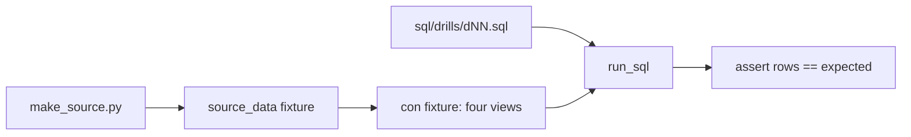

## Questions that deserve a test

Every week Omar and Yasmin ask Hala the same kinds of questions. How many reports did each market send? Which items did a market skip on a given day? What did the basket cost per market and day? Hala answers them by hand, and every time she has to trust her own eyes. One missed `WHERE` and the answer is wrong, and nobody notices until a total looks strange.

In this chapter you turn five such questions into five SQL files. Next to them you put tests that know the correct answers, computed from the seed-7 data. When a test passes, the query returned exactly the rows it should. When it fails, you see which rows were different. This is how you will work for the rest of the course: write the question down, write the check, then write the code.

By the end of the chapter you have five drill files in `sql/drills/`, a shared fixtures file, and 14 passing tests. You will have used the tools of the last three chapters on real data: join row counts, anti-joins, fan-out, NULL rules, double counting and named steps.

**What you need.** The project from chapter 1.4, with `data/raw` generated and the setup check passing. The workbench from chapter 2.2 is useful for trying queries. About 75 minutes.

## Where the project is now

After chapter 1.4 your repository has the generator, the setup check, the requirements and the `.gitignore`. In this chapter you add a `tests` folder with three files and a `sql/drills` folder with five. The `workbench.py` from chapter 2.2 is yours to keep or not; you may commit it.

```text
mizan-prices/
  make_source.py
  requirements.txt
  scripts/check_setup.py
  tests/
    conftest.py              shared fixtures (given in full below)
    test_setup.py            the test for chapter 1.4 (given in full below)
    test_drills_joins.py     the tests for this chapter (given in full below)
  sql/drills/
    d01_reports_per_market.sql
    d02_items_never_reported.sql
    d03_fan_out.sql
    d04_average_price_nulls.sql
    d05_basket_by_market_day.sql
```

## The design: the test is the specification

There is one decision to understand. Each drill is a file with exactly one SQL statement. A test reads the file, runs it on the raw data and compares the rows with a list written in the test. The list is the specification. You do not write the numbers into your query. You write a query that finds them.

The alternative is to run queries by hand and look at the output. That is quick, and it is how most wrong numbers start. A test costs a few minutes to write and then costs nothing to repeat. The expected numbers hold for the default data: 28 days from 1 March 2026 with seed 7. The tests make their own copy of that data, so they do not depend on your `data` folder. The price is that the numbers are tied to those settings. If the generator changed, the tests would fail, and that would be correct, because the answers would change too.



What to notice: your SQL file meets the data only through the `con` fixture, and the fixture builds the same four tables as your workbench. The test never edits your file. It runs it and compares the rows, so the same file that passes the test is the file you can read, explain and commit.

## The task

You will do seven steps. The first three add files and run them. The next two are the drills. The last two run everything and commit.

### 1. Check where you are

Switch on your environment and run the setup check from the project folder. It must print `OK` for all packages and `OK data folder found: data/raw`.

```bash
python scripts/check_setup.py --require-data
```

### 2. Add the shared fixtures

Create `tests/conftest.py` with the code below, exactly as shown. Pytest loads a file with this name automatically, and any test can use the fixtures it defines. You do not have to understand every line yet. Here is what the important parts do.

```python
"""Shared test fixtures.

Every test that needs data works in a temporary copy of the project, so it
never touches your real data/, lake/ or warehouse files.
"""
import contextlib
import os
import shutil
import sqlite3
import subprocess
import sys
from pathlib import Path

import duckdb
import pytest

REPO = Path(__file__).resolve().parent.parent
sys.path.insert(0, str(REPO))  # so "import pipeline" works after we change folder

# The code that a temporary project needs (data and lake are NOT copied).
CODE = ["make_source.py", "pipeline", "transform", "contracts", "sql", "report", "scripts"]


# Commands run by the tests get a fake key, so nothing depends on your own shell settings.
TEST_KEY = "test-secret-not-real"


def run_cmd(args, cwd, check=True):
    """Run a command in a folder and return the finished process."""
    env = {**os.environ, "MIZAN_KEY": TEST_KEY, "PYTHONUTF8": "1"}
    done = subprocess.run(args, cwd=cwd, capture_output=True, text=True, env=env)
    if check and done.returncode != 0:
        raise AssertionError(f"command failed: {args}\n{done.stdout}\n{done.stderr}")
    return done


def copy_code(target):
    target.mkdir(parents=True, exist_ok=True)
    junk = shutil.ignore_patterns("__pycache__", "target", "logs", "*.duckdb", "dbt_packages")
    for name in CODE:
        source = REPO / name
        if not source.exists():
            continue
        if source.is_dir():
            shutil.copytree(source, target / name, ignore=junk)
        else:
            shutil.copy(source, target / name)


@pytest.fixture(scope="session")
def source_data(tmp_path_factory):
    """Seed 7, 28 days, generated once for the whole test run."""
    folder = tmp_path_factory.mktemp("seed7")
    run_cmd([sys.executable, str(REPO / "make_source.py"), "--out", str(folder / "data")], cwd=folder)
    return folder / "data"


class Project:
    """A temporary copy of the project. Helpers run commands inside it."""

    def __init__(self, root):
        self.root = root

    def python(self, *args, check=True):
        return run_cmd([sys.executable, *args], cwd=self.root, check=check)

    def dbt(self, *args, check=True):
        """Run dbt from the transform folder, like a learner does."""
        exe = shutil.which("dbt", path=str(Path(sys.executable).parent)) or "dbt"
        return run_cmd([exe, *args, "--profiles-dir", "."], cwd=self.root / "transform", check=check)

    @contextlib.contextmanager
    def cd(self):
        """Work inside this project for a moment (the pipeline functions use paths relative to the folder)."""
        before = Path.cwd()
        os.chdir(self.root)
        try:
            yield
        finally:
            os.chdir(before)

    def make_data(self, days=28, *extra):
        self.python("make_source.py", "--days", str(days), *extra)
        return self.root / "data"

    def load_everything(self):
        """Land and publish every upload day, extract the registry, then dbt build. Returns the dbt result."""
        self.python("-m", "pipeline.land", "--all")
        self.python("-m", "pipeline.pseudonymise", "--all")
        for table in ["markets", "volunteers"]:
            self.python("-m", "pipeline.extract_registry", "--table", table)
        return self.dbt("build")

    def query(self, sql):
        """Rows from the warehouse, read after dbt has finished."""
        # Not read_only: when dbt ran inside this process (dbt_fast) it keeps the file open, and DuckDB insists on the same settings.
        con = duckdb.connect(str(self.root / "warehouse.duckdb"))
        try:
            return con.execute(sql).fetchall()
        finally:
            con.close()


@pytest.fixture
def project(tmp_path, monkeypatch):
    """A fresh copy of the code in a temp folder. We move into it and set a test key."""
    folder = tmp_path / "proj"
    copy_code(folder)
    monkeypatch.chdir(folder)
    monkeypatch.setenv("MIZAN_KEY", TEST_KEY)
    return Project(folder)


@pytest.fixture(scope="module")
def built(tmp_path_factory):
    """A project with all 28 days loaded and dbt built once. Shared by the tests of one file that only READ it."""
    folder = tmp_path_factory.mktemp("built") / "proj"
    copy_code(folder)
    proj = Project(folder)
    proj.make_data()
    proj.first_build = proj.load_everything()
    return proj


def run_sql(con, path):
    """Run one drill file and return its rows."""
    return con.execute(Path(path).read_text()).fetchall()


@pytest.fixture
def con(source_data):
    """DuckDB in memory with three views over the raw files (plus market_contacts)."""
    con = duckdb.connect()
    raw = source_data / "raw"
    # reports: every JSON line. upload_date comes from the folder name.
    # reported_at and uploaded_at are made plain UTC timestamps, so the computer's time zone cannot change a date.
    con.execute(f"""
        CREATE VIEW reports AS
        SELECT * REPLACE (timezone('UTC', reported_at) AS reported_at, timezone('UTC', uploaded_at) AS uploaded_at)
        FROM read_json('{raw.as_posix()}/uploads/*/*.jsonl', union_by_name = true, hive_partitioning = true)
    """)
    con.execute(f"CREATE VIEW items AS SELECT * FROM read_csv('{(raw / 'items.csv').as_posix()}')")
    con.execute(f"CREATE VIEW market_contacts AS SELECT * FROM read_csv('{(raw / 'market_contacts.csv').as_posix()}')")
    # markets: DuckDB cannot read SQLite offline without an extension, so Python reads it for us.
    registry = sqlite3.connect(raw / "registry.db")
    rows = registry.execute("SELECT * FROM markets").fetchall()
    registry.close()
    con.execute("CREATE TABLE markets(market_code VARCHAR, name VARCHAR, area VARCHAR, opens VARCHAR, updated_at VARCHAR)")
    con.executemany("INSERT INTO markets VALUES (?, ?, ?, ?, ?)", rows)
    yield con
    con.close()
```

The `source_data` fixture runs `make_source.py` with seed 7 and 28 days into a temporary folder, once for the whole test run. It does not use your own `data` folder, so your experiments cannot break a test. The `con` fixture opens DuckDB in memory and creates four tables from those files: `reports`, `items`, `market_contacts` and `markets`. They are the same four you made in the workbench. The timestamps are converted to plain UTC in the same way, so a report cannot slide into the next day because of your computer's time zone.

The other helpers are for later chapters. `project` copies your code into a temporary folder and moves into it, so that a test can run the whole pipeline without touching your files. `built` loads all 28 days and builds the warehouse once. `run_cmd` runs a command with a fake `MIZAN_KEY`, so no test depends on a secret in your own shell. Pytest ignores the ones you do not use yet.

### 3. Add the test for chapter 1.4 and run it

Chapter 1.4 had no test file because it needs the fixtures you just added. Create `tests/test_setup.py` with the code below. It checks the generator. It tests the exact counts for seed 7 and the files the script writes. It checks that the same seed gives the same files and that a different seed gives different prices. It also tests the incidents in the data.

```python
"""Chapter 1.4: the setup check and the data generator."""
import hashlib
import json
import sqlite3
import sys
from pathlib import Path

from conftest import REPO, run_cmd


def parse_summary(text):
    """Turn the 'name: number' lines the generator prints into a dict."""
    return {line.split(":")[0]: int(line.split(":")[1]) for line in text.strip().splitlines()}


def fingerprint(folder):
    """One hash for every file under a folder, so two runs can be compared."""
    digest = hashlib.sha256()
    for path in sorted(Path(folder).rglob("*")):
        if path.is_file():
            digest.update(path.relative_to(folder).as_posix().encode())
            digest.update(path.read_bytes())
    return digest.hexdigest()


def test_generator_counts_for_seed_7(project):
    done = project.python("make_source.py")
    assert parse_summary(done.stdout) == {
        "markets": 8, "volunteers in registry": 11, "items": 12, "upload folders": 28,
        "distinct reports": 2633, "lines written": 2712, "late reports": 211,
        "duplicate sends": 79, "bad rows": 13, "true repeats": 31,
    }


def test_expected_files_exist(source_data):
    raw = source_data / "raw"
    for name in ["items.csv", "registry.db", "market_history.csv", "market_contacts.csv"]:
        assert (raw / name).exists(), name
    folders = sorted(p.name for p in (raw / "uploads").iterdir())
    assert folders[0] == "upload_date=2026-03-01" and folders[-1] == "upload_date=2026-03-28"
    assert len(folders) == 28
    assert (raw / "uploads" / "upload_date=2026-03-01" / "batch-01.jsonl").exists()


def test_same_seed_gives_identical_files(tmp_path):
    for name in ["a", "b"]:
        run_cmd([sys.executable, str(REPO / "make_source.py"), "--out", str(tmp_path / name)], cwd=tmp_path)
    assert fingerprint(tmp_path / "a") == fingerprint(tmp_path / "b")


def test_different_seed_gives_different_prices(tmp_path):
    for seed in ["7", "8"]:
        run_cmd([sys.executable, str(REPO / "make_source.py"), "--seed", seed, "--out", str(tmp_path / seed)], cwd=tmp_path)
    assert fingerprint(tmp_path / "7") != fingerprint(tmp_path / "8")


def read_lines(source_data, day):
    lines = []
    for path in sorted((source_data / "raw" / "uploads" / f"upload_date={day}").glob("batch-*.jsonl")):
        lines += [json.loads(x) for x in path.read_text().splitlines()]
    return lines


def test_unit_field_appears_from_15_march(source_data):
    before = read_lines(source_data, "2026-03-14")
    after = read_lines(source_data, "2026-03-15")
    assert all("unit" not in row for row in before)
    assert all("unit" in row for row in after)


def test_m05_outage_arrives_on_12_march(source_data):
    outage_days = ("2026-03-09", "2026-03-10", "2026-03-11")
    on_12th = [r for r in read_lines(source_data, "2026-03-12")
               if r["market_code"] == "M05" and r["reported_at"][:10] in outage_days]
    assert len(on_12th) == 37
    for day in ["2026-03-09", "2026-03-10", "2026-03-11"]:  # nothing from M05 for those days arrived earlier
        early = [r for r in read_lines(source_data, day) if r["market_code"] == "M05" and r["reported_at"][:10] in outage_days]
        assert early == []


def test_registry_as_of_last_day(source_data):
    db = sqlite3.connect(source_data / "raw" / "registry.db")
    markets = dict((r[0], r[1:]) for r in db.execute("SELECT market_code, area, opens, updated_at FROM markets"))
    volunteers = dict((r[0], r[1:]) for r in db.execute("SELECT volunteer_id, phone, updated_at FROM volunteers"))
    db.close()
    assert markets["M03"][0] == "Hill" and markets["M03"][2].startswith("2026-03-12")
    assert markets["M06"][1] == "Sat to Thu"
    assert volunteers["V07"][0] == "+970-59-000-0207" and volunteers["V07"][1].startswith("2026-03-15")
    assert "V11" not in volunteers and len(volunteers) == 11  # hard deleted


def test_registry_only_as_of_an_earlier_day(project):
    project.python("make_source.py", "--registry-only", "--as-of", "2026-03-14")
    db = sqlite3.connect(project.root / "data" / "raw" / "registry.db")
    assert db.execute("SELECT area FROM markets WHERE market_code = 'M03'").fetchone()[0] == "Hill"
    assert db.execute("SELECT opens FROM markets WHERE market_code = 'M06'").fetchone()[0] == "daily"
    assert db.execute("SELECT count(*) FROM volunteers").fetchone()[0] == 12
    db.close()
    assert not (project.root / "data" / "raw" / "uploads").exists()


def test_check_setup_script(project):
    done = project.python("scripts/check_setup.py")
    assert "OK duckdb 2.0.0" in done.stdout and "OK dbt-core 1.12.6" in done.stdout
    assert "NOTE data folder not found yet" in done.stdout
    project.make_data()
    assert "OK data folder found: data/raw" in project.python("scripts/check_setup.py", "--require-data").stdout
```

Run it. It makes data several times, so it takes a few seconds. The time on your line will be your own.

```bash
python -m pytest -q tests/test_setup.py
```

```text
.........                                                                [100%]
9 passed in 7.19s
```

If one of these fails, fix it before you go on. It means that your `make_source.py` or `check_setup.py` differs from the one in chapter 1.4, and every number in the rest of the course would be off.

### 4. Add the drill tests and see them fail

Create `tests/test_drills_joins.py` with the code below. Each test calls `run_sql`, which reads one drill file and returns its rows, and compares them with the expected rows.

```python
"""Chapter 2.5: join drills. The expected rows were computed from seed 7."""
from datetime import date
from pathlib import Path

from conftest import run_sql

DRILLS = Path(__file__).resolve().parent.parent / "sql" / "drills"


def test_d01_reports_per_market(con):
    rows = run_sql(con, DRILLS / "d01_reports_per_market.sql")
    assert rows == [
        ("M01", "Al Nour Market", 335), ("M02", "Sea Gate Market", 341), ("M03", "Fisher Row Market", 341),
        ("M04", "Old Stone Market", 341), ("M05", "Northgate Market", 341), ("M06", "Olive Square Market", 338),
        ("M07", "Hilltop Market", 333), ("M08", "Palm Court Market", 342),
    ]
    assert sum(r[2] for r in rows) == 2712  # every line written by the generator


def test_d02_items_never_reported(con):
    rows = run_sql(con, DRILLS / "d02_items_never_reported.sql")
    assert rows == [("I08", "onions"), ("I09", "eggs")]


def test_d03_fan_out_total_is_not_doubled(con):
    rows = run_sql(con, DRILLS / "d03_fan_out.sql")
    assert rows == [("M02", 12, 135.5, 2)]
    # The trap: joining reports straight to contacts repeats every report once per contact.
    naive = con.execute("""
        SELECT SUM(r.price) FROM reports r JOIN market_contacts c ON c.market_code = r.market_code
        WHERE r.market_code = 'M02' AND CAST(r.reported_at AS DATE) = DATE '2026-03-04'
    """).fetchone()[0]
    assert naive == 271.0


def test_d04_average_price_with_nulls(con):
    rows = run_sql(con, DRILLS / "d04_average_price_nulls.sql")
    assert len(rows) == 13  # 12 items and one group with no item code
    by_item = {r[0]: r[1:] for r in rows}
    assert by_item["I01"] == (225, 224, 8.33)  # one bad price thrown away
    assert by_item["I02"] == (232, 232, 7.22)  # nothing thrown away
    assert by_item["I11"] == (219, 217, 14.24)  # two thrown away
    assert by_item[None] == (4, 4, 18.75)
    assert sum(r[1] for r in rows) == 2712
    assert sum(r[1] - r[2] for r in rows) == 9  # the 5 zero prices and the 4 negative ones


def test_d05_basket_by_market_day(con):
    rows = run_sql(con, DRILLS / "d05_basket_by_market_day.sql")
    assert len(rows) == 140
    assert rows[0] == ("M01", date(2026, 3, 3), 139.0)
    assert rows[-1] == ("M08", date(2026, 3, 28), 145.0)
    assert round(sum(r[2] for r in rows), 2) == 19794.58
    assert (min(r[2] for r in rows), max(r[2] for r in rows)) == (130.5, 155.5)
```

Run it before you write any SQL. All five tests should fail, because the files do not exist yet. A test that you have never seen fail is a test you cannot trust, so this step is on purpose.

```bash
python -m pytest -q tests/test_drills_joins.py
```

```text
FAILED tests/test_drills_joins.py::test_d01_reports_per_market - FileNotFound...
FAILED tests/test_drills_joins.py::test_d02_items_never_reported - FileNotFou...
FAILED tests/test_drills_joins.py::test_d03_fan_out_total_is_not_doubled - Fi...
FAILED tests/test_drills_joins.py::test_d04_average_price_with_nulls - FileNo...
FAILED tests/test_drills_joins.py::test_d05_basket_by_market_day - FileNotFou...
5 failed in 0.74s
```

### 5. Write the five drills

Create the five files in `sql/drills/`, one at a time. Each file holds one SQL statement. Keep the text of the files to plain ASCII: on Windows, Python reads them with your system code page, and a pasted special character can stop the test. After each file, run only its test, for example `python -m pytest -q tests/test_drills_joins.py -k d01`. The questions come next, with the results your queries must return.

**Drill 1: reports per market.** How many report lines did each market send? Return `market_code`, the market `name` from the registry's markets table, and `report_lines`, ordered by `market_code`. Count every line, including repeats and duplicate sends. The eight rows add up to 2,712, the number of lines the generator wrote.

```text
M01 | Al Nour Market | 335
M02 | Sea Gate Market | 341
M03 | Fisher Row Market | 341
M04 | Old Stone Market | 341
M05 | Northgate Market | 341
M06 | Olive Square Market | 338
M07 | Hilltop Market | 333
M08 | Palm Court Market | 342
```

**Drill 2: items a market did not report.** Which of the 12 items did market M02 not report on 2026-03-02? Use the report date, and return `item_code` and `item_name`, ordered by `item_code`. Think about which table must keep all its rows.

```text
I08 | onions
I09 | eggs
```

**Drill 3: the fan-out.** For market M02 on report date 2026-03-04, return one row. Its columns are `market_code`, `report_lines`, `total_price` rounded to 2 decimals, and `contacts`, the number of contact rows for the market. The total must be the true 135.5, and not the doubled 271.0 that a direct join gives.

```text
M02 | 12 | 135.5 | 2
```

**Drill 4: average price with NULLs.** For each item code, return four columns. They are `item_code`, `report_lines` (all lines of the item), `usable_prices` (lines with a price above 0) and `average_price` rounded to 2 decimals. The average uses only the usable prices, because a price of 0 or below is a mistake. Include the group of lines with no item code, and put it last. The report lines add up to 2,712, and 9 prices are thrown away.

```text
I01 | 225 | 224 | 8.33
I02 | 232 | 232 | 7.22
I03 | 221 | 220 | 9.21
I04 | 227 | 225 | 6.23
I05 | 225 | 225 | 18.64
I06 | 234 | 233 | 3.91
I07 | 223 | 222 | 3.57
I08 | 220 | 220 | 3.13
I09 | 226 | 225 | 24.64
I10 | 227 | 227 | 35.4
I11 | 219 | 217 | 14.24
I12 | 229 | 229 | 7.23
None | 4 | 4 | 18.75
```

**Drill 5: the basket per market and day.** What did the 12-item basket cost per market and report date? Keep only lines with a price above 0 and an item code. For each market, date and item, take the average price, so that a repeated price or a duplicate send is not counted as a second item. Add the 12 item prices of a market and date, and keep only the market-days where all 12 items have a price. Return `market_code`, `report_day` as a date, and `basket_cost` rounded to 2 decimals, ordered by market and day. Name your steps, as in chapter 2.4, and count the rows after each one.

The result has 140 rows. The first row is `M01 | 2026-03-03 | 139.0` and the last is `M08 | 2026-03-28 | 145.0`. The baskets add up to 19,794.58, and run from a lowest of 130.5 to a highest of 155.5. The 140 market-days split by market like this.

```text
M04 21 | M08 20 | M07 19 | M03 18 | M02 17 | M01 15 | M05 15 | M06 15
```

### 6. Run everything

When all five drill tests pass, run the whole test folder. You should see the 9 setup tests and the 5 drill tests pass.

```bash
python -m pytest -q
```

```text
..............                                                           [100%]
14 passed in 7.45s
```

### 7. Commit

Add the tests, the drills and the workbench in one commit with a message that says what they are.

```bash
git add tests sql workbench.py
git commit -m "Add join and aggregation drills with tests"
```

## Why each drill is there

Each drill matches one trap from this module, and each test is written to catch it. You can use that to debug.

Drill 1 is a plain join with a count, and it checks that you count lines and not distinct reports. The total of 2,712 is a boundary count: it must equal what the generator wrote. Drill 2 is the anti-join. If your result is empty or has all 12 items, the wrong table is on the left of your join, or the filter is in the wrong place. Drill 3 is the fan-out. The test also runs the direct join itself and checks that it gives 271.0. So the trap is proved to exist, and your answer is proved to avoid it.

Drill 4 is about NULL and counting. The gap between `report_lines` and `usable_prices` is the number of thrown-away prices, and the sum of the gaps must be 9. If your average for I01 is a little lower than 8.33, a zero or a negative price is still inside it. Drill 5 is the long query. Its numbers are checked in several ways: the count of rows, the first and last rows, the sum, and the lowest and highest basket. If your count of market-days is above 140, a repeated report is being counted as a second item. If it is below, you are throwing away a day that had all 12 items.

## Break it on purpose

Change drill 3 so that it joins the reports straight to the contacts and adds up the prices there, without reducing the contacts first. Run its test. It should fail, and the message shows the doubled numbers next to the right ones.

```text
E       AssertionError: assert [('M02', 24, 271.0, 2)] == [('M02', 12, 135.5, 2)]
E         At index 0 diff: ('M02', 24, 271.0, 2) != ('M02', 12, 135.5, 2)
FAILED tests/test_drills_joins.py::test_d03_fan_out_total_is_not_doubled
1 failed, 4 passed in 0.94s
```

Look at the first value in the wrong row: 24 lines, where 12 are right. That is the row count telling you about the fan-out before you even read the total. Put the correct query back and the test passes again.

## If you are stuck

**Hint.** Write the row count you expect before you run each query. Use the rule from chapter 2.2: for each key, the rows after a join are the left rows times the right rows. When a drill returns more rows than the table you started from, look at the key of the table you joined to. When it returns fewer, look at which join type, or which `WHERE`, dropped rows.

**Diagnostic.** Run your file in the workbench and look at what it returns, next to what the test expects. In `python -i workbench.py`, call `show(open("sql/drills/d03_fan_out.sql").read())`. Then compare the printed row with the tuple in the test. A difference in the second or third value tells you which part of the query to change.

## Commit your work

Your commit is in step 7. If you tidy the drills later, commit each change with a message that says what changed.

```text
Add join and aggregation drills with tests
```

**Next:** A quiz on joins, NULLs, double counting and readable queries, with one answer from an AI tool for you to check.
