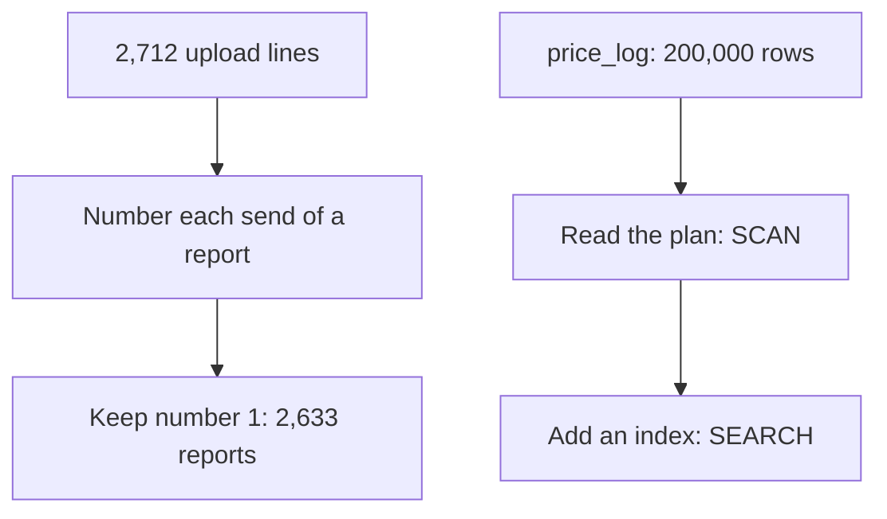

<BigWordAlert term="Window function" plainEnglish="A calculation that looks at a group of related rows and still returns every row. It can number the rows, compare a row with the one before it, or keep a running total." whyItMatters="It lets you keep one copy of a duplicated report, rank markets and compare weeks without losing the detail. Interview guides list window functions among the usual SQL questions." />

## Two messages on one Thursday

On a Thursday evening, Hala opens two messages. Hala is 26. She works part time and remotely as the junior data engineer for Mizan, and she plans her work around the hours when the power is on at home. The first message comes from Omar, the programme officer who reads the weekly food-basket report. The second comes from Karam, the volunteer who built the phone form and the registry app. Hala, Omar, Karam, Yasmin and all the data in this module are fictional.

Omar asks a short question: how many price reports did the eight markets send in the first 28 days of March? Hala counts the lines in the upload files and gets 2,712. Karam's form says the volunteers made 2,633 reports. The two numbers differ by 79, which is about 3 percent.

Hala looks for the cause. The phone form sends a report again when the connection drops before the confirmation arrives. The first copy was already received, so the upload files now hold the same report twice. Report `r-000020` is one example. It is a price for tomatoes at market M02, 4.0 shekels, written at 06:48 on 1 March. It was uploaded at 09:56 and again at 12:39. The lines have the same `report_id` and the same price.

This kind of mistake gives no error message. The report still opens, the totals still add up, and Omar has no reason to doubt it. If Hala adds up the lines, she counts the 4.0 shekel price twice. In a count of reports, the copies add 79 reports that never existed. Hala needs one rule that keeps one line per report, and she needs to write down which copy the rule keeps.

Her first idea is `COUNT(DISTINCT report_id)`. It returns 2,633, which is the right count of reports. But a distinct count answers only that one question. An average price or a total still reads every line, copies included. Hala wants clean rows, not one clean number. You met this idea in module 2: a distinct count can hide a problem that is still in the rows.

## The same week, a slow screen

The second message is about speed. Yasmin is the volunteer coordinator, and she owns the registry of markets and volunteers. She opens the price history screen in Karam's app for market M05 and flour, and she waits so long that she thinks the app has stopped.

Karam's registry app is also used by two partner networks. Its table `price_log` holds every price from all three groups. In this example the table has 200,000 rows. The screen runs this query.

```sql
SELECT avg(price)
FROM price_log
WHERE market_code = 'M05' AND item_code = 'I01';
```

Only 1,983 of the 200,000 rows match, which is about 1 row in every 100. Karam guesses that the database reads all 200,000 rows each time it answers. He cannot prove it, because the app only shows the answer. Hala knows that a database can say how it plans to answer. That plan is the evidence she needs.

Hala has about two hours of power left this evening, so she must choose. She decides to start with the duplicates. A duplicate changes a number that Omar will read tomorrow. The slow screen annoys Yasmin, but it still gives a correct answer. She writes both problems in her notebook and begins with the one that makes a number wrong.

## What the two problems have in common

Both problems are about rows. In the first, the table holds too many rows for the number of reports. In the second, the database reads too many rows for the answer it must give. Two tools from this module solve them.

The first tool is the window function. In module 2 you used `GROUP BY`, which collapses a group of rows into one row. A window function also looks at a group, but it keeps every row and adds a new column next to it. For report `r-000020` it can write 1 next to the newest copy and 2 next to the older copy. Both lines stay in place. A later filter keeps the lines with 1.

The second tool is the query plan. A plan is the database's own description of how it will read the table. You do not need to guess. You ask for the plan, you read one line of it, and you can tell a full read of the table from a read that uses an index.

## Why this matters for the job

Interview guides describe a SQL round that often asks for window functions, deduplication and the way ties are handled. Those guides are a sample, and the rounds vary by employer. Still, the same skills appear in everyday work. A pipeline meets duplicates in its first week, and a slow query soon after. The useful skill is to find the cause, fix it, and explain the fix to someone who does not write SQL.

The same two problems appear in freelance work. A client with an online shop may send an order file twice by mistake. A client's page may take a long time to open. In both cases the client does not ask for a window function. The client asks why the number is wrong, or why the page is slow. You answer with a cause that you have seen in the data or in the plan, and with a fix that you have tested.

Later chapters use both ideas again. In module 5 you will read a plan to see how many files a query opens. In module 7 a staging model keeps the latest row per key, with the same window function that you learn in chapter 3.2. Learning them now, on small tables, means you can check every result by eye.

## The case in one picture

The diagram below shows the two problems as two short chains. The chain on the left is about the number of rows you keep. The chain on the right is about the number of rows the database reads.



Look at where each chain changes the picture. In the left chain, the numbering step does not remove any line. The removal happens one step later, when you keep only number 1. In the right chain, the index does not change the answer at all. It changes only how much of the table the database must read to find it.

## Which copy would you keep?

Before you read on, make a guess about the first problem. Hala must choose which copy of a duplicated report to keep.

```predict
prompt: "Report r-000020 was uploaded at 09:56 and again at 12:39, with the same report_id and the same price. Which copy should Hala keep?"
options:
  - id: last
    label: "The copy uploaded last"
  - id: first
    label: "The copy uploaded first"
correctOptionId: last
explanation: "The copy uploaded last is the newest version of the report. A resend can carry a field that the first send did not have: from 15 March the form adds a unit field, and a resend after that date has it even if the first send did not. The rule is a choice, so write it down. Chapter 3.2 shows how to write it in SQL and how to break a tie."
allowRetry: true
```

Notice that the question has no answer in the numbers alone. Both copies are the same report. You pick a rule, you apply it to every report in the same way, and you write the rule where the next person can find it. That habit matters more than the single query.

There is a second reason to write the rule down. Suppose that next month Karam changes the form so that a resend can carry a corrected price. Then "keep the last copy" keeps the correction, and "keep the first copy" would keep the old price. Hala's rule is a decision about the data, not only a line of SQL, and a decision needs an owner and a date.

## What this module covers

The module has seven chapters. Chapter 3.2 teaches `ROW_NUMBER`, `RANK` and `DENSE_RANK`, and uses them to keep one line per report. Chapter 3.3 teaches `LAG`, running totals and moving averages, and the frame that decides which rows a calculation sees. Chapter 3.4 teaches how to read a plan in SQLite and in DuckDB, and when an index helps. In chapter 3.5 you write the drills and run the index experiment yourself. Chapter 3.6 is a short quiz, and chapter 3.7 is the gate, where you explain a plan to a teammate.

Every chapter starts with small tables, so you can check each result by eye. Then it moves to the full 28 days of Mizan data, where the same query must give the numbers you expect. The build chapter has tests that check those numbers for you. If you have only an hour of power, read one teaching chapter and do one drill. A short step that you finish is more useful than a long plan that waits for a free evening.

<LearningObjectives objectives={["Keep the latest row for each key with ROW_NUMBER, and say how ties are broken", "Compute week-over-week change and moving averages with the frame you intend", "Read a query plan and tell a full scan from a search that uses an index", "Say when an index helps and when a full scan is the right plan"]} />

## Key words

| Word | Plain English |
|---|---|
| **Window function** | A calculation over a group of related rows that keeps every row |
| **Duplicate send** | A report uploaded more than once, with the same `report_id` |
| **Tie** | Two rows with the same value in the column you sort by |
| **Frame** | The rows around the current row that a window calculation looks at |
| **Query plan** | The steps the database says it will take to answer a query |
| **Index** | An extra sorted structure that lets the database find rows without reading the whole table |

## What is in this module

| Chapter | You will practise |
|---|---|
| 3.2 | Numbering sends and keeping the latest one, and handling ties |
| 3.3 | Week-over-week change, running totals and moving averages |
| 3.4 | Reading a plan and deciding when an index helps |
| 3.5 | Five SQL drills and an index experiment, with tests |
| 3.6 | A quiz with five cases, including an AI answer to check |
| 3.7 | Explaining a slow query's plan to a teammate |

**Next:** Window functions: how to number the copies of a report and keep the latest one.
