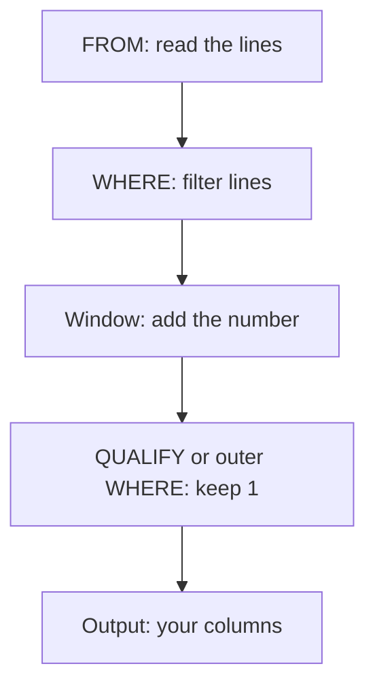

## One report, two lines

Hala has her rule: keep the copy of a report that was uploaded last. Now she must write it in SQL for 2,712 lines. She cannot use `GROUP BY report_id`, because a group collapses to one row of totals. She needs the whole line from the winning copy: the market, the item, the price and the volunteer. She needs a way to number the copies inside each report and then keep number 1.

That is the job of a window function. In 2,712 lines, 79 are extra copies. After the right query, 2,633 lines remain, one for each report. The query is short, but three small choices inside it decide whether the result is right.

## The idea in plain words

A window function has three parts. The first part is the calculation, such as `ROW_NUMBER()`. The second part is `PARTITION BY`, which says which rows belong together: here, the rows with the same `report_id`. The third part is `ORDER BY`, which sets the order inside each group: here, the newest upload first. The word `OVER` joins the three parts.

```sql
ROW_NUMBER() OVER (PARTITION BY report_id ORDER BY uploaded_at DESC)
```

A window function does not shrink the table. A table with 2,712 lines still has 2,712 lines, and it gains one column with a number from 1 upward. For a report sent once, the number is 1. For `r-000020`, the copy uploaded at 12:39 gets 1 and the copy uploaded at 09:56 gets 2. The filter that removes lines comes later, in a separate step.

## Three ways to number

`ROW_NUMBER` counts 1, 2, 3 and never repeats, even when two rows have the same value in the `ORDER BY` column. Two other functions work in a similar way. `RANK` and `DENSE_RANK` give rows with equal values the same number. They differ in what comes after a tie: `RANK` skips numbers, and `DENSE_RANK` does not.

You met the word tie in chapter 3.1. It matters because the function you choose decides how many rows survive a filter such as "rank is 1". Interview guides we read list tie handling in ranking among the usual SQL questions, which is one more reason to know how each function treats a tie. Look at one tie before you open the canvas.

<BigWordAlert term="Tie-breaker" plainEnglish="An extra column at the end of ORDER BY that decides between rows that have the same value in the first sort column." whyItMatters="Without a tie-breaker the database may order tied rows differently from one run to the next, and a test that passed today can fail tomorrow." />

```predict
prompt: "On 8 March, markets M04 and M07 both reported flour at 7.5 shekels, the cheapest price. You rank the eight markets by price with RANK() and keep the rows where the rank is 1. How many rows do you keep?"
options:
  - id: two
    label: "Two rows, M04 and M07"
  - id: one
    label: "One row, the first market"
correctOptionId: two
explanation: "RANK gives tied rows the same number, so M04 and M07 both get rank 1 and both pass the filter. ROW_NUMBER would give them 1 and 2 and keep one. Neither choice is wrong by itself. The right one depends on whether you want every tied winner or exactly one."
allowRetry: true
```

The canvas has two parts. The first part numbers seven upload lines and keeps number 1. The second part ranks the eight flour prices of 8 March, the same case as the predict.

<InteractiveCanvas slug="row-number-dedupe" />

**What this shows:** a window function numbers rows inside each group without removing any row, and a filter on that number then keeps one line per report. The second part shows how `RANK`, `DENSE_RANK` and `ROW_NUMBER` number the same tie in three different ways.

**Try this:** before step 7, predict how many rows `rank = 1` keeps, then check. Next, imagine that `r-000020` had been sent three times and work out its three numbers. Last, find the step where seven lines become four.

**What changed:** the lines did not disappear when they were numbered. They disappeared when the filter kept number 1. In the tie, the rank filter kept two rows and the row number filter kept one.

**Limits of the model:** seven lines and eight markets keep the picture small, and the sort column is clean. In this data no report has two sends with the same `uploaded_at`. Real data has ties that you did not expect, and the next sections show what they do.

## A worked example on a different table

Hala also needs the current version of each market. The file `data/raw/market_history.csv` has 10 rows for 8 markets, because M03 and M06 each have two versions. She wants one row per market, the version with the latest `valid_from` date. This has the same shape as the report problem, so the same three parts apply: group by `market_code`, order by `valid_from` newest first, keep number 1.

```sql
SELECT market_code, area, opens, valid_from
FROM (
    SELECT *, ROW_NUMBER() OVER (PARTITION BY market_code ORDER BY valid_from DESC) AS version_number
    FROM read_csv('data/raw/market_history.csv')
)
WHERE version_number = 1
ORDER BY market_code;
```

The inner query numbers the ten rows. The outer query keeps number 1. The result has eight rows:

```text
M01  Central   daily       2026-03-01
M02  Harbour   daily       2026-03-01
M03  Hill      daily       2026-03-12
M04  Old Town  daily       2026-03-01
M05  North     daily       2026-03-01
M06  South     Sat to Thu  2026-03-20
M07  Hill      daily       2026-03-01
M08  Central   daily       2026-03-01
```

M03 shows Hill, its area after the move on 12 March, and M06 shows its new opening days from 20 March. DuckDB also accepts a shorter form with the clause `QUALIFY`, which filters on a window result directly, so you can drop the inner query. Some other engines do not accept `QUALIFY`, so the two-step form works everywhere and is worth knowing.

The diagram shows why the two-step form exists. It follows the order in which the database does the work.



Read the boxes from the top. `WHERE` runs before the window function, so the number does not exist yet when `WHERE` runs. If you write `WHERE ROW_NUMBER() OVER (...) = 1`, DuckDB stops with the message `WHERE clause cannot contain window functions!`. The filter on the number must come after the number is made. Notice also that lines removed by `WHERE` never receive a number, so a bad line cannot win.

## Where people go wrong

**Partitioning by the wrong key.** Suppose Hala partitions by market, item and day instead of by `report_id`. The idea sounds right: one price per market, item and day. On the 2,620 good reports it keeps only 2,589 lines. The 31 lines it removes are true repeats: the same market priced the same item again on the same day, with a new report id and a new price. Both reports are real. Chapter 8.3 returns to this choice.

**Sorting the wrong way.** With `ORDER BY uploaded_at` and no `DESC`, number 1 is the oldest copy. The query still runs and still returns one line per report, so nothing warns you. For `r-000020` it would keep the 09:56 copy. A test that checks one known report catches this in a second.

**Using `SELECT DISTINCT`.** `DISTINCT` removes lines that are identical in every column. The two copies of `r-000020` differ in `uploaded_at`, so on all 2,712 lines `DISTINCT` removes nothing and still returns 2,712. A duplicate that is not exactly identical needs a rule, not a `DISTINCT`.

**No tie-breaker.** In this data, times are stored to the minute. Two sends of one report inside the same minute would tie on `uploaded_at`. `ROW_NUMBER` would still keep one line, but it would choose the line for you, and it may choose differently tomorrow. With `RANK` both lines would get 1 and both would stay. Add a last sort column that decides between the tied rows, or accept that either copy is fine because the copies are identical.

## The trade-off and the alternatives

Choose the function by the question. Use `ROW_NUMBER` when you want exactly one row for each group, as in deduplication. Use `RANK` when you want every row that ties for the place, such as all markets with the cheapest flour. Use `DENSE_RANK` when you want the first few price levels, however many rows each level holds.

There is another way to keep the latest copy: `GROUP BY report_id` to find the latest `uploaded_at`, then join back to the table. It works, but it joins the table to itself, and it brings back the fan-out risk from module 2 if two copies share a time. The window form is shorter and has no join.

Also decide where the rule runs. Raw files should keep all 2,712 lines, so you can always see what the form sent. The numbering belongs in a later step, which module 7 calls staging. If you delete copies on arrival, you lose the evidence for the next argument about the numbers.

One more point for small laptops. A window function sorts the rows of each group, and sorting uses memory. For 2,712 lines the work takes well under a second. On a table with many millions of rows it can use a lot of memory. DuckDB can write temporary data to disk when a query is too big for memory, but that has limits. On a laptop with 4 GB of memory, run `SET memory_limit = '2GB';` first so the computer stays usable. The value is a safe choice for this course, not a rule from the documentation.

## Try it on your data

Open `data/raw/market_history.csv` and run the query above. Check that you get 8 rows and that M03 shows Hill. Then change `DESC` to `ASC` and look at which rows change. You should see M03 go back to Harbour and M06 to `daily`. Write one line in your notebook that says which copy you keep and why. In chapter 3.5 you will write the same rule for the report lines.

## Check your understanding

```quiz
type: mcq
question: "Iyad freelances for an online soap shop. Its export keeps one line for every edit of an order: o-31 paid at 09:10, o-31 packed at 11:40, o-31 shipped at 15:05, and o-32 paid at 10:20. He wants one line per order with its latest status, so o-31 shipped and o-32 paid. Which window gives that?"
options:
  - "ROW_NUMBER() by order, newest edit first, keep number 1"
  - "ROW_NUMBER() over the whole table, newest first, keep number 1"
  - "ROW_NUMBER() by order, oldest edit first, keep number 1"
  - "ROW_NUMBER() by status, newest edit first, keep number 1"
correct: 0
explanations:
  - "Right. Each order is its own group, and sorting newest first puts the latest status at number 1. That keeps o-31 shipped and o-32 paid."
  - "With no partition the whole table is one group, so only one line gets number 1: o-31 shipped. The line for o-32 is lost."
  - "Sorting oldest first makes number 1 the first status, so o-31 would show paid. That is where the order started, not where it is now."
  - "Partitioning by status gives each status its own number 1. The result has 3 lines, and o-31 appears twice, as packed and as shipped."
```

```quiz
type: mcq
question: "Ruba's bakery sold this many loaves: Sun 150, Mon 150, Tue 150, Wed 140, Thu 140, Fri 130. She wants every day in the top two sales levels, where days with equal sales share one level. Which filter keeps the 5 days from Sunday to Thursday?"
options:
  - "RANK() highest first, keep rank 2 or better"
  - "ROW_NUMBER() highest first, keep number 2 or better"
  - "DENSE_RANK() highest first, keep rank 2 or better"
  - "Sort highest first and use LIMIT 2"
correct: 2
explanations:
  - "RANK gives 1, 1, 1, 4, 4, 6, because it skips after a tie. Rank 2 or better keeps only the three days at 150, and the 140 level is lost."
  - "ROW_NUMBER gives 1 to 6 with no repeats, so number 2 or better keeps only two days, and the choice among the three tied days is arbitrary."
  - "Right. DENSE_RANK gives 1, 1, 1, 2, 2, 3 with no gaps, so ranks 1 and 2 are exactly the two levels. That keeps 5 days."
  - "LIMIT 2 returns two rows. That cuts the three days at 150 down to two and drops the 140 level completely."
```

**Next:** Running totals, moving averages and frames: how to compare a week with the week before and smooth a noisy price.
