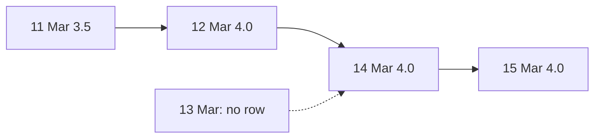

## Is the basket getting dearer?

Omar reads the weekly report on his phone. He does not ask for a table of prices. He asks one plain question: is the basket in market M05 dearer than last week, and by how much? To answer, Hala needs two numbers in the same row: this week's basket and last week's. A `GROUP BY` cannot do that, because it collapses the weeks. A window function can look at the row before.

Omar has a second request. The egg price in a market jumps up and down from day to day, and he cannot see the trend. He asks for a smoother line. Hala can give him an average of the last few days. Both requests use the same idea: a calculation that looks at the rows around the current row.

## The idea in plain words

Three kinds of window calculation matter most for a data engineer. `LAG` reads a value from an earlier row, and `LEAD` reads from a later row. A running total adds up the rows from the start to the current row. A moving average takes the average of the last few rows. Each of them depends on a frame.

You met the word frame in chapter 3.1: it names the rows around the current row that the calculation looks at. For a running total, the frame starts at the first row. For a 3-row moving average, the frame is the current row and the two rows before it. You write a frame with `ROWS BETWEEN 2 PRECEDING AND CURRENT ROW`. Without an `ORDER BY` inside the window, there is no earlier or later row, and the frame is the whole group.

`PARTITION BY` keeps the groups apart. With `PARTITION BY market_code`, each market has its own first row and its own frame. Without it, all markets form one long list, and a frame near the start of one market can reach back into the end of the market before it.

## Predict, then try the canvas

The canvas uses a made-up series so that you can check every number by hand. Egg prices in market M03 rise by 0.5 shekels a day for seven days. Look at how closely a short and a long average follow the rise.

```predict
prompt: "Egg prices in M03 rise by 0.5 shekels every day for seven days. Which moving average is closer to the price on day 7: the average of the last 3 rows or the average of the last 7 rows?"
options:
  - id: wide
    label: "The 7-row average"
  - id: narrow
    label: "The 3-row average"
correctOptionId: narrow
explanation: "A rising price makes older rows lower than today's price. The 7-row average includes more old rows, so it sits further below today's price. The 3-row average includes fewer, so it follows the price more closely. That is the trade-off: a wide frame smooths more and reacts later."
allowRetry: true
```

In the canvas, you can change the number of rows in the frame and turn the partition by market on or off. The bars show how far the average sits below each day's real price.

<InteractiveCanvas slug="moving-average-frame" />

**What this shows:** a moving average is the mean of the last N rows. A wide frame smooths more but sits further behind a rising price. The partition keeps one market's frame from reaching into another market's rows.

**Try this:** turn the partition on and lower the frame from 7 rows to 3. The trail on day 7 falls from 1.50 to 0.50. Then set the frame to 7 and turn the partition off, and watch the average on day 1.

**What changed:** with the partition off, the first days of M03 now include rows of M02. The average on day 1 fell from 25.00 to 23.71, although M03's own price did not change.

**Limits of the model:** the prices are made up and rise in a straight line, which makes the trail easy to predict. Real prices rise and fall. The model counts rows, not calendar days, and the next sections show why that matters.

## Week over week with LAG

Here is the weekly basket of M05 from the pipeline's weekly table. The column `full_days` is the number of days in that week with a complete basket of 12 items. Week 9 holds only Sunday 1 March, so its number rests on one day.

```sql
SELECT
    iso_week, full_days, avg_basket_cost,
    LAG(avg_basket_cost) OVER (PARTITION BY market_code ORDER BY iso_week) AS previous_week,
    ROUND(avg_basket_cost - LAG(avg_basket_cost) OVER (PARTITION BY market_code ORDER BY iso_week), 2) AS change
FROM (VALUES
    ('M05', 9, 1, 154.50), ('M05', 10, 3, 153.17), ('M05', 11, 3, 154.75),
    ('M05', 12, 5, 154.20), ('M05', 13, 3, 154.58)
) AS weekly(market_code, iso_week, full_days, avg_basket_cost)
ORDER BY iso_week;
```

```text
iso_week  full_days  avg_basket_cost  previous_week  change
9         1          154.50           NULL           NULL
10        3          153.17           154.50         -1.33
11        3          154.75           153.17         1.58
12        5          154.20           154.75         -0.55
13        3          154.58           154.20         0.38
```

The first week has no earlier row, so `LAG` returns `NULL` and the change is `NULL`. Do not turn that `NULL` into 0. A change of 0 would say that the price did not move, and the truth is that nobody knows. Week 11 rose by 1.58 shekels, then week 12 fell by 0.55.

## A running total

A running total is `SUM` with an `ORDER BY` inside the window. This query counts how many lines the phone form had uploaded by the end of each day. It first counts lines for each upload date and then adds them up.

```sql
SELECT upload_date, COUNT(*) AS lines,
       SUM(COUNT(*)) OVER (ORDER BY upload_date) AS running_lines
FROM reports
GROUP BY upload_date
ORDER BY upload_date;
```

The first eight days give 90, 179, 267, 367, 468, 564, 663 and 758 lines, and day 28 reaches 2,712. Here `reports` is the view over the upload files from chapter 2.5. A running total is a good check on a pipeline: if a day adds zero lines, something stopped.

## ROWS counts rows, RANGE counts days

Market M02 has no tomato report on 13 March. The table of daily tomato prices therefore has no row for that day. A 3-row frame on 14 March reaches back to 11 March. A frame of 2 days before 14 March reaches back only to 12 March. The two frames hold different rows.

```sql
WITH daily AS (
    SELECT CAST(reported_at AS DATE) AS report_day, AVG(price) AS day_price
    FROM reports
    WHERE market_code = 'M02' AND item_code = 'I06' AND price > 0
    GROUP BY 1
),
averages AS (
    SELECT report_day, day_price,
           AVG(day_price) OVER (ORDER BY report_day ROWS BETWEEN 2 PRECEDING AND CURRENT ROW) AS rows_3,
           AVG(day_price) OVER (ORDER BY report_day RANGE BETWEEN INTERVAL 2 DAYS PRECEDING AND CURRENT ROW) AS days_3
    FROM daily
)
SELECT report_day, day_price, ROUND(rows_3, 3) AS rows_3, ROUND(days_3, 3) AS days_3
FROM averages
WHERE report_day BETWEEN DATE '2026-03-12' AND DATE '2026-03-15'
ORDER BY report_day;
```

```text
report_day  day_price  rows_3  days_3
2026-03-12  4.0        3.833   3.833
2026-03-14  4.0        3.833   4.0
2026-03-15  4.0        4.0     4.0
```

On 14 March the two averages differ. The `ROWS` frame holds 11, 12 and 14 March, with prices 3.5, 4.0 and 4.0. The `RANGE` frame holds only 12 and 14 March, with prices 4.0 and 4.0. In plain words, `ROWS` counts rows and `RANGE` counts distance in the sort column. The diagram shows the rows that the window sees.



Follow the solid arrows. There are four rows, and the row after 12 March is 14 March. The dotted line starts from a day with no data, so a window never sees it. This is why `LAG` on 14 March compares with 12 March, not with a day that has no row.

## Where people go wrong

**A missing day.** `LAG` reads the previous row, not the previous day. On 14 March, `day_price - LAG(day_price)` is 0.0, and a reader will take it as "no change since yesterday". It means "no change since 12 March". If the gap matters, fill the missing days first, or use a `RANGE` frame.

**Filtering before the window.** `WHERE` runs before a window function. If you add `WHERE report_day >= DATE '2026-03-12'` to the same query as the `LAG`, the rows before 12 March are gone, and the change for 12 March becomes `NULL`. Compute the window in a CTE, then filter in the next step, as the query above does.

**No partition.** A moving average over a table sorted by market and then day, with no `PARTITION BY market_code`, blends two markets at every boundary. The canvas showed it: the day 1 average fell from 25.00 to 23.71. No error message appears. The numbers look normal.

**Running totals and ties.** When the window has `ORDER BY upload_date` and no explicit frame, every line of the same date counts as a peer and gets the same total. On 1 March, all 90 lines show 90. That is correct for a total by date and wrong for a total by line. Add `ROWS BETWEEN UNBOUNDED PRECEDING AND CURRENT ROW` and a tie-breaker column when you need one total for each line.

## The trade-off and the alternative

A wide frame hides noise and also hides real changes. In the canvas, a 7-row average trailed a steady rise by 1.50 shekels, and a 3-row average trailed it by 0.50. A narrow frame follows the price but passes the noise on. Choose the width from the question. For a weekly report, compare weeks. For a chart on a phone, a 7-day average is a common choice, because a week holds one of each weekday.

The gap problem has a cleaner fix than `RANGE`. Chapter 4.3 introduces a date table with one row for every day. If you join the prices to that table, a missing day becomes a row with a `NULL` price, and a 7-row frame then covers exactly 7 days. The cost is one more join, and you must check its row count, as you learned in module 2.

## Try it on your data

Take the daily price of one item in one market from the upload files. Write the `LAG` change from the day before, and find the first day where the previous row is not the previous day. Then add a 3-row moving average, and check one value by hand. Write the frame in words: "this row and the two before it". If you can say it in words, you can check it.

## Check your understanding

```quiz
type: mcq
question: "Tamer logs the battery charge (percent) of a shop's solar system: Mon 80, Tue 70, Thu 60, Fri 90. There is no reading on Wednesday. He computes charge minus LAG(charge) OVER (ORDER BY day). What does the Thursday row show?"
options:
  - "NULL, because there is no Wednesday row"
  - "-20, because LAG uses the Monday row"
  - "-30, because LAG uses the Friday row"
  - "-10, because LAG uses the Tuesday row"
correct: 3
explanations:
  - "Only the first row has nothing before it. Thursday has a row before it in the table: Tuesday. LAG does not look for a Wednesday that is not there."
  - "LAG with the default offset reads one row back, not two. Two rows back from Thursday would be Monday, and that needs LAG(charge, 2)."
  - "The Friday row is after Thursday. Reading a later row is the job of LEAD. LAG reads earlier rows only."
  - "Right. Thursday is 60 and the row before it is Tuesday at 70, so the change is -10. The change covers two days, which a reader may miss."
```

```quiz
type: mcq
question: "Sara has daily sales for two shops, sorted by shop and then day. Shop A: 10, 20, 30. Shop B: 100, 110, 120. Her window has ORDER BY shop, day and ROWS BETWEEN 2 PRECEDING AND CURRENT ROW, with no PARTITION BY. What is the 3-row average on shop B's first day?"
options:
  - "100, because shop B starts a new window"
  - "50, because the frame includes two rows of shop A"
  - "65, because the frame holds only two rows"
  - "110, because the frame covers all three days of shop B"
correct: 1
explanations:
  - "Without PARTITION BY, shop B does not start a new window. The whole table is one list, and the frame simply takes the two rows before the current row."
  - "Right. The frame is the current row and two rows before it: 20 and 30 from shop A, and 100. The average is 150 divided by 3, which is 50."
  - "A frame shrinks only at the very start of the list. Shop B's first day is the fourth row, so two earlier rows exist and the frame holds three rows."
  - "The frame ends at the current row, so it never includes later days. The average of all three days of shop B would need PARTITION BY and a different frame."
```

**Next:** Query plans and indexes: how to ask the database how it will read a table, and when an index helps.
