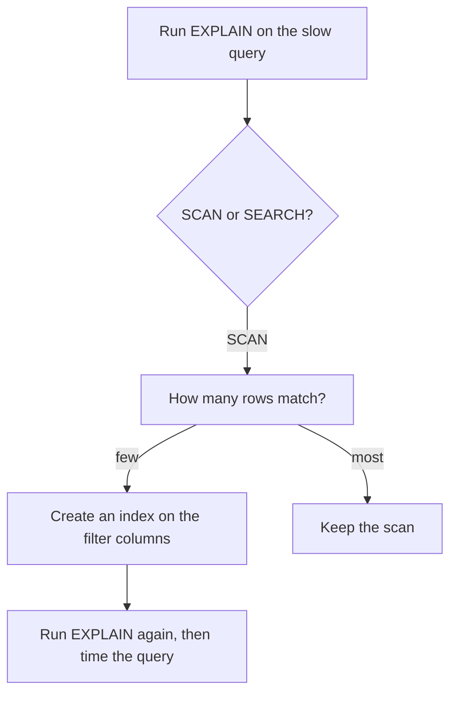

## A plan in one line

Yasmin's history screen asks for market M05 and flour, and Karam's table `price_log` has 200,000 rows. Karam thinks the database reads all of them every time. Hala does not want to guess, and she does not want to add anything before she knows the cause. She puts one word in front of the query and runs it again.

```sql
EXPLAIN QUERY PLAN
SELECT avg(price) FROM price_log WHERE market_code = 'M05' AND item_code = 'I01';
```

SQLite answers with a single line: `SCAN price_log`. That is the whole evidence. In SQLite, `SCAN` means the database visits every row of the table, and it does so even though only 1,983 rows match. Karam was right. Now Hala can say why the screen is slow, in a sentence that a non-technical person can follow.

<BigWordAlert term="Full scan" plainEnglish="A way of answering a query by reading every row of the table and keeping the rows that match." whyItMatters="A full scan is not always wrong. It is the right plan when the query needs most of the table, and it is the first thing to look for when a query on a big table is slow." />

## The idea in plain words

You met the query plan in chapter 3.1. It shows how the database will answer, and you do not run the query to see it. You write `EXPLAIN` before it, and the database prints its steps instead of the rows. In SQLite the command is `EXPLAIN QUERY PLAN`. The plan text can change between SQLite versions, so read it for the main word, `SCAN` or `SEARCH`, and do not compare it letter by letter.

Here is how the index from chapter 3.1 works. The database builds it and keeps it up to date. Imagine a second list, sorted by market and then by item, where each entry also stores where its row lives. To find M05 and I01, the database looks in the sorted list and jumps to those rows. It does not read the rest of the table. When the plan uses an index, SQLite writes `SEARCH ... USING INDEX`.

An index costs something. It takes space, and it must be updated when rows are added. So an index is a trade: you pay a little on every write to save a lot on some reads. The question is always whether the query picks few rows.

## Predict, then try the canvas

The canvas uses a simple rule so you can work out every number. It is a teaching rule and not a measurement of any real database. With an index, the engine reads about log2(rows) pages to find the first match, plus 3 pages for each matching row. With a full scan, it reads every page, and 100 rows fit on a page.

```predict
prompt: "A table has 200,000 rows, so a full scan reads 2,000 pages. Under the toy rule, an index costs 17.6 pages plus 3 pages for each matching row. A query picks 12.5 percent of the rows, one market in eight. Which plan reads fewer pages?"
options:
  - id: index
    label: "The index plan"
  - id: scan
    label: "The full scan"
correctOptionId: scan
explanation: "12.5 percent of 200,000 rows is 25,000 rows. At 3 pages each, the index reads about 75,018 pages. The full scan reads 2,000. An index helps when the query picks few rows, and one market in eight is not few."
allowRetry: true
```

Use the canvas to find the share of matching rows where the cheaper plan changes.

<InteractiveCanvas slug="index-or-scan" />

**What this shows:** two plans for the same query and the pages that each one reads under the toy rule. The full scan cost depends only on the size of the table. The index cost depends mostly on how many rows match.

**Try this:** raise the share of matching rows to 12.5 percent and check the numbers from the predict. Then set the share to 0.3 and to 0.4 percent, and find the point where the cheaper plan flips.

**What changed:** the flip happens near 0.33 percent for 200 thousand rows. Below it the index wins, and above it the full scan wins, even though the index sounds like the better plan.

**Limits of the model:** the numbers are a simple illustration and not a measurement. Real engines use memory caches, read pages in order, and guess how many rows match before they choose a plan. The real break-even point is different, and you have to measure it on your own data.

## What the experiment shows

Hala builds the same table in SQLite: 200,000 fake price rows, with a fixed seed so everyone gets the same rows. She asks for the plan, creates an index on the two columns that the screen filters on, and asks again. In chapter 3.5 you run this experiment yourself. These are the real results.

```text
Plan before the index:
  SCAN price_log
Plan after the index:
  SEARCH price_log USING INDEX idx_price_log_market_item (market_code=? AND item_code=?)
```

The plan changed from `SCAN` to `SEARCH`. The new text also says which columns the search uses. Two further plans from the same table teach more. With `SELECT count(*)` instead of `avg(price)`, the plan says `USING COVERING INDEX`, because the index alone holds everything the query needs, and the table is not touched at all. And with a filter on `item_code` only, the plan is `SCAN price_log` again, because the index starts with `market_code`. A filter on `market_code` only still uses the index, since the first column is present.

The diagram shows how to use a plan when a query is slow. It is a loop, and the last step is a measurement.



Read the loop from the top. A `SCAN` alone is not a problem to fix. Only a scan that answers a query for a few rows is. After you add an index, the plan must say `SEARCH`. A `SEARCH` in the plan tells you the index is in use, and it does not tell you that the query got faster. Time the query before and after, on your own machine, and expect the times to change a little from run to run.

## Plans in DuckDB

DuckDB has the same two commands with different words. `EXPLAIN` shows the plan. `EXPLAIN ANALYZE` runs the query and adds real row counts and the files and row groups it read. Because `EXPLAIN ANALYZE` really runs the statement, never put it in front of an `INSERT` or a `DELETE` unless you want the change to happen.

DuckDB is built for queries that read large parts of a table, so a Parquet lake is read in a different way. Instead of an index, it uses two kinds of information. Folders named like `upload_date=2026-03-05` let it skip whole files. And each Parquet file stores the smallest and largest value of each column in each block of rows, so it can skip blocks that cannot match. Chapter 5.2 explains these statistics. Here you only need to read the plan. Hala wrote the 28 days of upload lines to Parquet, one folder per upload date, and asked for two plans. The lines below are the parts that matter; the real output is drawn in boxes.

```text
-- WHERE upload_date = DATE '2026-03-05'
Read Parquet
  Projections: price
  File Filters: upload_date = '2026-03-05'::DATE
  Scanning Files: 1/28

-- WHERE market_code = 'M05'
Read Parquet
  Projections: price
  Filters: market_code = 'M05'
```

In the first plan, `Scanning Files: 1/28` says that 27 folders were never opened. In the second, the filter on `market_code` is pushed into the scan, so rows that do not match are dropped while reading. The line `Projections: price` says that only one column is read. With `EXPLAIN ANALYZE` on the second query, the output also shows `Row Groups Scanned: 26 / 28`: in this run the reader skipped 2 of 28 blocks without reading them. How many it can skip depends on how the values are spread across the files, so compare plans and row counts and not milliseconds.

## Where people go wrong

**Reading `SEARCH` as "fast".** The plan says how the database will read, and not how long it will take. Time the query.

**The wrong column order.** An index on `(market_code, item_code)` helps a filter on `market_code`, and a filter on both. It does not help a filter on `item_code` alone. Put first the column that your queries filter on most.

**An index on a column that matches most rows.** If half the rows have the same value, the index still sends the database to half the table, one jump at a time. The canvas showed that this costs more than a scan.

**Adding indexes to every column.** Each one takes space and must be updated on every insert. Add an index for a query you have seen in a plan, not for a query you imagine.

**Trusting the plan text across versions.** The words can change. The tests in chapter 3.5 look only for `SCAN` and `SEARCH ... USING INDEX`.

## The trade-off and the alternative

Choose an index for an app that looks up a few rows by a key, such as Karam's registry. Choose scans and statistics for analytical files, where each query reads many rows of a few columns. The Parquet partitions and the column statistics do the job that an index does for an app. And consider a third option for Yasmin's screen. Suppose the screen only needs an average for each market and item. A small summary table with 96 rows answers it with no index at all. The pipeline must then keep that table up to date.

## Try it on your data

Open `data/raw/registry.db` with Python and ask for two plans. The first filters on `market_code`, which is the primary key of the `markets` table. The second filters on `area`, which has no index. The key should give a `SEARCH` that uses an automatic index, and `area` should give `SCAN markets`. Then explain in one sentence why a table of 8 rows does not need either. In chapter 3.5 you use the same method on the big table.

```python
import sqlite3

db = sqlite3.connect("data/raw/registry.db")
for sql in ["SELECT * FROM markets WHERE market_code = 'M03'", "SELECT * FROM markets WHERE area = 'Hill'"]:
    print(sql)
    for row in db.execute("EXPLAIN QUERY PLAN " + sql):
        print("  ", row[3])
```

## Check your understanding

```quiz
type: mcq
question: "Mazen keeps a clinic's appointments in SQLite: 120,000 rows and one index on (patient_id, visit_date). Which query can use that index for a SEARCH?"
options:
  - "Rows in March, for any patient at the clinic"
  - "Rows for patient P-204, in any month of the year"
  - "Rows for doctor D-7, in any month of the year"
  - "All the rows, listed by clinic room, for every month"
correct: 1
explanations:
  - "The index starts with patient_id. With no patient in the filter, SQLite cannot start in the sorted list, so the plan says SCAN."
  - "Right. The first column of the index, patient_id, is in the filter, so SQLite can jump to that patient's rows. The plan says SEARCH ... USING INDEX."
  - "The doctor is not a column of the index, so the index cannot find these rows. The plan says SCAN."
  - "There is no filter at all, so every row is needed. No index can help; the database must read the whole table."
```

```quiz
type: mcq
question: "Lama's table has 400,000 rows. The toy rule from this chapter says an index reads log2(rows), about 18.6 pages, plus 3 pages per matching row, and a full scan reads rows divided by 100 pages. Her query matches 2 percent of the rows. Which plan is cheaper?"
options:
  - "The full scan, 4,000 pages against about 24,019 with the index"
  - "The index, about 24,019 pages against 40,000 pages for the scan"
  - "The index, because 2 percent of the rows is a small share"
  - "Neither, because both plans read 4,000 pages here"
correct: 0
explanations:
  - "Right. The scan reads 400,000 / 100 = 4,000 pages. At 2 percent, 8,000 rows match, so the index reads 18.6 + 3 x 8,000, about 24,019 pages. The scan is cheaper."
  - "The scan reads rows divided by 100, which is 4,000 pages, not 40,000. With the correct number the index is the more expensive plan."
  - "Whether a share is small depends on the rule. Here 2 percent is 8,000 rows and costs 24,000 pages at 3 pages each, which is more than a whole scan."
  - "The two plans read different numbers of pages: 4,000 for the scan and about 24,019 for the index. They are equal only at about 0.33 percent."
```

**Next:** Build the drills: deduplicate, rank and compare weeks in SQL, and run the index experiment.
