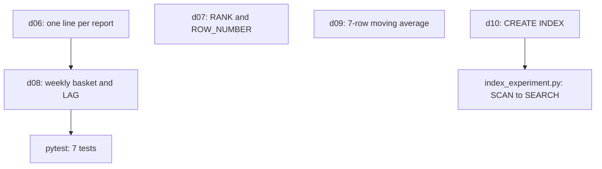

## What the project cannot do yet

Today Hala can count the lines in the upload files, and the count is wrong by 79. She can say that the history screen is slow, but she cannot show the proof. Every number she gives Omar rests on a query that nobody has tested. If a later change to the data breaks one of those queries, nobody will know until a report looks wrong.

By the end of this chapter, five SQL files in your project turn the ideas of chapters 3.2 to 3.4 into tested work. One keeps the latest send of each report. One ranks the markets by the price of flour. One computes the weekly basket and its change from the week before. One smooths the egg price. One adds an index. A script then shows the query plan before and after the index. You will need your laptop, about 75 minutes, and the project from chapter 2.5 with its tests passing.

## Where the repository is now

Your project folder already has the generator, the raw data in `data/raw`, the setup check, the test helper `tests/conftest.py` from chapter 2.5, and the drills `d01` to `d05` in `sql/drills`. The helper gives each test a DuckDB connection with a view named `reports` over the upload files. That view holds all 2,712 lines. The timestamps in it are plain UTC, so the machine's time zone cannot move a date.

You add five SQL files, one script and one test file. Nothing from earlier chapters changes.

```text
mizan-prices/
  scripts/index_experiment.py            given in full below
  sql/drills/d06_latest_per_report.sql   you write
  sql/drills/d07_rank_items_by_price.sql you write
  sql/drills/d08_weekly_change.sql       you write
  sql/drills/d09_moving_average.sql      you write
  sql/drills/d10_create_index.sql        you write
  tests/test_drills_windows.py           given in full below
```

## The design decision

Each drill reads the raw upload lines and does its own work. That is on purpose. In module 7 the work of d06 moves into a staging model, which deduplicates once and saves the result, and the other models read the clean table. For now, repeating the step keeps each file readable on its own, and it shows you why the pipeline will later do it once. The alternative is to save d06's result as a table and let d08 read it. That saves work, but it also means d08 gives stale numbers whenever the saved table is out of date.

The second decision is about the plan. You could simply believe that an index helps. Instead the experiment asks SQLite for the plan before and after, so the claim rests on evidence. The diagram shows how the five drills depend on each other.



Notice that d08 reuses the numbering step of d06, and the other drills stand alone. A mistake in d06 can therefore show up in d08 as well.

## The task

Create the five files below in `sql/drills`. Each file holds one SQL statement that reads the `reports` view and returns the columns in the order shown. The tests compare the rows, so the order of the columns matters. For every drill, the paragraphs after the table give the question and the result that your query must return. No solution SQL is given, because the point is to write it.

| Drill | File | Columns, in this order |
|---|---|---|
| d06 | `d06_latest_per_report.sql` | `report_id`, `market_code`, `item_code`, `price`, `uploaded_at` |
| d07 | `d07_rank_items_by_price.sql` | `market_code`, `price`, `price_rank`, `row_number` |
| d08 | `d08_weekly_change.sql` | `market_code`, `iso_year`, `iso_week`, `full_days`, `avg_basket_cost`, `previous_week`, `change` |
| d09 | `d09_moving_average.sql` | `market_code`, `report_day`, `day_price`, `moving_avg_7` |
| d10 | `d10_create_index.sql` | one `CREATE INDEX` statement, no columns |

**Drill d06: the latest send of each report.** Keep one line for each `report_id`, the copy with the latest `uploaded_at`. Do not filter bad rows here, because this drill only removes copies. Order the result by `report_id`. The expected result has 2,633 rows, one for each distinct `report_id`. Report `r-000020` was sent at 09:56 and 12:39 on 1 March, and the row you keep has `uploaded_at` 2026-03-01 12:39.

**Drill d07: rank the markets by the price of flour.** Rank the eight markets by the price of flour (`I01`) on 2026-03-08, cheapest first, using only prices above 0. The column `price_rank` uses `RANK`. The column `row_number` uses `ROW_NUMBER` and breaks ties by `market_code`. Order the result by price and then by `market_code`. The expected result has 8 rows. They are listed in the block that follows this paragraph, in the order that the query must return them.

```text
(M04, 7.5, 1, 1)
(M07, 7.5, 1, 2)
(M01, 8.0, 3, 3)
(M02, 8.0, 3, 4)
(M08, 8.0, 3, 5)
(M03, 8.5, 6, 6)
(M06, 8.5, 6, 7)
(M05, 9.0, 8, 8)
```

**Drill d08: the weekly basket and its change.** For each market and ISO week, give the average basket cost and the change from the week before. The next section defines it step by step. The expected result has 38 rows for ISO weeks 9 to 13. For example (M08, 2026, 10, 4, 142.75, 139.0, 3.75) and (M05, 2026, 13, 3, 154.58, 154.2, 0.38). The first week of every market has `NULL` in `previous_week` and `change`.

**Drill d09: the moving average of egg prices.** For eggs (`I09`), give each market's average price for each day, using only prices above 0. Add a second average: the mean of that day's average and the daily averages of the 6 rows before it, in the same market. Round `day_price` to 2 decimals and `moving_avg_7` to 3, and make `report_day` a date. Order by market and day. The expected result has 213 rows over all markets, and 27 of them are for M02. The first M02 row is (M02, 2026-03-01, 23.75, 23.75). The second is (M02, 2026-03-03, 24.0, 23.875). The last is (M02, 2026-03-28, 23.5, 23.857).

**Drill d10: the index.** Write one `CREATE INDEX` statement named `idx_price_log_market_item` on the table `price_log`, over the columns `market_code` and `item_code`, in that order. The plan of the market-and-item query must change from `SCAN price_log` to a `SEARCH` that uses this index.

## What d08 means, step by step

Drill d08 is the long one, so its definition is written out. It builds on the basket idea from Mizan's weekly report. Follow these steps in order, and write each as a named step in a CTE, as you learned in chapter 2.4.

1. Keep one send for each report, the latest, as in d06.
2. Keep only good rows: `price` above 0 and `item_code` not empty.
3. For each market, day and item, take the average price. A market can price one item twice on a day (a true repeat), and the item must count once, as the average of its prices.
4. Add up the item prices of each market and day to get the basket cost, and keep only days that have all 12 items.
5. For each market and ISO year and week, count those full days as `full_days` and average their basket costs, rounded to 2 decimals.
6. With `LAG` over each market's weeks in order, add `previous_week`, and `change` as the difference rounded to 2 decimals.

Keep all the numbers as plain floating-point values and do not cast them to `DECIMAL`. The test compares them with Python floats, and a decimal such as 154.58 does not equal the float 154.58.

## The constraints

The files must run in DuckDB 2.0.0 against the `reports` view and nothing else. Do not read the upload files directly. Do not write to the view. Use only the functions this module taught, and for d08 the functions `ISOYEAR` and `WEEKOFYEAR` for the year and the week. The file for d10 holds a single statement, so the experiment script can run it with `executescript`. The drills are read-only; they must not change any data.

## The index experiment, given in full

This script builds the `price_log` table from the chapter 3.1 story: 200,000 fake price rows in SQLite, with the same rows each time. It asks for the query plan, runs the SQL in the file you pass it, and asks again. Create `scripts/index_experiment.py` with this content.

```python
"""Does an index help? Build a big SQLite table and look at the query plan before and after.

Run:  python scripts/index_experiment.py sql/drills/d10_create_index.sql
"""
import random
import sqlite3
import sys

# The question we ask the table. Without an index SQLite must read every row to answer it.
QUERY = "SELECT avg(price) FROM price_log WHERE market_code = 'M05' AND item_code = 'I01'"


def build_table(db, rows=200_000, seed=7):
    """200,000 fake price rows. The same seed always makes the same rows."""
    rng = random.Random(seed)
    db.execute("CREATE TABLE price_log(report_id INTEGER PRIMARY KEY, market_code TEXT, item_code TEXT, price REAL)")
    markets = [f"M{n:02d}" for n in range(1, 9)]
    items = [f"I{n:02d}" for n in range(1, 13)]
    data = ((n, rng.choice(markets), rng.choice(items), round(rng.uniform(3, 40) * 2) / 2) for n in range(rows))
    db.executemany("INSERT INTO price_log VALUES (?, ?, ?, ?)", data)
    db.commit()


def query_plan(db):
    """The last column of EXPLAIN QUERY PLAN holds the sentence we want to read."""
    return [row[3] for row in db.execute("EXPLAIN QUERY PLAN " + QUERY)]


def run(index_sql_path):
    db = sqlite3.connect(":memory:")
    build_table(db)
    before = query_plan(db)
    db.executescript(open(index_sql_path).read())
    after = query_plan(db)
    db.close()
    return before, after


if __name__ == "__main__":
    path = sys.argv[1] if len(sys.argv) > 1 else "sql/drills/d10_create_index.sql"
    before, after = run(path)
    print("Plan before the index:")
    print("  " + "\n  ".join(before))
    print("Plan after the index:")
    print("  " + "\n  ".join(after))
```

The function `query_plan` takes the last column of each plan row, because that column holds the sentence. The script builds the table in memory, so it leaves no file behind and you can run it as often as you like.

## The acceptance tests

Create `tests/test_drills_windows.py` with this content. It imports `REPO` and `run_sql` from the helper of chapter 2.5, and it uses the fixtures `con` and `project` from the same file.

```python
"""Chapter 3.5: window function drills, the index experiment and a look at DuckDB's plan."""
import sys
from datetime import date, datetime
from pathlib import Path

from conftest import REPO, run_sql

DRILLS = REPO / "sql" / "drills"


def test_d06_latest_per_report(con):
    rows = run_sql(con, DRILLS / "d06_latest_per_report.sql")
    assert len(rows) == 2633  # distinct report ids
    assert len({r[0] for r in rows}) == 2633
    sent_twice = {r[0]: r for r in rows}["r-000020"]
    assert sent_twice[4] == datetime(2026, 3, 1, 12, 39)  # the later of 09:56 and 12:39


def test_d07_rank_keeps_ties_and_row_number_does_not(con):
    rows = run_sql(con, DRILLS / "d07_rank_items_by_price.sql")
    assert rows == [
        ("M04", 7.5, 1, 1), ("M07", 7.5, 1, 2), ("M01", 8.0, 3, 3), ("M02", 8.0, 3, 4),
        ("M08", 8.0, 3, 5), ("M03", 8.5, 6, 6), ("M06", 8.5, 6, 7), ("M05", 9.0, 8, 8),
    ]


def test_d08_weekly_change(con):
    rows = run_sql(con, DRILLS / "d08_weekly_change.sql")
    assert len(rows) == 38  # weeks 9 to 13; only 6 markets have a full basket on Sunday 1 March
    by_key = {(r[0], r[2]): r for r in rows}
    assert by_key[("M08", 10)] == ("M08", 2026, 10, 4, 142.75, 139.0, 3.75)
    assert by_key[("M05", 13)] == ("M05", 2026, 13, 3, 154.58, 154.2, 0.38)
    assert by_key[("M01", 10)][5:] == (None, None)  # no week 9 basket for M01, so nothing to compare with
    for market in ["M01", "M02", "M03", "M04", "M05", "M06", "M07", "M08"]:
        first = [r for r in rows if r[0] == market][0]
        assert first[5] is None  # LAG of the first week is NULL


def test_d09_moving_average(con):
    rows = [r for r in run_sql(con, DRILLS / "d09_moving_average.sql") if r[0] == "M02"]
    assert len(rows) == 27  # M02 reported no eggs on 2026-03-02
    assert rows[0] == ("M02", date(2026, 3, 1), 23.75, 23.75)
    assert rows[1] == ("M02", date(2026, 3, 3), 24.0, 23.875)  # the window is rows, not days
    assert rows[-1] == ("M02", date(2026, 3, 28), 23.5, 23.857)


def test_d10_index_changes_the_plan_from_scan_to_search(project):
    done = project.python("scripts/index_experiment.py", "sql/drills/d10_create_index.sql")
    before, after = done.stdout.split("Plan after the index:")
    assert "SCAN price_log" in before
    assert "SEARCH price_log USING INDEX idx_price_log_market_item" in after


def test_without_an_index_the_plan_stays_a_scan(project):
    Path("no_index.sql").write_text("SELECT 1;")
    done = project.python("scripts/index_experiment.py", "no_index.sql")
    assert done.stdout.count("SCAN price_log") == 2


def test_duckdb_explain_shows_partition_pruning_and_filter_pushdown(con, tmp_path):
    lake = (tmp_path / "pq").as_posix()
    con.execute(f"COPY (SELECT * FROM reports) TO '{lake}' (FORMAT parquet, PARTITION_BY (upload_date))")
    scan = f"read_parquet('{lake}/*/*.parquet', hive_partitioning = true)"
    by_partition = con.execute(f"EXPLAIN SELECT * FROM {scan} WHERE upload_date = DATE '2026-03-05'").fetchall()[0][1]
    assert "Scanning Files: 1/28" in by_partition  # 27 folders were never opened
    by_column = con.execute(f"EXPLAIN SELECT * FROM {scan} WHERE market_code = 'M05'").fetchall()[0][1]
    assert "Filters: market_code = 'M05'" in by_column  # pushed into the scan
```

## Why each test exists

The test `test_d06_latest_per_report` checks two things. It checks that you have exactly one row for each of the 2,633 report ids, and it checks the one report whose answer you can verify by eye. Counting alone would pass a query that keeps the wrong copy. The known report catches a sort in the wrong direction.

The test `test_d07_rank_keeps_ties_and_row_number_does_not` compares the whole result, because eight rows are short enough to check in full. It fails if `RANK` is replaced by `ROW_NUMBER`, since the third column would then read 1, 2, 3 and not 1, 1, 3. It also fails if the tie-breaker is missing and the two 7.5 rows swap.

The test `test_d08_weekly_change` checks the row count, two known rows and the `NULL` rules. The count of 38 catches a missing full-day filter, because without it M01 and M06 would also appear in week 9, and the result would have 40 rows. The two known rows catch a wrong average. The loop over all markets checks that the first week of each has no previous week.

The test `test_d09_moving_average` looks at three rows of one market. The second row proves that the frame counts rows: M02 has no egg price on 2 March, so the second row is 3 March and the average has only two values. The first row proves that the window does not reach into another market: its average equals its own price.

The next two tests run the index experiment. `test_d10_index_changes_the_plan_from_scan_to_search` needs `SCAN` before and `SEARCH ... USING INDEX` after. `test_without_an_index_the_plan_stays_a_scan` runs the script with a file that does nothing, and expects `SCAN` twice. That second test proves that the plan changes because of your index and not because of the script. The last test, `test_duckdb_explain_shows_partition_pruning_and_filter_pushdown`, needs nothing from you. It shows a DuckDB plan that skips 27 of 28 folders, and it prepares the ground for module 5.

## Build it

1. Create `scripts/index_experiment.py` and `tests/test_drills_windows.py` from the two blocks above.
2. Write `d06`, then run its test. Fix it before you move on.
3. Write `d07`, then `d09`, then `d08`, running each test after each file.
4. Write `d10` and run the experiment script by hand to read the two plans.
5. Run all seven tests together.

To run one drill's test, use the `-k` option. When a test fails, pytest prints the lines that start with `E`. For d07, d08 and d09 those lines show your value next to the expected value, so you can read the difference directly.

```bash
pytest -q tests/test_drills_windows.py -k d06
```

The experiment script runs the same way in PowerShell and in bash.

```bash
python scripts/index_experiment.py sql/drills/d10_create_index.sql
```

Now run all the tests of this chapter.

```bash
pytest -q tests/test_drills_windows.py
```

## What you should see

The experiment prints two plans. The words are from SQLite 3.49.1, which is the version in Python 3.12. Your version may use slightly different words, but it should still show `SCAN` and `SEARCH`.

```text
Plan before the index:
  SCAN price_log
Plan after the index:
  SEARCH price_log USING INDEX idx_price_log_market_item (market_code=? AND item_code=?)
```

The tests end with seven dots and a count. The time changes from machine to machine.

```text
.......                                                                  [100%]
7 passed in 2.53s
```

## See a DuckDB plan yourself

This step is optional and needs no test. The script below writes the 28 days to Parquet in a temporary folder, one folder for each upload date, and prints three plans. On Windows the plan uses box characters, so set the environment variable `PYTHONUTF8` to 1 first, or Python stops with a `UnicodeEncodeError`. In PowerShell write `$env:PYTHONUTF8 = "1"`. In bash write `export PYTHONUTF8=1`. Create `scripts/explain_demo.py` and run it from the project folder.

```python
"""See how DuckDB plans a query over a folder of Parquet files.

Run from the project folder:  python scripts/explain_demo.py
On Windows, set PYTHONUTF8=1 first (the plan uses box-drawing characters).
"""
import tempfile
from pathlib import Path

import duckdb

con = duckdb.connect()
con.execute("""
    CREATE VIEW reports AS
    SELECT * REPLACE (timezone('UTC', reported_at) AS reported_at, timezone('UTC', uploaded_at) AS uploaded_at)
    FROM read_json('data/raw/uploads/*/*.jsonl', union_by_name = true, hive_partitioning = true)
""")

with tempfile.TemporaryDirectory() as folder:
    lake = Path(folder).as_posix()
    con.execute(f"COPY (SELECT * FROM reports) TO '{lake}' (FORMAT parquet, PARTITION_BY (upload_date))")
    scan = f"read_parquet('{lake}/*/*.parquet', hive_partitioning = true)"
    queries = [
        ("A. EXPLAIN, one upload date", f"EXPLAIN SELECT price FROM {scan} WHERE upload_date = DATE '2026-03-05'"),
        ("B. EXPLAIN, one market", f"EXPLAIN SELECT price FROM {scan} WHERE market_code = 'M05'"),
        ("C. EXPLAIN ANALYZE, one market", f"EXPLAIN ANALYZE SELECT avg(price) FROM {scan} WHERE market_code = 'M05'"),
    ]
    for name, sql in queries:
        print(name)
        print(con.execute(sql).fetchall()[0][1])
```

In plan A look for `File Filters` and `Scanning Files: 1/28`. In plan B look for `Filters: market_code = 'M05'` and `Projections: price`. In plan C, which really runs the query, look for `Row Groups Scanned` and the row counts. The times in plan C change from run to run, so compare the counts.

## One failure on purpose

Change `DESC` to `ASC` in the `ORDER BY` of your d06 file and run its test. The query still runs and still returns 2,633 rows, so nothing warns you. The test should fail on the known report, with a line like this.

```text
E       assert datetime.datetime(2026, 3, 1, 9, 56) == datetime.datetime(2026, 3, 1, 12, 39)
FAILED tests/test_drills_windows.py::test_d06_latest_per_report
```

The query kept the copy uploaded at 09:56, the first one. Change it back and confirm the test passes. This is the failure that a row count alone would never catch.

## If you are stuck

Start with the hint for the drill that fails, and read the next hint only if you need it. For d06, number the sends of each `report_id` from the newest, then keep number 1. For d07, `RANK` and `ROW_NUMBER` both go in the same `SELECT`, each with its own `OVER` clause. For d09, average the prices of one day first, then run the window over those daily rows. For d08, build it one step at a time, as in the list above.

Then run one check. For d08, count the rows after each step and compare them with these numbers. You should have 2,633 rows after step 1 and 2,620 after step 2. After step 3 you should have 2,589, and after step 4 you should have 140 market-days with all 12 items. After step 5 you should have 38 rows. The first count that differs shows you which step is wrong. If the counts are right and the test still fails, look at the types: the numbers must stay floating-point, and `full_days` must be a whole number.

## Commit your work

Run all the tests once more. Then commit the five drills, the script and the test file. A suitable message is: "Add window function drills d06 to d10 and the index experiment".

**Next:** A short quiz on window functions and query plans, with one AI answer to check.
