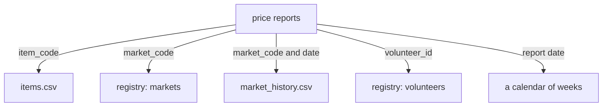

<BigWordAlert term="Grain" plainEnglish="What one row of a table stands for. If the grain is 'one price report', the table has one row for each report and nothing else." whyItMatters="Every count and every total depends on the grain. If nobody states it, two people can use the same table and get two different answers, and both believe they are right." />

## A weekly question that needs five joins

On a Tuesday, Omar sends Hala a new request. Until now the weekly report showed one number for each market. Omar wants more. He wants the average cost of the 12-item basket for each area of the city, week by week. He also wants each report counted in the area where its market was on the day of the report. He needs this for the partner kitchens, which plan their shopping by area. Omar, Hala, Karam and Yasmin are fictional, and so is all the data.

Hala sketches what she needs and where each piece lives. The prices are in the upload files. The names and units of the items are in `items.csv`. The name and area of each market are in the registry, which is Karam's SQLite file. Two markets changed, so the history of each market is in `market_history.csv`. Yasmin asks that only reports from volunteers listed in the registry are counted. And there is no calendar, so the week must come from the date.

Count the joins. Reports join to items, to markets, to the market history, to volunteers and to a calendar. That is five joins for one weekly number. In module 2 you saw that every join is a chance to multiply rows or to lose them. Hala will meet both in the same afternoon.

## What goes wrong in the joins

**Today's area for an old report.** The registry shows each market as it is now. M03 moved from Harbour to Hill on 12 March. If Hala joins the reports to the registry, a report made on 5 March, when M03 was still in Harbour, is counted in Hill. The weekly average for Harbour loses a market it really contained, and Hill gains one it did not yet contain. The result has no error and no warning.

**Two rows for one market.** The history file has two rows for M03 and two for M06. When Hala joins the reports to the history with only the market code, every report from those two markets matches both rows. The 2,620 accepted reports become 3,271 rows, and every sum for those markets counts some prices twice. You know this problem from chapter 2.2 as fan-out.

**A volunteer who is no longer there.** V11 left on 22 March, and the registry deleted that volunteer. The 129 accepted reports that V11 made from 1 to 21 March no longer match any row in the volunteers table. An inner join drops them without a word, and 2,620 reports become 2,491. The weekly numbers for V11's market are then too low, and the cause is a join and not a bad price.

None of these is a mistake in Hala's SQL. Each one comes from the tables, which were built for another job.

Hala finds the second and third problems because she checks the row count after every join, as chapter 2.2 taught. A join that changes the count when it should not is the one to look at. She finds the first problem only because she knows that M03 moved. A reader who did not know would never see it, since the numbers look normal.

## Why this is a design problem

Karam built the registry to look after the people and the markets. It is good at that. When a volunteer changes a phone number, one row changes in one place. When a market moves, Yasmin edits one row. Storing each fact once, and changing it in one place, is called a normalised design. It suits an app that reads and writes single records all day.

Omar's question is a different job. It reads thousands of price reports and groups them by area and week. It also needs to know how things were on a past day, and the app has forgotten that. Hala can force the answer out with five joins, and she must check each join. A better way is to build a second set of tables that is shaped for questions like Omar's. That is what this module designs.

There is a second cost to the five joins. Every new question repeats them, with the same checks. Hala writes them again for the next report, and a colleague writes them a little differently. Two correct queries can then give two different answers. A set of tables shaped for reports moves the joins and the checks into one place, done once and tested, and everyone queries the result.

The first decision comes before any table. Omar says "the weekly basket", and Hala asks what one row of that table stands for. One market in one week gives 8 rows each week. One area in one week gives 6 rows each week, because the 8 markets sit in 6 areas. Both are called the weekly basket. They are different tables, and they answer different questions. Until the team agrees, the numbers are not comparable.

## Why this matters for the job

Interview guides we read list a data modelling round. They say that candidates are expected to state the grain first, to choose a star schema, and to choose how to keep history. The guides are a sample, and rounds vary by employer. The skill is real work too. A modelling mistake is expensive, because every report, every test and every dashboard that comes later is built on the tables you choose.

In such a round you are often given a short business description and asked to design the tables. The strongest opening is a question, not a drawing: what does one row stand for? Interviewers use your answer to see whether you think about how the numbers will be used. You will practise exactly this in chapters 4.3 and 4.6, and again in the interview module later in the course.

For a freelancer the same skill saves time. A client with an online shop will ask for "sales by month". Ask one question first: "what is one row: an order, an order line or a product?" That one question prevents the most expensive kind of rework, which is rebuilding tables after the numbers are in use.

## The case in one picture

The diagram shows the five joins around the price reports. Each arrow is labelled with the key the join uses.



Look at the third arrow. It needs two keys, because a market has more than one version, and a join on the code alone would multiply the rows. Look at the fourth arrow. The volunteers table can lose rows over time, so a join that needs it can lose reports. Two of the five arrows are the dangerous ones. Good tables remove the danger before the query is written.

## Which area does the join give?

Before you read on, make a guess about the first problem. Hala joins every report to today's registry to find the area of its market.

```predict
prompt: "M03 moved from Harbour to Hill on 12 March. Hala joins every report to today's registry table. Which area does a report of M03 made on 5 March get?"
options:
  - id: hill
    label: "Hill, the area today"
  - id: harbour
    label: "Harbour, the area that day"
correctOptionId: hill
explanation: "The registry holds only today's value, so the join returns Hill for every M03 report, including those made while the market was in Harbour. The join cannot know the past, because the table has forgotten it. Chapter 4.4 shows how to keep each version with the dates it was true."
allowRetry: true
```

Notice that the join did exactly what it was told. The fault is not in the query. The table holds one answer for each market, and the question needs one answer for each market and date. That difference is the main idea of this module.

## What this module covers

Chapter 4.2 compares the app's normalised tables with a design for reports, and shows that neither one is better in general. Chapter 4.3 teaches the grain, the fact table, the dimension tables and the star schema, which is Kimball's way of organising analytical tables. Chapter 4.4 teaches how to keep the history of a market that moves. In chapter 4.5 you write the schema and the loading SQL for Mizan's star, and tests check it. Chapter 4.6 is a quiz, and chapter 4.7 is the gate, where you defend a grain and a history choice.

Plan your time around the power hours. The three teaching chapters take about 35 minutes each and need only a phone, so you can read them when the power is off. Chapter 4.5 is the longest, about 100 minutes, and it needs your laptop and a charged battery. If you must stop in the middle of it, stop after you have finished one table and its count, and write the next step in your notebook.

<LearningObjectives objectives={["Choose a normalised or a dimensional design for a workload, with reasons", "State the grain of a table before designing anything else", "Design a fact table and its dimensions around that grain", "Choose type 1 or type 2 history for an attribute, and join each fact to the right version"]} />

## Key words

| Word | Plain English |
|---|---|
| **Grain** | What one row of a table stands for |
| **Normalised** | A design where each fact is stored once, in one place |
| **Fact table** | A table with one row for each event you measure, such as a price report |
| **Dimension** | A table that describes the context of the facts, such as the market or the item |
| **Star schema** | One fact table linked to several dimension tables by keys |
| **Slowly changing dimension** | A dimension whose attributes change now and then, like a market's area |

## What is in this module

| Chapter | You will practise |
|---|---|
| 4.2 | Choosing between the app's tables and a design for reports |
| 4.3 | Stating the grain, and designing a fact table and its dimensions |
| 4.4 | Keeping history with type 1 and type 2 |
| 4.5 | Writing Mizan's star schema and loading it, with tests |
| 4.6 | A quiz with five cases |
| 4.7 | Defending a grain and a history choice |

**Next:** OLTP and OLAP: why an app and a report need different tables, and how to choose.
