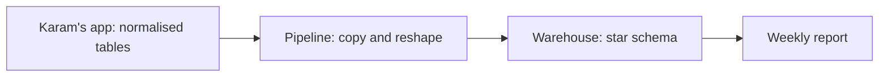

## Two jobs in one hour

At 10:00, Yasmin opens Karam's app and changes the area of market M03 from Harbour to Hill. The app changes one row and answers at once. At 10:05, Hala's weekly job starts. It reads all 2,620 accepted price reports, groups them by market and week, and writes 38 rows of weekly baskets. The app and the job use the same data, but they ask for opposite things.

Yasmin's change touches one record and must never leave the data in a half-changed state. Hala's job touches thousands of records and does not care about any single one. A table can be shaped to be good at the first job or at the second. It is hard to be the best at both with the same shape.

<BigWordAlert term="OLTP and OLAP" plainEnglish="OLTP is a system built for many small reads and writes of single records, like Karam's app. OLAP is a system built to scan and total many records, like Hala's weekly report." whyItMatters="The two jobs are shaped differently on purpose. Knowing which job a table serves tells you which design to expect, and which one to build." />

## The idea in plain words

Karam's tables follow the normalised design from chapter 4.1: each fact is stored once, in one place. The area of M03 lives in one cell of the `markets` table. A volunteer row points to a market by its code and does not copy the area. This has three benefits for the app. A change touches one cell. The data cannot contradict itself, because there is only one place to be wrong. And the tables stay small. We use the normalised idea only as far as it explains this trade-off; the formal rules are outside this course.

An analytical design is shaped for reading. Facts that are measured, such as a price, sit in one long table. The context around them, such as the market, the item and the date, sits in small tables beside it. The context may repeat a value on purpose, for example the area name in every row of a market. A common question needs few joins, the joins do not multiply rows, and the context can remember how it was on each day. DuckDB describes its own job in these terms: long-running queries over large parts of a dataset, and bulk loads.

At Mizan the two jobs already live in two places. The registry in SQLite is the app side: it holds the markets and the volunteers, and it changes one row at a time. The warehouse you build with DuckDB is the report side: it holds thousands of price reports and answers questions that add them up. The words OLTP and OLAP name the two kinds of job, and they do not name a product. The same tool can do either job, and a team can run both in one place if the load is small.

Neither design is better in general. The question to ask is what the table must do most. If it must change one record quickly and never contradict itself, choose the normalised shape. If it must answer many questions that add up thousands of records, and show history, choose the analytical shape.

## Predict, then try the canvas

The canvas scores two designs on four needs. The scores are teaching judgments for Mizan's tables. At the start, the weights describe Karam's app: quick single-row updates matter most, and the other needs are only nice to have. The normalised schema leads by 19 points to 16.

```predict
prompt: "At the start the normalised app schema leads, 19 points to 16. You raise the weight of 'Simple report queries' to Very important and leave the other weights as they are. Which design leads now?"
options:
  - id: normalised
    label: "The normalised app schema"
  - id: star
    label: "The star schema"
correctOptionId: star
explanation: "Simple report queries is a need where the star schema scores 5 and the normalised schema scores 2. At the highest weight, that criterion adds 15 points to the star and 6 to the normalised schema, so the star schema leads 26 to 23. The weight on a need decides which design wins, and not the design alone."
allowRetry: true
```

Change one weight at a time, and watch the totals and the leader.

<InteractiveCanvas slug="oltp-or-star" />

**What this shows:** each design has a score for each need, and each score is multiplied by how much the need matters. The totals show which design fits a given job. The same two designs win or lose depending on the weights.

**Try this:** raise Simple report queries to Very important and read the new leader. Then set it to Important and read the tie. Last, put it back to Nice to have and raise Quick single-row updates to Very important.

**What changed:** at Very important for report queries the lead flipped from the normalised schema to the star schema. At Important the totals were equal at 21 points, which means the weights alone cannot decide, and the job has to.

**Limits of the model:** the scores are judgments and not measurements, and the model treats them as exact. Real projects often keep both designs, so the question is rarely "which one" and more often "which one for this table".

## The same question in both designs

Take one question: what is the average price of flour in each area? Against the registry's current tables the query is short, because the area sits in the `markets` table.

```sql
SELECT m.area, COUNT(*) AS reports, ROUND(AVG(r.price), 2) AS avg_price
FROM clean_reports AS r
JOIN markets AS m ON m.market_code = r.market_code
WHERE r.item_code = 'I01'
GROUP BY m.area
ORDER BY m.area;
```

Here `clean_reports` stands for the 2,620 accepted reports, one line for each report. Run against the registry as it is today, it gives one answer. Run against the star schema from chapter 4.5, it gives another. There, each report is joined to the version of its market that was true on its day.

```text
area      today's registry        star schema with history
Central   56 reports   8.30       56 reports   8.30
Harbour   24 reports   8.00       35 reports   8.14
Hill      55 reports   8.35       44 reports   8.32
North     26 reports   9.10       26 reports   9.10
Old Town  28 reports   7.88       28 reports   7.88
South     27 reports   8.43       27 reports   8.43
```

Only two rows differ, and they differ because of one market. The registry puts all of M03's flour reports in Hill, including 11 made before the move. The star schema keeps those 11 reports in Harbour. Hala would not find the difference by reading the query, because both queries look correct. She finds it only because the second design remembers.

The diagram shows a common way to get both jobs done without choosing. The app keeps its normalised tables for its own work, and the pipeline copies the data into a second set of tables for reports.



Follow the arrows from left to right. The app changes data, and nothing in the report reads the app directly. Changes flow one way, from the app to the warehouse, on a schedule. This is the shape of the pipeline you build in this course. A slow report cannot slow the app, because the report reads the copy.

## Where people go wrong

**Running reports on the live app tables.** The first report works, so nobody changes it. Months later it needs history, or it runs while volunteers are saving data, and it gives wrong numbers or makes the app slow. A heavy question belongs on a copy.

**Copying everything into one flat table.** One big table with the area written in every row has no joins, and that feels simple. But when M03 moves, thousands of rows must change, and a missed row gives two areas for one market. Repeated values are a risk when the value can change.

**Believing one design is always right.** You will read opinions that star schemas are dead, and others that normalised tables are always best. Dimensional modelling is a widely used way to organise analytical tables, and other designs exist. Choose by the job.

**A copy that nobody refreshes.** The second set of tables is only as fresh as its last run. If the weekly job did not run, the report shows last week's world and looks perfectly normal. Module 9 schedules the run, and module 11 adds a check that raises an alarm when the copy is too old.

**Designing for speed at Mizan's size.** With 2,620 reports, almost any design runs in well under a second. The reasons to build a star schema here are clarity and history, not speed. Do not claim a speed gain without measuring it.

## The trade-off and the alternative

The cost of the second design is work. Someone must build and run the copy, test it, and keep it in step with the app. The benefit is that report questions become simple, and history is kept. If a project has one small table, a few hundred rows, and one reader, a single normalised table with a view may be enough. Choose the second design when many questions will be asked of the data, when history matters, or when the app and the reports compete for the same tables.

There is also a cost in people. A team that keeps two designs must teach both, and must say which one a question should use. A good habit is to write, next to each table, one line that says its job: "serves the app" or "serves reports". When a report is built on an "app" table, the line makes the risk visible before anyone is surprised by it.

## Try it on your data

Open `data/raw/registry.db` and list its tables. For each table, write one sentence: is its main job to change a record or to answer a question that adds up many records? Then do the same for the files `items.csv` and `market_history.csv`. You should find that the registry tables serve change, and that `market_history.csv` is already shaped a little like history for reports. Keep the sentences. You will use them in the gate.

## Check your understanding

```quiz
type: mcq
question: "Anas keeps a school's attendance. Teachers record attendance one student at a time, about 300 times a day. The head teacher reads one report each term, adding up 90,000 rows by class. A student can change class mid-term, and the head wants each day counted in the class the student had that day. Which design do the facts support?"
options:
  - "Normalised tables only, since one report a term is not worth a second design"
  - "A star schema only, with teachers typing each record straight into its fact table"
  - "One wide table for both jobs, since it has no joins to check or to get wrong"
  - "Normalised tables to record, and a star schema built from them for the report"
correct: 3
explanations:
  - "One report a term still adds up 90,000 rows and needs the class on each day. Tables that keep one row for each student have forgotten the old classes."
  - "Recording is 300 single-row entries a day, the job the normalised shape does best. A fact table built for adding up is not the place to type single records."
  - "A wide table repeats the class on each row. When a student changes class, many rows would need changes, and a missed row gives two classes for one student."
  - "Right. Recording is many small writes, so normalised tables fit it. The term report adds up many rows and needs the class on each day, so a star schema with history fits it. The pipeline copies from one to the other."
```

```quiz
type: mcq
question: "Ruba's pharmacy sheet repeats the supplier's phone number on each of its 5,000 stock lines. A supplier changes number. Ruba wants all 5,000 lines to show the new number, and she updates 4,800 of them before the power goes off. What do the facts show?"
options:
  - "The sheet holds two numbers for one supplier, and a report cannot tell which is right"
  - "Nothing is wrong, because the 200 old lines record what was true in the past"
  - "The fix is an index on the phone column, so the old lines are found quickly"
  - "Only the 4,800 changed lines are at risk, because the other lines did not change at all"
correct: 0
explanations:
  - "Right. The value is stored in 5,000 places, so one missed place means two answers. A normalised design stores the number once, so a single change cannot leave a mix."
  - "Ruba wanted all 5,000 lines to show the new number, so the 200 old lines are a mistake. They are not meant as history."
  - "An index finds rows quickly. It does not fix a wrong value, and the problem here is that the same fact is stored many times, not that it is slow to find."
  - "The 200 unchanged lines are the ones at risk. They still show the old number, and any report that reads them gives the wrong phone."
```

**Next:** Grain, facts and dimensions: how to state the grain first and design a star schema around it.
