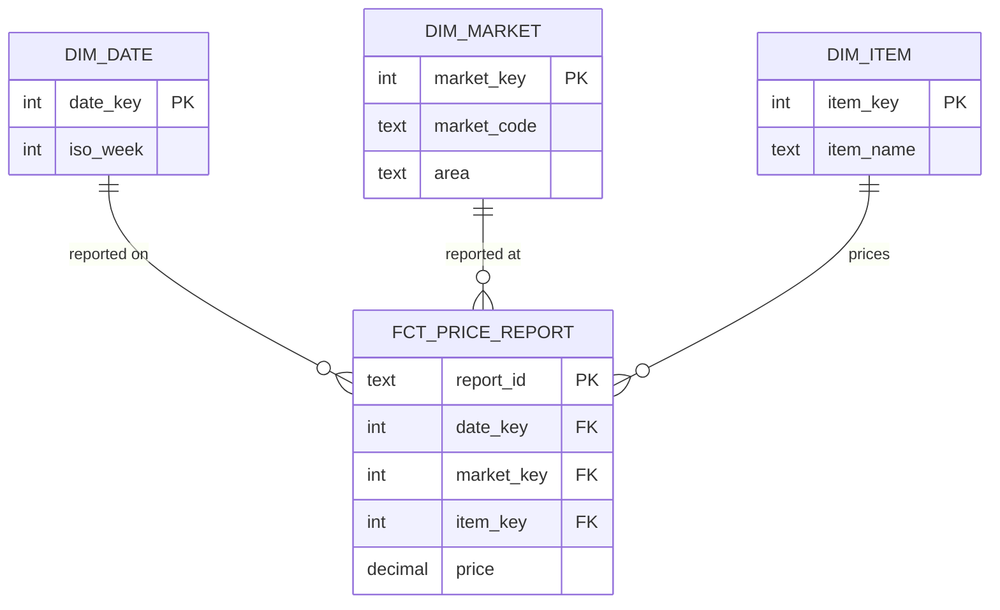

## Three answers to one question

Omar asks Hala for "a table of the weekly basket". Hala asks what one row should stand for. Omar's colleague says one row for each week. Karam says one row for each market and day. Yasmin says one row for each report, because she wants to see which volunteer sent a price. All three are reasonable, and the three tables are very different in size and in what they can answer.

You met the word grain in chapter 4.1. It is the sentence that finishes "one row in this table is one ...". This chapter shows how to choose it, and what follows from the choice. The method comes from Ralph Kimball and the Kimball Group, whose dimensional modelling is a widely used way to organise analytical tables. It has four steps: choose the business process, declare the grain, identify the dimensions, and identify the facts.

## The four steps for Mizan

The business process is the event you want to measure. At Mizan it is simple: a volunteer prices one item at one market, and the form sends a report. The second step is the grain, and Kimball calls it the pivotal one. Hala writes it as one sentence: one row is one accepted price report, with one `report_id`. Everything else must fit that sentence. If something does not fit, it belongs in another table.

The third step is the dimensions, the context of the event. A price report happens at a market, for an item, on a date. So Hala needs a market dimension, an item dimension and a date dimension. The fourth step is the facts, the numbers that the event measures. Here there is one: the price, in shekels. The volunteer's id stays in the fact table as a plain column. The personal details about volunteers must stay in the restricted zone, and a later chapter shows how a safe key replaces them.

A fact table holds the measurements and one key for each dimension. A dimension table holds the descriptions: the name and area of a market, the name and unit of an item, the week and weekday of a date. The date dimension solves the problem from chapter 3.3. It has one row for every day, so a missing day is a row with no facts and not a missing row. Kimball recommends the atomic grain, which is the finest level you capture. You can add up from fine detail, and you can never split a total back apart.

## Keys, stars and snowflakes

Each dimension row has a surrogate key, which is an anonymous integer that the warehouse assigns. It is not the market code. A natural key such as `M03` can repeat when you keep history, because a market with two versions has two rows and one code. The surrogate key is unique for each row, so the fact table points at one exact version. Chapter 4.4 uses this.

The star schema of chapter 4.1 is named for the shape of its picture: the fact table sits in the middle and the dimension tables surround it. If a dimension is split into secondary tables, for example the area moved into its own table, the result is called a snowflake. Kimball advises avoiding snowflakes, because they are harder for users and can hurt performance. When several fact tables share the same dimension with the same column names and meaning, the dimension is called conformed, and reports can combine the facts. Mizan has one fact table so far, so you only need the idea.

The diagram shows Mizan's star. The fact table sits in the middle, with one key for each dimension.



Read it from the dimensions toward the middle. Each line means that one dimension row can be linked to many fact rows, and each fact row links to exactly one row of each dimension. That is why a join from the fact table to a dimension never multiplies the rows: every key in the dimension is unique. Notice that the fact table has no market name, no area and no week. They are all one join away.

## Predict, then try the canvas

The canvas uses nine reports from market M02, for flour, rice and cooking oil on three days. It adds them up twice, to a day and then to a week, and asks at each step which questions can still be answered.

```predict
prompt: "The daily table says that flour, rice and oil together cost 33.0 shekels in M02 on 4 March. Can you read the price of flour on that day from this table?"
options:
  - id: cannot
    label: "No, many sets of prices give 33.0"
  - id: can
    label: "Yes, subtract the other two items"
correctOptionId: cannot
explanation: "The daily row holds only the sum. The prices of rice and oil are not in that table, so there is nothing to subtract. Many sets of three prices add up to 33.0. Once rows are added up, the detail is gone, and no query on the daily table can bring it back."
allowRetry: true
```

Step through the canvas and stop at each add-up.

<InteractiveCanvas slug="choose-the-grain" />

**What this shows:** the same nine reports at three grains. Each grain answers some questions and loses others, and adding up is a one-way step.

**Try this:** before step 3, predict whether the daily table can give the price of flour on 4 March. Then imagine a week with 5 days and the same average of 32.67, and name two different sets of daily costs that give it. Last, find the step where a question first becomes impossible.

**What changed:** after the first add-up, the question about flour was lost. After the second, the question about the cheapest day was lost. The weekly row is correct and it answers fewer questions.

**Limits of the model:** the example has nine reports and three items, and the real basket has twelve items. Coarser tables are still useful, since they are small and quick to read. Many teams keep both, and the finest table stays.

## A worked example: asking the star a question

With the star in place, a question about flour by area and week needs three joins, and each one uses a key that is unique in its dimension.

```sql
SELECT d.iso_week, m.area, COUNT(*) AS reports, ROUND(AVG(f.price), 2) AS avg_price
FROM fct_price_report AS f
JOIN dim_date AS d ON d.date_key = f.date_key
JOIN dim_market AS m ON m.market_key = f.market_key
JOIN dim_item AS i ON i.item_key = f.item_key
WHERE i.item_name = 'flour'
GROUP BY d.iso_week, m.area
ORDER BY d.iso_week, m.area;
```

Run on the prototype that you build in chapter 4.5, the result has 30 rows, one for each week and area. Their report counts add up to 216, the number of accepted flour reports. Here is week 11.

```text
iso_week  area      reports  avg_price
11        Central   14       8.21
11        Harbour   9        8.17
11        Hill      11       8.23
11        North     7        9.0
11        Old Town  7        7.93
11        South     6        8.5
```

The sum of 216 is the check. A join that multiplied rows would give more than 216. Week 11 runs from 9 to 15 March, and M03 moved on 12 March. Its reports from 9 to 11 March are counted in Harbour, and the later ones in Hill. One market, in one week, sits in two areas, and each report is in the area where its market was that day.

## Where people go wrong

**A fuzzy grain.** "One row for each market" sounds like a grain, but if the table has a row for every report, it is not true. When the sentence is not true, nobody knows what a total means. Write the sentence, then check it with a count: the number of rows should equal the number of things in the sentence. Here 2,620 rows equal 2,620 distinct accepted `report_id` values.

**Two grains in one table.** Suppose Hala adds a column with the market's total for the day to every report row. On 4 March, M02 has 12 reports and a day total of 135.5 shekels. Each of the 12 rows now carries 135.5, and `SUM` over that column gives 1,626.0, twelve times the real total. The table holds report rows and day totals at once. Keep totals in a separate table with its own grain.

**Descriptions inside the fact table.** If the fact table holds the area name, then a market that moves leaves old names in thousands of rows. Keep descriptions in dimensions and keep numbers and keys in the fact table.

**Using the natural key in a dimension with history.** `M03` appears in two rows after the move, so a join on the code alone doubles the reports. The surrogate key avoids this.

**Snowflaking early.** Splitting the area into its own table looks tidy. For a small star, it adds a join and gives readers one more place to make a mistake.

## The trade-off and the alternative

The finest grain costs space and time: 2,620 rows are more than 38 weekly rows. For Mizan the cost is tiny. For a table with billions of rows, teams often add a second table at a coarser grain, such as the weekly mart of module 7. Common reports then read the small table. The fine table stays as the source of truth. The alternative of storing only the coarse table saves space and gives up every question that you did not think of in advance. Keep the finest grain that you can afford to store.

## Try it on your data

Write the grain sentence for three tables: the fact table for price reports, the weekly basket table that Omar asked for, and a table of volunteers. Check each sentence with a count against the raw files. For the weekly basket, count the rows you expect for one market and one area. If the numbers do not match the sentence, change the sentence or the table, and write down which one you changed.

## Check your understanding

```quiz
type: mcq
question: "Hiba's water delivery round keeps these columns: delivery_id, household_id, delivered_at, litres and day_total_litres, which is that household's total for the day. A household got 3 deliveries of 60 litres on 5 March, so day_total_litres is 180 on each of its 3 rows. What is wrong with the table?"
options:
  - "Nothing is wrong: the sum of day_total_litres for that day is 180"
  - "The deliveries should be dropped, because 60 litres is too small to keep"
  - "The table mixes two grains, so the sum for that day is 540 and not 180"
  - "The household column needs its own dimension before any sum can be right"
correct: 2
explanations:
  - "The 180 is repeated on three rows, so adding the column for that household's day gives 3 x 180 = 540. The value is right on each row, and the sum is wrong."
  - "Deleting the delivery rows would destroy the finest grain. The three deliveries are the facts, and the day total is what should leave the table."
  - "Right. Each row stands for one delivery, but day_total_litres stands for a whole day. A sum over it counts the day three times. Keep the day total in a table with its own grain."
  - "A household dimension is useful, but it is not the fault here. Even with one, the repeated day total would still triple the sum."
```

```quiz
type: mcq
question: "Mazen's solar shop records the battery charge every 15 minutes. The owner asks for the daily average now. Later he may ask for the lowest reading of each day, or for the hour with the biggest drop. Which grain should the fact table have?"
options:
  - "One row for each day, holding the average charge of that day"
  - "One row for each reading, which means one row every 15 minutes"
  - "One row for each hour, holding the average charge of that hour"
  - "One row for each week, because the owner reads one report a week"
correct: 1
explanations:
  - "A daily average cannot give the lowest reading of the day or the hour of the biggest drop. Both are lost when the readings are averaged."
  - "Right. One row for each reading is the finest grain. The daily average, the lowest reading of a day and the hour with the biggest drop can all be built from it, and none of them can be built the other way round."
  - "An hourly average hides the lowest single reading, and it is too coarse to show a drop inside the hour. The daily average would still work, but two of the three questions would not."
  - "A weekly row answers neither the daily average nor the later questions. How often the owner reads a report does not decide the grain of the table."
```

**Next:** Slowly changing dimensions: how to keep the history of a market that moves, and join each report to the right version.
