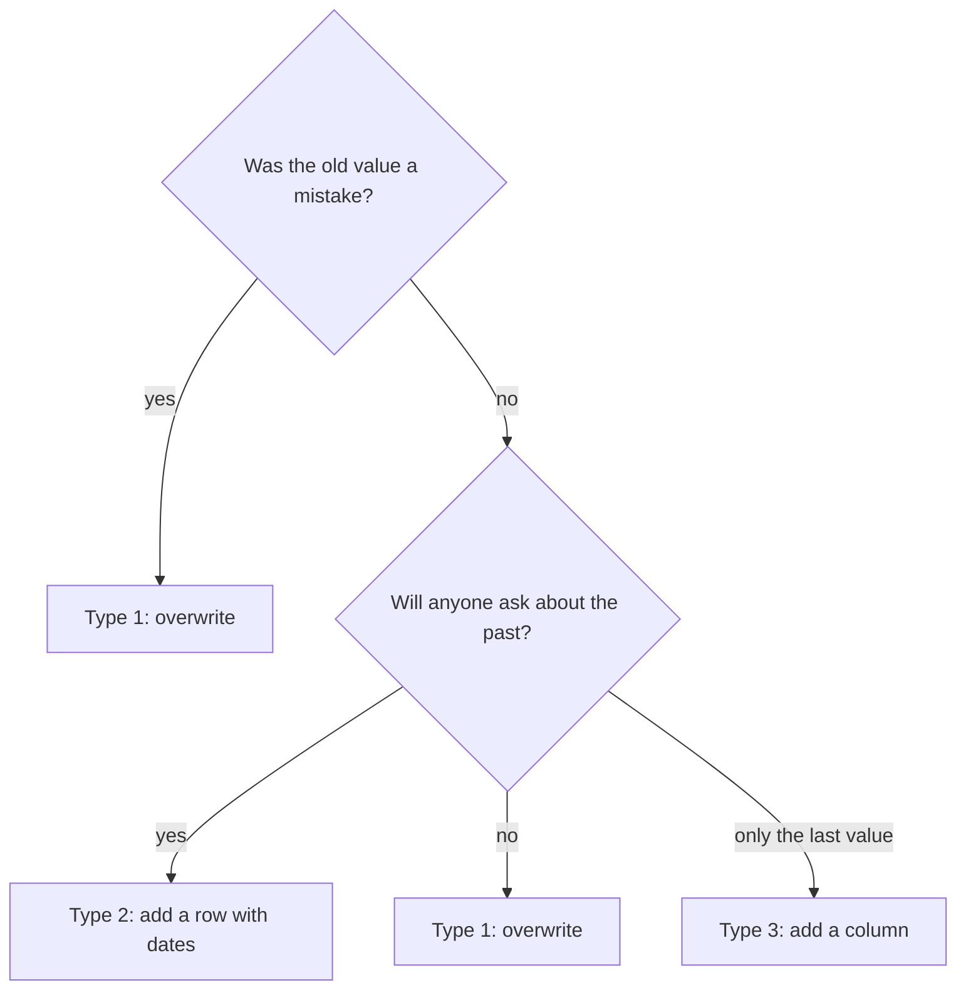

## The report that changed by itself

Omar sent the flour report for 1 to 11 March to the partner kitchens. In this example it said that the Harbour area had 20 flour reports, with an average price of 8.20 shekels, and that Hill had 11. On 12 March, Yasmin changed the area of market M03 from Harbour to Hill in the registry. The next day Omar ran the same report again for the same dates. It said Harbour had 9 flour reports and an average of 7.89, and Hill had 22. Nobody had changed a price. The numbers for the past had moved.

The cause is not a bug. The registry holds one area for each market, and the new value replaced the old one. Every report that joins to it now sees Hill for M03, even for days when M03 was in Harbour. This is the slowly changing dimension from chapter 4.1, and this chapter shows three ways to handle it.

## The three types

Kimball names the ways by number, and the plain version of each is short. Type 1 forgets the old value. It overwrites the cell, and the past is rewritten. Type 2 keeps every version as its own row, with dates. Type 3 keeps just one earlier value, in an extra column such as `previous_area`.

Type 2 is the one you will use most, so look at what it needs. Each version gets a new surrogate key, from chapter 4.3. Each row records when it was true: `valid_from` is the first day, and `valid_to` is the day it stopped being true. Kimball lists at least a row-effective date, a row-expiration date and a current-row indicator. In Mizan's design `valid_from` is included, `valid_to` is excluded, and `valid_to` is empty (`NULL`) on the current row, which `is_current` marks.

A fact joins to the version that was valid on its date. The report of 10 March joins to the Harbour row, because 10 March falls from the first day up to, but not including, 12 March. The report of 12 March joins to the Hill row. The rule is `valid_from <= date AND (valid_to IS NULL OR date < valid_to)`. Because the versions of one market never overlap, each report finds exactly one.

## Which type for which attribute

The choice depends on one question: does anyone need to ask about the past? M03's area is a real change in the world, and Omar's partner kitchens plan by area, so the area needs type 2. M06's opening days changed from every day to Saturday to Thursday on 20 March. A question such as "which days was M06 open when this price was reported?" is plausible in a data check, so the prototype keeps this change as a version too. If nobody would ever ask it, type 1 would be enough.

A typing mistake is different. If Yasmin finds that a market name has a wrong letter, the old name was never true. Overwriting it, type 1, is right, and a second row would only create a second name for one market. A short rule helps: use type 1 when the old value was a mistake, and type 2 when the old value was true and someone may ask about it. Use type 3 only when a single earlier value is enough, which is not often.

## Predict, then try the canvas

The canvas follows four flour reports of M03, made on 10, 11, 12 and 13 March. It shows how type 1 and type 2 count them by area.

```predict
prompt: "M03 moves from Harbour to Hill on 12 March. Four flour reports were made on 10, 11, 12 and 13 March. The dimension uses type 1, which overwrites the area. How many of the four reports are counted in Harbour?"
options:
  - id: two
    label: "Two, the ones made before the move"
  - id: none
    label: "None of the four"
correctOptionId: none
explanation: "Type 1 replaces Harbour with Hill in the one row for M03. Every report joins to that row and sees Hill, even those made on 10 and 11 March. The dimension has forgotten Harbour, so no query can count a report there."
allowRetry: true
```

Step through the two designs side by side.

<InteractiveCanvas slug="scd2-market-move" />

**What this shows:** the same market move stored in two ways. Type 1 changes the area in place, and all four reports say Hill. Type 2 adds a second row with dates, and each report joins to the row that was valid on its day.

**Try this:** before step 3, predict how many reports type 1 counts for Harbour. At step 5, imagine that the move happened on 13 March, and decide which reports would get the new key. Last, find the step where history is lost and the step where it is kept.

**What changed:** under type 1 the count for Harbour fell from two reports to none. Under type 2 it stayed at two, and Hill got the other two. Type 2 paid for this with one extra dimension row.

**Limits of the model:** four reports and one market keep the picture small. The dates here are whole days, so a change at 09:00 on 12 March counts for the whole of that day. A real dimension has to decide where the first row's start date comes from.

## A worked example: the version valid on a date

Here is the rule on two reports and the two M03 versions, as a small query you can run in DuckDB. The `VALUES` lists stand in for the fact and dimension tables.

```sql
SELECT r.report_id, r.day, m.market_key, m.area
FROM (VALUES ('r-000895', DATE '2026-03-10'), ('r-001073', DATE '2026-03-12')) AS r(report_id, day)
JOIN (VALUES (3, 'M03', 'Harbour', DATE '2026-03-01', DATE '2026-03-12'),
             (4, 'M03', 'Hill',    DATE '2026-03-12', NULL))
     AS m(market_key, market_code, area, valid_from, valid_to)
  ON m.market_code = 'M03'
 AND r.day >= m.valid_from
 AND (m.valid_to IS NULL OR r.day < m.valid_to)
ORDER BY r.report_id;
```

```text
report_id   day         market_key  area
r-000895    2026-03-10  3           Harbour
r-001073    2026-03-12  4           Hill
```

Each report found one row. The report of 12 March did not match key 3, because key 3 ends on 12 March and the end is excluded. In the prototype of chapter 4.5 the whole table for markets has 10 rows. Eight markets have one version, and M03 and M06 have two each. Of M03's 327 accepted reports, 128 belong to Harbour, from 1 to 11 March, and 199 to Hill, from 12 March on.

The first version of each market starts on 2026-03-01 in the prototype, because `market_history.csv` states when each market began to look as it did. A pipeline that only starts watching later cannot know this. In chapter 7.4 you will see a snapshot that starts the first version of each market at 1900-01-01 for that reason.

The diagram below is a small decision tree for choosing the type. Read it from the top for each attribute of a dimension.



Notice that two different paths end in type 1, for opposite reasons. In one, the old value was wrong. In the other, nobody cares about it. The tree asks about people and questions, not about technology.

## Where people go wrong

**Joining on the code alone.** The canvas ended with this near miss. Joining the reports to the dimension on `market_code` alone matches every report of M03 to both versions. Four reports become eight rows, and sums double. The join must also test the date, or use the surrogate key that was chosen at load time.

**Overlapping dates.** If one version ends on 12 March and the next starts on 11 March, a report of 11 March matches both. Test that no two versions of one market overlap, and that each market has exactly one current row.

**A date before the first version.** If a report is dated before the first `valid_from`, an inner join finds no row and drops the report without a warning. Make the first version start early enough, and check that the fact count did not change after the join.

**Type 2 for everything.** An attribute that changes every day, such as a price, would add a row every day. Fast-changing numbers belong in the fact table as measurements. Keep type 2 for attributes that change rarely and describe something.

**A change that arrives late.** Suppose Yasmin records the move on 16 March, for a move that happened on 12 March. The facts of 12 to 15 March were already loaded with the old key. A normal run that only reads the last few days will not fix them. Chapter 8.4 shows the backfill that does.

## The trade-off and the alternative

Type 2 costs rows and a more careful join. Type 1 is simple and loses history. Type 3 is cheap and keeps only one past value. There is also a fourth way: copy the area into each fact row when it is loaded. That freezes the history without versions, but it repeats the value in thousands of rows, and a correction later must change them all. For a handful of changing attributes, a type 2 dimension is usually the cleaner choice.

## Try it on your data

Open `data/raw/market_history.csv`. It has 10 rows. Check three things by eye or with a query. Each market has at least one row. For M03 and M06, the `valid_to` of the first version equals the `valid_from` of the second. And exactly one row for each market has an empty `valid_to`. Then pick one more attribute from the items or the volunteers, and write down in one line which type you would give it and why.

## Check your understanding

```quiz
type: mcq
question: "Lama's bakery chain keeps shops in a dimension. In March two things happen. A typo is found: shop 7 was entered as 'Hayy Alzahra' but its sign says 'Hayy Al Zahra'. And shop 4 moves from the north district to the south district. The owner wants district sales by month to show where each sale really happened. Which handling fits?"
options:
  - "Overwrite the typo, and add a new row for shop 4's district"
  - "Add a new row for the typo, and overwrite shop 4's district"
  - "Overwrite both, because the owner only reads the current names"
  - "Add a new row for both, because every change must be kept"
correct: 0
explanations:
  - "Right. The typo was never true, so overwriting it is correct. The move is a real change, and the owner wants sales counted where they happened, so shop 4 needs a second row with dates."
  - "This is backwards. A new row for the typo keeps a wrong name as if it were a version, and overwriting the district would move old sales to the south."
  - "The owner asked for district sales that show where each sale really happened. Overwriting the district puts every old sale of shop 4 in the south."
  - "A new row for the typo gives shop 7 two names, so it appears as two shops in reports. Not every change is worth keeping; a mistake is better fixed in place."
```

```quiz
type: mcq
question: "A market dimension has two rows for M03. Key 3: Harbour, valid_from 2026-03-01, valid_to 2026-03-12. Key 4: Hill, valid_from 2026-03-12, valid_to empty. The valid_to date is not part of the range. A report is dated 2026-03-12. Which key does it get?"
options:
  - "Key 3, because 12 March is the last day of the Harbour version"
  - "Both keys, so the report appears twice in the fact table"
  - "No key, because 12 March falls in a gap between the versions"
  - "Key 4, because the end date of key 3 is not part of its range"
correct: 3
explanations:
  - "The stem says valid_to is not part of the range. Key 3 covers up to 11 March, and 12 March is the first day of key 4."
  - "The ranges do not overlap. Key 3 ends before 12 March and key 4 starts on it, so only one key matches."
  - "There is no gap. Key 3 ends where key 4 begins, so every date from 1 March onward finds exactly one version."
  - "Right. Key 3 covers 1 March up to, but not including, 12 March. Key 4 starts on 12 March, so the report gets key 4 and appears once."
```

**Next:** Build the star schema: write the schema and the loading SQL for Mizan's dimensions and fact table, with tests.
