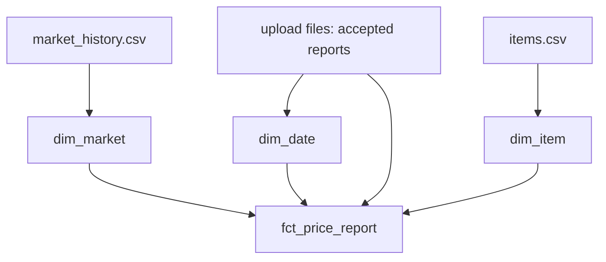

## What the project cannot do yet

Omar's question about the flour price for each area and week still needs five joins and a lot of care. Every query repeats the same checks, and a wrong join gives wrong numbers without any warning. The raw files hold everything Hala needs, but they are shaped for the app and the phone form, and not for the report.

By the end of this chapter your project has a small star schema in a DuckDB file, built only from the raw files with two SQL files that you write. It has a fact table with one row for each accepted price report, and three dimensions: market with history, item and date. Eight tests check the grain, check the history of the market that moved, and check that running the build twice gives the same result. You need your laptop, about 100 minutes, and the project from chapter 3.5 with its tests passing.

## Where the repository is now

You have the generator, the raw data in `data/raw`, the test helper from chapter 2.5, the drills `d01` to `d10`, and the scripts of chapter 3.5. Nothing there changes. You add two SQL files, one script and one test file.

```text
mizan-prices/
  sql/schema.sql                  you write
  sql/load_prototype.sql          you write
  scripts/build_prototype.py      given in full below
  tests/test_star_schema.py       given in full below
  prototype.duckdb                created by the script (ignored by git)
```

## The design decision

This chapter builds the star in plain SQL, before you meet dbt in module 7. That is deliberate. Writing the keys, the dates and the join yourself shows you what the tool will later do for you. The prototype uses integer surrogate keys, numbered with a window function, and it takes the true start date of every market version from `market_history.csv`.

The dbt version in chapter 7.5 differs in two ways, and you should know why now. Its surrogate keys are text hashes, not integers, because a numbering made with `ROW_NUMBER` would change whenever a new market version appears, and that would break an incremental fact table. And the first version of each market starts at 1900-01-01, because a snapshot cannot know how long a market had looked that way before it began to watch. The alternative to a prototype is to start directly in dbt. That is faster for an expert, and it hides the choices from a learner.

The diagram shows the load order. The dimensions come first, because the fact table needs their keys.



Look at the arrows into the fact table. There are four, one for each dimension and one for the reports themselves. If any one of them fails to match, a report is lost or doubled, and the tests are built to notice.

## The task

Write `sql/schema.sql`, which creates the four tables, and `sql/load_prototype.sql`, which fills them. The grain of the fact table is this: one row is one accepted price report, with one `report_id`. A report is accepted when its price is above 0, its item code is not empty, and it is the latest send of that `report_id`. Give each table the columns below, with these names and types.

| Table | Column | Type | Notes |
|---|---|---|---|
| `dim_market` | `market_key` | INTEGER | primary key |
| | `market_code` | VARCHAR | not null |
| | `name`, `area`, `opens` | VARCHAR | |
| | `valid_from` | DATE | not null, included in the range |
| | `valid_to` | DATE | excluded from the range, NULL on the current row |
| | `is_current` | BOOLEAN | not null, true when `valid_to` is NULL |
| `dim_item` | `item_key` | INTEGER | primary key |
| | `item_code` | VARCHAR | not null, unique |
| | `item_name`, `category`, `unit` | VARCHAR | |
| `dim_date` | `date_key` | INTEGER | primary key, like 20260301 |
| | `date` | DATE | not null, unique |
| | `iso_year`, `iso_week` | INTEGER | |
| | `weekday` | VARCHAR | for example Sunday |
| `fct_price_report` | `report_id` | VARCHAR | primary key |
| | `date_key`, `market_key`, `item_key` | INTEGER | not null, each refers to its dimension |
| | `volunteer_id` | VARCHAR | a plain column, not a dimension |
| | `price` | DECIMAL(8, 2) | not null |
| | `reported_at`, `uploaded_at` | TIMESTAMP | plain UTC timestamps |

## The constraints

The files run in DuckDB 2.0.0 from the project folder, so paths such as `data/raw/market_history.csv` are relative. The loader reads only the raw files: `data/raw/market_history.csv`, `data/raw/items.csv` and the upload files in `data/raw/uploads`.

Load the dimensions first. In `dim_market` every version of every market becomes a row, and an empty `valid_to` in the CSV becomes `NULL`. Number the keys in a fixed order, for example by market code and then by `valid_from`, so that the same input always gives the same keys. `dim_date` has one row for every calendar day from the first to the last report date, 28 rows for this data.

Load the fact table last. Each report joins to the market version that was valid on the date of the report, and to its item and its date. Declare the primary key and the foreign keys in the schema, so DuckDB itself refuses an orphan fact or a repeated report.

The two timestamp columns need care. DuckDB reads `2026-03-01T23:30:00Z` as a timestamp with a time zone, and casting it to a date uses the time zone of the computer. A report made at 23:30 UTC could land on the next day on some machines. Convert each of the two columns once, with `timezone('UTC', column)`, before you take any date from it, so that no result depends on the computer. If your laptop has 4 GB of memory, you can also put `SET memory_limit = '2GB';` on the first line of `sql/schema.sql`. The value is a safe choice for this course and not a rule from the documentation.

## The build script, given in full

This script is only a runner. It removes the old file, creates the tables from your schema, loads them from your loader, counts the rows and prints them. Removing the file first means that running it twice gives the same result. Create `scripts/build_prototype.py`.

```python
"""Build prototype.duckdb: create the star schema and load it from the raw files.

Run from the project folder:  python scripts/build_prototype.py
"""
from pathlib import Path

import duckdb

DATABASE = Path("prototype.duckdb")
TABLES = ["dim_market", "dim_item", "dim_date", "fct_price_report"]


def build():
    DATABASE.unlink(missing_ok=True)  # start clean, so running twice gives the same result
    con = duckdb.connect(str(DATABASE))
    con.execute(Path("sql/schema.sql").read_text())
    con.execute(Path("sql/load_prototype.sql").read_text())
    counts = {table: con.execute(f"SELECT count(*) FROM {table}").fetchone()[0] for table in TABLES}
    con.close()
    return counts


if __name__ == "__main__":
    for table, count in build().items():
        print(f"{table}: {count} rows")
```

## The acceptance tests

Create `tests/test_star_schema.py` with this content. The fixture `prototype` makes the data, runs your build script in a temporary copy of the project and opens the result read-only. The fixture `project` comes from the helper of chapter 2.5.

```python
"""Chapter 4.5: the star schema prototype."""
import json
from pathlib import Path

import duckdb
import pytest


@pytest.fixture
def prototype(project):
    project.make_data()
    project.python("scripts/build_prototype.py")
    con = duckdb.connect("prototype.duckdb", read_only=True)
    yield con
    con.close()


def test_row_counts(prototype):
    counts = {t: prototype.execute(f"SELECT count(*) FROM {t}").fetchone()[0]
              for t in ["dim_market", "dim_item", "dim_date", "fct_price_report"]}
    assert counts == {"dim_market": 10, "dim_item": 12, "dim_date": 28, "fct_price_report": 2620}


def test_one_current_row_per_market(prototype):
    rows = prototype.execute("SELECT market_code, count(*) FROM dim_market WHERE is_current GROUP BY 1").fetchall()
    assert len(rows) == 8 and all(count == 1 for _, count in rows)
    # is_current must agree with valid_to being empty
    assert prototype.execute("SELECT count(*) FROM dim_market WHERE is_current <> (valid_to IS NULL)").fetchone()[0] == 0


def test_no_overlapping_validity_ranges(prototype):
    overlaps = prototype.execute("""
        SELECT count(*) FROM dim_market a JOIN dim_market b
          ON a.market_code = b.market_code AND a.market_key < b.market_key
         AND a.valid_from < COALESCE(b.valid_to, DATE '9999-12-31')
         AND b.valid_from < COALESCE(a.valid_to, DATE '9999-12-31')
    """).fetchone()[0]
    assert overlaps == 0


def test_every_fact_matches_exactly_one_market_version(prototype):
    bad = prototype.execute("""
        SELECT count(*) FROM (
            SELECT f.report_id, count(*) AS versions
            FROM fct_price_report f
            JOIN dim_date d ON d.date_key = f.date_key
            JOIN dim_market m ON m.market_key = f.market_key AND d.date >= m.valid_from AND (m.valid_to IS NULL OR d.date < m.valid_to)
            GROUP BY 1 HAVING count(*) <> 1)
    """).fetchone()[0]
    assert bad == 0
    assert prototype.execute("SELECT count(*) FROM fct_price_report").fetchone()[0] == 2620


def test_fact_report_id_is_unique(prototype):
    assert prototype.execute("SELECT count(*) - count(DISTINCT report_id) FROM fct_price_report").fetchone()[0] == 0


def test_m03_facts_follow_the_market_when_it_moved(prototype):
    rows = prototype.execute("""
        SELECT m.area, min(d.date), max(d.date), count(*)
        FROM fct_price_report f
        JOIN dim_market m ON m.market_key = f.market_key
        JOIN dim_date d ON d.date_key = f.date_key
        WHERE m.market_code = 'M03' GROUP BY m.area ORDER BY min(d.date)
    """).fetchall()
    assert [r[0] for r in rows] == ["Harbour", "Hill"]
    assert str(rows[0][2]) == "2026-03-11" and str(rows[1][1]) == "2026-03-12"


def test_fact_count_equals_distinct_good_report_ids(project, prototype):
    good = set()
    for path in Path("data/raw/uploads").glob("*/*.jsonl"):
        for text in path.read_text().splitlines():
            row = json.loads(text)
            if row["price"] > 0 and row["item_code"]:
                good.add(row["report_id"])
    assert len(good) == 2620
    assert prototype.execute("SELECT count(*) FROM fct_price_report").fetchone()[0] == len(good)


def test_running_the_build_twice_gives_the_same_counts(project):
    project.make_data()
    first = project.python("scripts/build_prototype.py").stdout
    second = project.python("scripts/build_prototype.py").stdout
    assert first == second
```

## Why each test exists

The test `test_row_counts` is the first guard, and it is also a design check. The market dimension has 10 rows because 8 markets exist and two of them have a second version. The date dimension has 28 rows, one for each day. The fact table has 2,620 rows: 2,633 distinct reports minus 13 bad rows. If a count is wrong, the others usually are too, so read this failure first.

The test `test_one_current_row_per_market` checks that every market has exactly one current row, and that the flag `is_current` always agrees with an empty `valid_to`. Two current rows would mean that a market is in two places at once. A flag that disagrees with the dates would mean that two parts of your own table tell different stories.

The test `test_no_overlapping_validity_ranges` joins the market dimension to itself and counts versions of one market whose date ranges overlap. It must be zero. Overlap is the mistake that a type 2 table invites, and it would make one report match two versions.

The test `test_every_fact_matches_exactly_one_market_version` joins each fact to its date and to the market row that its key points at, and adds the date range condition. It looks for facts that match more than one row, and it must find none. The fact total must also stay at 2,620. This guards against a dimension with a repeated key and against a load that multiplies or loses reports. Be careful about what it cannot see: a fact that points at the wrong version simply matches no row, and so it does not appear in the count. The M03 test, two tests later, catches that mistake for M03.

The test `test_fact_report_id_is_unique` counts rows minus distinct report ids. The primary key should already make it zero. The test is there for the case where the key was forgotten in the schema.

The test `test_m03_facts_follow_the_market_when_it_moved` reads the story back from the data. It groups M03's facts by area and expects Harbour first and Hill second, with the last Harbour day on 11 March and the first Hill day on 12 March. This is the test that proves the history works for a real market. It is also the only test that fails if every fact is given the current version of its market. It checks M03 only, so a mistake that affects M06 alone would pass all eight tests.

The test `test_fact_count_equals_distinct_good_report_ids` does not trust your SQL. It reads the JSON files with Python, counts the distinct report ids that have a positive price and an item code, and compares the result with the fact table. Two different routes to the same number is a strong check.

The test `test_running_the_build_twice_gives_the_same_counts` runs the script twice and compares what it prints. A pipeline that gives different counts on a rerun is unsafe, and chapter 6.3 explains why in depth.

## Build it

1. Create `scripts/build_prototype.py` and `tests/test_star_schema.py` from the two blocks above.
2. Write `sql/schema.sql` with the four tables, the primary keys and the foreign keys.
3. Write `sql/load_prototype.sql`: the two small dimensions first, then the accepted reports, then `dim_date`, then the fact table.
4. Run the build script by hand and compare the four counts.
5. Run the eight tests.
6. Optional: add a ninth test of your own, with the same idea as the M03 test, for M06. Its reports before 20 March must point at the version with opening days `daily`, and its reports from 20 March must point at `Sat to Thu`.

Run the build from the project folder. The command is the same in PowerShell and in bash.

```bash
python scripts/build_prototype.py
```

Then run the tests.

```bash
pytest -q tests/test_star_schema.py
```

## What you should see

The build prints one line for each table. If your numbers differ, start with the table whose count is wrong.

```text
dim_market: 10 rows
dim_item: 12 rows
dim_date: 28 rows
fct_price_report: 2620 rows
```

The tests end with eight dots and a count. The time changes from machine to machine, and building the data takes most of it.

```text
........                                                                 [100%]
8 passed in 11.89s
```

## One failure on purpose

Remove the date conditions from the join that fills the fact table, so that it matches a report to a market only by the market code. Run the build script. For M03 and M06, every report now matches two versions, and the second one would repeat a `report_id`. Because you declared the primary key, DuckDB stops the load with an error like this one. The report id in your message may differ.

```text
_duckdb.ConstraintException: Constraint Error: PRIMARY KEY or UNIQUE constraint violation: duplicate key "r-001980"
```

The tests then report errors as well, because the fixture cannot build the prototype. Without the primary key, the load would have succeeded and given 3,271 rows. That is the same fan-out as in chapter 2.2, and `test_row_counts` would catch it. Put the conditions back and run all eight tests again.

## If you are stuck

Read one hint at a time. First, make the dimensions before the fact table, and check each count before you move on: 10, 12 and 28. Second, you already know how to number rows. A window function from chapter 3.2 gives each row of `dim_market` an integer, and the same pattern keeps the latest send of each report. Third, build the list of accepted reports once as a temporary table and reuse it for `dim_date` and for the fact table.

Then run one check. Count the fact rows after the join. If the count is above 2,620, some reports matched two market versions, so look at the date conditions. If it is below 2,620, some reports matched none, so look for a date before the first `valid_from` or for the wrong comparison at the end date. If the count is 2,620 and `test_m03_facts_follow_the_market_when_it_moved` fails, the dates are right but the end of the range is wrong by one day.

## Commit your work

Run all the tests of the project once more, then commit the two SQL files, the script and the test file. A suitable message is: "Add star schema prototype with market history and tests". Do not commit `prototype.duckdb`; it is a build result and your `.gitignore` already skips it.

**Next:** A short quiz on grain, star schemas and slowly changing dimensions.
