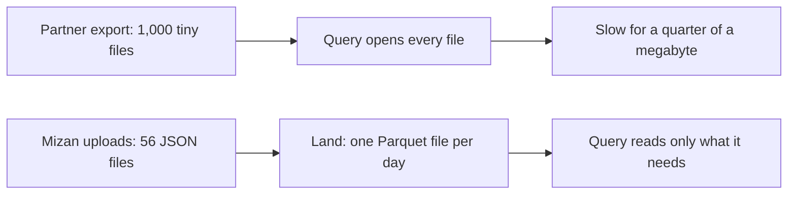

<BigWordAlert term="Parquet" plainEnglish="A file format for tables. It stores each column on its own, and it writes the smallest and largest value of each block of rows in the footer of the file." whyItMatters="A query can read only the columns it needs and skip blocks that cannot match, so a Parquet file is usually cheaper to query than the same rows as text. How much cheaper depends on your data, so you measure it." />

## A thousand small files

Hala is 26. She works part time and remotely as Mizan's junior data engineer, and she plans her work around the hours when the power is on at home. On a Tuesday evening she has four hours of power and one task. A partner has sent a folder of prices, and Omar wants them in the weekly comparison. Hala, Omar, Yasmin and everyone else in this module are fictional, and all the data is synthetic.

The partner is a network of community kitchens. Its price tool writes one file for every price note, and it sent the whole folder. There are 1,000 files, named report-0000.json to report-0999.json. Each file holds one report, between 252 and 257 bytes of text. Hala adds up the sizes and gets 254,399 bytes. That is about a quarter of a megabyte, so she expects any query to finish at once.

She runs a DuckDB query that counts the rows in all the files. It returns 1,000, and it works, but it feels slow for so little data. To find out why, she puts the same 1,000 lines into one file. That file is 255,398 bytes: the same text, with a line break between reports. She runs the same query on it. The single file is faster every time she tries. The folder is slowest the first time she reads it, and a little quicker after that.

Nothing is wrong with the data. The difference is the number of files. To read the folder, the engine must find each file, open it, read a few hundred bytes and close it, 1,000 times. Opening a file has a cost that does not depend on how big the file is. Here the opening costs more than the reading. This is called the small-files problem, and you will meet it again in every chapter of this module.

Hala writes to Omar before she goes further. She does not tell him about files and footers. She tells him that the partner's tool saves each price note as its own file. Her laptop must open every one of them. She will fix the layout before she adds the prices to the comparison. Omar can repeat that sentence to the kitchens, and it is true. A clear sentence for a non-technical reader is part of the job, and it only works when you know the real cause.

```predict
prompt: "The partner folder is only 254 kilobytes in total. Hala runs the same query on the folder and on one file that holds the same 1,000 lines. Which one is slower, and why?"
options:
  - id: many-files
    label: "The folder: it opens 1,000 files"
  - id: same-size
    label: "Neither: both hold the same 254 kilobytes"
correctOptionId: many-files
explanation: "The folder is slower. The text is the same size, but the engine must find, open and close 1,000 files instead of one, and that fixed cost is paid per file. The rest of this chapter shows why Mizan's own files need the same care, even though they are fewer."
allowRetry: true
```

## Mizan's own files

Hala looks at Mizan's raw folder next. The phone form uploads JSON lines, which means one report on each line. After 28 days there are 56 files in 28 folders, 2,712 lines and about 716 kilobytes in total. That is nothing like 1,000 tiny files, and queries over it are fast enough today. But Hala sees three other costs in the way the data is stored.

The first cost is the text itself. A JSON file has no stored types and no summary of what is inside it. Every query reads every line and picks apart every field, even when Omar's question needs only the market, the item and the price. The volunteer's name and phone number are read too, although the weekly report never shows them.

The second cost is risk. The names and phone numbers sit in the same files as the prices, so anyone who can read prices can read personal data. The third cost is that nothing in the layout helps a rerun. If the landing job runs twice for one day, nothing says which copy is the right one. Hala wants a layout where the answer is simple: one file for each day, and a rerun replaces it.

The diagram shows both stories side by side. On the top row is the partner's folder, where the size is small and the cost is the number of files. On the bottom row is the layout Hala wants for Mizan, where a day's reports are written once, as one file, and a query reads only what it needs.



What to notice: in both rows the data is the same kind of thing, a few thousand price reports. The only difference is the decisions about the files. The top row made none on purpose, so the tool's easiest choice, one report in one file, became the layout. The bottom row is a set of choices that Hala makes deliberately, and this module teaches them one by one.

## What a data engineer decides about storage

When you store data for analysis, you decide four things. You choose a file format, such as JSON lines or Parquet. You choose how files are grouped into folders, which is called partitioning. You choose how large each file should be. And you choose what kind of system holds them: plain folders of files, a database engine, or something in between. A tool that writes the data for you usually makes all four choices by default. The defaults suit the tool's author, not the person who queries the data later.

Each decision changes something a person feels later. The format decides how much of each file an engine must read. The grouping decides what a query can skip without opening it. The file size decides how many files exist, and so how much opening there is. The kind of system decides who may change the data and how safely. These are different questions, and a layout that is good for one can be bad for another, so each one needs its own reason.

A file format also has limits, and a pipeline that does not count rows will not notice them. The next case is a real one. It is here because the lesson is the same as Hala's: a format is a choice, and a choice has a limit.

<RealWorldEvent title="Cases lost to a file format limit" when="25 September to 2 October 2020, England" summary="Test results were passed as text files and loaded into spreadsheet templates in an older file format. Each template held about 65,000 rows, and each test used several rows, so once a template was full, further cases were left out. About 16,000 confirmed cases were missed from the daily figures. They were added later, but the people who had been in contact with them were not traced as quickly." lesson="A file format has limits. Count the rows that go into each stage and the rows that come out, so a limit shows up as a difference in the counts." />

At Mizan the risk is smaller, but the habit is the same. By the end of this module the landing job prints how many rows it wrote, and a test checks that this number equals the lines in the day's files. A wrong layout does not announce itself. It shows up as a slow query, a doubled day or a missing batch, and by then the cause is far from the symptom.

## Why this matters for the job

A freelance client or a new team may hand you a folder of exports, and the first question is how to store it. You need to say what format you would use, how you would group the files and why. A slow query often traces back to these four decisions. If you can explain a layout with numbers from your own data, you can defend it.

There is a practical reason to learn this on a small laptop. A habit of counting files and bytes, and of asking an engine for its plan, costs nothing and works offline. It also shows you the effect of a decision at a size where you can see every file. The same reasoning holds when the data is a thousand times larger, although the numbers you would choose are different.

This is also a part of the job where you can check yourself. You do not have to take a rule on trust. You can write a file, look at its footer, ask the engine for its plan and count the files it opens. The module is built on that: every claim comes with a command you can run on Mizan's data on your laptop.

## What this module covers

Chapter 5.2 explains how a table is stored by rows or by columns, and what is inside a Parquet file. Chapter 5.3 shows how to group files into partitions, how big files should be, and what compression does. Chapter 5.4 describes lakes, warehouses and lakehouses, and what a table format adds to plain files. In chapter 5.5 you write the landing job that turns each upload day into one Parquet file, safe to rerun. Chapter 5.6 is a practice check, and chapter 5.7 is the gate, where you defend a partitioning choice with numbers.

Hala keeps the same rule through all of it. Every choice must come with a reason that she can state in one sentence and check with a number. That is also what a reviewer or an interviewer asks for.

<LearningObjectives items={["Explain why a thousand tiny files are slower to query than one file with the same rows", "Say how a column layout and a Parquet footer let an engine skip data", "Choose a partition key and a file size for the queries you expect", "Tell a lake, a warehouse and a lakehouse apart, and say what an open table format adds", "Write a landing job that turns one upload day into one Parquet file and is safe to rerun"]} />

## Key words

| Word | Plain English |
|---|---|
| **Partition** | A folder that holds one slice of a dataset, such as one day, so a query can skip the other folders |
| **Row group** | A block of rows inside a Parquet file, stored column by column |
| **Footer** | The summary at the end of a Parquet file that lists its blocks and their smallest and largest values |
| **Compression** | A way of storing the same values in fewer bytes, with a method called a codec |
| **Small-files problem** | Many tiny files make a query slow because each one must be found, opened and closed |

## What is in this module

| Chapter | You will practise |
|---|---|
| 5.2 | Reading a Parquet footer and seeing which blocks a query skips |
| 5.3 | Choosing a partition key and a file size, and counting files in a plan |
| 5.4 | Choosing between a lake, a warehouse and a lakehouse |
| 5.5 | Landing one upload day as Parquet, safe to rerun, with tests |
| 5.6 | A practice check with five cases |
| 5.7 | Defending a partitioning choice with numbers |

**Next:** How a table is stored by rows or by columns, and what is inside a Parquet file.
