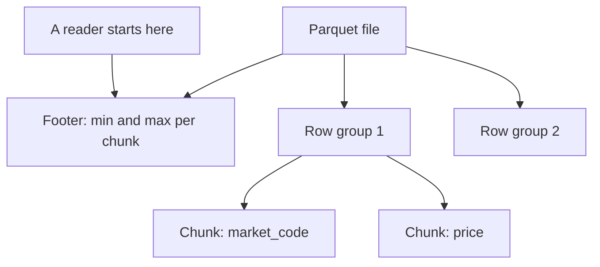

## A question that needs three columns

Omar asks Hala a short question: what is the average price of flour at each market? Hala knows what the query needs. It needs the market code, the item code and the price. That is three columns. The JSON lines that the phone form uploads hold nine fields in every report, and DuckDB adds a tenth column, the upload date, from the folder name. The other seven columns are never used, but the engine still reads them.

JSON has another cost. Each line is text, so the engine must pick apart every field name and every value on every line before it can throw the unneeded ones away. The volunteer's name and phone number are among the longest fields on the line, and Omar's question never touches them. Hala is paying to read personal data that she does not want to use.

A file format can avoid this by storing a table differently. In a row layout, the file holds report 1 completely, then report 2 completely, and so on. To get one column you must walk through every row. In a column layout, the file holds all the prices together, then all the market codes together, then all the item codes. To get three columns, the engine reads three blocks and ignores the other seven.

The choice is not new. A database that serves an app, like Karam's SQLite registry, stores rows, because the app reads and changes one whole record at a time. An analytics engine usually answers questions about a few columns of many rows, so it benefits from storing columns. Parquet is a file format that does this, and DuckDB reads and writes it without any extra installation.

```predict
prompt: "A table has 10 columns of the same width, and a query uses 3 of them. A row layout reads whole rows. About how much of the table does a column layout have to read?"
options:
  - id: all
    label: "About all of it, because the rows are the same"
  - id: three-tenths
    label: "About 3 tenths of it"
correctOptionId: three-tenths
explanation: "A column layout stores each column on its own, so the query reads the 3 columns it needs and skips the other 7. With equal-width columns that is 3 tenths of the table, and 7 tenths is skipped. A row layout cannot skip anything, because each row holds all 10 columns together. The canvas lets you change the numbers."
allowRetry: true
```

The canvas below uses a toy rule: every column is the same width, and nothing is compressed. Set it to Mizan's table after a few years, 10 columns and 2 million rows, and see what each layout must read.

<InteractiveCanvas slug="row-vs-column-read" />

**What this shows:** the data a row layout and a column layout must read for one query, under a simple equal-width rule. The row layout always reads every column. The column layout reads only the columns the query uses.

**Try this:** leave the table at 10 columns and 2 million rows with the query using 3 columns. The row layout reads 160 MB and the column layout reads 48 MB, so 70 percent is not read. Raise the columns used to 10 and the saving disappears. Then set the table to 40 columns and the query to 1 column: 97.5 percent is not read.

**What changed:** the share a column layout can skip depends on how many of the table's columns the query uses. It does not depend on the number of rows. Doubling the rows doubles both numbers and leaves the share at 70 percent.

**Limits of the model:** the numbers are a simple illustration, not a measurement. Real columns have different widths, real files are compressed, and a query that looks up one whole record needs every column in either layout.

## What is inside a Parquet file

A Parquet file is built in layers, and each layer has a job. The file is cut into row groups, the blocks of rows from chapter 5.1. Inside each row group, every column has its own <GlossaryTerm term="column chunk" definition="The part of one row group that holds the values of one column. A reader can fetch one column chunk without touching the others." />. Inside a chunk, the values are stored in pages. At the very end of the file sits the footer you met in chapter 5.1. It lists every row group and every column chunk, with where each one starts and the smallest and largest value inside it.

The order matters. A reader opens the file, jumps to the end, reads the footer, and only then decides which chunks to fetch. If the query needs three columns, the reader fetches three chunks per row group. If the footer shows that a row group cannot contain a match, the reader skips that whole row group. The smallest and largest values are called <GlossaryTerm term="statistics" definition="The smallest and largest value stored for each column chunk. An engine compares them with your filter and skips a block whose range cannot contain a match." />, and DuckDB uses them when the file has them.

Parquet also shrinks repeated values. With <GlossaryTerm term="dictionary encoding" definition="Storing each different value once, then storing a small number for each row that points at the value. It suits columns where the same few values repeat." />, a column such as market_code holds the eight codes once and a small number per row. A codec then compresses the bytes. The codec is a separate choice, and chapter 5.3 compares two of them. How much smaller a file gets depends on the data, so this course gives no fixed ratio and asks you to measure.



The diagram shows why the footer comes first. The reader does not scan the file from the top. It reads the footer, finds the chunks it needs, and fetches only those. Everything else in the file is never read.

## A worked example: one day of Mizan

Hala writes the upload of 2 March, 89 lines in two batch files, to a Parquet file. This is an experiment, so the file goes in the project folder and not in the lake. Run it from your project folder.

```python
import duckdb

duckdb.sql("""
COPY (SELECT * FROM read_json('data/raw/uploads/upload_date=2026-03-02/*.jsonl'))
TO 'try_one_day.parquet' (FORMAT parquet, COMPRESSION zstd)
""")
```

The two JSON files add up to about 23 kilobytes. The Parquet file is 3,637 bytes. That is much smaller, but do not turn it into a rule. This data is tiny and repeats a lot: 8 markets, 12 items and 9 volunteers over 89 rows. Your own files will give a different result, and that is why you measure them. Now Hala asks the file about itself. The function `parquet_metadata()` reads the footer. If your console cannot print the table, set `PYTHONUTF8=1` first.

```python
duckdb.sql("""
SELECT path_in_schema AS column_name, type, encodings,
       stats_min, stats_max, total_compressed_size AS bytes
FROM parquet_metadata('try_one_day.parquet')
WHERE path_in_schema IN ('market_code', 'item_code', 'price')
ORDER BY path_in_schema
""").show()
```

```text
┌─────────────┬────────────┬──────────────────┬───────────┬───────────┬───────┐
│ column_name │    type    │    encodings     │ stats_min │ stats_max │ bytes │
│   varchar   │  varchar   │     varchar      │  varchar  │  varchar  │ int64 │
├─────────────┼────────────┼──────────────────┼───────────┼───────────┼───────┤
│ item_code   │ BYTE_ARRAY │ PLAIN_DICTIONARY │ I01       │ I12       │   165 │
│ market_code │ BYTE_ARRAY │ PLAIN_DICTIONARY │ M01       │ M08       │   133 │
│ price       │ DOUBLE     │ PLAIN            │ 3.0       │ 39.5      │   202 │
└─────────────┴────────────┴──────────────────┴───────────┴───────────┴───────┘
```

Read the table the way the engine does. The file has one row group, because 89 rows are few. The market_code chunk uses dictionary encoding and its smallest and largest values are M01 and M08. The price chunk holds doubles, and the day's prices run from 3.0 to 39.5 shekels. Now Hala asks for the plan of Omar's query. The `EXPLAIN` command shows how DuckDB will run it without running it.

```python
con = duckdb.connect()
print(con.execute("""
EXPLAIN SELECT market_code, avg(price) FROM 'try_one_day.parquet' GROUP BY market_code
""").fetchone()[1])
```

The scan box in the plan lists what the engine will read.

```text
Function: PARQUET_SCAN
Projections: market_code, price
~89 rows
```

Only `market_code` and `price` are listed. The other eight columns, including the name and the phone number, are never fetched. In a plan, "Projections" names the columns the scan will read, so this is where you check that a column layout is doing its job.

## The near miss: statistics skip only grouped values

Hala now tries the second idea, skipping row groups. She writes all 2,712 lines to one file and filters on market M08. The filter is on a column with statistics, so she expects the engine to skip some of the file. It skips nothing.

The reason is in the footer. The file is in the order the reports arrived, so every row group holds a mix of markets. Each group's smallest value is M01 and its largest is M08, and a filter for M08 cannot rule any group out. Statistics prove that a block has no match only when the block's range excludes the value. Mixed values give wide ranges.

Hala rewrites the file sorted by market. She asks for row groups of 1,000 rows, and DuckDB writes groups of 2,048 and 664 rows. The size you ask for is approximate. This script writes both files, prints the range of market codes in each row group, and prints the plan line that counts the groups read. Run it from your project folder.

```python
import duckdb

con = duckdb.connect()
source = "SELECT * FROM read_json('data/raw/uploads/*/*.jsonl')"
for name, order in [("try_unsorted", "report_id"), ("try_sorted", "market_code, report_id")]:
    con.execute(f"""COPY ({source} ORDER BY {order}) TO '{name}.parquet'
                    (FORMAT parquet, COMPRESSION zstd, ROW_GROUP_SIZE 1000)""")
    groups = con.execute(f"""SELECT row_group_id, row_group_num_rows, stats_min, stats_max
                             FROM parquet_metadata('{name}.parquet')
                             WHERE path_in_schema = 'market_code' ORDER BY row_group_id""").fetchall()
    plan = con.execute(f"EXPLAIN ANALYZE SELECT count(*) FROM '{name}.parquet' WHERE market_code = 'M08'").fetchone()[1]
    print(name, groups)
    print([line.strip("│ ").strip() for line in plan.splitlines() if "Row Groups Scanned" in line])
```

```text
try_unsorted [(0, 2048, 'M01', 'M08'), (1, 664, 'M01', 'M08')]
['Row Groups Scanned: 2 / 2']
try_sorted [(0, 2048, 'M01', 'M07'), (1, 664, 'M07', 'M08')]
['Row Groups Scanned: 1 / 2']
```

Both files hold the same 342 lines for market M08, and the query finds all of them either way. The sorted file skipped its first group, because the largest market code in that group is M07. The unsorted file could not skip either group, because both ranges run from M01 to M08. Row groups skip only when the values you filter on are grouped. With 2,712 rows the saving is tiny. With millions of rows, the same idea decides whether a query touches the whole file or a part of it.

## Where people go wrong

The first mistake is to quote a ratio, such as "Parquet is five times smaller". The Parquet documentation gives no ratio, and the size depends on your data and your codec. Say what you measured, on which file. The second mistake is `SELECT *`. It asks for every column, so the column layout has nothing to skip and the plan lists all ten columns under Projections.

The third mistake is to expect row groups to be skipped for free. They are skipped only when the values are grouped, which usually means that someone sorted the data on the filter column when writing. The fourth mistake is to write many small files, because every file carries its own footer. Chapter 5.3 returns to that.

## The trade-off, and when to choose differently

A column layout is not better in every case. It suits reports that read a few columns of many rows. It does not suit looking up one whole record, because the engine must fetch a chunk from each column and put the row together. A row layout is also easier to write and to change: an app that adds one record at a time works naturally with rows. A Parquet file is written once and read many times. To change one row you write the file again, which is one reason chapter 5.4 describes table formats.

Plain JSON or CSV is still the right choice in some cases. If a file is small, read once and shared with someone who opens it in a text editor, the format costs nothing and everyone can read it. Choose Parquet when the same data is queried many times, when queries use few columns, and when you want types stored with the data.

## Try it on your data

Write one day of your own raw data to Parquet with the command above. Then print the metadata for the three columns and compare it with the table in this chapter. Next, write the whole month twice, once in report order and once sorted by `market_code`, using `ROW_GROUP_SIZE 1000`. Ask `EXPLAIN ANALYZE` for the same filter on both files and write down the row groups scanned. Delete the files that start with `try_` when you finish.

## Check your understanding

```quiz
type: mcq
question: "Manar runs a water delivery round for a village. Her delivery table has 20 columns of equal width and 5 million rows. The weekly report reads 4 of the columns. In the equal-width toy rule from the canvas, what can a column layout skip?"
options:
  - "About 20 percent, because the report reads 4 of 20 columns"
  - "None at all, because a file must be read whole to find its footer"
  - "About 80 percent, because 16 of the 20 columns go unread"
  - "It depends on the rows, so 5 million rows skip more than 1 million"
correct: 2
explanations:
  - "That is the share the report reads, not the share it skips. The report reads 4 of 20 columns, which is 20 percent, so the column layout skips the other 80 percent."
  - "A reader reads the footer first and then fetches only the chunks it needs. It does not read the whole file, so columns can be skipped."
  - "Right. 16 of 20 columns are never needed, so a column layout can skip 16 / 20, which is 80 percent. The report would read 20 percent of the data."
  - "The share depends on the columns used, not on the number of rows. With 1 million or 5 million rows, the share skipped is still 16 of 20."
```

```quiz
type: mcq
question: "Jamal owns three bakeries, A, B and C. His sales file has 6 row groups, in the order the sales happened. The footer shows branch from A to C in every group. He filters on branch C and the plan reads all 6 groups. What explains it, and what would help?"
options:
  - "Every group's range includes C, so none is ruled out; sorting by branch would help"
  - "The footer lists only the file's size, so each group must be opened to be checked"
  - "A text column such as branch has no statistics, so groups can never be skipped on it"
  - "The plan reads 6 groups because the engine always reads one more than it needs"
correct: 0
explanations:
  - "Right. The footer shows A to C in every group, so a filter for C cannot exclude any of them. If Jamal wrote the file sorted by branch, the groups would hold narrow ranges and many could be skipped."
  - "The footer lists the smallest and largest value of each column chunk, not only the size. The trouble is that the ranges are too wide to rule anything out."
  - "Text columns do have statistics, such as M01 to M08 for market_code in this chapter. They help when the values are grouped."
  - "Engines have no such rule. The plan reads every group because the facts in the footer leave no group that can be skipped."
```

**Next:** Partitions and file sizes: how to group files into folders, and how big files should be.
