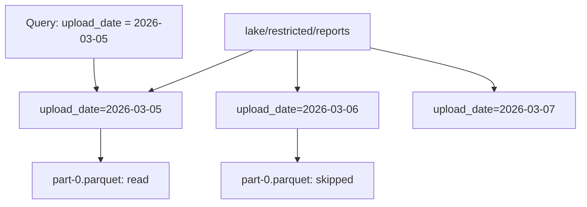

## The same 2,712 rows in four layouts

Hala wants Omar's weekly query to skip files it does not need. She takes all 2,712 lines of Mizan's uploads and writes them four times, once for each layout she can think of. Every version uses the same rows and the same compression, which is zstd. She counts the files and adds up their sizes. Run this from your project folder. It writes into folders that start with `try_`, so delete them when you finish.

```python
import duckdb
import pathlib

con = duckdb.connect()
source = "SELECT * FROM read_json('data/raw/uploads/*/*.jsonl')"
con.execute(f"COPY ({source}) TO 'try_one_file.parquet' (FORMAT parquet, COMPRESSION zstd)")
layouts = {"try_by_day": "upload_date", "try_by_day_market": "upload_date, market_code", "try_by_market": "market_code"}
for name, key in layouts.items():
    con.execute(f"COPY ({source}) TO '{name}' (FORMAT parquet, COMPRESSION zstd, PARTITION_BY ({key}))")
    files = list(pathlib.Path(name).rglob("*.parquet"))
    print(name, len(files), sum(f.stat().st_size for f in files))
print("try_one_file.parquet", pathlib.Path("try_one_file.parquet").stat().st_size)
```

```text
try_by_day 28 105338
try_by_day_market 222 457267
try_by_market 8 57978
try_one_file.parquet 36949
```

The file counts are exact. The byte totals change by a few hundred bytes from run to run, so the table rounds them.

| Layout | Files | Total bytes (about) | Average rows per file |
|---|---|---|---|
| One file | 1 | 37,000 | 2,712 |
| One folder per market | 8 | 58,000 | 339 |
| One folder per upload date | 28 | 105,000 | 96.9 |
| One folder per upload date and market | 222 | 457,000 | 12.2 |

Look at the last two rows. The finest layout stores the same rows in about twelve times the bytes of the single file. Every extra file repeats a footer and its own dictionaries, so more files cost more space and more opening. The same choice that lets a query skip files also makes each file smaller. This chapter is about where to stop.

The 222 in the last row is not 224, which would be 28 days times 8 markets. Market M05 had no upload on 9 March and none on 11 March (module 8 explains why). Two combinations of date and market have no data, so they have no folder.

## What a partition is

You met the partition in chapter 5.1: a folder that holds one slice of a dataset. DuckDB can write one with `PARTITION_BY`. The folder name carries the key and its value, such as `upload_date=2026-03-05`. This naming is called hive style, and the reader recognises it. When you read the files with `hive_partitioning = true`, the folder name becomes a column again, and a filter on that column can skip whole folders without opening a file.

You can see the skipping in a plan. Hala filters on one upload date, asks for the plan, and prints the line about files.

```python
plan = con.execute("""
EXPLAIN SELECT count(*) FROM read_parquet('try_by_day/*/*.parquet', hive_partitioning = true)
WHERE upload_date = DATE '2026-03-05'
""").fetchone()[1]
print([line.strip("│ ").strip() for line in plan.splitlines() if "Scanning Files" in line])
```

```text
['Scanning Files: 1/28']
```

The plan also has a `File Filters` line that names the date. The engine reads one file of 28. For a query for the week from 2 to 8 March it reads 7 of 28. On the layout with markets it reads 56 of 222, because each day now has eight files. The key must be one that your queries filter on, or the folders do nothing for you.



The diagram shows pruning in one picture. The query names one folder, so the engine opens that folder and leaves the others alone. The skipped folders cost nothing to the query, but each one is still a file that exists, with its own footer.

```predict
prompt: "Mizan's lake holds 28 days and 8 markets. Hala partitions by upload date and market. How many files does a query for the week 2 to 8 March open?"
options:
  - id: fifty-six
    label: "56 files: 7 days of 8 markets"
  - id: seven
    label: "7 files: one for each day of the week"
correctOptionId: fifty-six
explanation: "Each day now has one folder per market, so a week of 7 days opens 7 x 8 = 56 files. The query is faster to find, but it opens eight times as many files as the layout with a folder per day. The canvas shows the same count for any number of days."
allowRetry: true
```

The canvas lets you change the partition level, the days of data and the rows per day. It uses a toy count of files: one file per partition, 8 markets, and about 100 rows a day like Mizan.

<InteractiveCanvas slug="partition-file-size" />

**What this shows:** how many files a partition level makes, how many rows each file holds on average, and how many files a one-week query has to open. A finer level lets the query skip more files and also splits the same rows into smaller ones.

**Try this:** leave 28 days and 100 rows a day, and switch from 1 (day) to 2 (day and market). The lake goes from 28 files to 224, the average falls from 100 rows to 12.5 rows per file, and the week query opens 56 files instead of 7. Then switch to 0, and the single file holds all 2,800 rows, which the query must read in full.

**What changed:** the same rows are now spread over more files. The query skips more of them, but each file it opens holds less, so opening costs more of the work.

**Limits of the model:** the canvas counts files and nothing else. It does not show bytes, row groups or how fast any engine reads a file, and Mizan's real count is 222 files, not 224.

## Choose the key from the queries you expect

The key should be a column that your queries filter on, with a limited number of values. Omar's weekly report filters on a week of reports. Hala's landing job filters on the day a batch arrived. Those are two different columns, and the difference matters.

Hala partitions by upload date because that is how the data arrives: one batch of files per day. She then asks for the reports made on 5 March, using the report time and not the upload date. The plan shows no file filter at all, because the folders are named by upload date and the question is about report date. The engine reads every file. The query returns 93 lines.

These three queries show the difference. The first counts the lines made on 5 March. The second shows on which upload days they arrived. The third filters on the folder name.

```python
read = "read_parquet('try_by_day/*/*.parquet', hive_partitioning = true)"
made_on_5_march = "CAST(timezone('UTC', reported_at) AS DATE) = DATE '2026-03-05'"
print(con.execute(f"SELECT count(*) FROM {read} WHERE {made_on_5_march}").fetchone())
print(con.execute(f"SELECT upload_date, count(*) FROM {read} WHERE {made_on_5_march} GROUP BY 1 ORDER BY 1").fetchall())
print(con.execute(f"SELECT count(*) FROM {read} WHERE upload_date = DATE '2026-03-05'").fetchone())
```

```text
(93,)
[(datetime.date(2026, 3, 5), 88), (datetime.date(2026, 3, 6), 1), (datetime.date(2026, 3, 7), 1), (datetime.date(2026, 3, 8), 3)]
(101,)
```

The function `timezone('UTC', reported_at)` turns the stored time into plain UTC time, so the answer does not depend on the time zone of your computer. Chapter 5.5 explains why that matters.

Now she tries the other filter, `upload_date = DATE '2026-03-05'`. It skips 27 folders and returns 101 rows. But those are not the lines made on 5 March. Of the 93 lines made on that day, 88 arrived on 5 March, and the other 5 arrived on 6, 7 and 8 March. The folder for 5 March also holds 13 lines made on earlier days. A partition by arrival date answers "what arrived that day", not "what happened that day". Module 8 builds on this difference.

So the layout depends on the job. For the lake, arrival date is right, because each day's job then writes and replaces one folder. For the warehouse in module 7, tables are organised by report date, because that is what Omar asks about. Do not choose a key because it sounds sensible. Write down the three or four queries you expect, and check each one against the key.

## File sizes and the small-files problem

The table at the start of the chapter shows the cost of too many files. DuckDB's documentation gives guidance for larger data. Row groups of 100,000 to 1,000,000 rows work best. Files of about 100 megabytes to 10 gigabytes are ideal. The total number of row groups across all files should be at least the number of threads. In its own benchmark, row groups under 5,000 rows ran 5 to 10 times slower than well-sized ones. That benchmark is theirs, on their hardware.

Mizan's files are far below those numbers. Even the single file holds 2,712 rows, and a day holds about a hundred. At this size the numbers do not matter, and the query is fast in any layout. What carries over is the direction: many tiny files make every read slower, because each file has its own footer and the reader must open them all. Do not make files tiny just to get finer partitions.

The row-group size you ask for is also approximate. In chapter 5.2 Hala asked for groups of 1,000 rows and got groups of 2,048 and 664. Treat any size as a target, and check the metadata of the file you wrote.

## Compression: a trade-off to measure

As chapter 5.1 said, a codec is the method that shrinks the bytes. Parquet lists several, and it gives no figures for speed or size. DuckDB writes Snappy unless you ask for another codec, and it also offers zstd. The two trade file size against speed. Hala writes the 2,712 lines three times and compares the sizes.

```python
for codec in ["uncompressed", "snappy", "zstd"]:
    con.execute(f"COPY ({source}) TO 'try_{codec}.parquet' (FORMAT parquet, COMPRESSION {codec})")
    print(codec, pathlib.Path(f"try_{codec}.parquet").stat().st_size)
```

| Codec | Bytes for 2,712 rows |
|---|---|
| Uncompressed | 89,621 |
| Snappy (the DuckDB default) | 55,493 |
| zstd | 36,949 |

On these rows zstd gives the smallest file. That is a fact about this data, and the order could differ on yours. The table says nothing about speed, because Hala did not time the reads. Before you choose a codec for real data, write the file both ways and measure both the size and the time. This course uses zstd for Mizan's landing files because the files are small and rarely read in a hurry. It is a course choice, not a rule.

## Where people go wrong

The first mistake is to partition by the column with the most values, such as the report id, because it sounds precise. That makes one tiny file per row. The second is to partition by a column that no query filters on, so the folders exist and nothing is skipped. The third is to compare layouts by one number. The finest layout skips the most files and also stores the most bytes, so you need both numbers.

The fourth mistake is to forget that partitioning does not change the answer. A query on the wrong key still returns rows, and they look plausible. The 101 rows for 5 March are an example: they are real rows that answer a different question.

## The trade-off, and the alternative

At Mizan's size, the best layout for speed is no partitions at all: one file of 2,712 rows. Hala partitions by day for another reason. The landing job runs once a day and writes one folder, and a rerun replaces that folder and nothing else. That makes the job safe to run twice, which module 6 returns to. When the reason for a layout is safety and not speed, say so.

You would choose differently if the data were much larger and Omar's queries always filtered on market. Then a folder per market, or per month, might skip more with files that stay large. The choice would come from the plan, not from a rule.

## Try it on your data

Write all of your raw lines to a folder partitioned by `upload_date` with `PARTITION_BY (upload_date)` and again with `PARTITION_BY (upload_date, market_code)`. Use a folder name that starts with `try_` and delete it afterwards. Count the files and add up their sizes. Then ask `EXPLAIN` for the week 2 to 8 March on both and read the line that starts with `Scanning Files`. Finally, write one query by report date and see which line is missing.

## Check your understanding

```quiz
type: mcq
question: "Osama runs a courier company with 25 depots. His lake keeps 365 days of parcel records, about 20,000 rows a day, partitioned by day and depot. The weekly report reads the last 7 days for all depots. How many files does it open, and what is the cost?"
options:
  - "7 files, because only the 7 days of the week are needed"
  - "175 files, each holding about 800 rows, which is small"
  - "365 files, because the report needs every depot's data"
  - "9,125 files, because partitions only help with a filter on depot"
correct: 1
explanations:
  - "That would be right for a folder per day. Here each day also has one folder per depot, so 7 days of 25 depots is 175 files, not 7."
  - "Right. 7 days times 25 depots is 175 files. Each holds 20,000 / 25 = 800 rows on average, so every file is small and the report pays to open 175 of them."
  - "The week filter skips the other 358 days, so the report opens 7 days of files, not all 365 days. A depot is not needed in the filter for the days to be skipped."
  - "9,125 is the number of files in the whole lake (365 x 25), not the number the report opens. The week filter lets the engine skip all but 7 days."
```

```quiz
type: mcq
question: "Sana keeps school attendance for 12 classes. Her file holds 4,800 rows. She tests two codecs on it: Snappy gives 61,000 bytes and zstd gives 44,000 bytes. She did not time either read. A blog says 'zstd always reads fastest'. What do her facts support?"
options:
  - "zstd gives the smaller file here, but her tests say nothing about speed"
  - "zstd is faster, because a smaller file always takes less time to read"
  - "Snappy is better, because it is the default and the default is chosen well"
  - "The two codecs are equal, because both files are small for a laptop"
correct: 0
explanations:
  - "Right. 44,000 bytes is smaller than 61,000, and that is all her test shows. Speed needs its own timing, and the order of the codecs can change on other data."
  - "A smaller file does not always read faster, because decompressing takes time too. She would have to time the reads to know."
  - "The default is a general choice, not a measurement on her data. Her test shows zstd is smaller on this file."
  - "The files differ by 17,000 bytes, which is a clear difference. Small files can still be compared, and the result is a measurement of her own data."
```

**Next:** Lakes, warehouses and lakehouses: three designs for where the data lives, and what an open table format adds to plain files.
