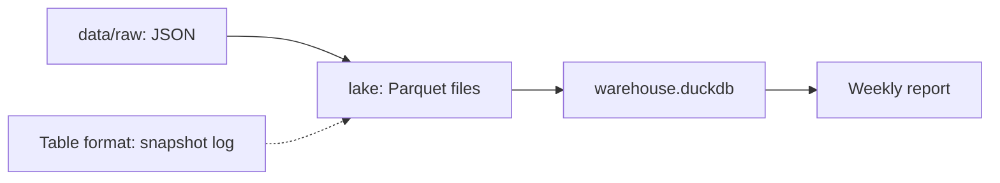

## Where does our data live?

Yasmin owns the registry of markets and volunteers, and she asks Hala a plain question. Where does Mizan's data live, and who can read it? Hala stops to think about it, because the honest answer is "in three places, and each one is a different idea".

The first place is the folder `data/raw`, where the phone form's uploads and the registry sit exactly as they arrived. The second is the folder `lake`, where Hala will write Parquet files. The third is a single file called `warehouse.duckdb`, which dbt will build in module 7. The same price report can exist in all three. They are not copies for safety. Each one has a different job, and each one answers a different question about what Mizan can promise.

Data engineers use three words for these ideas: a lake, a warehouse and a lakehouse. People argue about the words, so this chapter defines each one by what it does, shows what the newest idea adds, and ends with a way to choose. You can reach a good choice for Mizan without the words, and you will need the words in an interview or a client meeting.

## Three designs in plain words

A data lake is a place where data is kept as files in folders, in open formats such as Parquet or JSON. Any tool that reads the format can read the files. Storage is cheap, because it is only files. The cost is that the lake has no rules of its own. Nothing stops two jobs from writing the same folder. A reader can open a file while it is half written. There is no list of who may read which folder.

A data warehouse is a database engine that owns the storage. Data goes into tables, and users ask questions in SQL. The engine can offer fast queries, permissions for each user and safe updates, because a change either finishes or does not happen. The cost is that the data sits in the engine's own format. Getting it out takes an export, and storage is usually more expensive than plain files.

A lakehouse tries to keep the open files of a lake and add the safe updates of a warehouse. It does this with an open table format, which is a layer of records about the files. Apache Iceberg and Delta Lake are two projects that define such a layer. You will not install either in this course. You need the idea, and the next section gives it.

```predict
prompt: "Mizan needs storage that is cheap and in open formats most, and safe updates least. Which design should come out ahead in the canvas?"
options:
  - id: warehouse
    label: "A warehouse that owns the storage"
  - id: lake
    label: "A lake of files in folders"
correctOptionId: lake
explanation: "Cheap storage and open formats are the lake's strengths. In the canvas the lake leads the lakehouse by 1 point, because Mizan gives safe updates a low weight. Change that one weight and the result changes."
allowRetry: true
```

The canvas scores each design on four needs, from 1 to 5, and multiplies each score by how much that need matters. Start with the weights as they are, which describe Mizan today. Then change one weight.

<InteractiveCanvas slug="lake-warehouse-lakehouse" />

**What this shows:** three storage designs scored on four needs, with weights you can change. The total for a design is the sum of weight times score over the four needs. It shows that the best design depends on what the team cares about.

**Try this:** with Mizan's weights, the lake leads the lakehouse by 1 point, 35 to 34, and the warehouse is far behind on 24. Raise Safe updates and schema changes from 1 to 3. The lakehouse now leads with 42, ahead of the lake on 37 and the warehouse on 34. Then set Cheap raw storage to 1, Fast SQL and access control to 3, Open file formats to 1 and Safe updates to 3, and the warehouse leads with 33.

**What changed:** each time, one design lost the lead because a need it is weak at became more important. No design is best on its own.

**Limits of the model:** the scores are the course's judgement for a small team, not measurements. The model leaves out the work of running each design, the skills of the team and the money each one costs. A lead of one or two points means more than one design is reasonable.

## What a table format adds

A folder of Parquet files is simple, and it has a weakness. It has no safe way to change many files at once. Imagine a rule changes and Hala must rewrite all 28 daily files. She replaces them one at a time. A report that runs halfway through reads some days with the new rule and some with the old one, and nothing tells it so. The numbers look normal, and they are wrong.

A table format keeps a log of snapshots on top of the files. A snapshot is the list of files that make up the table at one moment. A change writes the new files first and then records a new snapshot in one step, so the change either happens fully or not at all. Iceberg commits by swapping the table's metadata file in one step that no reader can see half done. A reader keeps using the snapshot that was current when it started. Delta Lake keeps a transaction log with the same goal, for files in cheap shared storage. Because the old snapshots stay in the log, you can also look at an earlier version of the table.

The formats add more. Iceberg tracks each column by a unique id, so adding a column does not bring old data back. The way the table is partitioned can also change on an existing table. Those are the "safe updates and schema changes" in the canvas. A plain folder of files has none of this: when a column appears, as `unit` did on 15 March, the reader has to cope with it. The daily files from before 15 March will have no `unit` column, and a reader must ask DuckDB to line the files up by name, with the option `union_by_name`.



The diagram is Mizan's path. Raw files become a lake of Parquet files, and the lake feeds a warehouse that Omar's report reads. The dotted line shows where a table format would sit, over the lake. Mizan does not use one, and the next section explains why.

## A worked example: Mizan's choice

Hala reads the lake directly with DuckDB, with no database in between. She uses the folder `try_by_day` that she wrote in chapter 5.3. The query counts lines per market, and the result adds up to the 2,712 lines the generator wrote.

```python
import duckdb

duckdb.sql("""
SELECT market_code, count(*) AS lines
FROM read_parquet('try_by_day/*/*.parquet', hive_partitioning = true)
GROUP BY market_code ORDER BY market_code
""").show()
```

```text
M01 335   M02 341   M03 341   M04 341
M05 341   M06 338   M07 333   M08 342
```

That is a lake query: open files, no server, anyone with the files can run it. Mizan's warehouse comes later. In module 7 dbt will build tested tables in `warehouse.duckdb`, and the report will read those tables, not the files. So Mizan uses a lake for storage and a small warehouse for the tables people trust. It does not use a table format, because its situation does not need one. One job writes each folder, there are 28 folders, and no other job reads while it writes.

Hala makes a small version of the table-format idea by hand. The landing job in chapter 5.5 writes a temporary file and then swaps it in with one step, so a reader never sees a half-written file. That protects one file. It does not make a change to 28 files all-or-nothing, and for Mizan that is acceptable.

## Where people go wrong

The first mistake is to treat a lake as if it had rules. A folder only has the permissions of the folder, so personal data in a lake needs its own plan for who may read what. Mizan splits its lake into zones, and module 6 shows how. The second mistake is to believe that you must start with a lakehouse. A table format adds a layer to learn and run, and it helps when many writers share data, or when updates and deletes of single rows are common.

The third mistake is to treat the three words as products. A person who says "we have a lakehouse" may mean Iceberg, Delta Lake or just some Parquet files and a warehouse. Ask what it does: which files, which engine, how a change is committed. The fourth mistake is to trust a score. The canvas gave a one-point lead to the lake. A lead that small tells you the designs are close, so look at what you would have to build to use each one.

## The trade-off, and when to choose differently

The lake is the cheapest and the most open, and it asks the most of the people who use it. The warehouse is the safest and the easiest to use, and it holds your data in its own format. The lakehouse sits between them and asks you to run one more layer.

Choose a warehouse when many analysts need fast SQL with permissions for each person and the data fits the engine. Some cloud warehouses charge by the amount of data a query scans, which gives a reason for partitions and for selecting only the columns you need. Choose a table format when several jobs write the same data, or when you must update or delete rows and keep earlier versions. Choose a plain lake with a small warehouse, as Mizan does, when one person runs the pipeline on one laptop.

## Try it on your data

Write a table of your project's folders. For each one, name the design it belongs to (raw, lake or warehouse) and who may read it. Then say what would go wrong if two jobs wrote it at the same moment. Then change one weight in the canvas to describe a different team, such as ten analysts who share Mizan's data, and write down which design leads and why.

## Check your understanding

```quiz
type: mcq
question: "Duaa freelances for an online shop. The shop's order files sit in one folder. Three jobs rewrite them every night, and a dashboard reads them at 06:00. Last week the dashboard showed Monday's orders from the new rule and Tuesday's from the old one. Which fix addresses the cause?"
options:
  - "A faster laptop, so the jobs finish before 06:00"
  - "A table format, so a rewrite commits as one snapshot"
  - "Compressing the files with zstd to shorten the rewrite"
  - "More folders, one for each job, to keep the jobs apart"
correct: 1
explanations:
  - "A faster machine shortens the window but does not close it. Any rewrite that is not all-or-nothing can still be caught halfway by a reader."
  - "Right. The dashboard read a mix because the files changed one at a time. A table format commits the new files as one snapshot, so a reader sees either the old table or the new one."
  - "Compression changes file size and read speed. It does not change the fact that the files are replaced one at a time."
  - "Separate folders do not help a reader that needs all the days together. The dashboard would still read some folders before the rewrite and some after."
```

```quiz
type: mcq
question: "Karim sets up storage for a clinic's reports. Facts: one person runs the pipeline on one laptop, the data is 40,000 rows, nobody else writes the files, and the budget is zero. He asks whether he needs a lakehouse. What do the facts support?"
options:
  - "Yes, because a lakehouse is the modern design for all data"
  - "Yes, because Parquet files cannot be read without a table format"
  - "No, because a warehouse is needed first for any open files"
  - "No, because one writer and a small table do not need snapshots"
correct: 3
explanations:
  - "No design is right for all data. A lakehouse adds a layer to run, which helps when many jobs write or rows are updated often."
  - "DuckDB reads plain Parquet files directly, as Hala did in this chapter. A table format is optional."
  - "A warehouse is not required to keep open files. A folder of Parquet files is a lake already."
  - "Right. With one writer, 40,000 rows and no budget, a lake of files plus a small database is enough. A table format would add work for a risk that does not exist yet."
```

**Next:** Build: land the raw files as Parquet, with one file per upload day and a job that is safe to run twice.
