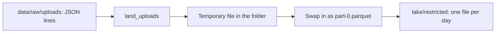

## What the pipeline cannot do yet

Hala can query Mizan's raw uploads, but every query parses text, nothing is typed, and the volunteers' names and phone numbers sit in the same files as the prices. She has no place that a job can write to and that a report can trust. Worse, she has no safe way to run a job twice. If a job writes into a folder that already has a file, it may fail, replace the file or add a second one, and the second case doubles the day.

This chapter builds the first real step of the pipeline. A landing job reads one day of uploads and writes it as one Parquet file in a folder that belongs to the restricted zone. You will then be able to land any day, run the same day again, and be sure that the folder holds exactly one file with the same rows. Everything in modules 6 to 9 builds on this job.

## What you will have at the end

When you finish, the command `python -m pipeline.land --date 2026-03-01` writes `lake/restricted/reports/upload_date=2026-03-01/part-0.parquet` and prints `2026-03-01: 90 rows landed`. Running it again prints the same line and leaves one file. The command with `--all` lands all 28 days. Eight tests in `tests/test_land.py` pass.

The tests are the contract. They check the row count, the folder and file name, the compression and a safe rerun. They also check a schema that changes on 15 March, a read of the whole lake, a time-zone trap and a clear error for a missing folder. You write the job, and the tests tell you when it is right.

## Where the repository is now

You have the project folder from chapter 1.4 with `make_source.py` and `data/raw`, and the test setup `tests/conftest.py` from chapter 2.5. That setup copies your code into a temporary folder for every test and makes fresh data there, so a test never touches your own `data` or `lake` folders. You need nothing else. If you did chapters 3.5 and 4.5 you also have SQL files and scripts, and they do not change.

## The design decision

The landing job has three jobs: read the JSON lines of one upload day, write Parquet, and make a rerun safe. Hala considered letting DuckDB do the folder work with `PARTITION_BY`. That option writes a file with a name chosen by DuckDB. Writing again into a folder that already has files either stops with an error, replaces them or adds a new file, depending on the option you choose. You want exactly one file with a name you control.

So the job picks the folder and the file name itself, one folder per upload date, and always the same name, `part-0.parquet`. To make a rerun safe, it writes the new file under a temporary name in the same folder and then swaps it into place in one step. A reader looks only at files that end in `.parquet`, so a half-written temporary file is invisible, and a power cut cannot leave a broken file. The alternative is to delete the old file first and write the new one. That leaves a gap in which the day has no file, and a crash in the gap loses the day.

The job partitions by upload date, not by report date. You saw in chapter 5.3 that this is how the data arrives, and that each day's job then owns one folder. Late reports land in the folder of the day they arrived. Module 8 deals with that.



The diagram shows the order of the job. The swap is the last step, and it happens only after the temporary file is complete. If anything fails before it, the old file is still there.

## The paths file, given in full

Every later chapter uses the same names for folders, so you start with one small file that holds them. Create the folder `pipeline` with an empty file `__init__.py`, and save this as `pipeline/paths.py`. It is given in full because it is only a list of names, and every path in it is relative to your project folder. Always run commands from that folder.

```python
"""Where things live. All paths are relative to the project folder, so run commands from there."""
from pathlib import Path

DATA = Path("data")                              # made by make_source.py, never edited by hand
RAW_UPLOADS = DATA / "raw" / "uploads"           # upload_date=YYYY-MM-DD/batch-NN.jsonl
REGISTRY_DB = DATA / "raw" / "registry.db"       # the volunteer registry (SQLite)

LAKE = Path("lake")                              # our own Parquet files
RESTRICTED = LAKE / "restricted"                 # contains names and phones: few people may read it
SHARED = LAKE / "shared"                         # pseudonymised: safe for the analytics team
QUARANTINE = LAKE / "quarantine"                 # rows that broke the contract (still contains names and phones)

STATE = Path("state")                            # small files the pipeline remembers between runs
LOGS = Path("logs")                              # one JSON line per task attempt
WAREHOUSE = Path("warehouse.duckdb")             # built by dbt
SITE = Path("site")                              # the HTML report

CONTRACT = Path("contracts") / "price_reports.yml"
```

This chapter uses `RAW_UPLOADS` and `RESTRICTED`. The other names wait for later chapters: `SHARED` and `STATE` in module 6, `QUARANTINE` and `CONTRACT` in module 8, `WAREHOUSE` in module 7 and `SITE` in module 9. The comments on `RESTRICTED` and `QUARANTINE` matter. A folder of raw uploads holds personal data, so the name of the zone tells the next person to be careful.

## The task

1. Create `pipeline/__init__.py` (empty) and `pipeline/paths.py` from the block above.
2. Write `pipeline/land.py` with the two functions below and a command line that accepts `--date YYYY-MM-DD` or `--all`.
3. Save the test file in the next section as `tests/test_land.py`.
4. Run the tests and fix the job until all eight pass.
5. Run the job for 1 March twice, and list the folder after each run.
6. Land all 28 days and count the rows you wrote.

## The interface

These are the names and signatures the tests import. Use them exactly.

```text
pipeline/land.py

  land_uploads(upload_date: str) -> int
      """Replace the restricted partition for this upload date ("2026-03-02").
      Returns the number of rows written.
      Raises FileNotFoundError, with the words "no batch files found" in the
      message, when the day has no batch files."""

  all_upload_dates() -> list[str]
      """Every upload date that has a folder in data/raw/uploads, oldest first."""

  Command line:  python -m pipeline.land --date 2026-03-01
                 python -m pipeline.land --all
  Output, one line per day:  2026-03-01: 90 rows landed
```

## Constraints

The file for an upload date is `lake/restricted/reports/upload_date=<date>/part-0.parquet`, and it is the only file in that folder after a run. It uses zstd compression, and it keeps every column that the JSON lines have, including the volunteers' names and phone numbers, because this is the restricted zone. A day's two batch files, `batch-01.jsonl` and `batch-02.jsonl`, are read together. Files before 15 March have no `unit` field, so the columns of different days differ, and your code must cope with that on the day it reads.

The two timestamps, `reported_at` and `uploaded_at`, must be stored as plain UTC timestamps with no time zone. The JSON text ends in `Z`, which means UTC, and DuckDB reads such text as a timestamp with a time zone. If you leave it like that, then casting to a date later uses the time zone of the computer. A report made at 22:00 UTC would move to the next day on a computer set to a time zone ahead of UTC. Convert once, in the job, so that no later step depends on the machine. Search the DuckDB documentation for the function that converts a timestamp with a time zone to a plain one in a named time zone.

The job must not change anything in `data/`. It must not leave a temporary file behind, and it must not write outside the `lake` folder. In this chapter it keeps every line, including the 13 bad rows of the month, and chapter 8.5 adds a check that sends bad rows to quarantine.

<Callout type="tip" title="A small laptop">
The landing job reads about a hundred lines at a time, so memory is not a problem. If you try the experiments on much larger files on a laptop with 4 GB of memory, set a limit first with `SET memory_limit = '2GB'` so that the computer stays usable.
</Callout>

## The acceptance tests

Save this file as `tests/test_land.py`. Copy it exactly. It is the only test file for this chapter.

```python
"""Chapter 5.5: landing the JSON uploads as Parquet."""
import json
from pathlib import Path

import duckdb
import pytest

from pipeline import paths
from pipeline.land import all_upload_dates, land_uploads


@pytest.fixture
def landed(project):
    project.make_data()
    return project


def query(sql):
    """Run one SQL statement in a fresh DuckDB and return the rows. (In DuckDB 2.0 duckdb.sql() relations have no fetchone.)"""
    return duckdb.connect().execute(sql).fetchall()


def json_lines(day):
    lines = []
    for path in sorted(Path(f"data/raw/uploads/upload_date={day}").glob("batch-*.jsonl")):
        lines += [json.loads(text) for text in path.read_text().splitlines()]
    return lines


def parquet_glob(base):
    return f"read_parquet('{(base / 'reports').as_posix()}/*/*.parquet', hive_partitioning = true, union_by_name = true)"


def test_rows_written_equal_json_lines(landed):
    assert land_uploads("2026-03-02") == len(json_lines("2026-03-02")) == 89
    rows = query(f"SELECT report_id FROM {parquet_glob(paths.RESTRICTED)}")
    assert sorted(r[0] for r in rows) == sorted(x["report_id"] for x in json_lines("2026-03-02"))


def test_partition_folder_and_file_name(landed):
    land_uploads("2026-03-02")
    files = sorted(p.relative_to(paths.RESTRICTED).as_posix() for p in paths.RESTRICTED.rglob("*") if p.is_file())
    assert files == ["reports/upload_date=2026-03-02/part-0.parquet"]


def test_file_uses_zstd_compression(landed):
    land_uploads("2026-03-02")
    codecs = query("SELECT DISTINCT compression FROM parquet_metadata('lake/restricted/reports/upload_date=2026-03-02/part-0.parquet')")
    assert codecs == [("ZSTD",)]


def test_rerun_is_idempotent(landed):
    first = land_uploads("2026-03-02")
    second = land_uploads("2026-03-02")
    assert first == second == 89
    files = [p.name for p in Path("lake/restricted/reports/upload_date=2026-03-02").iterdir()]
    assert files == ["part-0.parquet"]  # no part-1, no leftover .tmp
    assert query(f"SELECT count(*) FROM {parquet_glob(paths.RESTRICTED)}")[0][0] == 89


def test_early_files_have_no_unit_column_and_later_files_do(landed):
    land_uploads("2026-03-14")
    land_uploads("2026-03-15")
    early = [r[0] for r in query("DESCRIBE SELECT * FROM 'lake/restricted/reports/upload_date=2026-03-14/part-0.parquet'")]
    later = [r[0] for r in query("DESCRIBE SELECT * FROM 'lake/restricted/reports/upload_date=2026-03-15/part-0.parquet'")]
    assert "unit" not in early and "unit" in later
    # Read together, the early rows simply get NULL for unit (union_by_name).
    nulls = query(f"SELECT upload_date, count(unit) FROM {parquet_glob(paths.RESTRICTED)} GROUP BY 1 ORDER BY 1")
    assert [(str(d), n) for d, n in nulls] == [("2026-03-14", 0), ("2026-03-15", 97)]


def test_whole_lake_reads_back_with_hive_partitioning(landed):
    for day in all_upload_dates():
        land_uploads(day)
    total, days = query(f"SELECT count(*), count(DISTINCT upload_date) FROM {parquet_glob(paths.RESTRICTED)}")[0]
    assert days == 28
    assert total == 2712  # every line the generator wrote, bad rows included (chapter 8.5 sends 13 of them to quarantine)


def test_timestamps_do_not_depend_on_the_computer_time_zone(landed):
    land_uploads("2026-03-05")
    con = duckdb.connect()
    con.execute("SET TimeZone = 'Pacific/Auckland'")  # far from UTC on purpose
    rows = con.execute(f"SELECT report_id, CAST(reported_at AS DATE)::VARCHAR FROM {parquet_glob(paths.RESTRICTED)}").fetchall()
    expected = {x["report_id"]: x["reported_at"][:10] for x in json_lines("2026-03-05")}
    assert {r[0]: r[1] for r in rows} == expected


def test_missing_folder_gives_a_clear_error(landed):
    with pytest.raises(FileNotFoundError, match="no batch files found"):
        land_uploads("2030-01-01")
```

Each test exists because of one way a landing job goes wrong. The first test compares the rows written with the JSON lines of the day, 89 for 2 March. It also compares the `report_id` values, so a job that writes the right number of the wrong rows fails. The second test checks the folder and the file name, because everything downstream finds the file by that path.

The third test checks the codec in the file's own footer, with `parquet_metadata()`. The fourth is the rerun test, and it is the most important one. It lands the same day twice and then checks three things: both runs report 89 rows, the folder holds only `part-0.parquet`, and the lake holds 89 rows in all. An append would fail the second and third checks, and a leftover temporary file would fail the second.

The fifth test checks the `unit` field. The phone form added it from the upload of 15 March, so the file for 14 March has no such column and the file for 15 March does. Read together, the early rows show NULL, and the test counts 0 values of `unit` on 14 March and 97 on 15 March. The sixth test lands all 28 days and reads the whole lake back in one query. It finds 28 different upload dates and 2,712 rows, which is every line the generator wrote.

The seventh test is the time-zone trap. It lands 5 March and sets the session to a time zone far from UTC. It casts `reported_at` to a date and compares each result with the first ten characters of the original text. A job that left the timestamp with a time zone would fail here on any report made near midnight UTC. The last test asks for a day that does not exist and expects a `FileNotFoundError` with a clear message, so a mistyped date does not create an empty file.

## Run it

Open a terminal in your project folder and activate the virtual environment from chapter 1.4. Run the tests first, then the job.

```powershell
pytest tests/test_land.py -q
python -m pipeline.land --date 2026-03-01
python -m pipeline.land --date 2026-03-01
Get-ChildItem lake\restricted\reports\upload_date=2026-03-01
python -m pipeline.land --all
```

```bash
pytest tests/test_land.py -q
python -m pipeline.land --date 2026-03-01
python -m pipeline.land --date 2026-03-01
ls lake/restricted/reports/upload_date=2026-03-01
python -m pipeline.land --all
```

When all eight tests pass, you see this. The time on the last line varies from machine to machine.

```text
........                                                                 [100%]
8 passed in 6.38s
```

The job prints one line per day. The second run of 1 March prints the same line as the first, and the folder holds one file.

```text
2026-03-01: 90 rows landed
2026-03-01: 90 rows landed
part-0.parquet
```

With `--all` you get 28 lines. These are the first two and the last one.

```text
2026-03-01: 90 rows landed
2026-03-02: 89 rows landed
...
2026-03-28: 111 rows landed
```

Finally, count the lake in one query. Without a contract the job keeps every line, so the total is 2,712. If you set `PYTHONUTF8=1` first, the table prints on Windows.

```python
import duckdb

duckdb.sql("""
SELECT count(*) AS lines, count(DISTINCT upload_date) AS days
FROM read_parquet('lake/restricted/reports/*/*.parquet', hive_partitioning = true, union_by_name = true)
""").show()
```

```text
┌───────┬───────┐
│ lines │ days  │
│ int64 │ int64 │
├───────┼───────┤
│  2712 │    28 │
└───────┴───────┘
```

Some days carry more lines than a normal day. The upload for 12 March has 137 lines, because market M05's volunteer had no connection from 9 to 11 March and the reports arrived together. The days with bad rows also keep them in this version: 8 March has 95 lines, 10 March has 88, 13 March has 93 and 28 March has 111.

## A failure to try on purpose

A test you have never seen fail is a test you cannot trust yet. Open your job, change the compression from zstd to snappy, and run the tests again.

```text
>       assert codecs == [("ZSTD",)]
E       AssertionError: assert [('SNAPPY',)] == [('ZSTD',)]
FAILED tests/test_land.py::test_file_uses_zstd_compression
1 failed, 7 passed
```

Only the compression test fails. The other seven still pass, which tells you that each test watches one thing. Change the codec back and confirm that all eight pass. In chapter 5.3 you measured two codecs on Mizan's data, and this test makes the choice visible: if someone changes the codec, a test says so.

## If you are stuck

Build the job in three small steps and run the tests after each one. First read the day's files into a table and return the number of rows. Second write that table to the right path. Third make the write safe to repeat. The first three tests pass after step two, and the rerun test needs step three.

If a test still fails, list the folder after one run with `ls lake/restricted/reports/upload_date=2026-03-02`. You should see exactly one file named `part-0.parquet`. If you see `part-0.parquet.tmp`, the swap never happened. If you see a second file, your job is adding and not replacing. If you see nothing, the path is wrong. Run one test at a time with `pytest tests/test_land.py -q -k rerun`, and read only the first failing line.

## Commit your work

Make sure `lake/` and `data/` are in your `.gitignore`, because they are generated. Commit `pipeline/__init__.py`, `pipeline/paths.py`, `pipeline/land.py` and `tests/test_land.py` in one commit. A message that describes the change in plain words works well, for example: `Land each upload day as one Parquet file in the restricted zone`.

**Next:** A practice check on columnar files, partitions and storage designs, and then the module gate.
