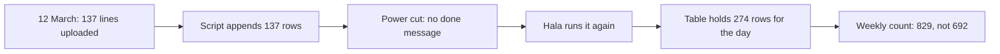

<BigWordAlert term="Idempotent" plainEnglish="A job is idempotent when running it twice gives the same result as running it once. It does not mean the job runs only once." whyItMatters="Power cuts, timeouts and mistakes make reruns normal. A job that is not idempotent adds a duplicate every time something goes wrong, and the duplicate looks like real data." />

## A job that finished, or did it?

Hala is 26. She works part time and remotely as Mizan's junior data engineer, and she plans her work around the hours when the power is on at home. Hala, Yasmin, Omar and everyone else in this module are fictional, and all the data is synthetic. Weeks before the landing job from module 5, Hala wrote a quick script to fill a table called `daily_prices`. Every evening it reads the day's upload files and adds their lines to the table. It was meant to be temporary, and it still runs.

On Thursday 12 March the script has more to do than usual. The upload folder for that day has 137 lines, where an ordinary day has about 90. Market M05's volunteer had no connection from 9 to 11 March, so the reports of three days arrived together. Hala starts the script at 21:10 and goes to make tea. When she returns, the screen is dark. The power went off while the script was running. She does not know whether it had finished, because the last line it prints, "done", never appeared.

At the next power hour she does the sensible thing. She runs the script again. This time it prints "done", and she goes to bed. She has made the usual choice: when you cannot tell whether a job finished, run it again. In this case the first run had finished before the power went. The second run added the same 137 lines for a second time.

## Nobody notices for four days

The next morning `daily_prices` holds 274 lines for 12 March, twice the 137 that the files have. Nothing breaks. The weekly basket report builds without an error. Omar's numbers look normal, because every extra line is an exact copy of a line that was already there, and an average of the same number twice is that number. The report that Omar reads cannot show the problem.

The problem shows up on Monday, in a place Hala did not expect. Yasmin, the volunteer coordinator, sends a message to all the volunteers every week with the number of lines the form uploaded. She builds it from `daily_prices`. The week of 9 to 15 March has 829 lines. The week before had 668. Yasmin thanks the volunteers for a 24 percent rise. Hala reads the message and sees a number she knows. The true count for 9 to 15 March is 692, a rise of 3.6 percent, and 829 is 692 plus 137.

```predict
prompt: "Hala's script added the 137 lines of 12 March twice. Omar's report shows the average basket price for each market. After the second run, what happens to the average for M05?"
options:
  - id: doubles
    label: "It doubles, because there are twice as many rows"
  - id: same
    label: "It stays the same, as the copies are exact"
correctOptionId: same
explanation: "An average adds up the values and divides by how many there are. Adding every value twice also doubles the count, so the average does not change. That is why the report looked right. Counts and totals do change, which is how Yasmin's weekly number showed the problem."
allowRetry: true
```

Hala writes to Yasmin the same hour. She does not say that the data was wrong. She says that the weekly count included one day twice, gives the true number, 692, and promises to change how the script works. Yasmin sends a short correction to the volunteers, with the real rise of 3.6 percent. A thank-you that has to be taken back is a small embarrassment, and it costs something more lasting. The volunteers learn that the numbers they hear from the project can be wrong, and the next number from Hala is trusted a little less.

Hala also finds the check that would have found the problem on Thursday. She compares two numbers that should be equal. The upload files for 12 March hold 137 lines. The table held 274 rows for that day. Counting between two stages takes one query and a few seconds. It does not prevent a double load, but it makes the double load visible on the same evening, while she still remembers the power cut.

The fix Hala makes on Monday is to delete the extra 137 lines by hand, with a query that she checks three times. She also writes a note to herself: never rerun this script. Both are what people do under pressure, and neither fixes the cause. A note is a rule that someone must remember on a day when the power is off and they are tired. A hand-made delete is a second change to the data that nobody tests.

The diagram follows the same incident in order. Read it as a chain in which each step was reasonable.



What to notice: no step in the chain is a mistake. Hala did not skip a check, and the script did what it was written to do. The fault is in the design. A job that adds rows each time it runs cannot be rerun, and reruns are exactly what a power cut produces. Nothing in the chain was broken until the weekly count, and by then the cause was four days old.

## Three ways a job can be interrupted

It helps to name the cases, because each leaves the data in a different state. In the first case the job stops halfway. Some rows are written and others are not. A rerun that adds every row now duplicates the first half and completes the second. In the second case the job finishes and only the last message is lost, which is what happened to Hala. All the rows are there, and a rerun adds them all again. In the third case someone starts the job twice by mistake, or a scheduler starts it a second time.

A safe design handles all three in the same way. Whatever state the data is in, a new run replaces the day's output with the full, correct result for that day. It does not need to know what the earlier run did. That is a very useful property for a person who is tired, in the dark, or working from a phone message.

## Why this matters for the job

Every pipeline fails sometimes. A connection drops, a laptop sleeps, a disk fills, a server restarts. When that happens, the person who looks after the job must decide whether to run it again, and they decide with half the facts. A pipeline where the answer is always "yes, run it again" is easy to work in. A pipeline where the answer is "it depends, and be careful" is not.

Interviewers and clients can ask about this directly. "What happens if your job runs twice?" is a fair question, and a good answer is not "I make sure it runs once". It is a design. The job replaces its own output for the day, or it merges rows on a key. A test proves that two runs and one run give the same table. On a freelance project, the same design means a client can call you at night and you can say "run it again" without a worry.

## What this module covers

Chapter 6.2 places each step and each piece of personal data in the right zone, and it compares transforming before loading with loading first. Chapter 6.3 makes the rerun problem precise and shows three ways to write a table, one of which doubles the data. Chapter 6.4 loads only what changed since the last run, with a watermark, and shows the changes that method cannot see. In chapter 6.5 you build the pieces: a pseudonymised copy of the reports, an incremental extract of the registry, and a run log. Chapter 6.6 is a practice check, and chapter 6.7 is the gate, where you explain why your ingestion is safe to rerun.

The landing job from module 5 already has the property Hala wanted. It replaces its folder, so a second run leaves one file. The rest of the pipeline does not have it yet. Publishing a copy for the analytics team, copying the registry and keeping a log of what ran each need the same care. Each one has a different way of going wrong. The module takes them one at a time, and for each one it asks the same question: what does the data look like if this step runs twice?

You keep Hala's rule from this chapter in mind throughout: a rerun is a normal event, and a job should be built for it. Each build step in module 6 has a test that runs it twice.

<LearningObjectives items={["Place each step of a pipeline, and each piece of personal data, in the right zone", "Say what idempotent means and why a rerun is a normal event", "Choose between appending, replacing a partition and merging on a key", "Load only the rows that changed with a watermark, and name the changes it misses", "Pseudonymise volunteer data, extract the registry incrementally and log every run"]} />

## Key words

| Word | Plain English |
|---|---|
| **ETL and ELT** | Two orders of work: transform the data before loading it, or load it first and transform it afterwards |
| **Zone** | A part of the data store with its own rule about who may read it, such as restricted or shared |
| **Watermark** | The newest update time a job has already seen, saved so that the next run asks only for newer rows |
| **Pseudonym** | A code that replaces a name or a phone number, so a row no longer shows who the person is |
| **Change data capture** | Finding the rows that changed in a source since the last run |

## What is in this module

| Chapter | You will practise |
|---|---|
| 6.2 | Placing steps and personal data in zones, and telling ETL from ELT |
| 6.3 | Choosing between append, replace and merge, and testing a rerun |
| 6.4 | Using a watermark, and naming what it cannot see |
| 6.5 | Pseudonymising volunteers, extracting the registry and logging every run |
| 6.6 | A practice check with five cases |
| 6.7 | Explaining why your ingestion is safe to rerun |

**Next:** ETL, ELT and zones: where each step runs and where each piece of personal data is allowed to go.
